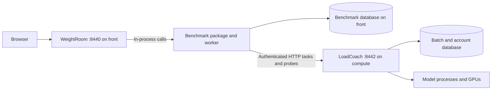

# LoadCoach, explained

Chronological implementation reference: later sections supersede earlier designs. Use the
[openWeightGym guide](README.md) for current operation, the [agent ledger](agent-status.md) for approvals,
status and proposals, and the [agent reference](agents.md#documentation-maintenance) for maintenance.
Dated examples and constraint tables describe their section's implementation, not necessarily
the current deployment; preserve their unique contracts without treating old pending steps as work.

The current LoadCoach package is split by responsibility:

| Area | Main files |
|---|---|
| Configuration, settings and shared storage | [`config.py`](../loadcoach/config.py), [`settings.py`](../loadcoach/settings.py), and [`db/`](../db/) |
| Accounts and authorization | [`groups.py`](../loadcoach/groups.py), [`users.py`](../loadcoach/users.py) |
| Models and scheduling | [`models.py`](../loadcoach/models.py), [`model_setup.py`](../loadcoach/model_setup.py), [`cards.py`](../loadcoach/cards.py), [`runner.py`](../loadcoach/runner.py), [`probes.py`](../loadcoach/probes.py) |
| Roles and production evidence | [`roles.py`](../loadcoach/roles.py), [`role_evidence.py`](../loadcoach/role_evidence.py), [`reliability.py`](../loadcoach/reliability.py); used on the front machine by [`turnstile/roles.py`](../turnstile/roles.py) |
| Durable work and records | [`batches.py`](../loadcoach/batches.py), [`tasks.py`](../loadcoach/tasks.py), [`log.py`](../loadcoach/log.py), [`capture.py`](../loadcoach/capture.py), [`usage.py`](../loadcoach/usage.py) |
| External services and maintenance | [`outside.py`](../loadcoach/outside.py), [`backups.py`](../loadcoach/backups.py), [`database_admin.py`](../loadcoach/database_admin.py) |
| HTTP and command line | [`app.py`](../loadcoach/app.py), [`cli.py`](../loadcoach/cli.py) |

A browser test page sits beside them in [`loadcoach/test.html`](../loadcoach/test.html).

## Inference engine boundary

`engines/` owns the static registry and lifecycle/schema contracts. `engines/llama_cpp/`
contains launch/environment/health/version behavior, device discovery, GGUF metadata,
model validation/context/placement semantics, form parsing, setup checks and native probes.
Existing `loadcoach.cards`, `loadcoach.gguf`, `loadcoach.probes` and
`weightroom.model_settings` imports remain compatibility aliases. LoadCoach retains queueing,
admission, reservations, process ownership, settings, model persistence and HTTP transport.

Each node accepts `[engines.llama_cpp]` with boolean `enabled` and text `executable`.
Omission preserves enabled llama.cpp and `llama_server`; conflicting paths are refused.
Compute nodes saves both matching aliases through the existing signed node settings API.
Changes require that node's normal restart; saving neither installs software nor restarts
anything. The page distinguishes active availability from pending restart values.
`GET /loadcoach/engines` returns schemas, path availability and cached build information
without executing help or loading a model; it requires manage-models or manage-settings.
`GET /loadcoach/components` (manage-settings) says which openWeightGym services this machine has
installed — a service counts when systemd, the account's own manager or the system one, knows its
unit, under its current or former name — and which engines' programs are found, with the install
receipt's topology, mode and date. It only reads `systemctl show`; nothing is started or run.
`GET /turnstile/components` gathers it from front and every compute node for the console's
System → Components page; a node the monitor finds silent is reported as such and never woken.

Models may explicitly store `engine = "llama_cpp"`; omission still means llama.cpp.
No database migration or eager model rewrite is introduced. Explicit/default llama.cpp
use the same canonical fingerprint, file revision, kin and measurement settings. Engine
schemas select the Add/Edit model fields; unknown engines are rejected, and presets cannot
cross engines. Selecting a node retains it through forms, polling, preview/apply/undo and
bulk measurement. The bounded `/turnstile/machines/NAME/model-api/…` management surface
requires manage-models, signs for that node and never wakes or falls back to another node.
Version/help caches are installation-scoped; existing llama.cpp benchmark environment
identities and historical receipts retain their previous format.

The ToolLocker is a second program beside LoadCoach, with files of its own. It is explained in
section 13. Hosted models, answered outside this machine, are explained in section 14. Models
are no longer written in the settings file: section 15 explains where they are kept and how
one is added, changed or removed without a restart. Section 16 explains signing in with a
password, which replaced the part of section 5 about the front machine acting for people. Section 17
explains `weightroom`, the app on the front machine, and section 18 `spotter`, the helper that
watches compute, puts it to sleep and restarts it. Section 19 explains draining, which is how
LoadCoach is emptied before that, and section 20 `turnstile`, which passes requests on from the
front machine and wakes compute for them. Section 21 explains where groups are kept now, how
one account can have more or less than its group, the rules that stop anyone raising
themselves, and how an app outside this suite signs in. Where an earlier section speaks of a
model's section in `settings/loadcoach.toml`, read it as that model's settings.

The last section, *Accounts on the front machine, milestone 76*, moves the users, keys and groups
to the front machine and supersedes what earlier sections say about who checks a key or a password.

## 1. What LoadCoach is

LoadCoach is a small web server that sits in front of your models and starts them when asked.

A *model server* is the program that loads a model onto a GPU and generates text. LoadCoach uses
`llama-server`, from llama.cpp. A *caller* is anything that wants text generated: a coding
harness on another machine, a chat page, a script. Callers talk to LoadCoach. LoadCoach starts
`llama-server` with the right model and talks to it on the caller's behalf.

```text
  caller                    LoadCoach                         llama-server, one per loaded model
  (harness, app,   HTTP     (port 8442)             HTTP      ┌ model A on card 0
   script, curl)  ───────►   reads "model"         ───────►   └ model B on card 1
                  ◄───────   starts it if needed   ◄───────   (started by LoadCoach,
                   answer    forwards, streams      answer     loopback only)
```

Both conversations use the same language: the OpenAI HTTP API, the set of URLs and JSON shapes
such as `POST /v1/chat/completions` that almost every tool now speaks. A tool that works with
OpenAI works with LoadCoach by changing one base URL.

What LoadCoach adds on top of forwarding:

- **Users.** Each caller has their own API key. LoadCoach knows who is asking, and what their
  group lets them do: which models, what priority, whether they may lock, unload, or manage
  other users.
- **Model on demand.** The caller names a model. If it is not running, LoadCoach starts it.
- **One line for everyone.** Requests wait their turn. A model takes one request at a time
  unless you say it can take more.
- **Priorities.** A request may be marked `high` or `low`. The line is served best priority
  first, and first come, first served within a priority.
- **A lock.** A caller can take the GPU for itself until it lets go or the lock runs out. The
  prompt already under way finishes first. Everyone else waits, or is turned away at once if the
  holder asked for that.
- **A model on each card where they fit.** Each model says which cards it needs. Models whose
  cards do not overlap stay loaded side by side and answer at the same time. LoadCoach chooses
  the card, unless you name it.
- **Models replaced safely.** When cards are needed for another model, the one unused longest
  makes way, but never while a request is still using it.
- **A record of what happened.** Every request, model load, lock, refusal and change to a user
  leaves an entry in the event log, readable over HTTP and with `loadcoach log`. For an ordinary
  request the log holds no prompt or answer text, only facts such as timings and token counts.
- **The latest requests in full.** Beside the log, what the last 50 requests sent and what they
  were answered is kept, whatever their level, so that a failure can be looked into. The
  oldest goes as a new one comes. `keep_text` sets how many, and `0` keeps none.
- **Sensitivity levels.** A request may say it is `sensitive` or `restricted` work, if its user's
  group allows, and may name the piece of work it belongs to.
- **A full record of sensitive work.** For a request marked `sensitive` or `restricted`, the
  request, the answer and every tool call are kept: which tool, each parameter by name, and what
  came back. A piece of work can then be read back from the log alone. A sensitive request that
  cannot be recorded is not run.
- **A log that shows tampering.** Entries are never changed, and each carries a hash of the one
  before. `loadcoach log verify` says whether any was altered or removed from the middle.
- **A view of what is going on.** `GET /loadcoach/status` shows what is loaded, who is running and
  who is waiting.
- **A way to free the GPU.** `POST /loadcoach/unload`.
- **A limit on waiting.** A request that waits too long is told to try again.
- **Its own model list.** `GET /v1/models` returns the names from your configuration.
- **Hosted models.** A request may be answered by a service outside this machine, when the
  settings allow it and the request is not sensitive. See section 14.

### Reading the implementation history

Later sections document model selection, measured memory fitting and the subsequent additions.
Use [Agent status](agent-status.md#milestones) for approved behavior and
[Agent backlog](agent-status.md#proposals) for outstanding work.

## 2. Ideas you need

**HTTP request and response.** A request has a method (`GET`, `POST`), a path
(`/v1/chat/completions`), headers (named values such as `content-type`) and an optional body. A
response has a status code (`200`, `401`, `502`), headers and a body.

**Streaming.** When a caller sends `"stream": true`, the model server sends the response headers
at once, then small pieces of body as tokens are produced, formatted as `data: {...}` lines. This
is called server-sent events. LoadCoach passes each piece on as it arrives.

**Proxy.** A program that receives a request and makes the same request to another server on the
caller's behalf.

**Async.** LoadCoach handles many requests at once in a single thread. A function marked `async`
can pause at each `await` while it waits, and another request runs in the meantime. Because there
is only one thread, code between two `await`s is never interrupted. That fact is what makes the
line-keeping in `Runner` safe without further precautions.

**Task.** A piece of async work running on its own alongside the requests. LoadCoach has one
long-lived task, `dispatch`, which decides who goes next.

**Process.** A running program. `llama-server` runs as a separate process that LoadCoach starts,
watches and stops. LoadCoach is its *parent*.

**Port.** A number that identifies one listening program on a machine. LoadCoach listens on
`8442`. Each `llama-server` it starts gets a free port chosen at that moment.

**Card.** One GPU in the compute node's hardware inventory, such as `CUDA0`.

**The three libraries.**

| Library | Role | Where it appears |
|---|---|---|
| uvicorn | The web server. Listens on the port, parses HTTP, calls the app. | `main` |
| Starlette | The app framework. Matches a path to a function and builds responses. | `build_app` |
| httpx | The HTTP client. Makes requests to the model server. | `Runner`, `forward` |

Everything else is the Python standard library.

## 3. The life of one request

A caller sends a chat request naming the model `gemma-31b`. `forward` handles it.

1. **Who is asking.** The API key is looked up and gives a user and their group. No key, or one
   that is unknown or disabled: `401`. Until the first user has been added, there is nothing to
   look up and a caller on this machine is `anonymous`, allowed everything.
2. **Read the model name.** The body is read and parsed as JSON, and its `model` field is taken.
   No such field, or a body that is not a JSON object: `400`. A name that is not in the
   configuration, or that this user's group may not use: `404`, listing the names they may use.
3. **Check the cap.** If the user's group caps requests at once and they are at the cap: `429`.
4. **How sensitive, and which piece of work.** `X-LoadCoach-Sensitivity` may say `normal`,
   `sensitive` or `restricted`, and `X-LoadCoach-Trace` may name the piece of work. If the trace
   has been at a higher level before, that level applies. A level above what the user's group
   allows is `403`.
5. **A log entry is made,** saying the request was asked. Its id goes back to the caller later
   in the `X-LoadCoach-Request-Id` header. For sensitive work the entry also holds the request
   itself, and any tool result that arrived with it gets an entry of its own. If these cannot be
   written, a sensitive request stops here with `503` and is never run.
6. **Priority and the lock.** `X-LoadCoach-Priority` may say `high`, `normal` or `low`; anything
   else is `400`, and `high` without the ability is `403`. With no header, the group's own
   priority applies. `X-LoadCoach-Lock` may carry a lock token: one that is not the lock now in
   force gets `409`. If someone else holds a lock that refuses others, the request gets `503` at
   once.
7. **Join the line.** The request gets a ticket, placed behind every ticket of the same or better
   priority, and waits for its turn. While it waits, three things can end the wait early:
   - The caller hangs up. The ticket is removed and nothing more happens.
   - `max_wait` seconds pass. The ticket is removed and the caller gets `503` with a
     `Retry-After` header.
   - Its model will not load. The caller gets `502` with the reason.
8. **Its turn comes.** `dispatch` reads the line from the front. Under a lock it looks only at
   the holder's tickets. For this request, one of four things happens:
   - Its model is loaded and has room: it goes at once.
   - Its model is loaded but busy: it waits for a running request to finish.
   - Its model is not loaded and the cards it needs are available: the model starts loading
     there, replacing any idle model in the way, and the request goes when it is ready. A user
     whose group may not load models gets `403` here instead.
   - Its model is not loaded and the cards are in use: it waits, and those cards are held for
     it, so nothing further back in line can take them first.

   Requests that need different cards do not wait for each other.
9. **Forward.** The request goes to `llama-server`, with the same path, query string and body.
   The caller's key and LoadCoach's own headers are not sent along.
10. **Stream the answer back,** chunk by chunk, with the model server's status and headers.
11. **Release.** When the answer ends, or the caller hangs up, the ticket is released and
   `dispatch` looks at the line again. A second log entry says how it ended, how long it ran, and
   the token counts read from the end of the answer. For sensitive work it also holds the answer,
   and each tool the model asked for gets an entry of its own.

### The life of a lock

1. A caller sends `POST /loadcoach/lock`, optionally saying for how many seconds.
2. The request joins the line with the best priority there is, ahead of every ordinary request
   but behind earlier lock requests.
3. `dispatch` waits until nothing is running or loading on any card. A prompt under way is never
   cut off, and nothing behind the lock request is started meanwhile. Then the lock is put in
   force and the caller receives a token. The lock covers every card.
4. While the lock is in force, only requests carrying that token in `X-LoadCoach-Lock` are let
   through. They follow the usual rules among themselves, so the holder can use any model.
5. Everyone else waits in line. If the lock was taken with `refuse`, they get `503` instead, both
   those already waiting and those who arrive later.
6. The lock ends when the holder sends `POST /loadcoach/unlock`, or when its seconds run out. A
   holder that needs longer sends the lock request again with its token.

## 4. The code, piece by piece

This section follows three of the files in the order a request meets them last to first:
settings, then the line, then the web side. `users.py` has its own section, 5.

## 4a. `config.py`: the settings

`OUR_FLAGS` is `host`, `port` and `device`, the three `llama-server` flags LoadCoach sets itself.
A model's flags may not contain them, because the model server must stay on loopback, on a port
LoadCoach chose, and on the cards LoadCoach gave it.

### `Config`

A frozen dataclass. Frozen means it cannot change after startup.

| Field | Default | Meaning |
|---|---|---|
| `models` | none, required | One entry per model: the cards it needs and its `llama-server` flags |
| `gpus` | auto | Physical GPU inventory; explicit legacy device lists are also accepted |
| `host` | `127.0.0.1` | Address LoadCoach listens on |
| `port` | `8442` | Port LoadCoach listens on |
| `groups` | empty | What the members of each group may do. See section 5 |
| `database` | `loadcoach.db` in the data folder | The file that holds the users and the event log |
| `data` | beside the settings file | The folder for the database and the token, counted from the settings file. `../data` in this suite's layout |
| `llama_server` | `llama-server` | The program to start. A full path is safest |
| `load_timeout` | `300` | Seconds to wait for a model to become ready |
| `max_wait` | `600` | Seconds a request may spend in line, loading included, before `503` |
| `max_estimated_wait` | `0` | Optional global arrival-time estimated-wait ceiling; 0 disables it, enabled limits refuse unknown/excessive estimates before enqueueing |
| `token_file` | `loadcoach.cli-token` beside the configuration | Where a running LoadCoach leaves a token for the `loadcoach` command |
| `keep_days` | `90` | How long event log entries are kept. `0` keeps them for ever |
| `keep_text` | `50` | How many of the latest requests are kept in full, with what was sent and what came back. `0` keeps none |
| `unlogged` | `false` | `true` lets an account with the ability `unlogged` send a request that leaves nothing behind. Section 22 |
| `[hosted]`, `keys` | gone | Ignored, with a note in the log. Cloud APIs and their keys are the front machine's: see section 14a |

Each model is a small table with two parts: `gpus`, which LoadCoach reads, and `flags`, which go
to `llama-server` untouched. Keeping them apart means a LoadCoach setting can never be mistaken
for a flag, and the other way round.

### `load_config`

Reads the TOML file, builds a `Config`, and refuses to start if anything is wrong. Each check
exists so a mistake shows up at startup with a clear message, not later as a failed request.

- **No unknown or missing keys.** The file's keys are passed as arguments to `Config`, so a
  misspelled key is an argument `Config` does not have. Python raises `TypeError` and the function
  turns it into a clean exit.
- **No `api_keys`.** The list of keys from before milestone 6 is refused, with a reminder of how
  users are added now.
- **Defaults are filled in first.** `[model_defaults]` holds `llama-server` flags that every
  model gets unless its own `flags` set a value for the same flag. They are merged into each
  model before anything is checked, so a default is checked exactly like a flag written out.
- **Every group makes sense.** Its abilities are known ones, its models exist, its priority is
  `high`, `normal` or `low`, and its limits are not negative. `read_group` in `users.py` does
  the checking.
- **At least one model.**
- **A model section holds only `gpus` and `flags`.** Anything else is refused, with a reminder
  that `llama-server` flags belong in the `flags` table. This is what catches a configuration
  written before milestone 5.
- **Every model's flags have `model` and `ctx-size`.** `model` is the `.gguf` file. `ctx-size` is
  required on purpose: left unset, a model server may reserve memory for the largest context the
  model supports, which once thrashed this machine.
- **The model file exists.**
- **No model's flags set `host`, `port` or `device`.**
- **`gpus` makes sense.** A number from 0 to how many cards there are, or a list of card names
  from the top-level `gpus`, without repeats.
- **A model that leaves `gpus` out needs cards to exist.** Leaving it out means "every card", and
  with no cards listed that would mean nothing at all.

## 4b. `runner.py`: the line and the model servers

`RANK` gives each priority a number: `lock` 0, `high` 1, `normal` 2, `low` 3. Lower goes first.
`lock` is not something a caller can ask for by header. It is the priority of a request to take
the lock.

### `command_line`

Turns one model's flags, and the cards it was given, into the command that starts its server.

```python
command = [llama_server, "--host", "127.0.0.1", "--port", str(port)]
command += ["--device", ",".join(cards) or "none"]
for flag, value in flags.items(): ...
```

The first three flags are LoadCoach's. `--device` names the cards chosen for this load, or
`none` for a model that was given no card, which keeps it on the CPU.

Then each key of `flags` becomes `--key`. The value follows, with three special cases: `true`
gives a bare flag with no value, `false` leaves the flag out entirely, and a list is joined with
commas. So

```toml
model = "/models/gemma.gguf"
ctx-size = 8192
split-mode = "layer"
tensor-split = [1, 1]
mlock = true
```

loaded on both cards becomes

```text
llama-server --host 127.0.0.1 --port 51234 --device CUDA0,CUDA1 --model /models/gemma.gguf
             --ctx-size 8192 --split-mode layer --tensor-split 1,1 --mlock
```

LoadCoach does not know what any flag means. Any flag `llama-server --help` lists can be used
without changing LoadCoach, including flags added by future llama.cpp versions. A misspelled flag
is caught by `llama-server` itself, which exits, and the caller sees a `502` saying so.

### `free_port`

Asks the operating system for an unused port by binding to port `0`, reading which port was
assigned, and closing the socket. `llama-server` is then told to use that number.

### `Refusal`

The one exception LoadCoach raises on purpose. It means "this request cannot go ahead" and
carries three things: the HTTP status to answer with, a message written for the caller, and
optionally how many seconds to suggest waiting before trying again.

| Raised when | Status |
|---|---|
| A model will not load, or `llama-server` cannot be started | `502` |
| A request spent `max_wait` seconds in line | `503`, retry in 10 |
| Someone else holds a lock that refuses others | `503`, retry when the lock runs out, at most 60 |
| A request carries a lock token that is not in force | `409` |

### `Lock`

The GPU held for one caller.

| Field | Meaning |
|---|---|
| `token` | A random string. Requests carrying it are the holder's |
| `user` | Who took the lock |
| `caller` | The address they took it from |
| `seconds` | How long it was asked for |
| `refuse` | Turn other callers away at once instead of leaving them in line |
| `unload` | Stop the loaded model at the moment the lock is taken |
| `until` | When it runs out. Set when it is granted |

### `Server`

One `llama-server` process: one model, loaded on some cards.

| Field | Meaning |
|---|---|
| `model` | The model's name |
| `cards` | The cards it occupies. Empty for a model that runs on the CPU |
| `process` | The running process, once started |
| `url` | Where it listens, such as `http://127.0.0.1:51234` |
| `ready` | `False` while the model is still loading |
| `used` | When a request last started on it. The longest unused is replaced first |
| `said` | The last few KB the process printed, kept to explain a failure |
| `listener` | The task that reads what it prints |

`dead()` says whether the process was started and has since exited.

`last_words()` gives the reason a failed process itself gave. `llama-server` marks its error
lines with ` E `. The first such line is usually the cause and the rest follow from it, so the
first is chosen. A mistake on the command line is reported differently, as a line starting
`error:`. Failing both, the last line it printed is used.

### `Ticket`

One request's place in line.

| Field | Meaning |
|---|---|
| `model` | The model it wants, or `None` for a request to unload or to take the lock |
| `user` | Who is asking |
| `caller` | The address the request came from |
| `priority` | `lock`, `high`, `normal` or `low` |
| `token` | The lock token the request carries, if any |
| `wants` | The `Lock` this ticket is asking for, if it is a lock request |
| `may_load` | `False` if the user may only use a model that is already loaded |
| `since` | When it joined the line. Reset to when it started running |
| `turn` | A flag. Set when the request may go. The request waits for it |
| `error` | A `Refusal`, set instead of a turn being granted |
| `server` | The model server it was let onto |

### `Runner`

The heart of LoadCoach. One `Runner` exists for the life of the process. It owns the
`llama-server` processes, the line of requests waiting to use them, and the lock.

Its state:

| Attribute | Meaning |
|---|---|
| `servers` | What is loaded or loading: one `Server` per model name |
| `loads` | The loading jobs under way |
| `waiting` | The line: tickets, best priority first, arrival order within a priority |
| `running` | Tickets of requests being answered right now |
| `lock` | The lock in force, or `None` |
| `wake` | A flag meaning "something changed, look at the line again" |

The design has one rule that makes it easy to reason about: **only `dispatch` moves a ticket from
`waiting` to `running`, decides which model goes on which cards, or puts a lock in force.**
Requests never do any of these. They join the line, wait for their flag, and say when they are
done.

**`acquire(ticket)`** is what a request calls to join the line, with a ticket already filled in.

It first checks the lock. A token that is not the lock in force is refused with `409`, so a
holder whose lock ran out finds out instead of silently losing its exclusive use. A request
without the token, while a refusing lock is in force, is refused with `503`.

```python
self.waiting.append(ticket)
self.waiting.sort(key=lambda waiting: RANK[waiting.priority])
self.wake.set()
await asyncio.wait_for(ticket.turn.wait(), self.config.max_wait)
```

It puts the ticket in line, tells `dispatch` to look, and waits for its turn with a time limit. The sort is what makes priorities work. Python's sort keeps the existing order of items
that compare equal, so a new ticket lands behind every ticket of the same priority and ahead of
every worse one.

The `except` block below those lines handles a wait that ended badly, either by the time limit or
because the caller hung up. If the ticket is still in line it is taken out, so nobody is left
holding a place for a request that has gone. There is one awkward case: the turn can be granted
in the very same instant the wait is abandoned. Then the ticket is no longer in line, and the
code either carries on normally, if it was only the time limit, or cleans up, if the caller is
gone. Cleaning up includes dropping a lock that was granted to a caller who is no longer there.

**`release(ticket)`** is the other half: this request has finished.

```python
if ticket in self.running:
    self.running.remove(ticket)
    self.wake.set()
```

It is deliberately a plain function, not `async`. It is called while a request is being torn
down, sometimes because the caller hung up, and in that state Python refuses to wait for
anything. A function that never waits always runs to the end. If a ticket were ever left in
`running`, its model would look busy forever.

**`room_for(model)`** says how many requests a model takes at once. It reads the model's own
`parallel` flag, which is also `llama-server`'s number of slots. Without it the answer is one.

**`needs(model)`** says which cards a model asks for: a number, meaning any that many, or a list,
meaning exactly those. A model that says nothing needs every card.

**`busy(server)`** counts the requests a server is answering right now.

**`free_now(model, token)`** says whether a request for a model would be answered at once: the
model is loaded with room to spare, nobody is in line, and no lock is held by someone else. It
changes nothing. The busy flag of section 14 is its only use.

**`holder()`** returns the lock in force, or `None`. It is the only way the rest of the code reads
the lock, because it is also where a lock that has run out is dropped.

**`renew(token, seconds)`** and **`unlock(token)`** extend and end a lock. Each returns `False` if
the token does not hold the lock now.

**`break_lock()`** ends whatever lock is in force, whoever holds it. Only a user with the
`break-lock` ability reaches it.

**`note`** is how the runner reports what only it sees happen: a model finishing loading, failing
to load, dying or being unloaded, and a lock running out. It is a function handed in when the
runner is made. LoadCoach hands in the event log's `add`. The runner still knows nothing about
the log itself, and tests that make a runner on its own hand in nothing.

**`remove(ticket, by)`** takes one ticket out of the line and gives its caller a `400` naming
who did it. It is what `stop` uses for a request that is still waiting.

**`clear(by)`** turns away every request waiting in line, each with a `503` naming who did it.
Requests being answered are not touched. It returns how many were removed.

**`count(user)`** says how many requests a user has in line or being answered, for the cap a
group may set.

**`grant(lock)`** puts a lock in force. It sets when the lock runs out and asks the event loop to
set `wake` at that moment, so `dispatch` looks at the line again even if nothing else happens. If
the lock refuses others, every waiting ticket that does not carry its token is given a `Refusal`
and removed from the line.

**`place(model, taken)`** chooses cards for a model that is not loaded, or returns `None` if it
must wait. `taken` is the set of cards already promised to tickets further ahead in line.

A card is usable if it is not in `taken`, and it is either empty or holds a model that is loaded
and answering nothing. A model that is loading or busy is never disturbed.

- For a model that names its cards, every one of them must be usable.
- For a model that asks for a number, the usable cards are sorted with empty ones first, then by
  how long ago their model was last used. The first few are taken. So an idle model is only
  replaced when no card is empty, and the one unused longest goes first.

The chosen cards are handed over in the order the configuration lists them, so `tensor-split`
always refers to the same cards in the same order.

**`load(model, cards)`** begins loading. Any idle model sitting on those cards is removed from
`servers` at once, a new `Server` is recorded in its place, and the slow work is started as a
separate task. It returns straight away.

**`bring_up(server, replaced)`** is that separate task. It stops the replaced models, starts the
new one, and waits for it to be ready. Because it runs on its own, models on other cards keep
answering during a load that may take a minute. When it finishes it sets `wake`. If the model
will not load, every ticket waiting for it is given the `Refusal` and removed from the line.

**`dispatch()`** is the loop that decides who goes next. It runs as a task for the whole life of
LoadCoach, asleep until `wake` is set. Each time it wakes it reads the line once, from the front.

```python
taken = set()                      # cards that a ticket ahead in line is waiting for
for ticket in list(self.waiting):
    ...
    server = self.servers.get(ticket.model)
    if server is None:
        cards = self.place(ticket.model, taken)
        if cards is None:
            taken |= the cards it needs
            continue
        server = self.load(ticket.model, cards)
    if server.ready and self.busy(server) < self.room_for(ticket.model) and not taken & set(server.cards):
        ...let it go...
    else:
        taken |= set(server.cards)
```

Read it as: for each ticket in order, find its model's server, starting a load if there is none
and cards can be had. If the server is ready and has room, the ticket goes. If not, the cards it
is waiting for are added to `taken`.

`taken` is the whole idea. A ticket that cannot go yet marks the cards it needs, and no ticket
behind it may use those cards. Tickets that need other cards are free to go. That gives both
things at once: the two cards work independently, and nobody is overtaken on the cards they are
waiting for.

A ticket that asks for a number of cards and cannot get them marks every card, because any of
them would do and it should have the first that comes free.

A ticket whose model is not loaded, from a user who may not load models, is refused with `403`
and removed. It never causes a model to be replaced.

Unload requests and lock requests have no model. They need every card quiet, so the loop stops
at them until nothing is running or loading, and starts nothing behind them meanwhile. Then
unload stops every model server, a lock is granted, and the line is read afresh.

At the top of each pass, any server whose process died on its own is forgotten, so the next
request for that model loads it again.

Five properties follow.

- *Nobody is overtaken on the cards they wait for.* Within a priority, order is arrival order.
- *Cards work independently.* A long answer on one card does not hold up a request for a model
  on the other.
- *A model is never stopped while in use, and a prompt under way is never cut off.* Only idle
  models are replaced, and locks wait for quiet.
- *One bad model does not block the line.* Tickets for a model that will not load get the
  `Refusal`, and the loop carries on.
- *A lock is exclusive.* While one is in force, only the holder's tickets are read.

A request that gives up while its model is loading is simply gone from the line when the load
finishes. The model stays loaded, which is useful if the caller tries again.

**`status()`** returns what `/loadcoach/status` shows: each loaded model with its cards and
whether it is ready or still loading, the lock, and the running and waiting tickets with their
model, caller, priority and seconds so far. The lock's token is never included.

**`start(server)`** picks a port, builds the command, starts the process and waits for it to be
ready. If anything goes wrong while waiting, the half-started process is stopped before the
error is passed on.

**`listen(server, output)`** reads everything a model server prints. It passes it straight on
to LoadCoach's own output, which under systemd is the journal, so it is still found where it
always was. It also keeps the last 16 KB in `server.said`. That is what lets a failure be
explained without anyone going to look. It runs for as long as the process does, and has to: a
process whose output nobody reads fills its pipe and then stops, waiting.

**`wait_until_ready`** asks the new server's `/health` address five times a second.
`llama-server` answers `503` while loading and `200` when the model is usable. The loop ends in
one of three ways: `200` means ready, the process having exited means the load failed, and
`load_timeout` seconds passing means it took too long. Both failures quote `last_words()`, so
the caller's error and the log entry say why in `llama-server`'s own words:

```text
llama-server exited with code 1 while loading qwen-coder-14b: ggml_backend_cuda_buffer_type_alloc_buffer:
allocating 12000.00 MiB on device 1: cudaMalloc failed: out of memory
```

**`stop(server)`** sends the process a polite termination signal and waits up to ten seconds for
it to exit. If it has not, it is killed outright. Waiting matters: the GPU memory is only free
once the process is gone, and the next model is about to need it. **`stop_all()`** does this for
every loaded model.

## 4c. `app.py`: the web side

`LOOPBACK` is the set of addresses that mean "this machine only".

`HOP_HEADERS` lists headers that describe one network connection rather than the message: how
long the body is, whether the connection stays open, which host was dialled. A proxy has two
separate connections, so these are never copied from one to the other.

### `error`

Builds a response in the JSON shape OpenAI uses,
`{"error": {"message": "...", "type": "loadcoach_error", "code": null}}`, which tools already know
how to show. `type` says the error is LoadCoach's own. `code` is OpenAI's short name for the
problem where OpenAI has one, such as `model_not_found`, because some tools look at it.

### `build_app`

Creates the httpx client, the `Runner` and the `Users`, defines the handlers below, and returns a
Starlette app with these routes.

| Route | Method | Handler | Needs |
|---|---|---|---|
| `/` | `GET` | `test_page` | nothing |
| `/v1/models` | `GET` | `models` | a key |
| `/v1/models/NAME` | `GET` | `model` | a key |
| `/v1/` anything else | `POST` | `forward` | a key, and the model allowed |
| `/loadcoach/status` | `GET` | `status` | a key |
| `/loadcoach/me` | `GET` | `me` | a key |
| `/loadcoach/unload` | `POST` | `unload` | `unload` |
| `/loadcoach/model-lock` | `POST` | `model_lock` | `unload` |
| `/loadcoach/lock` | `POST` | `lock` | `lock` |
| `/loadcoach/unlock` | `POST` | `unlock` | the lock's token, or `break-lock` |
| `/loadcoach/clear` | `POST` | `clear` | `clear-line` |
| `/loadcoach/drain` | `POST` | `drain` | `drain`. Section 19 |
| `/loadcoach/events` | `GET` | `events` | a key; `see-log` for other people's entries |
| `/loadcoach/events/ID` | `GET` | `event_one` | the same; one entry whole, with what a failed model printed |
| WeightRoom: `/loadcoach/conversations` | `GET`, `POST` | `conversation_list`, `conversation_start` | a key; one's own conversations only. Section 24 |
| WeightRoom: `/loadcoach/conversations/ID` | `GET`, `POST`, `DELETE` | `conversation_one`, `conversation_change`, `conversation_remove` | its owner |
| WeightRoom: `/loadcoach/conversations/ID/messages` | `POST` | `conversation_say` | its owner |
| WeightRoom: `/loadcoach/conversations/ID/stop` | `POST` | `conversation_stop` | its owner |
| WeightRoom: `/loadcoach/conversations/ID/stream` | `GET` | `conversation_stream` | its owner |
| `/loadcoach/users` | `GET` | `user_list` | `manage-users` |
| `/loadcoach/users/NAME` | `GET` | `user_one` | one's own, or `manage-users` |
| `/loadcoach/groups` | `GET` | `group_list` | `manage-groups` or `manage-users` |
| `/loadcoach/groups/NAME` | `POST`, `DELETE` | `group_put`, `group_remove` | `manage-groups`. Section 21 |
| `/loadcoach/users` | `POST` | `user_add` | `manage-users` |
| `/loadcoach/users/mirror` | `GET` | `user_mirror` | `mirror-users` |
| `/loadcoach/users/NAME` | `POST` | `user_change` | `manage-users`, or oneself for the password |
| `/loadcoach/users/NAME/rename` | `POST` | `user_rename` | `manage-users`, within one's abilities |
| `/loadcoach/users/NAME` | `DELETE` | `user_remove` | `manage-users` |
| `/loadcoach/users/NAME/keys` | `POST` | `key_add` | `manage-users`, or oneself |
| `/loadcoach/users/NAME/keys/ID` | `DELETE` | `key_remove` | `manage-users`, or oneself |

Paths under `/v1/` are the OpenAI API. Paths under `/loadcoach/` are LoadCoach's own commands,
which no OpenAI tool will ever call by accident.

The client has no limit on how long it waits for data, because a model can think for minutes
before its first token. Only connecting is limited, to 5 seconds.

**`who`** works out which user a request comes from.

```python
scheme, _, key = request.headers.get("authorization", "").partition(" ")
if config.token_file and secrets.compare_digest(key.encode(), cli_token.encode()):
    return COMMAND_LINE
if config.host in LOOPBACK and not users.any():
    return ANONYMOUS
user = users.by_key(key) if scheme.lower() == "bearer" else None
if user is None:
    return error(401, "Missing or wrong API key.")
```

First it checks for the command line's token. Each time LoadCoach starts it makes a fresh random
token and writes it to a file only its owner can read, `loadcoach.cli-token` beside the
configuration. A request carrying that token is `COMMAND_LINE`, who may do everything. This is
how `loadcoach status`, `unlock` and `clear` sign in without anyone's key. The file is removed
when LoadCoach stops. The reasoning is the same as for the users file: whoever can read it is
already in charge of this LoadCoach.

With no users at all, on a loopback address, the caller is `ANONYMOUS`, who may do everything.
That keeps a fresh install usable from this machine without any setup, exactly as before users
existed. The moment one user is added, every request needs a key.

Then comes acting for someone else. If the request carries `X-LoadCoach-User: NAME` and the
key's own group has the `act-for` ability, the request is treated as coming from `NAME`, with
`NAME`'s group and limits. This is how the front machine's web pages will make requests for
whoever is signed in there, using one key of its own.

**`address`** is where a request came from, for the log.

**`signed_in`** wraps a handler so that it is only called once `who` has found a user, and is
handed that user. It is also where being turned away is recorded: any `401`, `403` or `429`
leaves a `refused` entry with the path and the reason. A request that got as far as the line
has an entry of its own already, so it is not recorded twice. Every route except the test page is wrapped this way, in the `route` helper
at the bottom.

**`lacks(user, ability)`** returns the `403` for a user without an ability, or `None`. The message
is built from the ability's own description, such as "Your group may not take the lock."

**`read_json`** reads a request body as a JSON object and refuses any field it was not told to
expect, so a misspelled field is an error, not silence.

**`models`** and **`model`** are OpenAI's two model endpoints. `GET /v1/models` lists the
configured models this user's group may use, and `GET /v1/models/NAME` gives one of them. Tools
call the first to fill their model picker, and some call the second to check a model exists
before using it. Nothing is loaded by either.

Each model has the same four fields OpenAI gives:

```json
{"id": "gemma-31b", "object": "model", "created": 1759700000, "owned_by": "loadcoach"}
```

`created` is when the model's file was last changed, since that is the nearest thing a local
model has to a release date. `described` builds the entry and `no_such_model` the `404`, which
carries OpenAI's own code for it, `model_not_found`. A name may contain a slash.

**`take_turn`** waits in line on a request's behalf, and watches for the caller hanging up while
it waits. It is also where the ticket is filled in: who is asking, the lock token from the
headers, whether they may load a model, and the priority. The priority is the header's if there
is one, otherwise the group's. Asking for `high` needs the `high` ability unless the group's own
priority is already `high`.

```python
waiting = asyncio.ensure_future(runner.acquire(model, ...))
hung_up = asyncio.ensure_future(request.receive())
await asyncio.wait({waiting, hung_up}, return_when=asyncio.FIRST_COMPLETED)
```

Two things are started side by side: waiting for a turn, and waiting for the next message from
the caller's connection. Once a request's body has been read, the only message that can still
arrive is "the caller disconnected". Whichever finishes first decides what happens. If the caller
left, the wait for a turn is cancelled, which takes its ticket out of the line. Otherwise the
function returns the ticket, or turns a `Refusal` into the error response that ends the request.

This matters because tools give up. A harness with a 60 second timeout that meets a longer line
will hang up and often retry. Without this check each abandoned request would keep its place,
and when its turn came a model might be swapped in for nobody.

**`forward`** is the function walked through in section 3. Points worth knowing:

- Only `POST` reaches it, because the model name is in the body.
- A model the user's group may not use is answered exactly like a model that does not exist.
- The cap on requests at once is checked before joining the line, and answers `429`.
- The body is parsed only to read `model`. It is forwarded exactly as received.
- After `take_turn` returns a ticket, the request counts as running until `release` is called.
  There are exactly two places that happens: at once if the model server cannot be reached, and
  in `answer`'s `finally` otherwise.
- `headers.setdefault("accept-encoding", "identity")` stops httpx from asking for compressed
  bytes on its own when the caller did not.
- Headers starting with `x-loadcoach-` are LoadCoach's own and are not forwarded.
- The sensitivity level is worked out as the higher of what the request says and what its trace
  has been before, then checked against the group's `max_sensitivity`, then remembered for the
  trace. Anything above `normal` switches on `capturing`: the text is kept as well as the facts.
- `about` is the five things every entry for this request says: who, from where, which model,
  which trace, what level.
- A request leaves two entries. `asked` is written before it waits in line. `ended` writes the
  second, in one of three places: if the wait ends in a refusal or the caller leaves, if the
  model server cannot be reached, and when the answer ends. Entries are never changed afterwards,
  which is what lets them be chained.
- When capturing, `request_text` from `capture.py` splits the body into what to keep. The
  entries are written with `must=True`, so a failure raises, and the `except` turns it into the
  `503` that stops the request. For an ordinary request a failing log only prints a warning.
- When capturing, the model server is always asked for an uncompressed answer, so it can be read.
- The answer's `X-LoadCoach-Request-Id` header carries the `asked` entry's id.

**`answer`** is the generator that streams the response body.

```python
try:
    async for chunk in upstream.aiter_raw():
        yield chunk
finally:
    try:
        await upstream.aclose()
    finally:
        runner.release(ticket)
```

If the caller hangs up mid-answer, Starlette stops the generator and Python runs the `finally`
blocks. Closing the connection tells `llama-server` to stop generating. The inner `finally`
guarantees `release` runs even if the close is interrupted.

In the real code the loop also keeps the last 4 KB of the answer as it passes, and the inner
`finally` writes the ending entry: `done` if the answer ran to its end and `hung up` if not, the
status, how long it waited and ran, and the token counts found in those last bytes. For an
ordinary request that is the only looking inside an answer LoadCoach does, and it looks only for
those numbers.

When capturing, the loop gathers the whole answer as well. Afterwards `answer_text` from
`capture.py` puts it back together, the ending entry holds it, and each tool call the model made
gets an entry of its own. An answer cut short by the caller leaving is kept as far as it got.

**`status`** returns the status as this user may see it. With `see-all` that is everything.
Without it, `running` and `waiting` hold only the user's own requests, and `others_running` and
`others_waiting` say how many more there are. What is loaded and who holds the lock are shown to
everyone, since both affect everyone.

**`me`** says who a key belongs to and what they may do: name, group, abilities, models,
priority and limits.

**`unload`** frees every card, for a user with the `unload` ability. It does so by joining the line with a ticket that names no model.
When `dispatch` reaches that ticket it waits for everything to go quiet, then stops every model
server. So an unload never cuts off an answer in progress, and it takes its turn like everything
else. It returns the status afterwards.

**`lock`** handles `POST /loadcoach/lock`, for a user with the `lock` ability. The body is
optional JSON with `seconds` (default 600), `unload` and `refuse`. Any other field is a `400`.
If the user's group sets `max_lock`, asking for longer is a `403`, when taking and when extending. With
no token it makes a `Lock` with a fresh random token and waits in line through `take_turn`, then
returns the token. With a token in `X-LoadCoach-Lock` it extends that lock instead, without
waiting.

**`unlock`** ends the lock named by the token in `X-LoadCoach-Lock`. A token that does not hold
the lock gets `409`. With no token at all, it breaks whatever lock is in force, which needs the
`break-lock` ability.

**`clear`** turns away everyone waiting in line, for a user with the `clear-line` ability.

**`events`** returns entries from the event log. A user gets their own. With `see-log` they get
everyone's, and may narrow it to one `user`. `after=ID` returns what is newer than that entry,
which is how a page follows along by asking again every so often. `limit`, `kind` and `trace`
narrow it further. `text=1` includes the text kept of sensitive requests, for a user with the
`see-capture` ability, with references to earlier text filled back in by `resolve`.

**The handlers that change something** each add an entry once the change has happened: a lock
taken, extended, released or broken, the line cleared, an unload asked for, a user added,
changed or removed, a key added or removed. A changed password is recorded as `password: true`,
never the password.

**The user handlers** are thin: check the ability, read the body, call one method of `Users`,
answer. `may_manage` is the one rule they share: a user may always add and remove their own keys
and set their own password, and needs `manage-users` to touch anyone else or to change a group
or switch a user off. `user_add` returns the new user's first key, and `key_add` a further one.
On the user's WeightRoom page, a key made from the API keys card is shown once inside that
open card. Credentials made while adding an account are shown once at the top of its page.

`user_rename` accepts `{"name": "new-name"}` and returns the old name as `renamed` and the new
one as `name`. WeightRoom exposes it on Settings → Users → an account → Rename and redirects to
the new address. The name follows account creation's lowercase spelling rules; occupied or
invalid names return 400, missing accounts 404, and accounts with active work, model holds or
a lock return 409. Managers may rename themselves without changing their permissions.
`Users.rename` updates the account, key ownership, app-session `via` references and batch/file
ownership in one SQLite transaction with deferred foreign-key checks. Front-side conversations
keep the account's immutable identity, so their ownership needs no rewrite. Failed-login
and authenticator replay state follow the rename. Existing audit records and their usage keep
the old name; a `user/renamed` event records both names without rewriting the hash chain.
The offline WeightRoom mirror learns the change during its usual refresh.

`Users.sign_in` lowers the supplied login name before checking the password, lockout or
authenticator code. Thus LoadCoach and Spotter accept any letter case while returning the
stored lowercase name. WeightRoom's offline password check does the same, including for its
lockout counter and signed cookie. Passwords and API keys retain their case-sensitive checks.
A key is only ever shown in that one answer.

**`test_page`** returns `test.html`. See section 6.

**`lifespan`** runs at startup and shutdown. At startup it starts the `dispatch` task. At shutdown
it cancels that task and any loads under way, stops every model server and closes the client, so
stopping LoadCoach frees the GPUs. It also writes the command line's token file at startup and
removes it at shutdown, records `started` and `stopped` in the log, and starts
`forget_old_entries`, which once a day removes log entries older than `keep_days`.

## 4d. `cli.py`: the `loadcoach` command

```text
loadcoach                          run the server
loadcoach user ...                 look after users
loadcoach group ...                look after groups (section 21)
loadcoach log                      read the event log
loadcoach status | unlock | clear  see and change the line and the lock
loadcoach drain WHY | drain off    stop taking new requests, and take them again (section 19)
```

Every form takes `--config FILE` first, defaulting to `settings/loadcoach.toml` in the current directory.

**Help.** `loadcoach --help`, or `-h`, lists every command in two boxes, one for each of the
kinds below. Every command and every group of commands has a page of its own:
`loadcoach user --help`, `loadcoach user add --help`, `loadcoach log -h`. A mistyped command
is answered with the nearest one: "No such command 'ad'. Did you mean 'add'?"

**How the command line is made.** With Typer, a package that turns a function into a command.
The end of `cli.py` is a list of small functions, one for each command. A function's
arguments are the command's arguments, and its description is the command's help page, so
the two cannot drift apart. Each of those functions is one line of work: it opens the file
named by `--config` and calls one of the functions above it, `user_command`, `model_command`,
`log_command`, `verify_command` or `server_command`, which do the work and know nothing of
Typer. Those are what the tests call.

| In `cli.py` | Is |
|---|---|
| `app`, `users_cli`, `models_cli`, `log_cli` | The command and its three groups of commands |
| `root` | What runs first: it keeps `--config`, and with no command runs the server |
| `opened(ctx)` | The settings, the users and the log for a command, from the file `--config` names |
| `for_user`, `for_model`, `for_server` | One line each: open, then call the function that does the work |
| `Name`, `Group`, `Model`, `Request`, `Pairs` | An argument's kind and its line of help, written once and used by several commands |
| `main` | Runs `app`. A mistake in what was asked for is said in one line, not as a traceback |

The owner asked for Typer's help format on 2026-10-08:
the help that `argparse` printed was one flat list, with the commands described in a
paragraph at the bottom. The other four programs, which have no commands, use Typer for their
one page of help: what the program is, how it is normally run, and where its settings are
explained. `CLI` in `config.py` holds the three settings all five share: no offer to install
shell completion, `-h` as well as `--help`, and no values of variables printed with an error,
since a key or a password could be among them.

The commands fall into two kinds, because the things they act on live in two different places.

| | `user` and `log` commands | `status`, `unlock`, `clear` |
|---|---|---|
| Act on | The users and the log, both in `loadcoach.db` | The line and the lock |
| Which live | On disk | Only in the memory of a running LoadCoach |
| So the command | Reads and writes the file itself | Asks the running LoadCoach over HTTP |
| Needs LoadCoach running | No | Yes |
| Signs in with | Nothing. Being able to read the file is enough | The token in `loadcoach.cli-token` |

Because the `user` commands need nothing but the file, they are the way back in when every key
has been lost or LoadCoach will not start.

### The `user` commands

| Command | Does |
|---|---|
| `user list` | A table of every user: group, enabled, whether a password is set, and each key's label and id |
| `user add NAME GROUP` | Adds a user and prints their first key |
| `user group NAME GROUP` | Moves a user to another group |
| `user disable NAME`, `user enable NAME` | Switches a user off or on. Their keys stay |
| `user remove NAME` | Removes a user and their keys |
| `user key NAME LABEL` | Makes a further key and prints it |
| `user unkey NAME ID` | Removes the key with that id, as shown by `user list` |
| `user password NAME` | Asks for a password twice, without showing it |
| `user import FILE` | Adds many users from a file |

A key is printed once and cannot be shown again. A change takes effect on the very next request,
even while LoadCoach is running, because LoadCoach reads the file on every request.

These commands do not go through the web side, so each one writes its own entry to the event
log, with `command-line` as who did it.

**`user import`** reads a file of `name,group` lines. A heading line `name,group`, blank lines and
lines starting with `#` are skipped. Every entry is checked first: a good name, a group that
exists, not already a user, not listed twice. If any entry is wrong, the problems are listed and
nobody is added. Otherwise everyone is added and `name,group,key` is printed for each, so:

```bash
loadcoach user import people.csv > keys.csv
```

`keys.csv` is then the only record of those keys.

### `log`

```bash
loadcoach log                    # the latest 20 entries
loadcoach log -n 200             # the latest 200
loadcoach log --follow           # keep showing new ones as they happen
loadcoach log --user pat         # one user's
loadcoach log --kind tool        # one kind: request, tool, model, lock, line, user, refused, loadcoach
loadcoach log --trace task-7     # one piece of work
loadcoach log --trace task-7 --text          # with the text kept of sensitive requests
loadcoach log --trace task-7 --text --json   # the same as JSON, for another program
loadcoach log verify             # has anything been altered?
```

It reads the file directly, so it works with LoadCoach stopped and shows everyone's entries,
text included. One entry is one line: when, its id, kind, what, who, then everything else known.

```text
2026-10-06 17:05:47  3   request  asked   jordan  model=qwen-1.5b  trace=weather-1  level=sensitive  path=chat/completions
2026-10-06 17:05:49  5   request  done    jordan  model=qwen-1.5b  trace=weather-1  level=sensitive  of=3  status=200  waited=0.8  ran=1.3  prompt_tokens=176  answer_tokens=26
2026-10-06 17:05:49  6   tool     asked   jordan  model=qwen-1.5b  trace=weather-1  level=sensitive  tool=run_shell  call=XBGl...
2026-10-06 17:05:49  7   tool     result  jordan  model=qwen-1.5b  trace=weather-1  level=sensitive  call=XBGl...
2026-10-06 17:05:50  10  request  asked   jordan  model=qwen-1.5b  path=chat/completions
2026-10-06 17:05:50  11  request  done    jordan  model=qwen-1.5b  of=10  status=200  waited=0.0  ran=0.3
```

With `--text`, an entry that has text shows it underneath. Entry 6 above would show
`{"arguments": {"command": "/bin/ls -l /tmp"}}`: the command the model asked to run.

**`log verify`** walks the chain and says either that the log is intact, or which entry does not
follow from the one before it. It exits with an error in the second case, so a script can check.

### `status`, `unlock` and `clear`

`status` shows an `ID` for each request. `loadcoach peek ID` and `loadcoach stop ID` take that
number. Both are explained in section 8, under "Looking at one request, and stopping it".

| Command | Does |
|---|---|
| `status` | Shows what is loaded on which cards, who holds the lock, who is running and who is waiting |
| `unlock` | Breaks the lock, whoever holds it |
| `clear` | Turns away everyone waiting in line. Answers under way carry on |

A cleared request gets `503` with `Retry-After: 10`. Many tools try again by themselves after
that. To keep them away, take a lock with `refuse` first, or follow `clear` with whatever you
wanted the line cleared for.

### The code

**`table`** prints rows in columns as wide as their longest entry.

**`user_command`** carries out one `user` command. A table at its top says how many arguments
each takes, and anything else gets the list of commands as its error.

**`import_users`** is the all-or-nothing import. It uses `Users.check_new`, the same checks `add`
makes, on every entry before adding any.

**`log_line`** turns one entry into one line. **`log_command`** prints the latest entries and,
with `--follow`, asks the file once a second for anything newer than the last one it showed. With
`--text` it prints kept text under each entry, and with `--json` everything as one JSON list.
**`verify_command`** reports what `Log.verify` found.

**`running`** opens a connection to the LoadCoach on this machine, signed in with the token from
the file. No file means LoadCoach is not running, and it says so.

**`ask`** makes one request and turns a refusal into a plain message.

**`show_status`** and **`server_command`** print the status and carry out the three commands.
`unlock` works by sending no lock token at all, which is the request that breaks a lock, and the
command line has the ability for that.

**`main`** reads `--config`, loads it, and looks at what follows. `user ...` goes to
`user_command`, the three server commands go to `server_command`, and nothing at all runs the
server. Before running the server it refuses to start on an address other machines can reach
while there are no users, because that would let anyone in.

## 4e. `log.py`: the event log

One table, `events`, in the same file as the users. An entry has fixed columns for what almost
every event has, and a small JSON object, `detail`, for whatever is particular to its kind.

| Column | Holds |
|---|---|
| `id` | A number that only goes up. "Everything after entry N" is how the log is followed |
| `at` | When |
| `kind` | `request`, `tool`, `model`, `file`, `lock`, `line`, `user`, `refused`, `loadcoach` or `toollocker` |
| `what` | What happened, within that kind |
| `user` | Who did it. Empty for LoadCoach itself |
| `caller` | The address it came from |
| `model`, `trace`, `level` | For requests: the model, the piece of work, and how sensitive |
| `detail` | Everything else, such as `waited`, `ran`, `status`, `seconds`, `removed` |
| `text` | For sensitive work only: what was said. See section 4f |
| `hash` | The link to the entry before. See "The chain" below |

What is recorded:

| Kind | What | Detail |
|---|---|---|
| `request` | `asked`, then one of `done`, `hung up`, `refused`, `failed` | `path` on the first, and `hosted` and `instead_of` if it left the machine; `of`, `status`, `waited`, `ran`, `priority`, `cost`, `prompt_tokens`, `answer_tokens`, `tokens_per_second` on the second |
| `tool` | `asked`: the model asked for a tool. `result`: the harness reported what it returned | `tool`, `call`, `of` |
| `model` | `loaded`, `failed`, `died`, `unloaded`, `unload-all` | `cards`, `seconds`, `replaced`, `why` |
| `lock` | `taken`, `extended`, `released`, `broken`, `ran-out` | `seconds`, `refuse`, `unload`, `held_by` |
| `line` | `cleared` | `removed` |
| `line` | `draining`, `open` | `why` |
| `user` | `added`, `changed`, `removed`, `key-added`, `key-removed` | `name`, and what changed |
| `group` | `added`, `changed`, `removed`, `taken-over` | `name` and the settings given; `count` for `taken-over` |
| `refused` | The status: `401`, `403` or `429` | `path`, `why` |
| `file` | `moving`, `moved`, `move-failed`, `deleted` | `path`, `to`, `was`, `size`, `seconds`, `why` |
| `service` | `start`, `stop`, `restart`, written by `spotter` | `name`, `unit`, `worked`, `said` |
| `power` | `sleep`, `reboot`, `off`, `called-off`, `woke`, written by `spotter` | `worked`, `forced`, `unasked`, `said`; `slept` for `woke` |
| `loadcoach` | `started`, `stopped` | |

The ToolLocker writes to the same table: more `tool` entries, and `toollocker` `started` and
`stopped`. They are listed in section 13.

**A request leaves two entries.** `asked` when it arrives, and a second when it ends, whose `of`
is the first one's id. An `asked` with no ending after it is a request still under way, or one
that was cut off by LoadCoach itself stopping.

**`tool` entries exist only for sensitive work,** because only there does LoadCoach read what
was said. `asked` is something LoadCoach saw the model say. `result` is what the harness sent
back in its next request, so it is the harness's word for what the tool returned.

### The chain

Entries are only ever added. None is changed afterwards. Each one stores a hash worked out from
its own contents and the hash of the entry before:

```python
hashlib.sha256(json.dumps([before, at, kind, what, user, caller, model, trace, level, detail, text]))
```

So every entry depends on all the entries before it. Change one, or take one out of the middle,
and the entry after it no longer matches. `verify` walks the entries in order, works each hash
out again, and reports the first that does not match.

What the chain shows, and what it does not:

| Shows | Does not show |
|---|---|
| An entry that was edited, facts or text | Entries removed from the very end |
| An entry removed from the middle | A chain rebuilt from some point by someone who can write the file |
| An entry inserted in the middle | |

The second column is what an *anchor* would close: a copy of the latest hash kept somewhere the
person editing could not also reach. There is none yet. Until there is, the chain is evidence
against careless or partial changes, not against someone determined who can write the file.

Three details:

- The oldest entry still kept is taken on trust, because the one before it has been removed with
  age. Removing old entries does not break the chain for what remains.
- Entries made before the chain existed have no hash and are passed over.
- Two programs can write at once: LoadCoach, and the `loadcoach` command. Each takes the file's
  write lock *before* reading the last hash, so they cannot both build on the same entry.

### The code

**`token_counts`** finds the numbers `llama-server` reports at the end of an answer, in the last
few KB of it: tokens in the prompt, tokens in the answer, and tokens per second. It looks for
those field names with a pattern and does not parse the answer. If a number appears more than
once, the last one wins, since the summary comes at the end. If none is found, none is recorded.

**`chain_hash`** is the hash described above.

**`Log`** wraps the table.

| Method | Does |
|---|---|
| `add(kind, what, user, caller, model, trace, level, text, must, **detail)` | Records an entry, chained to the last, and returns its id |
| `read(after, limit, user, kind, trace, with_text, what, model, before)` | Entries in order. With `after`, those newer than it; with `before`, the latest older than it; with neither, the latest. Text only if asked |
| `keep_asked(entry, asked)` | Keeps what a request sent, and removes the oldest so that no more than `keep_text` are kept |
| `keep_said(entry, said)` | Puts what it was answered beside that |
| `text_of(entry)` | Both, if the request is among those still kept |
| `verify()` | How many entries were checked, and the first that fails, if any |
| `trace_level(user, trace)`, `set_trace_level(...)` | The highest level a piece of work has had, which is what makes a level stick |
| `seen(user, trace, hash)`, `mark_seen(...)` | Whether a piece of text was already kept in this piece of work |
| `prune()` | Removes entries older than `keep_days`, kept text included, and any request kept in full whose entry is gone |

**If an entry cannot be written,** for instance because the disk is full, `add` prints a warning
and carries on, so that a failing log does not stop ordinary work. With `must=True` it raises
instead. That is used for sensitive requests, which must not run without a record.

A trace belongs to the user who named it. Two users who happen to pick the same trace name do
not affect each other.

**The latest requests in full** are a table of their own, `texts`: the number of the request's
`asked` entry, the body that was sent as it came, and what came back, put together by
`answer_text` the same way as for sensitive work. It is not part of the chain, on purpose. The
chain is a record, and only ever grows. This table is a working copy for finding out what
went wrong, and its oldest row is removed whenever a new one is added. A body larger than
2 MB, such as one carrying pictures, is not kept: only its size is. If the table cannot be
written, a warning is printed and the request carries on.

The file is opened in a mode (`WAL`) that lets `loadcoach log` read while LoadCoach is writing.
It leaves two small extra files beside `loadcoach.db` while in use.

## 4f. `capture.py`: what is kept of sensitive work

Nothing in this file touches the database or the web. It turns a request and an answer into the
pieces the log stores, and back into something readable.

### What is kept, and where

For one sensitive chat request, up to four kinds of entry carry text:

| Entry | Its text |
|---|---|
| `request` `asked` | The request: its settings, its messages, its list of tools |
| `tool` `result` | One message a tool's result arrived in, as the harness reported it |
| `request` `done` | The answer: what the model said, what it reasoned, why it stopped, which tools it called |
| `tool` `asked` | One tool call: its arguments, as named parameters |

The tool's name and the call's id are in the entry's ordinary columns, so `loadcoach log --kind
tool` lists every tool used without showing any text.

### Keeping the conversation once

A harness sends the whole conversation again with every call. Ten calls into a piece of work,
the first message has been sent ten times. Keeping every request whole would store it ten times.

So each message gets a fingerprint, a short hash of its content. The first time a fingerprint is
seen in a piece of work, the message is kept, with its fingerprint. Every later time, only a
reference is kept:

```json
{"hash": "46562a160d0ab16c453c", "message": {"role": "system", "content": "Be brief."}}
{"seen": "46562a160d0ab16c453c"}
```

The list of tools is treated the same way, as one piece. A request that says no trace has
nothing to compare with, so all of it is kept.

Reading puts it back. Given the entries of a piece of work in order, `resolve` replaces each
reference with the message it points to, so each request reads as it was sent.

### The code

**`text_hash`** is the fingerprint.

**`request_text(asked, seen)`** splits a request body. It returns the text for the `asked`
entry, the tool results that are new with this request, and the fingerprints of everything new.
A tool result is taken out as its own entry and left in the request as a reference, so that it
is not kept twice.

**`answer_text(raw, content_type)`** reads an answer. A streamed answer arrives as hundreds of
small pieces, one per token, each wrapped in JSON. Keeping those as they came would cost perhaps
a hundred times the size of the answer, so they are put back together into the answer itself.
Tool calls arrive the same way, in fragments, and are joined. Their arguments are then read as
JSON, so a shell tool's call is kept as `{"command": "ls -la"}` and not as a string of escaped
characters. If the model wrote arguments that are not valid JSON, its exact text is kept.

An answer that is not a chat answer, or not in a shape that is understood, is kept exactly as it
came, under `raw`. Nothing is dropped for being unfamiliar.

**`resolve(entries)`** fills references back in, as described above. A reference whose text is
not among the entries given is left as a reference.

## 5. Users, groups and abilities
## 5. Users, groups and abilities

All of this is in [`loadcoach/groups.py`](../loadcoach/groups.py) and
[`loadcoach/users.py`](../loadcoach/users.py).

**Read section 21 with this one.** Since milestone 19 groups are kept in `loadcoach.db`, not in
`settings/loadcoach.toml`, an account can have more or less than its group, and there are rules about
who may change whom. What follows is still true of what a group is and what each ability
allows.

### The idea

**Groups carry abilities. Users belong to a group.** A group is defined once in the
configuration. A user is a row in a database naming their group. A hundred users in five groups
means five things to think about, not a hundred.

| Thing | Lives in | Changed by | Takes effect |
|---|---|---|---|
| Groups | `loadcoach.db`. Those in `settings/loadcoach.toml` are the first set, taken over once | Commands under `/loadcoach/groups`, and `loadcoach group` | On the next request |
| Users, keys, passwords | `loadcoach.db`, beside it | Commands under `/loadcoach/users` | On the next request |

### What a group can set

| Setting | Meaning | If left out |
|---|---|---|
| `can` | A list of abilities | None |
| `models` | Which models its users may use: `"*"` or a list | Every model |
| `tools` | Which of the ToolLocker's tools its users are shown: `"*"` or a list of names and patterns such as `nas__*`. A tool above their level stays hidden either way | Every tool |
| `priority` | The priority of a request that does not ask for one | `normal` |
| `max_lock` | The longest lock, in seconds | No limit |
| `max_requests` | Requests one user may have in line or running | No limit |
| `max_sensitivity` | The most sensitive work its users may ask for: `normal`, `sensitive` or `restricted` | `normal` |
| `max_hosted_spend` | The most one user may spend on hosted answers in any 24 hours, in dollars | `0`, no limit |

### The abilities

| Ability | Allows |
|---|---|
| `load` | Causing a model to be loaded, which may replace an idle one. Without it a user can only use what is already loaded |
| `hosted` | Using a hosted model, by name or with the busy flag. Without it hosted models do not exist for the user |
| `unlogged` | Sending a request that leaves nothing behind. It does nothing unless `unlogged = true` in the settings. Section 22 |
| `lock` | Taking the lock |
| `break-lock` | Ending a lock someone else holds |
| `unload` | Unloading every model |
| `high` | Asking for high priority |
| `see-all` | Seeing every caller in the status, not only oneself |
| `clear-line` | Turning away every request waiting in line |
| `drain` | Stopping new requests being taken so that the line empties, and letting them in again. Section 19 |
| `power` | Restarting compute, putting it to sleep and switching it off, through `spotter`. Section 18 |
| `stop` | Stopping one request of someone else's, in line or being answered. A user can always stop their own |
| `see-log` | Reading everyone's entries in the event log, not only one's own |
| `see-capture` | Reading the text kept of sensitive requests. Without it, not even one's own |
| `manage-users` | Adding, changing and removing users, within what one may do oneself. Section 21 |
| `manage-groups` | Adding, changing and removing groups, within what one may do oneself. Section 21 |
| `app-sign-in` | Having someone's sign-in checked, for a session that can do no more than the account that asked. For an app's own key. Section 21 |
| `act-for` | Acting as another user by naming them. For the front machine's own key |
| `mirror-users` | Reading every user's abilities and password hash. For the front machine |
| `front-` anything | Not LoadCoach's. Passed to the front machine untouched |
| `superuser` | Everything a person can be allowed to do. See below |

**`superuser` stands for every ability.** A group with `can = ["superuser"]` has each ability in
the table, and any that is added later, without listing them. It is spelled out when the
group is read, in `read_group`, so nothing that asks "may this user do X" knows about it. Three
things to know:

- It leaves out `sign-in` and `mirror-users`. Those are for the front machine's own key: with
  them a key can have anyone's password tried and can read password hashes. No person needs
  that, an owner included.
- It lifts `max_sensitivity` to the highest level, unless the group sets one. The group's
  other limits, such as `max_requests`, stay as they are set: they are limits, not abilities.
- On the front machine it counts as each of `weightroom`'s own abilities, today `front-wake`.
  So a superuser is among the few whose password hash is copied there, to sign in while
  compute is off.

The group's name is free. It is the ability that counts.

A user in a group that has since been removed from the configuration can do nothing and use no
model, until they are moved to a group that exists.

### Keys and passwords

A user can have several API keys, each with a label such as `laptop` or `coding-harness`. One can
be removed without disturbing the others. A key looks like `lc_` followed by random characters.

Neither keys nor passwords are stored. Only hashes are.

- **A key** is long and random, so nobody can guess it, and one fast hash (SHA-256) is enough.
  It is hashed on every request and looked up by that hash.
- **A password** is short and guessable, so it gets a deliberately slow, salted hash (scrypt)
  that makes guessing expensive. Setting one takes a noticeable fraction of a second.

**LoadCoach never checks a password.** It only keeps the hash. See the next part for why.

### The compute machine and the front machine

*Superseded by milestone 76: see the last section, Accounts on the front machine.*

There is one record per user, and it lives here, on the compute machine. That is what lets
compute keep working when the front machine is switched off: API keys are all it needs.

The front machine will have web pages, and people sign in to web pages with a password. It must
also keep working when *compute* is down, so that someone can sign in and look at logs, restart
things or wake compute up. So it cannot ask compute to check a password at that moment.

The division is this:

| | Compute, LoadCoach | Front, the web pages |
|---|---|---|
| Owns the user records | Yes | No |
| Stores | Names, groups, key hashes, password hashes | A copy of names, abilities and password hashes |
| Checks | API keys | Passwords, against its copy |
| Changes users | Yes, through `/loadcoach/users` | Only by asking compute |
| Works alone | Yes, with API keys | Yes, for signing in and for its own `front-` abilities |

The front machine has one API key of its own, in a group with `mirror-users` and `act-for`.

- With `mirror-users` it reads `/loadcoach/users/mirror` whenever compute is reachable and keeps
  what it gets. Each entry has the user's name, group, whether they are enabled, their abilities
  already worked out, and their password hash.
- When someone signs in, it checks the password against its copy with `check_password`. That
  works with compute off.
- With `act-for` it then makes requests on that person's behalf, by adding
  `X-LoadCoach-User: NAME` to its own key. LoadCoach applies that person's group and limits.
- Abilities starting with `front-` are defined in the same groups but mean nothing to LoadCoach.
  They are for the front machine's own features, such as waking compute.

Changes always go to compute. With compute down, people can still sign in at the front, but
nobody can be added or changed until it is back. A password changed or a user switched off on
compute reaches the front the next time it refreshes its copy.

The front machine does not exist yet. What exists is everything it will need from LoadCoach.

### The code

**`LEVELS`** is the three sensitivity levels, least first.

**`ABILITIES`** maps each ability to a short description, used both to check a group's `can` list
and to word the `403` message.

**`Group`** and **`User`** are small frozen records. `Group.may_use(model)` and
`User.can(ability)` are the two questions the rest of the code asks.

**`ANONYMOUS`** is who a caller is before any user exists: every ability except the two that are
only for the front machine. **`COMMAND_LINE`** is who the `loadcoach` command is when it talks
to a running LoadCoach, with the same abilities.

**`read_group`** checks one `[groups.NAME]` section and turns it into a `Group`.

**`hash_key`**, **`hash_password`** and **`check_password`** are the three hashing functions.
`check_password` is not used by LoadCoach itself. It is here so the front machine checks
passwords in exactly the way they were made.

**`keep_private`** makes the database file readable by its owner only.

**`Users`** wraps the database. It creates its two tables if they are missing: `users`, with a
name, a group, an enabled flag and a password hash, and `keys`, with a hash, the user it belongs
to, a label and a date. Removing a user removes their keys with them.

| Method | Does |
|---|---|
| `any()` | Is there at least one user |
| `by_key(key)`, `by_name(name)` | The enabled user, or `None` |
| `check_new(name, group)` | Raises an error saying why, if this user could not be added |
| `add(name, group)` | A new user, after `check_new` |
| `new_key(name, label)` | Makes a key, stores its hash, returns the key this once |
| `remove_key(name, id)` | Removes the key whose hash starts with `id` |
| `change(name, group, enabled, password)` | Changes whichever were given |
| `remove(name)` | Removes the user and their keys |
| `listing()` | Users with their keys' labels and ids, for whoever manages users |
| `mirror()` | Users with abilities and password hashes, for the front machine |

Every change is written at once. Nothing about users is kept in memory between requests, so a
change, even one made by the command line while LoadCoach runs, applies to the very next request.

## 6. The test page

Opening `http://127.0.0.1:8442/` in a browser shows a page for sending requests by hand. It is
served by LoadCoach itself because a browser will not let a page from a file or another site
call a different address.

- **A status line** at the top: who you are signed in as, what is loaded on which cards, who is
  running, who is waiting, and how many requests of other people you are not shown. It refreshes when
  you press Refresh and once a second while a request from the page is under way. It does not
  refresh constantly, so the server log stays readable. **Unload model** frees the GPU.
- **Sensitivity** and **Trace** for the request you send. After an answer, the line under Send
  shows the id of its log entry. Choosing the path `/loadcoach/events` shows the log.
- **Lock** and **Unlock**, with the lock request's body beside them to edit. While the page holds
  the lock, its token goes out with every request it sends, so they are let through. The token is
  kept for the browser tab, so a reload does not lose it.
- **Priority** for the request you send.
- **Offload**, the name of a hosted model that may answer in place of a local one that would
  have to wait. Empty keeps the request here. After an answer that left the machine, the line
  under Send says which hosted model gave it. Hosted models are marked in the Model list.
- **Model**, a list filled from `GET /v1/models`, so it shows exactly the models your key may
  use, each with its file's date. Choosing one writes it into the fields below. Each model also
  becomes a path to try, `/v1/models/NAME`, which is OpenAI's endpoint for one model.
- **API key, method and path.** The key decides who you are. Leave it empty on a fresh install. Choosing `/v1/models` or `/loadcoach/status` switches the method
  to `GET`.
- **Message** is the text you want to send.
- **Other fields** is the rest of the request body as JSON, yours to edit: `model`, `stream`,
  `max_tokens`, `temperature`, `tools` and anything else. `model` must be a name from your
  configuration. If you put `messages` in here it is used as written and the message box is
  ignored.
- **Send** makes the request. **Stop** abandons it.
- **Answer** shows the readable result: text, thinking, tool calls, or the error message.
- **Request sent** shows the exact body that went out.
- **Response** shows what came back: indented JSON, or one event per line for a stream.

Tools are tested on a second page, served by the ToolLocker at port `8443` and linked from the
top of this one. See section 13.

Everything it sends is checked like any other caller's request. The page has no screen for
managing users; that belongs to the front machine's pages. The page needs no key to load because
it contains no secrets. It remembers what you typed, including the key, in this
browser's local storage, in plain text. It saves as soon as a field is changed, so a
key pasted once is still there after a reload. A browser keeps this per address, so
`127.0.0.1:8442` and the machine's LAN address each want the key once.

## 7. Configuration

One TOML file. [`settings/examples/loadcoach.toml`](../settings/examples/loadcoach.toml) is a working starting point.
The real file, `settings/loadcoach.toml`, is not committed. Neither is `loadcoach.db`, which holds the
users.

```toml
host = "127.0.0.1"
port = 8442
llama_server = "/home/jpk/.local/bin/llama-server"
load_timeout = 300
max_wait = 600
keep_days = 90
keep_text = 50
gpus = ["CUDA0", "CUDA1"]

[groups.admin]
can = ["load", "lock", "break-lock", "unload", "high", "see-all", "clear-line", "see-log", "manage-users"]
max_sensitivity = "restricted"

[groups.user]
can = ["load", "lock"]
max_lock = 3600
max_requests = 4

[models."qwen-coder-14b"]
gpus = 1

[models."qwen-coder-14b".flags]
model = "/home/jpk/ai/models/llm/Qwen2.5-Coder-14B-Instruct-Q4_K_M.gguf"
ctx-size = 16384
gpu-layers = "all"

[models."gemma-31b"]
gpus = 2

[models."gemma-31b".flags]
model = "/home/jpk/ai/models/llm/gemma-4-31B-it-Q5_K_M.gguf"
ctx-size = 8192
split-mode = "layer"
tensor-split = [1, 1]
gpu-layers = "all"
```

**Cards.** The top-level `gpus` lists the cards LoadCoach hands out, by the names
`llama-server --list-devices` prints. Their order here is the order models receive them in.

**Models.** Each `[models."NAME"]` section is one model. `NAME` is what callers send as `model`.
Quote the name if it contains a dot. A section has two parts.

`gpus` is what LoadCoach reads, to decide where the model goes:

| Setting | Meaning |
|---|---|
| `gpus = 1` | Any one card, whichever is free |
| `gpus = 2` | Any two cards |
| `gpus = ["CUDA1"]` | Exactly these cards |
| `gpus = 0` | No card. The model runs on the CPU |
| left out | Every card |

Models whose cards do not overlap stay loaded side by side. A `gpus = 0` model uses no card and
is never replaced by another model.

Since milestone 26 a card is room and not a seat: a model that has been measured takes only
what it measured, and several share a card. A model never measured has a card to itself the
first time it loads. Section 29 has all of it. `gpus = 1` is still your statement that the
model fits on one card with the context you gave it. If it does not fit even on an empty
card, `llama-server` fails to load it, and LoadCoach will not have warned you.

`flags` is what goes to `llama-server`. Every key is one of its flags without the leading dashes,
exactly as `llama-server --help` prints it. Flags you are likely to use:

| Key | Meaning |
|---|---|
| `model` | Path to the `.gguf` file. Required |
| `ctx-size` | Context length in tokens. Required |
| `gpu-layers` | Layers to put on the GPU: a number, `"auto"` or `"all"` |
| `split-mode` | How to split across GPUs: `none`, `layer`, `row`, `tensor` |
| `tensor-split` | Share of the model per GPU, such as `[3, 1]` |
| `main-gpu` | Which GPU holds the model with `split-mode = "none"` |
| `parallel` | How many requests the model works on at once. LoadCoach reads this too |
| `flash-attn` | `"on"`, `"off"` or `"auto"` |

`device` is not in the list because LoadCoach sets it from `gpus`.

**Defaults for every model.** A flag wanted on every model is written once, in
`[model_defaults]`, and a model that wants something else sets its own value:

```toml
[model_defaults]
cache-type-k = "q8_0"
cache-type-v = "q8_0"
flash-attn = "on"

[models."needs-full-precision".flags]
cache-type-k = "f16"
cache-type-v = "f16"
```

**Context memory at 8 bits.** The three defaults above are the usual first step to save GPU
memory. A model's context is held in memory as numbers of 16 bits each. `cache-type-k` and
`cache-type-v` keep them at 8 bits, which needs flash attention on. Measured here, the context
then takes 53 % of the memory, and with `q4_0` 28 %. The weights are not affected.

| Model | Context memory at 65536, `f16` | `q8_0` | Saved |
|---|---|---|---|
| Qwen2.5-Coder-14B | 12.0 GB | 6.4 GB | 5.6 GB |
| Ministral-3-14B, granite-4.2-8b | 10.0 GB | 5.3 GB | 4.7 GB |
| DeepSeek-R1-8B | 9.0 GB | 4.8 GB | 4.2 GB |
| gemma-4-31B | 6.1 GB | 3.2 GB | 2.9 GB |
| Qwen3.8-27B | 4.0 GB | 2.1 GB | 1.9 GB |
| gpt-oss-20b, gemma-4-12b | 1.5 GB | 0.8 GB | 0.7 GB |

How much is saved depends on how costly a model's context is, which varies eightfold between
these. The effect of `q8_0` on answers is generally held to be too small to notice, and of
`q4_0` to be noticeable. Neither has been measured here.

**`parallel` is the one flag LoadCoach also reads.** It lets that many requests for the model
run at once, and holds the rest in line. Without it, one at a time. Be aware that `llama-server`
may divide `ctx-size` between its slots when `parallel` is set, so four slots on a context of
16384 can leave each request 4096. Its startup output states the context per slot. This has not
been measured here.

To change how a model is split, edit one line and restart LoadCoach. To try a flag you have not
used before, add it under `flags`. To run a model on CPU only, set `gpus = 0` and, in its flags,
`gpu-layers = 0`.

**The database.** Users and the event log are kept in one SQLite file. If the configuration does
not say where, it sits beside the configuration with the same name: `settings/loadcoach.toml` gives
`loadcoach.db`. To keep it elsewhere, set `database = "/full/path/to/file.db"`. LoadCoach makes
the file, and the two working files SQLite keeps beside it, readable by their owner only.

**Groups.** Each `[groups.NAME]` section says what its members may do. Section 5 lists every
setting and ability. Editing a group needs a restart.

**Users** are not in this file. On the compute machine, look after them with the command:

```bash
loadcoach user add jordan admin        # prints jordan's key, once
loadcoach user list
loadcoach user group pat batch
loadcoach user disable pat
loadcoach user key pat laptop
loadcoach user import people.csv > keys.csv
```

Section 4d lists them all. They need no key and work whether or not LoadCoach is running.

From another machine, or from a program, the same things are done over HTTP with a key that has
`manage-users`. This is what the front machine's pages will use.

```bash
KEY=lc_...        # jordan's key

# Add a user. The answer holds their key, shown this once.
curl -X POST localhost:8442/loadcoach/users -H "Authorization: Bearer $KEY" \
  -d '{"name": "coding-harness", "group": "user"}'

# See everyone.
curl localhost:8442/loadcoach/users -H "Authorization: Bearer $KEY"

# Move someone to another group, switch them off, or set a password for the front machine.
curl -X POST localhost:8442/loadcoach/users/pat -H "Authorization: Bearer $KEY" -d '{"group": "batch"}'
curl -X POST localhost:8442/loadcoach/users/pat -H "Authorization: Bearer $KEY" -d '{"enabled": false}'
curl -X POST localhost:8442/loadcoach/users/pat -H "Authorization: Bearer $KEY" -d '{"password": "..."}'

# Give someone a second key, or take one away by the id shown in the list.
curl -X POST localhost:8442/loadcoach/users/pat/keys -H "Authorization: Bearer $KEY" -d '{"label": "laptop"}'
curl -X DELETE localhost:8442/loadcoach/users/pat/keys/3f9a01c2 -H "Authorization: Bearer $KEY"

# Remove a user and all their keys.
curl -X DELETE localhost:8442/loadcoach/users/pat -H "Authorization: Bearer $KEY"
```

**Opening it to other machines.** Set `host` to this machine's address on the network you want to
serve. LoadCoach will not start on such an address until at least one user exists.

Changes to the file take effect when LoadCoach is restarted. Changes to users take effect at once.

## 8. How it behaves

| Situation | What the caller gets | Who produced it |
|---|---|---|
| Valid request, model loaded and free | The model server's exact status, headers and body | Model server |
| Valid request, model busy | The same, after the requests ahead of it for that model | Model server |
| Valid request, model not loaded, cards available | The same, after the load. Other cards keep answering meanwhile | Model server |
| Valid request, model not loaded, cards in use | The same, after those cards go idle and the load | Model server |
| Someone else holds the lock | The same, once the lock ends and its turn comes | Model server |
| Someone else holds a refusing lock | `503` with `Retry-After` | LoadCoach |
| No key, an unknown key, or a disabled user | `401` | LoadCoach |
| Lacking the ability for a command | `403` naming what the group may not do | LoadCoach |
| Model not loaded, and the user's group may not load | `403` | LoadCoach |
| Asking for `high` without the ability | `403` | LoadCoach |
| Lock longer than the group's `max_lock` | `403` | LoadCoach |
| At the group's `max_requests` already | `429` with `Retry-After: 5` | LoadCoach |
| `X-LoadCoach-User` without `act-for`, or naming nobody | `403` | LoadCoach |
| Body is not a JSON object, or has no `model` | `400` with a LoadCoach error | LoadCoach |
| `X-LoadCoach-Priority` is not `high`, `normal` or `low` | `400` | LoadCoach |
| `model` is not in the configuration, or not one the user may use | `404` with code `model_not_found`, listing the names they may use | LoadCoach |
| `X-LoadCoach-Lock` carries a token that is not in force | `409` | LoadCoach |
| In line longer than `max_wait` | `503` with `Retry-After: 10` | LoadCoach |
| Model will not load, or takes longer than `load_timeout` | `502` with the reason in `llama-server`'s own words | LoadCoach |
| `llama-server` cannot be started at all | `502` naming the program | LoadCoach |
| Model server answers with an error, such as `400` | That same error, unchanged | Model server |
| `GET /v1/models` | The models the user may use, in OpenAI's shape | LoadCoach |
| `GET /v1/models/NAME` | That one model, or `404` with code `model_not_found` | LoadCoach |
| `GET /loadcoach/status` | What is loaded where, locked, running and waiting, as far as the user may see | LoadCoach |
| `GET /loadcoach/me` | Who the key belongs to and what they may do | LoadCoach |
| `POST /loadcoach/unlock` with no token | Breaks the lock, with `break-lock` | LoadCoach |
| `POST /loadcoach/clear` | `{"removed": N}`, with `clear-line` | LoadCoach |
| `GET /loadcoach/events` | One's own log entries, or everyone's with `see-log` | LoadCoach |
| `GET /loadcoach/events?text=1` | The same, with the text kept of sensitive requests. Needs `see-capture` | LoadCoach |
| `GET /loadcoach/requests?limit=N&page=N&completed=1` | Request starts with outcomes and durations, paginated; one's own or everyone's with `see-log`. Omit `completed` to include active requests | LoadCoach |
| `GET /loadcoach/event-choices` | Authorized event filter values and user/group membership; no captured text | LoadCoach |
| `GET /loadcoach/tools` | ToolLocker's published settings and recorded tool descriptions; `manage-settings` required | LoadCoach |
| `GET /loadcoach/events/ID` | One entry whole, and the later entries that point at it. Section 23 | LoadCoach |
| A sensitive request that cannot be recorded | `503`, and it is not run | LoadCoach |
| `X-LoadCoach-Sensitivity` above the group's `max_sensitivity`, by itself or through its trace | `403` | LoadCoach |
| `X-LoadCoach-Sensitivity` or `X-LoadCoach-Trace` malformed | `400` | LoadCoach |
| `X-LoadCoach-Log: off` where `unlogged` is false, or from a user without the ability | `403` | LoadCoach |
| `X-LoadCoach-Log: off` together with a level, a piece of work, the busy flag or a hosted model, or with any value but `off` | `400` | LoadCoach |
| Any forwarded answer | An extra header, `X-LoadCoach-Request-Id`, with its log entry's id | LoadCoach |
| Waiting when the line is cleared | `503` with `Retry-After: 10`, naming who cleared it | LoadCoach |
| `/loadcoach/users` and below | See section 7 | LoadCoach |
| `POST /loadcoach/unload` | The status, once every model is unloaded | LoadCoach |
| `POST /loadcoach/lock` | `{"token": ..., "seconds": ...}`, once the lock is held | LoadCoach |
| `POST /loadcoach/unlock` with the token | The status | LoadCoach |
| `GET /` | The test page, no key needed | LoadCoach |
| Any other path, or a wrong method | `404` or `405`, plain text | Starlette |
| Model server dies mid-answer | The connection is cut; the next request starts it again | LoadCoach |
| Caller hangs up while waiting | Its place in line is removed | LoadCoach |
| Caller hangs up mid-answer | Generation is cancelled; the model stays loaded | LoadCoach |
| LoadCoach is stopped | Every model server is stopped too, and any lock is gone | LoadCoach |

The event endpoint also accepts `group`, `start` and `end` (ISO date/time) and `timezone`
(default UTC for naive values). The group filter narrows to current members of that group,
then applies the caller's existing access scope and any selected user. Date boundaries are
inclusive; malformed or reversed ranges return 400. Requests listings allow 1–1,000 rows
per page and return only metadata, never captured prompts or responses.
Request listings aggregate endings once and use an indexed join to their request starts.
The join removes integer affinity from the start id so SQLite can index the JSON parent
value. A repeated scan per start can block the event loop for minutes on a retained log;
the console tests enforce a SQLite work budget on a larger history to prevent regression.

Status includes `active_batches`, derived from executing ordinary batch requests and active
external-task probes. Persisted `in_progress` alone does not make a batch active. Each entry
contains the batch ID, model, user, execution duration and linked request IDs; the same
`see-all`/owner visibility applies as for current requests. Queued batch requests carry a
`batch_id` so the console can omit them from its current-work display. WeightRoom adds its
supervised benchmark during preparation and grading, deduplicated by batch ID.

To tell where an error came from, look at `error.type`. `loadcoach_error` means LoadCoach.

**The status looks like this:**

```json
{
  "loaded": [
    {"model": "qwen-coder-14b", "gpus": ["CUDA0"], "state": "ready"},
    {"model": "qwen-1.5b", "gpus": ["CUDA1"], "state": "loading"}
  ],
  "lock": {"user": "jordan", "caller": "10.77.10.84", "seconds_left": 212.5, "refuse": false},
  "running": [{"model": "qwen-coder-14b", "user": "jordan", "caller": "10.77.10.84", "priority": "normal", "seconds": 12.4}],
  "waiting": [{"model": "qwen-1.5b", "user": "coding-harness", "caller": "10.77.10.90", "priority": "high", "seconds": 3.1}]
}
```

A user without `see-all` gets only their own entries in `running` and `waiting`, plus
`others_running` and `others_waiting` with the number of entries left out.

`loaded` lists each model with the cards it holds. `seconds` is time spent running, or time
spent waiting. `lock` is `null` when nobody holds one. A
waiting entry whose `model` is `null` is a request to unload, or with priority `lock`, a request
to take the lock.

**Using the lock.**

```bash
# Take it for five minutes. The answer arrives once the prompt under way has finished.
curl -X POST http://127.0.0.1:8442/loadcoach/lock -d '{"seconds": 300}'
# {"token": "k3J...", "seconds": 300}

# Requests with the token are let through. Everyone else waits.
curl http://127.0.0.1:8442/v1/chat/completions -H 'X-LoadCoach-Lock: k3J...' \
  -H 'content-type: application/json' -d '{"model": "gemma-31b", "messages": [...]}'

# Need longer: ask again with the token.
curl -X POST http://127.0.0.1:8442/loadcoach/lock -H 'X-LoadCoach-Lock: k3J...' -d '{"seconds": 300}'

# Done.
curl -X POST http://127.0.0.1:8442/loadcoach/unlock -H 'X-LoadCoach-Lock: k3J...'
```

To take the GPU for something that does not go through LoadCoach at all, such as image generation
or training, lock with `{"seconds": 3600, "unload": true}`. Every loaded model is stopped, both
cards are free, and nothing is loaded until you unlock or the hour passes. A lock always covers
every card; there is no lock for one card. Add `"refuse": true` to have
other callers told to try again at once, which suits a long hold better than leaving them in
line until `max_wait`.

**Waiting is silent.** While a request is in line or its model loads, the caller's connection
stays open with nothing arriving. A tool with a short timeout may give up first. `max_wait`
covers the whole wait, loading included. A `503` means "try again", and many OpenAI clients do so
on their own.

### Looking at one request, and stopping it

Every request that has been let in has a number: the id of its `asked` entry in the event log.
`loadcoach status` shows it in the `ID` column, `/loadcoach/status` gives it as `id`, and an
answer carries it in `X-LoadCoach-Request-Id`.

**`loadcoach peek ID`**, or `GET /loadcoach/peek/ID`, shows the last of what that request has
been answered so far: the model's thinking and its text, put back together from the stream.
This is how a model caught in a loop is told from one doing long, honest work. LoadCoach holds
the last two thousand pieces of each answer in memory while it is under way, about one token a
piece, and drops them when it ends. `peek` itself writes nothing. An answer that is not streamed
arrives all at once at the end, so there is nothing to see until then.

**After it has ended,** `GET /loadcoach/requests/ID` gives its `text`: what it sent and what it
was answered, in full, as long as it is among the latest `keep_text` requests. `text_kept`
says whether it is still kept, also to someone who may not read it. One's own is one's own to
read. Someone else's needs `see-capture`, and the first time is written to the log as `peeked`,
like a look while it ran.

**`loadcoach stop ID`**, or `POST /loadcoach/stop/ID`, ends that one request and leaves every
other alone. What it does depends on how far the request has got:

| The request is | Stopping it | Its caller gets |
|---|---|---|
| In line | Takes it out of the line | `400`, "Stopped by NAME." |
| Sent to the model, nothing back yet | Drops the connection to the model server | `400`, "Stopped by NAME.", with `code: stopped` |
| Being answered | Closes the connection to the model server | What had been sent so far, then the stream ends |

In the last two cases the model server sees the connection close and stops working, exactly
as it does when a caller hangs up. Its log says `cancel task`. The card is free at once for
whoever is next in line. The status is `400` and not `503` on purpose: OpenAI's client
libraries send a request again after a `503`, and a request that was stopped should stay
stopped.

A user may look at and stop their own requests. Someone else's needs `see-capture` to look,
because that is reading their words, and the new ability `stop` to stop. Looking at someone
else's request is written to the log as `peeked`. A stopped request's ending entry says
`stopped` and `by`.

In the code: `Underway` in `app.py` is one request between being let in and ending. It holds
the ticket, the task that is sending, the response coming back and the last pieces of the
answer, and which of those is set says how far the request has got. `under_way` maps ids to
them. `forward` adds one when it writes the `asked` entry, and `ended` removes it. `stop` and
`peek` are two short handlers that look one up. `Runner.remove` takes a ticket out of the line.

## 9. Security: what is and is not protected

**Protected.**

- Once a user exists, nothing but the test page answers without a valid key.
- Each user can do only what their group allows: which models, which commands, what priority,
  how long a lock, how many requests at once.
- A user who may not load models cannot push anyone else's model off a card.
- Keys and passwords are stored only as hashes. Reading the database does not reveal either.
- A key is shown once, when it is made. LoadCoach cannot show it again.
- A lock token is random and is never shown in the status, so one caller cannot use another's.
- The command line's token is made afresh at every start, kept in a file only the owner can read,
  and removed at shutdown.
- LoadCoach will not start on a network-reachable address while there are no users.
- Model servers are always started on `127.0.0.1`. A model's settings cannot change that.
- The caller's key and LoadCoach's own headers are never forwarded to the model server.
- uvicorn's access log records method, path and status, not headers or bodies.
- The event log holds no keys, no lock tokens and no passwords, and for ordinary requests no
  prompt or answer text.
- Sensitive work is always recorded in full. The caller cannot switch that off, and if the record
  cannot be written the request is not run.
- Kept text is returned over HTTP only to a user with `see-capture`. Not to the user whose work
  it was, and not to an admin, unless their group has that ability.
- An altered entry, or one removed from the middle of the log, is shown by `loadcoach log verify`.
- A user reads only their own log entries unless their group has `see-log`.
- A group caps how sensitive its users' work may be, and a level once reached sticks to that
  piece of work.
- A caller chooses among the configured models by name only. Nothing in a request can change a
  flag, a file path or the program that is run.

**Not protected.**

- **Before the first user is added, anyone on this machine may do anything.** That is the
  point of it, but it means a shared machine should have a user from the start.
- **Traffic is plain HTTP.** Keys, lock tokens, prompts and, when set over HTTP, passwords cross
  the network unencrypted. Acceptable on a network you trust or inside a tunnel, not across the
  internet.
- **The front machine's key is powerful.** `act-for` lets it be any user, and `mirror-users` lets
  it read every password hash. Whoever holds that key holds everything. Give those two abilities
  to that one key only.
- **`manage-users` is the top of the tree.** A user with it can move themselves into any group.
- **Nothing stops the last manager from removing themselves.** The command line can always add
  another.
- **Sensitivity is only recorded and capped so far.** It does not yet change what is kept, and
  nothing yet stops sensitive data reaching a model in an unmarked request. That needs the tool
  door, milestone 9. Until then a level is the caller's statement about its own work.
- **A trace is whatever the caller says it is.** A caller can start a new one at any time.
- **The log says who did what, which is itself worth protecting.** Addresses, model names and
  timings are in it. `loadcoach log` shows everyone's to whoever can read the file.
- **Kept text is not encrypted.** Anyone who can read `loadcoach.db` can read every captured
  prompt, answer and tool call. `loadcoach log --text` shows it to whoever can run the command.
  At a secure site, keep the file on an encrypted disk and readable by its owner only.
- **The chain has no anchor.** Someone who can write the file could remove the newest entries,
  or rebuild the chain from some point, without `verify` noticing. See section 4e.
- **A tool's result is the harness's word.** LoadCoach sees what the harness sends back to the
  model, not what the tool really did. That changes with the ToolLocker, milestone 9.
- **Marking work sensitive is still the caller's choice.** A user allowed to work at `sensitive`
  can also send the same text unmarked, and then the log does not hold it.
- **Every request's text is on disk for a while.** The latest `keep_text` requests are kept in
  full, ordinary ones too. Before milestone 21 an ordinary request left no text behind; now
  it does, until 50 newer ones have come. Whoever can read `loadcoach.db` can read them, and
  so can anyone with `see-capture`. The owner chose this, to be able to look into failures.
  Set `keep_text = 0` where that is not wanted. One request can be sent that leaves nothing
  at all: section 22.
- **Conversations are text on disk, kept until deleted.** They are in front's `data/chat.db`,
  unencrypted and owner-readable only. Through WeightRoom only their owner reads them.
  Each turn is also a request, so the latest of them are among the requests kept in full. A
  temporary conversation is the one kind that rests nowhere. Section 24.
- **An unlogged request is a hole in the record, on purpose.** Where `unlogged = true`, an
  account with the ability can use a model and leave no entry. What remains is that the
  ability was given, which is logged, and what section 22 lists under "What still shows".
- **The front machine's key and `see-capture`.** Acting for a user gives that user's abilities,
  so text is shown through the front machine only to users who have `see-capture` themselves.
- **The database file is as sensitive as it sounds.** It holds key hashes and, for sensitive
  work, the text itself. LoadCoach keeps it readable by its owner only, each time it opens it.
  Anyone who can write to it can make themselves an admin with `loadcoach user add`.
- **Anyone who can read `loadcoach.cli-token` can do everything** while LoadCoach runs. It is
  created readable by its owner only. Other users on this machine cannot use it; root can.
- **Model servers have no key of their own.** Any program on this machine can call one directly
  on its port.
- **`llama-server`'s output goes to LoadCoach's own output,** the journal, and it may include
  parts of prompts depending on its own logging flags. One line of it, the reason for a failed
  load, is also shown to the caller and kept in the event log. That line names the model's file
  path and how much memory was asked for, which a caller would not otherwise see.
- **Other model servers are outside LoadCoach's control.** Ollama, if it listens on the network,
  can be reached without going through LoadCoach.
- **No limit on request size.** The cap on requests at once is the only limit on volume.

## 10. Known limits

| Documented constraint |
|---|
| LoadCoach counted cards, not memory, and never put two small models on one card |
| A lock and an unload cover every card. One card cannot be locked or freed alone |
| A model with `gpus = 0` is never replaced by another model. It stays until unload |
| A request that asks for "any card" and finds none holds every card for itself, so nothing new starts behind it even on a model with room |
| A user is in exactly one group. There are no per-user exceptions |
| Nothing but a person cuts off an answer under way. A lock or a replacement waits for it however long it takes |
| Nothing caps how long an answer may be. A harness that asks for 65,536 tokens gets them, loop or not |
| `peek` shows only streamed answers, and only the last two thousand pieces |
| Groups are edited in the file and need a restart; only users change live |
| A `low` request can wait forever while better ones keep arriving. Only `max_wait` ends it |
| A loaded model stays loaded until its cards are wanted, or unload is called |
| The front machine's copy of users is only as fresh as its last refresh. A user switched off on compute can still sign in at the front until then |
| The line and the lock are lost when LoadCoach restarts; waiting callers see a dropped connection |
| Kept text is not encrypted, and is kept the same 90 days as everything else |
| Token counts are read with a pattern from the end of the answer. An answer the caller asked to have compressed, or a model server that reports them differently, gives none |
| A request cut off by LoadCoach stopping has an `asked` entry and never an ending |
| The chain has no anchor, so the newest entries could be removed unseen |
| A sensitive answer is held whole in memory until it ends |
| Only chat answers are understood. Anything else sensitive is kept as it came, unparsed |
| Text is kept once per piece of work. The same system prompt in two pieces of work is kept twice |
| If the ending entry of a sensitive request cannot be written, the answer has already been sent |
| The log is followed by asking again, not by a stream that pushes new entries |
| Reading the log and the line needs two commands; nothing joins a `refused` entry to the request that caused it |
| Keys do not expire and nothing records when one was last used |
| Database calls happen inside the request, briefly holding up everything else. Setting a password takes a fraction of a second |
| If LoadCoach is killed outright, outside systemd, `llama-server` is left running |
| The test page's script has no automated test |

## 11. Tests

[`tests/test_app.py`](../tests/test_app.py) holds the checks. Run them with `.venv/bin/pytest`.
They take about twenty-three seconds and need no GPU or model. The fake model server can be told
exactly what to answer, with `"reply"` in the request, so a test can play the model asking for a tool.

They work by replacing `llama-server` with a fake:
[`tests/fake_llama_server.py`](../tests/fake_llama_server.py). It is a real program that LoadCoach
starts as a real process on a real port. It accepts the same flags, answers `/health`, and replies
to every request with a description of itself: its process number, the flags it was started with,
and the request it received. A test can therefore check what LoadCoach actually ran and sent.
Started with `--fail`, it exits at once, like a model that will not load. A request carrying
`"sleep": seconds` takes that long, like a slow generation, which is how tests make a line form.

Tests that need several requests at once send them from threads and watch `/loadcoach/status`
to see the line. Each test starts with no users, so the caller is `anonymous` and may do
anything; tests about users add some first. The test machine has two pretend cards, `GPU0` and
`GPU1`. The fake ignores which
cards it is given but reports them, so a test can check where LoadCoach put each model.

| Test | What it proves |
|---|---|
| naming a model starts it | The command carries the model's flags; path and body arrive intact; a second request reuses the same process |
| asking for another model | The first process is gone and a new one answers; shutting LoadCoach down stops the last one |
| streamed answer | Stream chunks and content type come back as sent |
| the models endpoints | The list and the single model have OpenAI's four fields, `created` being the file's date; a name with a slash works; an unknown model is `404` with `model_not_found`; a model the user's group may not use looks the same as a missing one; both need a key |
| unknown or missing model | `404` and `400` with useful messages, in four cases |
| a model that will not load | `502` naming the exit code and quoting the cause, an out-of-memory line, not the line that followed it; a mistyped flag quoted likewise; the same words in the event log; the next request for a good model works; and everything the model server printed still reaches LoadCoach's output |
| a model server that dies | The next request starts it again, and the log has one `died` entry with the last thing it said |
| no users, then the first | With nobody added the caller is `anonymous` with every ability; once one user exists, three keyless requests and a wrong key get `401`; the right key works and is not forwarded |
| test page opens | `/` returns HTML without a key and does not contain a user's key |
| one at a time, status shows the line | Two requests for one model: one runs, one waits, the status shows both with the caller, and it is empty afterwards |
| `parallel` flag | With `parallel = 2`, two requests run at once and nobody waits |
| first come, first served across a swap | Three requests finish in arrival order, and the third gets a freshly loaded model, not a turn out of order |
| waiting too long | `503` with `Retry-After`, the ticket leaves the line, and a later request works |
| unload | The process is gone, the status says nothing is loaded, the next request loads again, and it needs a key |
| a request that gives up | A cancelled wait leaves the line empty and causes no swap |
| a lock holds others in line | Others wait and show in the status; the holder's request goes through, on another model; LoadCoach's headers are not forwarded; unlock lets the others go |
| a lock waits for the running prompt | The prompt finishes with `200`, the lock is granted only after it, and the request already in line is still waiting |
| a lock runs out | Others proceed after its seconds; the old token then gets `409` on a request and on unlock |
| extending a lock | The same token comes back and the lock outlives its first deadline |
| a refusing lock | A waiting request and a newcomer both get `503` naming the holder, with `Retry-After`; the holder still runs |
| a lock that unloads | The model server is gone the moment the lock is held |
| malformed lock request | Four bad bodies each get `400` and no lock is taken |
| priority | `high`, `normal`, `normal`, `low` is the order shown and the order finished, whatever the arrival order; `lock` as a header value is `400` |
| two one-card models | They land on different cards, both stay loaded, and asking for one does not disturb the other |
| a third model | It replaces the one unused longest and takes that one's card |
| a busy model does not hold up the other card | A request for the second model returns while a slow answer on the first is still running |
| a model needing both cards | It waits for the running answer, is not overtaken by a later request that could have run at once, and is started on both cards in configured order |
| pinned and CPU models | A pinned model gets its named card, two models pinned to one card replace each other even with the other card empty, and a CPU model gets `--device none` and survives a both-card model |
| `command_line` | Cards become `--device`, no cards become `--device none`, and values, lists, `true` and `false` become the right flags |
| config refuses | Fifteen kinds of mistake stop startup, including the key list and model shape of earlier milestones and four kinds of bad group; valid files load, with groups read and the database placed beside the file |
| model defaults | A default reaches a model that says nothing, a model's own value wins, a default that LoadCoach itself sets is refused, and the command line carries the result |
| a group limits models | The model list shows only allowed models, and a disallowed one is `404` |
| priority from the group | A `low` group's request shows as `low`; asking for `high` without the ability is `403` |
| abilities gate lock, unload and breaking a lock | Each is `403` without the ability; a lock over `max_lock` is `403`; an admin breaks another user's lock without its token, after which the token gets `409` |
| a user without `load` | They get an answer from a loaded model, `403` for one that is not, and nothing is replaced |
| requests at once | The third request of a user capped at two is `429`, and a later one works |
| without `see-all` | One user sees both requests; the other sees their own and a count of one |
| the front machine acts for a user | The named user's identity and model limits apply; the header is not forwarded; an unknown name, and a key without `act-for`, are `403` |
| managing users over HTTP | Five things a plain user may not do, five malformed requests, one's own password and keys, removing a key, changing group, switching off, removing; the list never contains a key or a hash |
| the front machine's copy | Needs `mirror-users`, which even an admin lacks; holds worked-out abilities including `front-` ones, and a password hash that `check_password` accepts for the right password only |
| users are kept in a file | Starting on a network address with no users is refused; an unknown group is refused; `user add` prints a key that a fresh look at the file accepts, and the file does not contain the key |
| clearing the line | Two waiting requests get `503` naming who cleared it, the running one finishes, and a user without `clear-line` is refused |
| renaming a model | `403` without `manage-models`, `404` for no such model, `409` for a name that is taken, `400` for one that is no name; then the same settings in the same place in the list, the old name gone and the new one answering from a freshly loaded copy, the group and the account that listed it following, the log saying what it was; and the same from the command line |
| the flags `llama-server` knows | Read from the stand-in's help: short and long spellings, what each takes, a switch and the spelling that switches it off, text that runs over several lines, the environment variable's name left out; kept and not asked for twice; `403` without `manage-models`; `503` when the program cannot be run |
| draining | With one request running and one waiting, a new one gets `503` with the reason and `Retry-After`, and so does a lock; both that were here finish; anyone sees that it is draining and how much is left; unloading still works; the command line begins and ends it; a user without `drain` is refused |
| the command line's token | The file is readable by its owner only while LoadCoach runs and gone afterwards; the token signs in as `command-line` even when users exist; a nearly right token does not |
| the help pages | `loadcoach --help` names every command; each of the twelve `user` commands, the six `models` commands and `log verify` has a page; a mistyped command is answered with the nearest one; each of the other four programs has a page naming its settings file |
| `status`, `unlock`, `clear` from the command line | The status names the model, its cards, both users and that there is no lock; `clear` turns away the waiting request; `unlock` breaks another user's lock, and says so when there is none |
| looking after users from the command line | Add, a second key, the list, removing a key, changing group, disable and enable, a password typed twice; seven mistakes each get a plain message; remove |
| importing many users | A file with five different faults adds nobody and names each fault; a good file adds everyone and prints keys that work |
| a request leaves two entries | `asked` with who, from where, which model and path; then `done` pointing back at it with status, how long it ran and its priority; the answer's header carries the first one's id; nothing from inside the request is in either; the model load is recorded with its cards |
| the latest requests in full | With `keep_text = 2`, three requests: the last is read back whole by its owner, the first is no longer kept; someone with `see-log` alone is told it is kept and not shown it; someone with `see-capture` reads it and that is on record once; sensitive work is kept here too; a body over the size limit leaves its size; `keep_text = 0` keeps none. And the log narrowed by `what` and `model` and gone back with `before` |
| a request that leaves nothing behind | Answered with no number; not a row more in `events`, `texts` or `traces`; in the status with the number 0 while it runs; not in the usage; refused with a level, a piece of work, the busy flag, a hosted model or another value; refused and recorded without the ability; refused with the switch off |
| a conversation | Kept, answered from inside as its owner's own request with the instructions first and the conversation as its piece of work; the thinking, the model and the figures kept with the answer; nobody else has it; asked not to think; nothing more said while it is answered; followed as it grows, to the last word and `done`; stopped part-way and carried on as one answer; asked again and the last question changed, each replacing and not adding; and removed |
| a long conversation, and a temporary one | Near-limit context is summarized before overflow, original messages remain intact, summary failures are visible, and impossibly small contexts fail without silent cuts. A temporary one answered with not a row more in `events`, `texts` or `conversations`, refused without the ability, and a removed account's conversations gone with it |
| token counts | Found in the end of a streamed answer and of a whole one, the last value winning over the same words earlier in the text; none where there are none |
| how each request ended | Only `asked` while it runs; then `done`; `refused` with `503` for one that waited too long; nothing for a model that does not exist |
| being turned away | A missing key and a missing ability each leave a `refused` entry with path and reason |
| locks, the line and users | Taken, extended, released, taken, ran out, taken, broken, in order; who broke whose; the line cleared; five user changes with who made them; and no password, key or lock token anywhere in the log |
| own entries, or everyone's | A plain user gets only their own even when asking for someone else's; `see-log` gets all, one user's, what came after an entry, and the latest one |
| sensitivity | Above the group's cap is `403`; a made-up level or trace is `400`; a trace that was sensitive once stays so for a later unmarked call; another trace and no trace are unaffected; none of the headers reach the model server |
| old entries | One older than 90 days is removed with its trace, a recent one is kept, and `keep_days = 0` removes nothing |
| a sensitive piece of work read back | Two calls with a tool call between: six entries in order; the first request kept whole; the model's reasoning and the tool it asked for; the arguments by name; the tool's result as its own entry; the second request reading as it was sent; each message stored once; no text without `text=1`, none at all for an ordinary request; and `403` without `see-capture`, even for one's own work |
| a streamed answer | Token pieces, reasoning and a tool call in fragments are joined into one answer and one call with `{"command": "ls -la"}`; arguments that are not JSON are kept as written; an answer that is not a chat answer is kept as it came |
| only what is new is kept | A second request repeats two messages and the tools as references, takes a repeated tool result out once, and reads back whole; a reference with nothing to fill it from stays a reference |
| the chain | Five entries verify; an edited fact, an edited text and a removed entry are each caught at the right place; two writers taking turns keep one chain; removing the oldest by age leaves the rest intact |
| a log from before the chain | Opens, gains the new columns, and its old entry is passed over |
| a sensitive request that cannot be recorded | `503` saying so, its model never loaded, an ordinary request still answered, and a warning printed |
| the command line and kept text | No text without `--text`; with it, text under each entry with references filled in; `--json`; `log verify` says intact, then names the entry after a hand edit |
| the command line and the log | Seven user changes each appear as made by `command-line`; `loadcoach log` shows them and a request with its trace and level; `--user`, `--kind` and `-n` narrow it; no key is in it |

**Checked by hand against real `llama-server`** on CPU with two small models:

- With one long answer streaming and two more requests in line, the status showed one running
  and the others waiting in order. All three finished in arrival order.
- A fourth caller that hung up after two seconds in line disappeared from the status.
- The status showed `loading` while a model was starting.
- Unload left no model server running.
- With `max_wait = 4`, a request behind a long answer got `503` and `Retry-After` after four
  seconds.
- A lock asked for while a long answer was streaming was granted when that answer finished,
  ahead of a request already in line. The holder then swapped to another model with its token.
  After unlock the waiting request ran. The old token then got `409`.
- A lock with `unload` and `refuse` left no model server running and turned a caller away with
  `503`. When its three seconds ran out, requests worked again.
- Three requests asked in the order `low`, `normal`, `high` behind a running one finished in the
  order `high`, `normal`, `low`.
- The test page's status line, Unload, Lock and Unlock, in a real browser, including a reload
  while holding the lock.

- On a fresh install a keyless request worked. After `user add` from the command line, with
  LoadCoach running, the same request got `401` and the new key worked.
- A user limited to one model saw only it, got `404` for the other, `403` for unload and for a
  lock longer than their group's limit. An admin saw their lock and broke it.
- The front machine's key acted for that user and read the mirror, with a password hash for
  the one user who had a password. A disabled user's key stopped working at once.
- The `loadcoach` command itself, against a running LoadCoach: `user add`, `user import` and
  `user list` with it stopped; then `status` showing one running and two waiting requests,
  `clear` turning those two away with `503`, `unlock` breaking a user's lock, and a user disabled
  from the command line losing access at once. The token file was private while running and
  gone after stopping.
- Deep capture against real `llama-server`: a streamed sensitive request in which the model asked
  for a shell tool, kept as `run_shell {"command": "/bin/ls -l /tmp"}`; the follow-up request
  carrying the tool's result, which read back as the whole conversation; an ordinary request by
  the same user, of which no text was kept; `loadcoach log verify` reporting ten entries intact,
  then naming entry 6 after its text was changed by hand in the file.
- The event log against real `llama-server`: token counts read from a streamed and a whole
  answer (34 and 20, 9 and 10); a second call in the same trace recorded as `sensitive` though it
  did not say so; a caller that hung up during a model load recorded as `hung up`; a refused
  key; user changes made from the command line; the model loads; and `started` and `stopped`.
  `loadcoach log`, `--trace`, and the same over HTTP. In a real browser, the test page's
  Sensitivity and Trace fields, the log entry id after an answer, and the log shown on the page.
  Also the Model list filled from `/v1/models`, a chat with the model chosen there, one model
  fetched by name, and the `404` for an unknown one.
- A failed load explained, against real `llama-server`: a file that is not a model gave
  `invalid magic characters: 'not ', expected 'GGUF'`, and a mistyped flag gave
  `error: invalid argument: --ctx-sise`, both to the caller and in `loadcoach log`. A working
  model still streamed, and `llama-server`'s output still reached LoadCoach's own.
- Context memory at 8 bits, through LoadCoach against real `llama-server`: with the default in
  place the same model reported 95.6 MiB of context memory at `q8_0`, and 180 MiB for an entry
  that set `f16` for itself.
- Two models loaded side by side as separate model servers. A request for one returned in a
  fraction of a second while the other was nine seconds into a long answer.
- A model was loaded from nothing while the other was mid-answer, without waiting for it.
- Unload, and a lock with `unload`, each stopped both model servers. So did stopping LoadCoach.

Those side-by-side checks ran on the CPU, with `gpus = 0`, so they show several model servers
working at once but not which card each landed on. Card choice is covered by the automated tests
above.

**Checked by the owner on the GPUs** on 2026-10-06, before milestone 5: a model on a single card
and a model split across both cards each loaded and answered. Two models side by side on
separate cards has not been tried on the GPUs yet.

## 12. Running it

```bash
python3 -m venv .venv && .venv/bin/pip install -e '.[dev,benchmarks]'   # once
cp settings/examples/loadcoach.toml settings/loadcoach.toml                     # then edit
.venv/bin/loadcoach --config settings/loadcoach.toml
```

Nothing else needs starting. The first request for a model starts its server. On a fresh install
no key is needed from this machine. Once you add a user, every command below needs
`-H 'Authorization: Bearer <key>'`.

Check it in a browser at `http://127.0.0.1:8442/`, or from a terminal:

```bash
.venv/bin/loadcoach log --follow            # what is happening, as it happens
.venv/bin/loadcoach status                  # what is loaded, the lock, the line
.venv/bin/loadcoach unlock                  # break the lock
.venv/bin/loadcoach clear                   # turn away everyone waiting
.venv/bin/loadcoach drain new drives go in  # take no new requests, and say why; `drain off` ends it
.venv/bin/loadcoach peek 1311               # the last of what request 1311 has been answered so far
.venv/bin/loadcoach stop 1311               # end that one request; the others carry on

curl http://127.0.0.1:8442/v1/models -H 'Authorization: Bearer <key>'
curl http://127.0.0.1:8442/loadcoach/status -H 'Authorization: Bearer <key>'
curl -X POST http://127.0.0.1:8442/loadcoach/unload -H 'Authorization: Bearer <key>'
curl -X POST http://127.0.0.1:8442/loadcoach/lock -H 'Authorization: Bearer <key>' -d '{"seconds": 60}'

curl -N http://127.0.0.1:8442/v1/chat/completions \
  -H 'Authorization: Bearer <key>' -H 'content-type: application/json' \
  -d '{"model":"qwen-1.5b","stream":true,"messages":[{"role":"user","content":"hello"}]}'
```

From a tool on another machine, set its OpenAI base URL to `http://<compute address>:8442/v1`,
its API key to a key of the user you made for it, and its model to a name from your
configuration.

**As a service.** [`loadcoach.service`](../services/loadcoach.service) is a systemd user unit.

```bash
cp services/loadcoach.service ~/.config/systemd/user/
systemctl --user daemon-reload
systemctl --user enable --now loadcoach.service
systemctl --user status loadcoach.service
journalctl --user -u loadcoach.service -f      # live log, including llama-server's
```

Run these from the repository folder. If `enable` reports that the unit is masked, run
`systemctl --user unmask loadcoach.service` first, then copy the file again.

Three things to know about the service:

- **It caps memory.** `llama-server` runs inside the unit, so the unit's `MemoryHigh` and
  `MemoryMax` limit the host memory a model may take. A model that outgrows them is stopped
  rather than pushing the whole machine into swap. GPU memory is not affected.
- **Stopping it frees the GPU.** systemd stops every process in the unit, the model server
  included.
- **It runs the code in this folder.** An edit takes effect the next time the service starts,
  whether you restart it, it crashes and is restarted, or the machine reboots.

**After editing the configuration or the code:** `systemctl --user restart loadcoach.service`.
This unloads the current model, drops any requests in line and ends any lock.

**Upgrading llama.cpp.** LoadCoach runs whatever `llama_server` in the configuration points at,
which is the link `~/.local/bin/llama-server`. [`scripts/update-llamacpp.sh`](../scripts/update-llamacpp.sh)
lists the last ten llama.cpp commits, builds the one you pick in its own folder beside the
current build, and offers to move the link to it and restart LoadCoach. The old build is left in
place, and the script prints the one command that goes back to it. The settings at the top of the
script, such as where the CUDA compiler is, belong to this machine.

After an upgrade, load one model and watch the log. LoadCoach passes your flags by name, so a
flag that a new version renamed shows up as a model that will not load, with `llama-server`'s own
message saying which one.

**What `pip install -e` leaves behind.** A `loadcoach.egg-info/` folder appears next to the code.
It is the installer's record of the package. It is not source and git ignores it.

## 13. The ToolLocker

For fresh-install requirements, installing the gateway on front and adding a Python tool, use
[ToolLocker setup and adding tools](../toollocker/README.md), also available at **Docs → Modules → ToolLocker**.

The ToolLocker is a second program in this repository. LoadCoach is the door to the models. The
ToolLocker is the door to tools: reading files, looking at code, and whatever is added later. It has its own port, its own settings file and its own service, and it shares
front's users, groups and event log. The gateway now runs on front; file/code tools remain on
their owning hosts. [Current relocation contract](operations.md#front-toollocker-relocation-milestone-128).

```text
              ┌─ LoadCoach, port 8442 ──── llama-server ── GPUs
harness ──────┤     same key, same groups, same event log
              └─ ToolLocker, port 8443 ──── tool servers ── files, code
```

It exists for two reasons. A harness on another machine can use tools that live on this one,
with one address and one key. And access to data is checked where the data is: a tool has a
level, and a caller whose group is not cleared for that level never sees the tool.

| File | Lines | Job |
|---|---|---|
| [`toollocker/door.py`](../toollocker/door.py) | about 350 | Settings, the one MCP address, who may use what, the log |
| [`toollocker/servers.py`](../toollocker/servers.py) | about 215 | Start each tool server, or reach one on another machine, and talk to it |
| [`toollocker/tools/__init__.py`](../toollocker/tools/__init__.py) | about 195 | What every tool server shares, over stdio or HTTP, and finding the tools in a tool folder |
| [`toollocker/tools/__main__.py`](../toollocker/tools/__main__.py) | about 35 | The tool host: `python -m toollocker.tools FOLDER` serves every tool in a tool folder |
| [`toollocker/README.md`](../toollocker/README.md) | | How to add a tool: written for whoever adds one, and copied to each remote tool host |
| [`toollocker/tools/files.py`](../toollocker/tools/files.py) | about 90 | `list_folder` and `read_file` |
| [`toollocker/tools/code.py`](../toollocker/tools/code.py) | about 115 | `repositories`, `status`, `log`, `diff` and `search` in git repositories |

### Ideas you need

**MCP** is the Model Context Protocol: an agreed way for a harness to find out what tools a
program offers and to call them. The program that offers tools is an MCP server. The harness is
its client.

**Every MCP message is a small JSON object** in a format called JSON-RPC. A request has a
`method`, optional `params`, and an `id`. The answer carries the same `id` and either a `result`
or an `error`. A message with no `id` is a notification: nothing is sent back.

```json
{"jsonrpc": "2.0", "id": 7, "method": "tools/call", "params": {"name": "code__search", "arguments": {"pattern": "def chain_hash"}}}
{"jsonrpc": "2.0", "id": 7, "result": {"content": [{"type": "text", "text": "..."}], "isError": false}}
```

**Four methods are all that tools need.**

| Method | What it does |
|---|---|
| `initialize` | The first message. Each side says which version of MCP it speaks |
| `tools/list` | Returns each tool's name, description and parameters |
| `tools/call` | Runs one tool with named arguments and returns its result |
| `ping` | Returns `{}`. A harness uses it to check the connection |

The ToolLocker answers those four and nothing else. MCP also has prompts, resources and messages
that a server starts by itself. None is needed for tools, so none is written.

**A tool's description is its schema.** `tools/list` returns, for each tool, a name, a
description in plain words, and an `inputSchema` that names each parameter and its type. The
harness copies these into the request it sends the model. The model reads the description to
decide when to use the tool. So a description is text a model acts on.

**Two ways to carry the messages.** Over *stdio*, the server is a program, and messages go one
per line into its standard input and come one per line out of its standard output. Over *HTTP*,
each message is the body of a `POST` to one address, and the answer is the response. The tool
door speaks HTTP to harnesses and stdio to the tool servers it starts.

**A failed tool is not a failed message.** When a tool runs and fails, the answer is still a
`result`, with `isError` set to true and the reason as its text, so that the model reads the
reason and can try something else. An `error` is for a message that could not be carried out at
all, such as a call to a tool that does not exist.

### What a harness sees

One MCP server at `http://<compute address>:8443/mcp`. The key is a LoadCoach API key, sent as
`Authorization: Bearer <key>`. A harness that cannot set headers puts it in the address:
`/mcp?key=<key>`.

Each tool is offered under its server's name, two underscores, and its own name: `code__search`,
`files__read_file`. So two servers may each have a `search`. The description and parameters are
the tool server's own, passed through untouched.

`/mcp` offers every tool the caller's level allows. `/mcp/NAME` is a tool set: a second address
that offers only the tools that set lists. A harness asks for the tool list once, when it
connects, and puts every tool in front of its model. A tool set is how a harness is given fewer.

### The test page

Opening `http://127.0.0.1:8443/` in a browser shows a page that does what a harness does:
connects, lists the tools, and calls one. It is the ToolLocker's own page, served by the tool
door, and separate from LoadCoach's. A browser will not let a page from one address send a
keyed request to another, and a port is part of the address. So each program serves the page
that tests it, and each page links to the other.

- **API key.** A LoadCoach key. Unlike LoadCoach's page, this one is never usable without one.
  The browser remembers it for this address, apart from what it remembers for LoadCoach's page,
  so it is typed once here too.
- **Connect** sends `initialize` and `tools/list`. The line beside it says how many tools came
  back and what the door named this connection. Changing the key or the tool set connects again.
- **Tool set.** Empty asks at `/mcp`. A name asks at `/mcp/NAME`.
- **Tool** is the list as the door gave it, so it shows exactly what this key may use. Under it
  is the tool's description, the same text a model would read.
- **One box for each parameter**, built from the tool's own schema, each marked with its type
  and whether it is required. A box left empty is left out of the call. Text goes as typed. A
  number, `true`, `false`, a list or an object is read as JSON.
- **Sensitivity** and **Trace** go out as `X-LoadCoach-Sensitivity` and `X-LoadCoach-Trace`.
  Using the same trace on both test pages shows the level carrying from a tool to a model
  request.
- **Call** runs the tool. **Result** shows its text, and the line beside Call says whether it
  returned or failed and how long it took.
- **Message sent** and **Response** show the MCP messages themselves.

The links between the two pages assume ports `8442` and `8443` on the same machine. The page
needs no key to load because it contains no secrets. Its script has no automated test.

### The life of one tool call

1. The harness sends `tools/call` for `code__search` to `/mcp`, with its key.
2. `mcp` in `door.py` looks the key up in the users file. No user, no answer: `401`, and a
   `refused` entry in the log.
3. It works out which tools this caller may use at this address: those whose level is at or
   below the group's `max_sensitivity`, and, at a tool set's address, those in the set. A tool
   outside that is answered exactly like one that does not exist.
4. `call` works out the level of this call: the tool's own level, raised by
   `X-LoadCoach-Sensitivity` if the caller sent one, and raised by the level its piece of work
   has already reached. It writes a `tool` `called` entry. From `sensitive` up, the entry holds
   the arguments, and if it cannot be written the tool is not run.
5. `Server.call` in `servers.py` writes the message to the `code` tool server's input and waits
   for the line with the same number to come out of its output. If the server has stopped, it
   is started again first.
6. In the tool server, `serve` reads the line, `run` calls the `search` function, and the text
   it returns goes back as a result.
7. `call` writes a second entry, `returned` or `failed`, with how long it took. From `sensitive`
   up it holds the result. The result goes back to the harness.

### Levels, pieces of work and the log

A tool server has a `level` in the settings: `normal`, `sensitive` or `restricted`. Every tool
it offers is at that level. To put the same tools at two levels, run the server twice under two
names, pointed at different data.

**Who sees a tool.** A group's `max_sensitivity` in `settings/loadcoach.toml` is the cap. A user in a
group capped at `normal` sees only `normal` tools. This is the whole of the access check, and it
needs nothing from the harness. A third-party harness sends no special header. Its key decides.

**A level sticks to a piece of work, across both doors.** A harness that names its piece of
work sends the same `X-LoadCoach-Trace` to the ToolLocker as to LoadCoach. When a call in that
piece of work uses a `sensitive` tool, the ToolLocker raises the piece of work to `sensitive` in
the same table LoadCoach reads. The next request to a model in that piece of work is then
treated as `sensitive` too, and is recorded in full, whatever it says of itself. That is how
data fetched by a tool is followed into the model request that carries it.

A harness that names no piece of work gets one for each connection. The door hands it out in
the `Mcp-Session-Id` header when the harness connects, and the harness sends it back with every
message, as MCP requires. Its tool calls are then grouped in the log, but nothing links them to
its model requests except the user and the time.

**What is written.**

| Kind | What | Detail | Text, from `sensitive` up |
|---|---|---|---|
| `tool` | `called` | `tool` | The arguments |
| `tool` | `returned` or `failed` | `tool`, `of`, `took` | The result |
| `tool` | `new`, `changed` | `tool` | The description before and after |
| `tool` | `server-failed` | `server`, `why` | |
| `refused` | `401`, `403` | `path` or `tool`, `why` | |
| `toollocker` | `started`, `stopped` | `tools` | |

These sit in the same table and the same chain as LoadCoach's entries, so `loadcoach log`,
`--kind tool`, `--trace` and `log verify` cover both programs.

LoadCoach's own `tool` entries, `asked` and `result`, say what a model asked for and what a
harness reported. The door's `called` and `returned` say what was really run and what really
came back. For a tool behind the door, the second pair is the one to trust.

**A changed description is written down.** At every start the door compares each tool's name,
description and parameters with what they were last time, kept in a table named `tool_schemas`
in the same file. A tool seen for the first time gets a `new` entry. One that differs gets a
`changed` entry holding both versions. The tool is still offered. See the limits below.

### `door.py`

**`Config`** holds the settings: `servers`, `toolsets`, `host`, `port`, `call_timeout`, and two
things that are not in the ToolLocker's own file, `groups` and `database`.

**`load_config`** reads `settings/toollocker.toml`. It then reads LoadCoach's own settings file and takes
two things from it: the groups, read with LoadCoach's own `read_group`, and the database path.
It checks nothing else there. A model whose file is missing stops LoadCoach from starting, and
is no reason to stop the ToolLocker. The `loadcoach` key says where that file is. Left out, it
is `settings/loadcoach.toml` in the same folder.
Each server must have a lowercase name and either a `command` that is a list, or a `url`
beginning `http://` or `https://` with a `key_file`. `key_file` goes only with `url`. An unknown
key anywhere stops startup with a message, as in LoadCoach.

**`note_changes`** is the comparison described above. It uses the log's own connection to the
file, because a second connection writing to it would have to wait for the first.

**`build_app`** makes the `Users` and the `Log` from LoadCoach's classes, one `Server` for each
server with a `command` and one `Remote` for each with a `url`, and an empty `tools` dictionary.
A relative `key_file` is found beside the settings file. It then defines:

- **`bring_up(server)`**: starts one server and adds its tools. With a `description`, each tool's
  description becomes `NAME: DESCRIPTION. ` followed by its own, so a model can tell the same
  tool on two machines apart. The changed description is caught by `note_changes` like any other.
- **`level_of(name, server)`**: a tool's level, its own from `tool_levels` if set, otherwise its
  server's. It is read from the settings each time, so a level changed on the site holds within
  seconds. A server that will not start is
  reported, written to the log as `server-failed`, and put in `missing` with the time it was tried.

- **`failed(why)`**: a tool result with `isError` true and `why` as its text.
- **`call`**: steps 4 to 7 above. It returns a tool result in every case, including when the
  caller asked for a level above their group's, and when the record could not be written.
- **`mcp`**: the handler for the address. It finds the user, checks the tool set exists, as well
  as each set named in an `X-ToolLocker-Sets` header, reads the message, and answers by method.
  A tool is offered when four things hold: its level is within the caller's, the caller's group
  and account are shown it (`may_see_tool`), it is in the address's tool set if there is one,
  and it is in one of the header's sets if there are any. A message without an `id` gets `202` and no body. An
  unknown method gets error `-32601`. An unknown tool gets `-32602`. Before answering
  `tools/list`, it tries again each server in `missing` that was last tried at least `RETRY`
  (30) seconds ago. One that starts adds its tools, and they go through `note_changes`. So a
  machine that was asleep when the door started joins when it is awake, with no restart.
- **`lifespan`**: at startup, brings up each server in turn. The door opens without those that
  did not start. At shutdown, stops each server.

`GET /` serves the test page, [`toollocker/test.html`](../toollocker/test.html). At `/mcp` only
`POST` is routed. A `GET` or `DELETE` there gets `405`, which MCP allows and which
tells a harness that the door sends nothing unasked and keeps no session to end.

**`main`** is the `toollocker` command. It turns off the web server's access log, because a key
may be in the address and the access log would print it.

### `servers.py`

**`ToolProblem`** is raised when a tool server cannot answer. Its message is written for the
model to read.

**`Server`** is one tool server.

| Method | What it does |
|---|---|
| `start` | Runs the command, sends `initialize`, then asks for the tools, a page at a time if the server pages them |
| `listen` | Runs for as long as the program does. Reads each line it prints and hands the answer to whoever is waiting for that number. When the program ends, everyone still waiting is told |
| `tell` | Writes one message. With a number it is a request |
| `ask` | Sends a request and waits for its answer, up to a time limit. On the limit, the program is killed, since it may be stuck |
| `call` | Starts the server again if it has stopped, then asks it to run one tool |
| `stop` | Closes the program's input, which asks it to finish, and kills it after three seconds if it has not |
| `dead` | True if the program was never started, has ended, or is no longer being listened to |

`waiting` maps each request's number to an `asyncio.Future`, the place its answer will be put.
That is what lets several calls be under way on one server at once. `starting` is a lock so
that two calls arriving together at a stopped server start it once.

The server's error output is not captured. It goes to the ToolLocker's own output, and so to
`journalctl`.

**`Remote`** is one tool server on another machine, reached by its address with MCP's
"Streamable HTTP" transport. It has the same `name`, `level`, `tools`, `start`, `call`, `stop`
and `dead` as `Server`, so the door treats both alike.

| Method | What it does |
|---|---|
| `start` | Reads the key from `key_file`, sends `initialize` and `notifications/initialized`, then asks for the tools, a page at a time |
| `send` | POSTs one message with the key as `Authorization: Bearer`, and the server's `Mcp-Session-Id` once it has given one. Reads the answer as JSON, or as a stream of events, keeping the event that carries the request's number. A `202` is no answer |
| `ask` | Numbers a request, sends it, and waits up to a time limit |
| `call` | `Server.call` itself: greet the server again first if it has forgotten us, then run one tool |
| `stop` | Tells the server the connection is over with a `DELETE`, if it gave one |
| `dead` | True until it has been greeted, and again after it could not be reached or answered `404` |

A `404` on a known connection means the server restarted and forgot it. That call fails, and the
next greets the server again. A `401` or `403` means it refused the key. Any other failure to
reach it marks it dead the same way, so a machine that went to sleep is greeted afresh when it
is back.

### `tools/__init__.py`: what the tool servers share

A tool server written here is a few ordinary functions marked `@tool`, and one call to `serve`.

**`tool(function)`** marks a function as a tool, by setting `is_tool` on it, and returns it
unchanged. Only marked functions are found in a tool folder, so a file's helpers stay private.

**`load(folder, settings)`** finds every tool in a **tool folder**. It reads each `*.py` file not
starting with `_` as a module of its own, in name order. A file with a `setup(settings)` function
is handed its own section of the settings, `[notes]` for `notes.py`, and is left out, saying so,
if there is none. Of what the file defines, the functions marked `@tool` are its tools, in the
order written; one it imported from elsewhere is not counted twice. Each is passed through
`describe` at once, so a parameter of a kind a model cannot be shown is found at start. A file
that cannot be read, set up or described is left out with the reason printed, and the rest are
served. The same tool name in two files stops the host, since a harness could not tell which
it called. It prints one line per file, naming its tools, which is what the journal shows.

**`describe(tool)`** builds what `tools/list` returns, from the function itself. The name is
the function's name. The description is its docstring. Each parameter becomes a property, typed
from its annotation: `str`, `int` or `bool`. A parameter with no default is required. So the
docstring of a tool is written for the model that will read it.

**`run(tool, arguments)`** calls the function with the arguments by name. What it returns
becomes the text of the result. `ValueError` is how a tool refuses: its message becomes the
text, with `isError` true. `TypeError` covers arguments the function does not take. Any other
error is a fault in the tool: its trace is printed and its name and message returned. A result
longer than 40,000 characters is cut, and says so.

**`answer(name, tools, message)`** is the answer to one message: `initialize`, `ping`,
`tools/list` and `tools/call`, and `-32601` for anything else. A notification gets none.

**`serve(name, *tools, http=None)`** reads lines from standard input until it closes and writes
each answer. It first points `print` at the error output, so that a stray `print` in a tool
cannot land among the messages. It handles one call at a time.

**`arguments(usage)`** reads a tool server's command line: its folders, and `--http PORT
--key-file FILE`, which go together. **`serve_http`** is what `serve` does when given them: it
answers each `POST` with the same `answer`, on every address of the machine. It refuses a
request without `Authorization: Bearer` and the file's key with `401`, and one carrying an
`Origin` header with `403`, since only a browser sends that and the ToolLocker never does.
`GET` and `DELETE` get `405`: it sends nothing unasked and keeps no connection between
messages. It handles one call at a time, as over stdio. So `files` and `code` can run on the
machine where the files are:

```bash
python -m toollocker.tools.files /srv/shared --http 9100 --key-file ~/keys/files-far.key
```

### `tools/__main__.py`: the tool host

`python -m toollocker.tools FOLDER [--settings FILE] [--http PORT --key-file FILE]` reads the
TOML settings, `load`s the folder and `serve`s every tool found: over stdio for a ToolLocker on
the same machine, which starts it as a server's `command`, or over HTTP for one on another
machine. With no tools to serve it stops with a message. A tool file added or changed counts
from the next start. The suite's own `files.py` and `code.py` are tool files like any other, so
this folder, `toollocker/tools`, is itself a tool folder; `__init__.py` and `__main__.py` start
with `_` and are skipped. How to write a tool is in [`toollocker/README.md`](../toollocker/README.md).

### `tools/files.py`

The folders it may read come from `setup`: `folders` in its `[files]` section, or, run alone, its
arguments. `list_folder` and `read_file` take full paths.

**`inside(path)`** is the check both go through. It follows every link and `..` to the real
place, and requires that place to be under one of the folders. Then it walks from the folder
down to the file and refuses if any step is hidden, with a name starting with a dot, or
private, meaning not readable by others in its file permissions. So a link that points out of
the folder is refused, and so are `.env`, `.git`, a key file, and LoadCoach's own database and
token, even inside a folder that was named.

`read_file` returns numbered lines, 400 at a time unless asked otherwise.

### `tools/code.py`

Its `setup` says which repositories it may read: `repositories` in its `[code]` section, or, run
alone, its arguments. Each is a repository, or a folder that holds
repositories. **`find_repositories`** turns the second kind into every repository directly
inside it, looking no deeper. `repositories` is a tool that lists them, so a model can find
out what there is. Everything is asked of `git`, through the one function
**`git(repo, *arguments)`**. So only files git tracks are searched, and a file that
was never committed is not seen.

`status`, `log`, `diff` and `search` each run one git command in the repository named, or in
the first one when none is named. Three things keep a model's
arguments from doing more than asked: a commit that starts with a dash is refused, since git
would take it for an option; a search pattern is passed after `-e` and a path after `--`, where
git takes nothing for an option; and `diff` is told never to run a program the repository
names. `GIT_OPTIONAL_LOCKS=0` keeps even `status` from writing.

### Configuration

[`settings/examples/toollocker.toml`](../settings/examples/toollocker.toml) explains every key.

| Key | Meaning |
|---|---|
| `host`, `port` | Where the door listens. `8443` unless said |
| `loadcoach` | LoadCoach's settings file. Left out: `settings/loadcoach.toml` beside this file |
| `call_timeout` | Seconds one tool call may take. `120` unless said |
| `[servers.NAME]` `command` | The program and its arguments, as a list |
| `[servers.NAME]` `url` | Instead of `command`: the address of a server on another machine |
| `[servers.NAME]` `key_file` | With `url`: the file holding the key the door shows it. Relative to the settings file |
| `[servers.NAME]` `public` | `true` explicitly allows an unauthenticated HTTPS server, without `key_file` or an Authorization header |
| `[servers.NAME]` `description` | What the server is, such as "the NAS: family files". Put in front of each of its tools' descriptions |
| `tool_levels` | A level for one tool, by the name a harness sees, in place of its server's. Changed on Settings → Tools; holds within seconds |
| `[servers.NAME]` `level` | `normal` unless said |
| `[toolsets.NAME]` `tools` | Tool names this set offers. `*` stands for anything: `files__*`. Changed on Settings → Tools; holds within seconds |

Adding a tool is adding a server section and restarting the ToolLocker. LoadCoach is not
restarted and no model is unloaded. Front account and group restrictions are checked on each
request through Turnstile's signed identity.

Any MCP server that runs as a command and speaks stdio, or that answers by address over
Streamable HTTP, can be a section here, not only the ones in this repository.

**A remote tool host is installed with one script**, run on that machine from a copy of the
suite: [`scripts/install-tool-host.sh`](../scripts/install-tool-host.sh). It needs Python 3.11 or
later, for `tomllib`, and git only for `--code`. It checks what it is asked before it changes
anything, then:

1. copies the tool host (`toollocker/__init__.py`, `toollocker/tools/__init__.py` and
   `__main__.py`) into `~/.local/share/toollocker-host`, the suite's own `files.py` and `code.py`
   into the tool folder `~/.local/share/toollocker-host/tools`, and `toollocker/README.md` beside
   it. Nothing beyond Python's own library is needed;
2. makes a key in `~/.config/toollocker-host/host.key`, readable only by its owner, unless one is
   there already;
3. the first time, writes the tool settings `~/.config/toollocker-host/tools.toml`: `[files]`
   with the `--files` folders and `[code]` with the `--code` ones, a section not asked for written
   as a comment. Once they exist it never changes them, and refuses `--files` and `--code`;
4. writes `toollocker-host.service`, one systemd user unit with a 512 MiB memory ceiling,
   32-task limit, owner-only umask and no new privileges, that runs
   `python3 -m toollocker.tools` on the tool folder with the settings, `--http PORT` (9100 unless
   `--port`), optional `--bind ADDRESS`, and the key, then enables and restarts it;
5. prints the key, the `[servers.NAME]` section to put on compute, the restart,
   `loginctl enable-linger` for running while nobody is signed in, and a firewall rule.

```bash
scripts/install-tool-host.sh --name nas --description "the NAS: family files" \
    --files /srv/photos --files /srv/documents --code /srv/repos \
    --bind 10.77.10.42 --compute 10.77.10.84
```

The same tools on three machines are three runs with three names, such as `nas`, `office` and
`laptop`. Compute offers them as `nas__read_file`, `office__read_file` and so on, each with its
machine's description in front, so a model can tell them apart and a group can be shown
`office__*` and not the rest. A tool of one's own is a file put in a host's tool folder and a
restart of its service, then of the ToolLocker; [`toollocker/README.md`](../toollocker/README.md)
says how. Running the installer again replaces the suite's own files and the unit, and keeps the
key, the settings and every other file in the tool folder. It never changes the firewall itself.

**A server on another machine** can also be set up by hand, in three steps. On that machine, write a key to a
file only its owner can read, and run the tool server with `--http PORT --key-file FILE`, as a
service if it should stay up. Let only compute reach that port, with the machine's firewall or a
Tailscale ACL. On compute, copy the key to a file only its owner can read and add the section:

```toml
[servers.shared]
url = "http://files-host:9100/mcp"
key_file = "../keys/files-host.key"
level = "sensitive"
```

An intentionally public HTTPS MCP server uses `public = true` in place of `key_file`. Review
its discovered schemas and restrict its tools before making them available to accounts.

### Security: what is and is not protected

**Protected.**

- Nothing is answered without a valid key. There is no first-run exception as in LoadCoach,
  because a browser page can send a `POST` to this machine, and a tool may do real things.
- A caller sees and can call only tools at or below their group's level.
- Work at `sensitive` or above is recorded with arguments and results, and is not done if it
  cannot be recorded. A result that cannot be recorded is withheld.
- Using a sensitive tool raises the level of the piece of work for LoadCoach as well.
- A key in the address is not printed: the access log is off, and the `refused` entry holds the
  path without it.
- `files` never leaves its folders and never shows a hidden or private file. `code` passes
  nothing from the model to git as an option, and sees only what git tracks.
- The tool servers here only read. None writes a file or runs a command of the model's choosing.
- A tool server here answering over HTTP answers only a caller with its key, and no web page.
  The key is in a file, not in the settings, the site or the log.

**Not protected.**

- **Traffic is not encrypted.** As with LoadCoach, keys and results cross the network in the clear.
  That includes the door's key to a server on another machine over `http://`. Use `https://`, or
  a private network such as Tailscale, between them.
- **Who may reach a remote tool server is the operator's to limit.** Its key is the only check
  it makes. The firewall or ACL that admits only compute is set up by hand.
- **Once a tool hands data to a harness, the harness has it.** The log shows who received what.
  It cannot stop them pasting it elsewhere.
- **A harness's own tools bypass the door.** Hermes's shell and file tools run where Hermes
  runs, and are not seen here.
- **A tool server is trusted completely.** It runs under your account with no isolation. The
  three here are short enough to read. One downloaded from elsewhere is not checked by anything.
- **The files tool trusts file permissions.** A secret in an ordinary file with an ordinary
  name, inside a named folder, is readable.
- **A changed tool description is recorded, not blocked.**

### Known limits

| Documented constraint |
|---|
| A tool's level and a group's tools are checked when tools are listed and called. A harness that listed tools before a change keeps its list until it lists again |
| A tool set narrows and never grants. Which tools a caller may use at all is set on their group and account |
| Tool levels and tool sets are kept with the settings changed on the site; server descriptions only in the settings file, and change at the next start |
| A changed description is written down and still offered. Nothing holds it back until you accept it |
| A tool server gets no settings but its arguments. No environment of its own, such as a token |
| A server that is down is tried again only when a harness lists tools, and the harness waits while it is tried, up to five seconds to connect |
| A server that comes back with different tools keeps the tools it had until the ToolLocker restarts, unless it was down from the start |
| The tool servers here answer HTTP without TLS. `https://` needs a server that has it, or a proxy in front |
| A tool added to a tool folder is offered only after its host restarts and then the ToolLocker, which reads each server's tools when it starts |
| A tool in a tool folder runs as the host's account, with all it may do. The ToolLocker checks who calls a tool, not what the tool does |
| The tool servers here take one call at a time. A slow `search` of a large repository holds up the next call to that server |
| The door answers each message with plain JSON, never a stream, and sends nothing unasked. A tool cannot report progress |
| Several messages in one `POST`, which older MCP allowed, are refused |
| The front machine cannot act for a signed-in user here, as it can at LoadCoach |
| A dead tool server is started again when next called; an HTTP server that forgot its session may require one failed call before reconnecting |
| A call under way when the caller hangs up still runs to its end |
| The test page shows tools, not servers. Nothing lists which tool servers are running or which failed to start, except the log |
| There is no web tool. Search and page reading are left to a harness's own tools or to a package |
| Finding tools by describing the task, `find_tools` and `call_tool`, is not built |

### Tests

[`tests/test_toollocker.py`](../tests/test_toollocker.py) covers the door and transports.
[`tests/test_tool_access.py`](../tests/test_tool_access.py) checks the group and account
tool lists and who may hand them out, [`tests/test_tool_access_pages.py`](../tests/test_tool_access_pages.py)
the site's forms for them, and [`tests/test_tool_host_installer.py`](../tests/test_tool_host_installer.py)
the remote tool host installer. [`tests/fake_tool_server.py`](../tests/fake_tool_server.py) is a real tool server,
built with the same `serve`, whose tools answer, wait, refuse and die. The door starts it as a
real process.

- A harness connects, lists and calls; names carry the server's name; an ordinary call leaves
  two entries with no text; the chain is intact with two programs writing.
- A key is needed, may come in the address, and is not in the `refused` entry.
- A caller sees only tools at or below their level; one above it is unknown by name; a
  sensitive call keeps arguments and result and raises the piece of work; a level above the
  group's is refused.
- A tool set offers only its tools, and an unknown set is `404`.
- A server that dies or hangs fails that call and is started again; one that will not start is
  left out.
- A changed description is written to the log with both versions.
- Sensitive work that cannot be recorded is not done.
- The settings file is checked, and a model missing from LoadCoach's file does not stop the door.
  A `url` needs a `key_file` and no `command`.
- The `files` server answering over HTTP on loopback refuses a request without its key or from
  a web page, and a door with its key lists and calls its tools at the server's level. A door
  with the wrong key opens without it and logs why.
- A server that is down when the door starts joins when tools are next listed, once `RETRY` has
  passed, and its tools are written to the log as `new`.
- A tool folder serves the marked tools of every file, set up from its own section; a file that
  will not read, has no section for its `setup`, or takes an unknown kind of parameter is left
  out, and a name in two files stops it. The door starts a tool folder as a server, and the
  suite's own tools load from `toollocker/tools` as one.
- A remote answer sent as a stream of events is read, with a notice before it skipped; a
  forgotten connection fails that call and the next greets the server again.
- `X-ToolLocker-Sets` offers the tools of any set it names, together with the address's own set;
  an unknown set is `404`.
- A group shown some tools lists and calls only those; an account is shown more or fewer.
- A tool's own level holds over its server's, either way, and is the level recorded for its
  call; a server's description comes before each of its tools'.
- `files` refuses hidden, private, linked-out, outside and missing paths. `code` searches
  tracked files only, writes nothing when handed `--output=`, and takes a folder of
  repositories for each repository in it.

**Checked by hand** on 2026-10-14, for servers on another machine (milestone 72): the official
test server `@modelcontextprotocol/server-everything` (2025.9.25), run with `npx` in a throwaway
folder and answering Streamable HTTP on a loopback port, was reached by `Remote`. It answered
with streams of events; `Remote` listed its ten tools and called `echo` and `add`. It is not a
dependency. Not checked: two real machines, a firewall or ACL, or `https://`.

**Checked by hand** on 2026-10-07, with a ToolLocker on a loopback port and its own users file:

- The official MCP client library, which is what Hermes uses, connected over HTTP, agreed on
  MCP version `2025-11-25`, listed the tools and called each. It is not a dependency. It
  was installed in a throwaway environment for this check.
- `files` read a document and refused `loadcoach.cli-token`. `code` gave the status, log and a
  search of this repository.
- A user capped at `normal` did not see the `code` server set to `sensitive`, and was told the
  tool was unknown when asking by name. At a tool set's address the same user saw only that
  set's tools.
- An admin's calls after the first sensitive one were all recorded at `sensitive`, with
  arguments and results readable through `loadcoach log --text`. `loadcoach log verify` passed.
- A key in the address worked and did not appear in the door's output. Stopping the door
  stopped all three tool servers.
- The test page, in a real browser: no key and a wrong key each said so; a key listed eight
  tools; a tool's boxes were built from its schema; a call returned, a refusal showed its
  reason, and a word typed where a number belongs was caught before sending; a trace reached
  the log; the key survived a reload; a tool set showed two tools and an unknown one said so.

These checks were made while a third tool server, for web search and reading pages, still
existed. It was removed the same day: see the README's decisions. The checks above are the
ones that did not depend on it.

### Running it

```bash
.venv/bin/pip install -e '.[dev,benchmarks]'            # once more, to get the toollocker command
cp settings/examples/toollocker.toml settings/toollocker.toml       # then edit
.venv/bin/toollocker --config settings/toollocker.toml
```

It needs at least one user, added with `loadcoach user add`. Try it from a terminal:

```bash
curl -X POST http://127.0.0.1:8443/mcp -H 'Authorization: Bearer <key>' \
  -d '{"jsonrpc":"2.0","id":1,"method":"tools/list"}'

curl -X POST http://127.0.0.1:8443/mcp -H 'Authorization: Bearer <key>' \
  -d '{"jsonrpc":"2.0","id":2,"method":"tools/call","params":{"name":"code__status","arguments":{}}}'

.venv/bin/loadcoach log --kind tool --follow
```

**As a service.** [`toollocker.service`](../services/toollocker.service) is a systemd user unit, run from the
repository folder like LoadCoach's:

```bash
cp services/toollocker.service ~/.config/systemd/user/
systemctl --user daemon-reload
systemctl --user enable --now toollocker.service
journalctl --user -u toollocker.service -f
```

After editing `settings/toollocker.toml` or a tool: `systemctl --user restart toollocker.service`. Nothing
about LoadCoach or a loaded model is touched.

**Pointing Hermes at it.** In `~/.hermes/config.yaml` on the machine Hermes runs on:

```yaml
mcp_servers:
  toollocker:
    url: "http://10.77.10.84:8443/mcp"
    headers:
      Authorization: "Bearer <the hermes user's key>"
```

The address may be `/mcp`, for every tool the key's level allows, or a tool set such as
`/mcp/reading`.

## 14. Hosted models

> **Since milestone 114 hosted models are the front machine's.** Compute is for inference, voice and
> telemetry. The services, their keys and every check described below are made by turnstile on the
> front machine, before anything is sent, against that machine's own log: see section 14a. Where this
> section and the next say "LoadCoach" or "compute", read "turnstile on the front machine". The
> `[hosted]` section and `keys` in compute's settings are ignored.

A hosted model is answered by a service outside this machine, such as OpenRouter, and not by
the GPUs. The caller uses the same address, the same key and the same OpenAI format. LoadCoach
decides whether the request may leave, sends it on with the service's key, and records it.

Nothing can leave unless an outside service is registered. With none, every part described
here is switched off, and that is how a secure site is set up. This section was written when
one service could be named in the settings file, under `[hosted]`. Since milestone 28 services
are registered on the site, several of them, each with a key file, prices and a ceiling:
section 34. What a request must pass to leave, described below, is unchanged.

### Two ways to ask

**By name.** A hosted model has a name in the settings, beside the local ones. A caller sends
that name as `"model"`. It appears in `GET /v1/models` with `"owned_by": "hosted"`. Any harness
can use it with no special header, and a request that names a hosted model always leaves.

**The busy flag.** A request for a local model may carry `X-LoadCoach-Offload: NAME`, where
`NAME` is a hosted model. If the local model would have to wait, the hosted one answers in its
place. "Would have to wait" means any of: the model is not loaded, it is loaded but has no room
for another request, anyone at all is in line, or someone else holds the lock. If none of those
is true the request is answered here as usual. So the flag buys speed with money: it never
waits, and it never causes a model to be loaded.

The answer to a request that left carries `X-LoadCoach-Hosted: NAME`, so a caller can tell.

### What decides whether a request may leave

| Check | By name | With the busy flag |
|---|---|---|
| The group lacks the `hosted` ability | `404`: the model does not exist for them | `400`: the flag must name a hosted model they may use |
| The group's `models` list leaves the hosted model out | `404` | `400` |
| The request is `sensitive` or `restricted`, by itself or through its trace | `403`, nothing is sent | Stays here and waits |
| The user is past their group's `max_hosted_spend` | `429`, try again in an hour | Stays here and waits |

Sensitive work never leaves. This is the same level LoadCoach already works out for every
request, including the part that sticks to a trace: once a piece of work has been sensitive,
no later request in it can go to a hosted model, whatever it says of itself. And since a
sensitive tool call at the ToolLocker raises its trace too, data fetched by a sensitive tool
cannot be sent out in the next model request of that piece of work.

### What is sent

The request body as the caller wrote it, with one change: `"model"` becomes the service's own
name for the model. Two headers go with it, `Authorization` with the service's key and
`Content-Type`. Nothing else of the caller's is passed on: not their LoadCoach key, not the
`X-LoadCoach-` headers, not cookies or the name of their program.

The address is the service's `url` followed by the request's path without its `/v1`. So
`/v1/chat/completions` goes to `https://openrouter.ai/api/v1/chat/completions`. Streaming works
as it does for a local model, piece by piece.

### No line, no lock

A hosted request needs no card. It does not join the line, it does not wait for a lock, and
unloading or locking the GPUs does not wait for it. It does count toward its user's
`max_requests`, and while it is under way it is shown in `/loadcoach/status` under `hosted`, in
`loadcoach status`, and on the test page's status line.

### Spending

Two limits, chosen by the owner to work together.

**The service's own.** Set a credit limit on the key at the service. It holds whatever
LoadCoach does or fails to do, and is the one to rely on.

**`max_hosted_spend`, in a group.** The most one user in that group may spend on hosted answers
in any 24 hours, in dollars. `0`, the default, is no limit. OpenRouter reports what each answer
cost at its end, as `"cost"` in the usage numbers. LoadCoach reads that the same way it reads
token counts and stores it in the request's ending entry. Before a hosted request is sent, the
user's costs over the last 24 hours are added up from the log and compared with the limit.

`GET /loadcoach/me` shows `max_hosted_spend` and `hosted_spent`.

What this limit cannot do: it counts only costs that were recorded. An answer the caller
abandoned part-way has no cost on record. A request under way when the limit is crossed still
finishes, so a user can pass the limit by one request, or by several sent at once.

### The log

A hosted request leaves the same two entries as any other. The first has `hosted`, the
service's name for the model, and, when the busy flag sent it out, `instead_of`, the local
model that was asked for. Its model is the hosted one that answered. The second has the token
counts and `cost`. `loadcoach log --kind request` shows who sent what out and what it cost.

### Settings

```toml
[hosted]
url = "https://openrouter.ai/api/v1"
key_env = "OPENROUTER_API_KEY"

[hosted.models]
"sonnet" = "anthropic/claude-sonnet-4.5"

[groups.user]
can = ["load", "lock", "hosted"]
max_hosted_spend = 2.00
```

| Key | Meaning |
|---|---|
| `url` | The service's address, as far as and including `/v1`. Any OpenAI-compatible service |
| `key_env` | The name of the environment variable that holds the service's key |
| `[hosted.models]` | A name of your choosing = the service's own name for the model. A name may not also be a local model's |

**The key is never in the settings file.** The file names a variable, and LoadCoach reads the
variable when it starts. [`loadcoach.service`](../services/loadcoach.service) has the line
`EnvironmentFile=-%h/ai/suite/.env`, so systemd reads `.env` beside the settings and hands its
lines to LoadCoach as variables. `.env` holds a line such as `OPENROUTER_API_KEY=sk-or-...` and
should be readable by its owner only: `chmod 600 .env`. Started by hand, LoadCoach needs the
variable set in the shell.

If `[hosted]` is set and the variable is empty, the server refuses to start and says so. The
`loadcoach user` and `loadcoach log` commands do not need the key and work without it.

One service is supported. All hosted models go to the same `url` with the same key.

### In the code

- **`config.py`**: `load_config` takes `[hosted]` out of the file, checks it, and fills three
  fields of `Config`: `hosted_url`, `hosted_key` (from the environment) and `hosted_models`.
- **`users.py`**: the ability `hosted`, and `max_hosted_spend` in `Group`.
- **`log.py`**: `"cost"` is one more number `token_counts` looks for. `Log.spent(user)` adds up
  a user's recorded costs over the last 24 hours with one SQL query.
- **`runner.py`**: `free_now(model, token)` answers the busy flag's question: would a request
  for this model be answered at once?
- **`app.py`**: `offered(user)` lists the models a user may name, local and hosted. `forward`
  decides whether the request leaves, right after it has worked out the level, and then takes
  one of two branches. The hosted branch builds the address, headers and body described above
  and adds the request to `away`, the list of requests out at the service. The local branch
  waits in line as before. Both end with a function named `finish`, which is `away.remove` for
  one and `runner.release` for the other. Everything after that, sending, streaming back and
  writing the ending entry, is the same code for both.

### Checked, and not

Six automated checks use a stand-in service: the same fake that plays `llama-server`, started
by the test itself. They cover what is sent and what is held back, who sees hosted models,
sensitive work by name, by trace and with the flag, the flag with a model that is not loaded,
idle, and busy, the lock and the line, the spending limit, and the settings.

By hand on 2026-10-07, a LoadCoach on a loopback port with the same stand-in, through the test
page in a real browser: the model list marked the hosted model, a request by name and one with
the flag were answered outside, the flag was ignored once the local model was loaded and idle,
and a sensitive request was refused.

**Not checked: the real OpenRouter.** No request was sent with the owner's key. Two things
therefore rest on OpenRouter's documentation and not on a test here: that `"cost"` is in every
answer, including the last piece of a stream, and that it is in dollars.

## 15. Models that change while LoadCoach runs

Models used to be sections of `settings/loadcoach.toml`, read once at start. Changing one meant a
restart, which unloads every model and drops everyone in line. They are now kept in the
database, `loadcoach.db`, beside the users, and work the same way users do: a change is
written at once and applies to the next request. Nothing is restarted and no answer is cut off.

### What happens to a model in use

| You | What happens |
|---|---|
| Add a model | It can be asked for at the next request. Nothing that is running is touched |
| Change a model that is not loaded | The new settings are used the next time it loads |
| Change a model that is loaded | Answers under way finish on the old settings. The model is marked stale. The next time it is asked for and idle, it is stopped and started afresh with the new settings, in place of itself |
| Remove a model | It stops being offered at once: a new request for it gets `404`. Requests being answered, and requests already in line for it, are completed, even if the model was not loaded yet. When nobody is left wanting it, it is unloaded |
| Delete a model's file by hand | Requests for that one model get `503` saying which file is missing. Every other model carries on, and LoadCoach still starts |

No change to one model ever unloads another. Removing a model never deletes its file.

### Where the models in `settings/loadcoach.toml` went

The first time LoadCoach, or the `loadcoach models` command, opens a database with no models
in it, the `[models]` sections of the file are taken over into it, once. The event log gets a
`model` `taken-over` entry. From then on the file's `[models]` sections are not read. LoadCoach
says so at every start until you remove them, so that an edit made there by habit does not
silently do nothing.

`[model_defaults]` stays in the file. So do the cards, the groups and `[hosted]`. Changing
those still needs a restart.

### From the command line

These read and write the database themselves, like the `user` commands. They need no key and
work whether LoadCoach is running or not. A running LoadCoach sees the change at its next request.

```bash
loadcoach models                                   # every model: sort order, cards, context, size, file
loadcoach models show NAME                         # one model's settings, written as TOML
loadcoach models export                            # all of them as TOML, to read or to keep a copy
loadcoach models add NAME FILE ctx-size=32768 gpus=1 gpu-layers=all
loadcoach models set NAME ctx-size=65536 parallel=2
loadcoach models set NAME reasoning-budget=        # an empty value takes a flag away
loadcoach models order NAME 5                      # persistent order, lowest first
loadcoach models order -- NAME -5                  # -- allows a negative order
loadcoach models order NAME default                # back to 10
loadcoach models rename NAME NEW                    # another name, the same settings and file
loadcoach models remove NAME
```

`FLAG=VALUE` names one of `llama-server`'s flags, without the dashes, or `gpus`. A value that
is a number, `true`, `false` or a list such as `[1,1]` is kept as that. Anything else is kept
as text. The same checks apply as before: `model` and `ctx-size` are required, `host`, `port`
and `device` are LoadCoach's own, and `gpus` must fit the cards.

`SIZE` shows `MISSING` for a model whose file is not there.

Since milestone 95, `models list` includes `ORDER`, and `models show` / `models export` include
`order = NUMBER` beside the model's own settings, outside `.flags`. Importing this TOML through
the existing first-start model takeover restores the order; an already populated store retains
its saved models and orders. The accepted range is -2147483648 through 2147483647, shared with
PostgreSQL and the setup editor. `models order NAME default` resets to 10. Ties still use the
existing case-insensitive name ordering. `models set NAME order=...` explains the dedicated
command rather than passing an invented flag to llama-server.

Reordering changes only the existing `models.place` column and records an `ordered` event. It
does not reload a model, change its stable ID, settings, file revision or fingerprint, or discard
measurements and benchmark evidence. The web/API controls use the same integer bounds. No new
store or schema migration is needed; compute deployment makes the new CLI command available.
Local verification passed 166 focused CLI/API/model-setup/PostgreSQL/documentation checks
with zero skips; one existing Starlette/httpx deprecation warning remains. This includes
invalid-input rejection before any settings change, negative orders and default reset,
export-to-first-start round trips, populated-store preservation, and unchanged IDs,
fingerprints and measurements. No running service or model was changed.

### Over HTTP

For a page, and for the front machine. All three need the ability `manage-models`.

| Request | What it does |
|---|---|
| `GET /loadcoach/models` | Every model with its settings as given, its file's size (`null` if missing), whether it is loaded and on which cards, `stale`, how many requests are running and waiting on it, and when it was last asked for. Also the defaults and the cards |
| `POST /loadcoach/models/NAME` | Adds the model, or replaces the settings of one that exists. The body is `{"flags": {...}, "gpus": ...}`, the whole of its settings. `201` if new, `200` if replaced |
| `DELETE /loadcoach/models/NAME` | Removes it. The answer says how many requests are still being finished |

`GET /v1/models` is unchanged: it is the plain list of names a caller may use.

### In the code

**`models.py`** is new. `check_model` is the set of checks that used to be in `load_config`,
without the one for the file existing. `Models` is the table: `names`, `stored` (settings as
given), `get` (settings as used: the model's own flags on top of the defaults), `put` and
`remove`. Every method is one SQL statement, so each read sees the latest change, whichever
program made it.

**`runner.py`** no longer looks models up in the configuration. A `Server` remembers the
settings it was started with. A `Ticket` remembers the settings its model had when it joined
the line, which matter only if the model is removed while it waits. `dispatch` does three new
things each time it looks at the line:

- It unloads any idle model that is no longer on the list and that no ticket is waiting for.
- For each ticket it reads the model's settings as they are now. If the model is loaded with
  different ones and is busy, the ticket waits. If it is idle, it is loaded afresh.
- `load` replaces a model's own earlier server as well as whatever sits on the cards it is
  given, so there is never more than one of a model.

**`app.py`** has `library`, the `Models` object, and the three handlers above. `forward` reads
the model's settings when a request arrives, refuses with `503` if its file is missing, and
hands the settings to the ticket.

**`config.py`** still reads `[models]` from the file, for the one-time take-over, and checks
them. It no longer requires any model to be there, or any model's file to exist.

**`users.py`**: a group's `models` list is no longer checked against the models that exist,
since a model can be added after the group was written.

### What a model file says about itself

A `.gguf` file begins with a list of named facts: what the model is called, how it is built, how
much context it was trained for, its chat template. [`loadcoach/gguf.py`](../loadcoach/gguf.py)
reads that list and nothing else. The weights, which are nearly all of the file, are never
touched, so a 20 GB file is read as quickly as a small one: under 0.2 seconds for each of the
owner's files.

- **`read_metadata(path)`** returns every fact by name. A long list, such as a vocabulary of a
  hundred thousand entries, is stepped over and given as `"151936 values"`. A file that is not
  a `.gguf`, or is cut short, raises `ValueError` saying which.
- **`facts(metadata)`** picks out the few worth showing at a glance: name, architecture, size
  label, trained context, layers, licence, and three things read off the chat template's own
  text: whether there is one, whether it mentions tools, and whether it has the
  `enable_thinking` switch.

LoadCoach remembers what each file said, and reads a file again only if its size or date has
changed. Both of these need `manage-models`:

| Request | What it gives |
|---|---|
| `GET /loadcoach/files` | Every `.gguf` file in the model folders and one level below them: path, size, when it changed, its `facts`, and `used_by`, the models that use it. A file with an empty `used_by` is one that was downloaded and not added yet |
| `GET /loadcoach/file?path=...` | Everything one file says: `facts` and the whole `metadata`. Only for a file a model uses or one in the model folders, never any file at all |

### Places, and moving and deleting files

A **place** is a folder that holds model files, with a name. They are set in `settings/loadcoach.toml`:

```toml
[places]
fast = "/home/jpk/ai/models/llm"
slow = "/mnt/ssd/models/llm"
```

A place whose folder does not exist is made when LoadCoach starts. With no `[places]` at all,
the places are the folders the models already added are in, each named by its own path. That
needs no setting, but such a place stops being one when the last model's file leaves it, so
name them once there is more than one.

`GET /loadcoach/files` now also gives each file's `place`, when it was `last_used` (by any
model that uses it), and `moving` while it is being moved. It gives the places too: each with
its folder, the size of the drive under it, how much is free, and how much model files take.

**Moving** is `POST /loadcoach/files/move` with `{"path": ..., "to": "slow"}`. It answers `202`
at once and the move runs on. The list of files shows how far it has got.

1. The file is copied to the other place under a name ending `.part`, so nothing takes a
   half-made file for a model. Then its size is checked, it is given the original's date, and
   it gets its real name.
2. Every model that uses the file is pointed at the copy. They are found by where the file
   really is, so a model that reaches it through a link is found too.
3. Only then is the original removed.

A model that is loaded has the original open, and the system keeps an open file until it is
closed. So it goes on answering, shows `old settings`, and loads from the new place the next
time it is idle and asked for, like any other change. Nobody is cut off. When both places are
on one drive nothing is copied: the file is given a second name and the first is removed.

A move is refused if the place does not exist, if a file of that name is already there, if the
file is already being moved, or if the drive would be left with less than 1 GB free. If the
copy fails part-way, the half-made file is removed and the original and the models are as they
were. The log gets `file` `moving`, then `moved` or `move-failed`.

**Deleting** is `POST /loadcoach/files/delete` with `{"path": ..., "name": ...}`. It is at once
and for good; there is no trash. The owner chose that, with one condition: `name` must be the
file's own name, typed out. LoadCoach checks it, so no page or script can skip it. A file that
a model uses is refused, saying which model to remove first. The log gets `file` `deleted`
with the size that was freed.

Both act only on a `.gguf` file inside a place, never on any other file. Both need
`manage-models`.

[`loadcoach/files.py`](../loadcoach/files.py) holds the part that touches the drive:
`model_files_in`, `room`, `same_drive` and `carry`, which makes the copy and leaves the
original alone. It knows nothing of models or the web. `file_move`, `move` and `file_delete` in
`app.py` do the rest.

One rule came out of building this: **the database is used from one thread at a time.**
Looking through folders runs on another thread, because reading thirty files takes a second or
two. An early version asked the database from that thread while requests were asking it from
the main one, and a query came back empty. Now everything the database is asked is asked
before the other thread starts.

### Limits

| Documented constraint |
|---|
| A move over a slow link between drives is as slow as the drive. 20 GB to a SATA drive is about a minute |
| The first look through a folder reads every file in it, about two seconds for thirty files. After that it is immediate |
| The look goes one folder deep and no deeper. A download lands exactly that deep: see section 28 |
| A move cannot be stopped once begun, and one that LoadCoach is restarted in the middle of leaves a `.part` file behind |
| A model's file that is in no place is not listed, and cannot be moved or deleted from here |
| There is no trash. A deleted file is gone |
| Two places on one drive show the same free space, since it is the drive's |
| A model in several parts, or a projector file, is listed like any other file. Nothing says which belong together |
| `[model_defaults]`, the cards, the groups and `[hosted]` are still read only at start |
| A model removed from the command line is unloaded only when something next happens, such as a request arriving. Over HTTP it is immediate |
| A changed model is loaded afresh only when it is next asked for. Until then the old one keeps its card |
| There is no page for any of this yet, only the command line and HTTP |
| Nothing in this section moves or deletes a model's file, shows free space, or downloads a model |
| A model's notes, such as its size or what it is good for, have nowhere to live. The comments that were in the file are not taken over |
| Two changes to the same model at the same instant: the last one written wins |

### Checked

Four automated checks: a model added, changed and removed while another request is being
answered; a request in line for a model that is then removed is still answered, by a model
that had not been loaded yet; a missing file refuses one model and stops nothing else; and the
command line, including that what `export` prints reads back as the same settings.

By hand on 2026-10-07, with real `llama-server` on the CPU and a separate LoadCoach on a
loopback port. While a long answer streamed from one model: a second model was added from the
command line and answered at once; the first model's context size was changed, the list showed
it `stale` with one request running, and the stream ran on to its own end; the next request
loaded it afresh, and the log showed `replaced=['small']`; the second model was removed and
then gave `404` while the first still answered.

## 16. Signing in

*Superseded by milestone 76: see the last section, Accounts on the front machine.*

A person signs in with a name and a password and gets a **session key**: an ordinary API key
that stops working after some hours. Because it is an ordinary key, LoadCoach, the ToolLocker
and anything else that reads the users file accept it with no code of their own.

This replaced an earlier plan, described in section 5, in which the front machine checked
passwords and LoadCoach took its word for who had signed in. Someone who broke into the front
machine could then have been any user. Now the password is checked on compute, and the front
machine's key can do nothing but pass a sign-in on. `X-LoadCoach-User` and the ability
`act-for` are gone. A settings file that still lists `act-for` loads, and it does nothing.

### What happens

```text
POST /loadcoach/sign-in   {"name": "pat", "password": "...", "code": "123456", "new_password": "..."}
201                       {"key": "lc_...", "name": "pat", "group": "user", "can": [...], "ends": "2026-10-08T22:14:03"}
```

`code` and `new_password` are sent only when asked for. The key is then used like any other,
as `Authorization: Bearer lc_...`. `GET /loadcoach/me` shows `session_ends`, which is `null` for
an API key. `POST /loadcoach/sign-out`, sent with the session key, ends it.

**Who may send a password in.** It arrives as plain text, so it is accepted from two places
only: this machine itself, and a caller whose own key has the `sign-in` ability. That key is the
front machine's, passing on what someone typed there. Anyone else gets `403`. The front may add
`X-LoadCoach-From` with the address the person is really at, and it is written to the log.

**How long it lasts** is the group's `session_hours`, 12 unless said. An API key does not end.

### When it is refused

| Status | `code` | Meaning |
|---|---|---|
| `401` | `wrong` | Wrong name or password. A name that does not exist gets exactly the same answer, after the same time, so the two cannot be told apart |
| `429` | `locked` | Five wrong tries in a row. The name is locked for five minutes, even for the right password |
| `403` | `password_change` | The password is one somebody else set. Send it again with `new_password`, a different one of at least eight characters |
| `403` | `second_step_setup` | The group asks for a code and this person has no authenticator yet. The answer carries `secret` and a `uri` for their app. Send again with a `code` |
| `403` | `code_required` | Send again with the code from the app |
| `403` | `code_wrong` | The code is not right, or it has been used already. Counts as a wrong try |

A refusal that is really a question (`password_change`, `second_step_setup`, `code_required`)
issues no session. Nobody is ever signed in on a temporary password or without the code.

### Temporary passwords

An admin does not choose anyone's password. `loadcoach user temporary NAME`, or
`{"temporary_password": true}` sent to `/loadcoach/users/NAME`, makes one up and shows it once.
It serves only to sign in a first time and choose one's own. A password an admin types in for
someone else is treated the same way. The front machine's copy leaves such users out.

Changing your own password needs your current one, as `current_password`, so that a sign-in
which fell into the wrong hands is not enough to take the account over. A changed password ends
that person's other sign-ins. Switching a user off ends all of them at once.

### The second step

With `second_step = true` in a group, its users also give a six-digit code from an
authenticator app. It is off unless set, and the owner keeps it off during development.

The app and LoadCoach share a secret, made at the first sign-in. Every 30 seconds both work out
the same six digits from the secret and the time: a keyed hash of the time's step number, and
six digits picked out of it. This is the standard every authenticator app follows (RFC 6238).
`code_at` in `users.py` is that sum, and it gives the standard's own published test values.

- The code for the step before and the step after is accepted, since clocks differ a little.
- A code works once. The same one sent again is refused.
- A wrong code counts toward the lock, since six digits can be guessed.
- A lost phone: `loadcoach user forget-code NAME`, or `{"second_step": false}` from an admin,
  and the person sets up afresh at their next sign-in.

The secret is kept as it is, not as a hash, because the sum needs it. That is one more reason
the users file is readable by its owner only.

### In the code

Signing in is `Users.sign_in` in `users.py`, not a handler in `app.py`, so that the helper
planned for compute can sign people in when LoadCoach itself is down. It checks, in order: the
lock, the password, the code, and whether a password must be chosen. The slow password hash runs
on another thread, so nobody else's request waits for it.

The `keys` table has a new column, `expires`. `by_key` leaves out keys whose time has passed,
and that one condition is the whole of how a session ends. Ended keys are removed once a day.
The `users` table has `must_change` and `totp`. All three columns are added to an existing file
when it is opened.

`sign_in` and `sign_out` in `app.py` are short. `sign_in` is the one route that needs no key.

### The front machine's copy

`GET /loadcoach/users/mirror` now gives only users whose group has an ability starting with
`front-`, which are the ones who can do something while compute is off, and of their abilities
only those. Nobody else's password hash leaves compute.

### The test page

It has Name, Password, Sign in and Out. Signing in puts the session key in the key box, and the
rest of the page works as before. It asks in a small box for a new password or a code when
LoadCoach wants one. It works from a browser on compute itself. From another machine LoadCoach
refuses, and says to sign in at the front machine.

### What this does and does not protect

- **Protected:** a break-in at the front machine no longer yields a key that can be anyone.
- **Protected:** a guessed or stolen password alone, where the group asks for a code.
- **Not protected:** the front machine sees each password as it is typed, and holds the session
  keys of whoever is signed in at that moment. Whoever controls it can use those.
- **Not protected:** the hop from the front machine to compute is plain HTTP on the home
  network, like every other request to LoadCoach today. Passwords and keys cross it unhidden.
- **Not protected:** anyone who can send sign-ins can lock a name out for five minutes at a
  time by guessing wrongly. API keys of that user still work.

### Limits

| Documented constraint |
|---|
| The lock and the used-code memory are kept in each program's memory. A restart clears them, and each program counts by itself |
| A sign-in lasts its hours and no longer. Using it does not extend it |
| A user cannot see or end their own other sign-ins one by one, only all of them by changing the password |
| There are no rules for a password beyond eight characters |
| Setting up the second step shows a secret to type, not a picture to scan. The `uri` is what such a picture would hold |
| There are no spare codes for a lost phone. An admin resets it |

### Checked

Six automated checks: a session key that works, ends, signs out, and dies when the user is
switched off; who may send a sign-in; the lock after five wrong tries, and signing in from this
machine with no key; temporary passwords and changing one's own; the second step, including a
code used twice, a clock one step ahead, a lost phone, and that being asked for a new password
does not use a code up; and the smaller copy for the front. The ToolLocker's test signs in with
a session key and is refused one that has ended.

By hand on 2026-10-08, in a real browser on a scratch LoadCoach: a wrong password, a temporary
password leading to a chosen one, a request made with the session key, the key surviving a
reload, signing out, and a user in a `second_step` group setting up a code and choosing a
password in one go. `loadcoach user list` then showed the password as set, the code as set up
and one person signed in.

## 17. `weightroom`, the front machine's app

`weightroom` is the third program, and the first that does not run on compute. It runs on the
front machine, `k-srv`, and is where people sign in and use everything from a browser. This
milestone is its foundation: signing in, a page for one's own account, what it does while
compute is off, and the frame every later page sits in.

| File | Lines | Job |
|---|---|---|
| [`weightroom/app.py`](../weightroom/app.py) | about 470 | Settings, the link to LoadCoach, who is asking, the handlers |
| [`weightroom/pages/`](../weightroom/pages/) | twenty-three short files | The HTML, as templates |
| [`weightroom/static/`](../weightroom/static/) | four files | Two of ours, the style sheet and the table sorting, and two that are not: Bootstrap and htmx |

### It owns almost nothing

Users, keys, models and the log live on compute. Every page asks LoadCoach for what it shows,
with the key of whoever is signed in, and shows the answer. `weightroom` has no database and no
list of who is signed in.

What it keeps is three small files in its `data` folder, each readable by its own account only:

| File | Holds | For |
|---|---|---|
| `last.json` | The last status LoadCoach gave it, and when | Showing something, marked as old, while compute is off |
| `users.json` | The password hashes of the few who may act while compute is off | Signing those people in then |
| `secret.json` | A random secret, made once | Signing the cookie of someone who signed in while compute was off |

### Signing in

1. The form sends a name and password to `weightroom`.
2. `weightroom` passes them to `POST /loadcoach/sign-in`, with its own key, and adds
   `X-LoadCoach-From` so that the log says where the person really is.
3. LoadCoach checks them and returns a session key. Section 16 describes that side.
4. `weightroom` puts the session key in a cookie and sends the browser to the first page.

From then on each request carries the cookie, and `weightroom` uses the key in it to ask
LoadCoach on that person's behalf, starting with `GET /loadcoach/me` to learn who it is.

LoadCoach's three questions come back as the same form with one more part: choose a password
of your own, set up an authenticator with the secret shown, or give the code. What was typed
before travels along in a hidden field, so nothing is typed twice.

Signing out tells LoadCoach to end the session key, so the key itself stops working and not
only the cookie.

**The cookie** is marked so that no script on a page can read it, and so that another site
cannot make the browser send it along with a form. `weightroom` also refuses any form whose
`Origin` is not its own address.

### While compute is off

`weightroom` looks at compute every 15 seconds, by asking for the status with its own key. It
also learns at once whenever a request it makes on someone's behalf fails.

| Who | Sees |
|---|---|
| Anyone, in the band under the bar at the top of every page | "compute off since 14:02", in red. The mark asks for itself again every 15 seconds, so a page left open finds out without a reload |
| Someone signed in before it stopped | "Compute is not answering." Their cookie is kept, and works again when compute is back, if the session has not ended meanwhile |
| Someone whose group has a `front-` ability | May sign in with their password, checked against the copy. They see the last status `weightroom` saw, dimmed and marked as old. That sign-in lasts one hour |
| Anyone else trying to sign in | That only people who can act while compute is off can sign in |

When compute answers again, a sign-in that was checked on the front machine is no longer
enough. The person is sent to the form with "Compute is back. Sign in again."

**Waking compute** is the one thing that can be done while it is off. Someone whose group has
`front-wake` sees a Wake button on the first page then. It sends the waking packet that
section 20 describes. It needs `wake_mac` in `settings/weightroom.toml`; without it there is no button.
The mark in the band says when compute answers again: the one word "compute", in green.

### The bar at the top, and the band under it

Both stay in view however far a page is scrolled. That is one class of Bootstrap's on the
element that holds them, `sticky-top`.

- **The bar** has the links to the pages. A person's name is at its end, and opens a small
  menu with "My account" and "Sign out". The menu is a `<details>` element, which the browser
  opens and closes itself. Four lines in `static/sort.js` close it when something else is
  clicked.
- **On a narrow screen** the links are put away behind "Menu", and come out below the bar, one
  to a line. A tick box and its label do that, with no script: the style sheet shows the
  links when the box is ticked.
- **The band** begins with the mark that says whether compute is answering: a small dot and
  the word "compute", in the meters' size. The dot is green when it is, and red when it is
  not, and then the words say "compute off since" and the time. Colour alone would tell some
  people nothing, so the words change too. Beside it are the meters, for someone who has not
  chosen to do without them.
- **A meter** is a name, a bar and its numbers. A card's and the memory's number is how much
  is in use. How much there is in all is not written: the bar shows the share, and hovering
  over the number says it. On a screen narrower than a wide one, under 992 points, the
  numbers are left out and the bars stand alone.

Bootstrap has classes for a bar that folds and for a menu under a button, and leaves the
opening and placing to its own script. Only its style sheet is used here, so those few rules
are in `style.css`.

`static/sort.js` also measures how tall the bar and the band are together and keeps that
where the style sheet can read it, as `--top`. The chat page's list of conversations stays
just below them by it, and a link to a place further down a page does not end up under them.

### The pages

- **Sign in.**
- **Home.** What compute is doing, kept true as it changes, and the controls. Described below.
- **One page for each request.** Described below.
- **My account.** Who you are and when this sign-in ends. Change your password. Your API keys:
  make one, shown once, and remove one. How much you asked for, over the same three spans as
  on a user's page, and for those who may use hosted models, what they cost against your
  limit. Your latest log entries.
- **Compute is not answering.**
- **Models**, and one page for each model. Described below.
- **Files**, and one page for each file. Described below.
- **Users**, and one page for each account. **Groups**, and one page for each group. Described
  below.
- **Chat**: one's conversations with a model. Section 24.
- **Settings**: what every program runs with, and changing what is safe to change. Section 26.
- **Log**, and one page for each entry. **Output**: what the programs on compute printed, with
  a card to ask a model about it. The Log page is described below, the rest in section 23.
- **Machine**, and the strip of meters on every page. Described below.

`GET /loadcoach/me` grew for this page. It now also gives one's own keys, how many places one
is signed in, and `usage`.

### Console settings layout

General settings are grouped by purpose, with labelled controls, units and restart badges. A section save submits each service fragment sequentially through the existing per-program endpoints; a partial failure identifies already-saved fragments and preserves the remaining input. Without JavaScript, each fragment retains its own Save button. Unknown keys keep their existing editor. Machine-only values live in one collapsed sorted table.

Voice settings appear only on Settings → Voice, and audio defaults only on Settings → Audio. Audio selectors filter the available catalogue by task and preserve unavailable saved choices. System → Voice contains readiness and latency diagnostics. Compute nodes retain the GPU table, label RAM policy with units, and show one runtime card with executable/limit sections, one Save and Revert to file.

### The Models pages

Image and audio model detail pages show read-only Model, Hardware and Generation defaults summaries. **Edit settings** opens the Images or Audio models editor with the model and node selected. Editors share hardware modes, structured defaults and collapsed Advanced JSON; image LoRAs use rows, and audio families follow file metadata. Image/audio list columns show family and kind instead of language context.

The model detail page opens with Settings: Model, Context and requests, Hardware, Generation defaults, Adapters and collapsed Advanced loading flags. A node bar identifies the local scope; generation defaults stay global. Automatic GPU, pinned GPUs and CPU-only modes retain the existing configuration fields. Settings are reviewed before apply; presets and locations follow, with benchmarks and file facts collapsed and removal/measurement reset in Danger zone.

Added in milestone 14, over what section 15 built. They are for people whose group has
`manage-models`. Nobody else has the link, and LoadCoach refuses them if they type the address.

**`/models`, the list.** One row a model: its name, the size of its file, its context size,
what it is doing now, and when it was last asked for. "Now" is a few words: `not loaded`,
`loading onto CUDA0`, `loaded on CUDA0 + CUDA1`, with `1 answering` or `2 waiting` after it,
`old settings` if it was changed while loaded, and `its file is missing` in red. The list asks
for itself again every five seconds, so it stays true while it is open.

Above the list, Compute node pills show All nodes' models (`/models`) or one node's
(`/models?node=NAME`), and the LLM/Image/Audio pills select the table type. Below the model
list is a form to add a model: the compute nodes to add it to (ticked boxes; a node that is not
accepting work cannot be ticked), a cache/storage file picker, the engine, the name, a projector
picker, context size and cards. The pickers label each file `node · tier · file name · size`
and keep the full path as its title. Choosing a file fills the name with the file's own name,
lower-cased and without its extension, unless a name has been typed. The trained-context note
and the reason Add cannot be used yet sit in a row beneath the fields. Cards defaults to
`any`, including when the field is blank or omitted on submission; `0` explicitly selects
CPU only. Adding refuses a name
that is taken. LoadCoach's `POST /loadcoach/models/NAME` replaces by default, so `?new` was
added to it for this: with it, a taken name gets `409` and nothing changes.

**Verified installation and node settings (2026-10-26).**
`GET /turnstile/models/files` inventories every configured node under `manage-models`.
`POST /turnstile/models/install` checks the complete referenced bundle and aggregate free space
per node/filesystem, including pending installs and 1 GiB spare, before queueing any mutation.
`machine` names one destination and answers with its job. `machines` names several: each is
checked before any starts, a refusal from one is reported as `NODE: why. Nothing was started.`,
and the answer is `{"jobs": [...]}`, one per node. A file that several destinations place in
the same spot, such as a stored file promoted into its cache, is counted once against free
space and placed once. The other installations wait for it and use the copy whose SHA-256
matches.
Storage promotion uses Files' atomic copy without removing the original. Transfers use signed
`/loadcoach/files/hash` and `/loadcoach/files/content` with Spotter's existing size/hash-verified
receiver; relative audio/component paths are retained and conflicting files are never overwritten.
A model is created with `?new` only after all files verify. Failed installs retain completed file
copies, expose their failure on Models, and create no model before verification. Interrupted jobs
are transient like existing distributions; inspect Files/Models before retrying after a restart.

Each node retains its own loading configuration. Console model writes use the named-node API;
`turnstile/model_configuration.py` defines generation flags/profile defaults shared across verified
logical copies. Changing these inventories all nodes, preserves each copy's loading settings and
applies shared defaults. An unavailable node blocks a global edit before any write. A failed
peer write triggers restoration of the prior configurations; unverifiable restoration names the
nodes requiring inspection. Presets and undo use the same path. Worker-local CLI/API writes remain
local administrative operations. Display aliases and different engines are not inferred to be
interchangeable.

Image/audio tasks accept load-only probes at context zero, recording context as unavailable.
Their engine/machine identities remain distinct from llama.cpp evidence. The shared probe lock,
foreground preemption, RAM admission and owned-process cleanup remain authoritative. Image load
probes explicitly await native component readiness through the private child `/load` route;
ordinary wrapper health is not a weight-load measurement. Staged image readiness and audio native
readiness do not establish first-generation latency or full-workflow GPU peaks. Context/throughput/
quality runs are rejected by the benchmark API and worker for these engines.

**`/models/NAME`, the one page for a model.** Every mention of a model anywhere in `weightroom`
links here. The top row is its name, and on the right when it was last used and its file,
refreshed every five seconds. On a phone those two go under the name, one under the other.
Whether it is loaded is not said here: the list of models and the first page say that. Then
what its file says about itself, and then its settings, which carry no words of explanation:

- **File** and **Name**, with its Rename button, share a row. Under them **Context**, one
  group of two boxes for the minimum and the maximum, shares a row with **Projector**. Then
  **Compute** uses mutually exclusive CPU/GPU checks. GPU mode lists each enabled GPU: none
  checked means automatic placement, one pins that GPU and several require that exact split.
  **Allow model to split across GPUs** permits automatic placement to fall back from one GPU
  to two. The old free-text Cards field is no longer on an individual model page.
- Saved flags have fixed, read-only names so their values cannot accidentally be reassigned.
  `temp`, `top-p`, `top-k`, `min-p`, `reasoning` and `reasoning-effort` always have dedicated
  rows; reasoning is an on/off/auto list and starts at auto. Four empty rows remain for more
  flags, with editable names. The six dedicated flags are omitted from the generic flag catalogue.
<a id="llamacpp-reasoning-capabilities"></a>

- After an ordinary model load, LoadCoach reads `/props` once (two-second timeout) and exposes
  `chat_template_caps` unchanged in shape on `/v1/models`, `/loadcoach/facts` and
  `/loadcoach/models`, and each worker `/loadcoach/me` chat model option (no network lookup).
  Its boolean `supports_reasoning_effort` and ordered string array
  `reasoning_effort_levels` come from the running template, never the model name. The model
  page displays these levels and suggests them in the effort field without restricting saved values.
  Missing metadata means unknown (unloaded, stale settings, older engine or failed discovery);
  `[]` means the template reports no distinct levels. Observations last only for the matching
  ready process; catalogue reads never load or wake a model and never query its runtime.
  This is llama.cpp metadata, not a standard OpenAI model field. Chat requests already forward
  `reasoning_effort` and `chat_template_kwargs` to the engine without an openWeightGym level whitelist.
  Verified against [llama.cpp v0.8.0](https://github.com/ggml-org/llama.cpp/releases/tag/v0.8.0)
  and its [template capability contract](https://github.com/ggml-org/llama.cpp/blob/v0.8.0/common/jinja/caps.h).
- The catalogue also removes command actions (`help`, `version`, cache listing, shell completion
  and device listing) and options incompatible with LoadCoach's one-model child: alternate model
  download sources, router mode, API authentication/TLS and an API prefix. Other server-launch
  options remain available; this is an explicit compatibility filter, not a group-name guess.
- **Every flag this llama-server knows** is a card inside the settings, closed until clicked.
  It lists each flag by the name to write, with its other spellings, what it takes, what
  `llama-server` says it does, and which group it is in, in a table that can be sorted. A flag
  that takes nothing is a switch, written with `true`. Flags that LoadCoach sets itself, and
  the two with boxes of their own, are greyed and say so. A box above the table finds a flag
  as you type: a row stays if it holds every word typed, in its name, its spellings, what it
  takes or what it does, and a count says how many are showing.
- A value is read as `loadcoach models set` reads it: a number, `true`, `false` or a list such
  as `[1, 1]` is kept as that, anything else as text. An emptied value takes the flag away.
- **Suggested**, under the rows, offers the flags a model on cards would do well to set and
  does not, each with its value and the reason. Tick one and save to set it. There are two,
  and `suggested` in `weightroom/app.py` is the whole of the rule. `gpu-layers = all` is offered
  to every model on a card: left out, `llama-server` puts on the cards what it finds room for
  and leaves the rest to the processor without saying so, which is many times slower, and the
  speed benchmarks refuse such a model. `tensor-split`, with a 1 for each card, is offered to a
  model on more than one: left out, the division changes from load to load, so the model needs
  its cards empty, as section 29 says. A flag the defaults set is not offered. Neither is
  anything to a model on the processor alone.
- Under that, the defaults every model gets unless it sets its own.

Saving sends the whole of the settings to LoadCoach. If LoadCoach refuses them, its reason is
shown and what was typed stays in the form. Nothing is checked twice: the rules live on compute.

**Where the list of flags comes from.** From `llama-server` itself. `GET /loadcoach/flags`, for
those with `manage-models`, runs the installed `llama-server --help` and reads what it prints.
So the list is right for the version on compute, and stays right when that is replaced, which
a list written here would not. On this machine it is 256 flags. `flags_in` in `models.py` does
the reading, in about twenty lines: a line that starts with a dash begins a flag, its
spellings and what it takes come first, what it does follows and may run on over further
lines, and the name of the matching environment variable is dropped. LoadCoach keeps the
result until the program file's date changes. If the help cannot be run, the card says why and
the boxes still work.

The list says what `llama-server` says. LoadCoach does not check a value against it, so a
wrong value is still found the old way: the model does not load, and its page says why.

**Rename** is the Name box among the settings, with a button of its own. The box and the
button belong to a second, empty form on the page, named by their `form` attribute, because a
form cannot sit inside another. So Rename sends the new name alone, and Save sends everything
but the name. The name is what callers ask for, so the old one stops
working at once, and whatever asks for the model must be told the new name. Its settings, its
file and its place in the list stay. A group or an account that lists the model by name
follows, and the message says which did. A loaded copy is treated as a removed model's is: it
finishes what it is answering and what is in line, is unloaded, and the model is loaded again
when the new name is first asked for. The log keeps its past under the old name; the entry
`model` `renamed` says what it was. LoadCoach does this at `POST /loadcoach/model-rename` with
`{"name": OLD, "to": NEW}`, which is not under `/loadcoach/models/` because everything after
that is a model's name, slashes included. From the command line it is
`loadcoach models rename OLD NEW`.

**Remove** is a card near the bottom that is always open, behind a tick box that must be
ticked. The message afterwards says how many requests are still being finished. Under it, last
on the page, are the fingerprint, the file's SHA-256 and the build of `llama-server`. They are
not asked for again every five seconds, so a fingerprint still being worked out shows after
the page is loaded again.

In `app.py`: `settings_from` turns the form into settings, `read` turns one typed value into a
number, a list or text, and `shown` does the reverse for display. `models_page`, `add_model`,
`model_page` and `change_model` are the handlers. The pieces a page asks for again by itself
are templates of their own, `models_list.html` and `model_state.html`, and so is the piece a
pill asks for, `model_benchmark.html`. A request with `?part=list`, `?part=state` or
`?part=benchmark` gets only that piece.

**What the file says about itself** is on a model's page above the settings, in no card and
under no heading: its name, size label, how it is built, layers, trained context, licence, and whether its
chat template handles tool calls and has a thinking switch. Under that, everything the file
says, all of it, in a table that can be sorted, closed until clicked. The trained context is
also shown beside the Context boxes.

**Benchmark results** is a card on a model's page, above the settings and open. At its top is
a pill for every benchmark, greyed for one this model has no result on. Under the pills are
the figures of the chosen benchmark in a table of four columns, a label and its value twice
to a row: the score first, then each thing the benchmark measures. A star marks a score whose
engine or machine has changed since, and a link under the table leads to the run on the
Benchmark page. Prefer the newest complete run for the model's current fingerprint. Otherwise
show the latest saved result with a settings-changed label and recorded context, rather than
hiding measurements after a context edit. This is the same choice the Scores table makes. The benchmark shown first is
the first this model has run.

On Benchmark → Runs, **Queue outstanding benchmarks** takes one logical model and queues every
enabled benchmark without current completed evidence. Evidence becomes outstanding when the
model fingerprint, benchmark version or implementation, server reuse mode, inference engine or
machine identity changes. Failed and cancelled work is also outstanding; already-current active
work is not duplicated. Performance measurements are queued for every enabled model location,
while quality benchmarks are queued once and retain normal Turnstile placement.

A pill does not load the page again. It asks `/models/NAME?part=benchmark&benchmark=ID`, which
answers with `model_benchmark.html` alone: the pills and the table, with that benchmark
chosen. htmx puts the answer in the place of the piece that was there. A pill is also a plain
link to the whole page with `?benchmark=ID`, for a browser without scripts. `model_page` asks
`/benchmarks` for the runs, as the Benchmark page does, and keeps this model's. If that cannot
be had, the card says why and the rest of the page is as ever.

Not here yet: a note about what a model is for. Downloading a model file is section 28.

### The Users and Groups pages

They are the pages over section 21: nothing about who may do what is decided here. A page
shows what LoadCoach says, sends what was typed, and repeats LoadCoach's words when it
refuses. "Users" is in the top links for someone with `manage-users`, "Groups" for someone
with `manage-groups`.

**Users** lists every account: its group, whether it has a password, an authenticator code,
sign-ins and keys, and whether it differs from its group. The box above the list finds as you
type, the same way as the flags on a model's page. An app is an account like any other: type
`app` to see only those. "Add an account" asks for a name and a group, and has two tick
boxes: a temporary password, for a person, and an API key, for a program. Each is shown once,
on the account's own page, which comes next. No group is chosen to begin with, so that an
account never lands in one by accident.

**A user's page** shows, always in view, its group, its password and code, and how much it
asked for: requests, tokens in and tokens out over the last 24 hours, the last 7 days, and a
number of days typed into the box under the table, 28 to begin with. It can be no more than
`keep_days`, since nothing older is in the log. Below are cards:

| Card | Does |
|---|---|
| Group | Moves the account to another group. What it has of its own goes with it |
| Abilities | One tick box for every ability there is, with what it allows |
| Tighter than its group | Fewer requests at once, a lower level, and fewer models |
| Password | Makes a temporary password, shown once. Forgets the authenticator, if one is set up |
| API keys | Makes a key, shown once, and removes one |
| Enabled | Disables the account, or enables it again |
| Remove | Removes it, after a tick |

**The tick boxes** are how the owner chose to edit what an account has of its own. What is
ticked is what the account may do. A box is marked `group` if its group gives it that. Tick
one the group does not give and the account is given it; untick one the group gives and it is
taken away. After saving, each of those is marked `given` or `taken away`. `of_its_own` in
`app.py` turns the ticks into the `add` and `remove` that LoadCoach keeps, by comparing them
with the group. Ticked exactly as its group is, an account has nothing of its own again.

`superuser` is one box among the others. It stands for all of them except the three meant for
a program's own key, so with it ticked the rest show ticked too, and only the word is kept.
To give someone everything but one thing, untick `superuser` and then that one thing.

**A box is greyed** when the one looking may not do that themselves. Nobody hands out what
they may not do, so the box could only lead to a refusal. A greyed box is not sent by the
browser, and that loses nothing: LoadCoach lets nobody change an account or a group that
holds more than they do, so on a page that can be saved no greyed box is ticked.

**A page that cannot be changed is shown and greyed whole.** That is one's own account, one's
own group, and an account or group that may do more than oneself: the three rules of section
21. LoadCoach says so as `why_not` when it is asked for the account or the group, in the
words it would refuse a change with. The page shows those words and puts every form inside
`<fieldset disabled>`, which is the browser's own way to grey a whole part of a page. The
page works out none of this itself. Sent anyway, by hand, the change is refused by LoadCoach.
Someone with `superuser` may change their own account, so theirs is not greyed. The two cards
that disable and remove an account are left out of anybody's own page.

**Groups** lists every group with how many are in it and what it allows. "Add a group" asks
for a name only: a new group allows nothing, and its own page comes next. **A group's page**
has one form over two cards, since LoadCoach keeps a group's settings as one thing: what its
members may do, with the same tick boxes and a list of models, and its limits and how its
members sign in. Then who is in it, and Remove, which LoadCoach refuses while anyone is.

**The models to tick,** on both pages, are the ones the person looking may use. That is all
they could hand out. A model already in the list stays in it, also when it is not one of those.

In `app.py`: `covered` is what `superuser` stands for, `held` spells a list of abilities out,
`tick_list` makes the rows of boxes, and `of_its_own` turns ticks into `add` and `remove`.
These four are plain functions above `build_app`, so that they can be checked by themselves.
`users_page`, `add_user`, `user_page` and `change_user` are the handlers for accounts;
`groups_page`, `add_group`, `group_page` and `change_group` for groups. Every form on a
user's page goes to `change_user` with a `do` that names its card, such as `keys-add`, which
is how the card just used comes back open. `fetch` asks LoadCoach for what a page shows, and
gives the "Not here" page with LoadCoach's reason if it would not say.

LoadCoach grew a little for these pages:

| Ask | What is new |
|---|---|
| `GET /loadcoach/users/NAME` | `usage` is three rows, for 1 day, 7 days and `?days=N`, 28 unless said. `keep_days`. `why_not` |
| `POST /loadcoach/users` | `"key": false` makes no first key. `"temporary_password": true` makes one and shows it once |
| `GET /loadcoach/groups` | Every setting of each group, also those nobody set. `why_not` for each. `own_key`: the abilities meant for a program's own key |

A group's two limits that may be fractions, `max_lock` and `max_hosted_spend`, are now refused
in plain words when they are not numbers. Typed into a form, they could be anything.

### The first page, and the page for one request

The first page, **Home** (`/`), now shows the signed-in user's personal usage. The 1-day,
7-day, 30-day and all-time pills share the Usage page's calendar-day accounting and KPIs.
All time covers retained history. A daily input/output token chart sits beside the top ten
models by tokens, with paginated recent requests below. Administrator sessions also stay
personal by default. The `see-summaries` ability adds Mine, Total and group-name pills.
Group pills capitalize only the first letter of the name and omit the `Group:` prefix;
the stored group name and summary query remain unchanged. The owner confirmed all Home
checks passed and milestone 88 complete on **2026-10-15**.
Date-range pills are on the left and summary pills on the right of one shared row, wrapping
when needed on narrow screens. The exact dates and timezone appear below that row.
`summary=mine|group|total` on `/loadcoach/usage` and `/loadcoach/requests` enforces that
ability independently of `see-log`. Group summaries use the saved request group, falling
back to current membership for older records. Period and pagination links retain scope.
Only request metadata is shared by this ability; opening another person's request still
requires `see-log`, and captured text retains its existing permission check.

**My account** uses its own Account, Appearance and Logs sidebar. Account contains identity
facts and non-collapsible Password/API-key cards. Appearance saves the telemetry checkbox
on change and displays the themes without a card. Logs retains Asked for and pages the
caller's events through `/loadcoach/account-events`; account logs remain owner-only.

The operational page added in milestone 16 now lives at **System → Status** (`/status`).

**Status.** At the top, each card and the model on it, or `empty`, and who holds the lock. Below,
one sortable table of every request there is right now: its number, whether it is being
answered, waiting, or answered off this machine, its model, user, where it came from, and for
how long. All of it refreshes itself every two seconds. Someone without `see-all` sees their
own requests and a count of the rest, which is LoadCoach's rule, not the page's.

Each row has **Stop** for whoever may stop it: its own user, or someone with the `stop`
ability. Controls between the model overview and request cards steer the selected LoadCoach,
each shown only to those whose group allows it: Take no requests, Clear requests and
Unload model. They require two clicks, with a red confirmation button on the second click.
Unloading waits in line on that node, perhaps for minutes, so the page
sends it on its way and does not wait for the answer; it shows in the table as `unload`.

**`/requests/NUMBER`, the one page for a request.** A request's number is the id of its `asked`
entry in the event log. Every mention of a request, in the tables on Home and Status and in
My account → Logs, leads here.
The page starts with the retained **Request** card when its text is available to the caller,
followed by **Response**. Feedback buttons are inside Response, without an explanatory helper
paragraph. Request metadata, diagnostics and other cards follow. The owner confirmed C03/92,
including this layout refinement, passed all checks **2026-10-15**.

- What is on record: model, user, where from, when asked, level and piece of work if any, and
  once it is over how it ended, its status, how long it waited and ran, tokens in and out,
  speed, and cost if it was answered off this machine.
- While it is under way the page refreshes itself every second, and shows what it has been
  answered so far: the model's thinking and its answer, each in a box that rests at its end,
  where the newest words are. That is done with one line of style and no script. This is how a
  loop is told from long honest work, as on the day a request ran for fifteen minutes.
- When it ends, the page stops asking, and what it was answered stays: the thinking, the
  answer and any tool the model asked for, now in full and read from the beginning. That is
  for as long as the request is among the latest kept in full. After that the page says so.
- **What was sent**, in a card: each message of the conversation with who said it, the tools
  that were offered by name, and the settings the caller chose. A part of a message that is
  not text, such as a picture, is named and not shown.
- **Stop**, in a card, for whoever may.
- Anyone who looked at someone else's request is named there. A look is put on record once,
  however long the page is left open.

Reading what someone else's request is being answered, or was, needs `see-capture`, as it does
from the command line. Without it the facts are shown and the text is not.

Text that is complete is shown with the style `kept`, which begins at its beginning. Text
that is still growing keeps the style `stream`, which rests at its end.

### The Log page

"Log" is in the top links for everyone. It shows the event log, newest first: one's own
entries, or everyone's for someone with `see-log`. Each row is when, the kind, what happened,
who, the model, and under "More" whatever else that kind of entry holds, as it is kept. A row
about a request leads to that request's one page. Any other row leads to a page with all of
that entry, described in section 23.

Above the table are boxes to narrow it: kind, what happened, model, piece of work, and for
someone with `see-log`, user. They are sent with GET, so what is asked for is in the address
and a view can be kept as a link, such as `/log?kind=model&what=failed`.

Showing the latest, the table asks for itself again every five seconds, like the list of
models. "Older" under a full table goes back a hundred entries from the last one shown. Gone
back, the table stays as it is, so that what is being read does not move.

In `app.py`: `log_page` is the one handler, and `log_list.html` the piece that refreshes.
The filter `rest` gives the part of an entry that is particular to its kind, and `shown`
writes a value as text. On compute, `GET /loadcoach/events` learned `what`, `model` and
`before`.

On compute this needed one new address, `GET /loadcoach/requests/NUMBER`, which gives the
`asked` entry, the ending, any tool calls, how far it has got if it is not over, and whether
this caller may stop it. `Log.about` finds an entry and everything that says it is `of` that
one. The status now also lists every card, so that an empty one can be shown as empty.

In `app.py`: `home`, `control`, `request_page` and `stop_request`. The pieces that refresh
themselves are `status.html` and `request_live.html`.

These pages ask again on a timer. Nothing is pushed from compute. Two seconds for the status
and one for a request is near enough to live that it reads as live, and it needed no new
machinery. Answers that arrive word by word in a chat are a different need, and that
machinery comes with the chat page.

### Taking no new requests, from the first page

Added in milestone 18. The Controls card on the first page gained "Take no new requests", for
those with `drain`: a box for the reason and a tick box. Section 19 explains what it does.
While LoadCoach is draining, everyone sees a line across the top of the first page: since
when, who asked, why, and how many requests are still here. Those with `drain` have "Take
requests again" in that line. It is on the first page and not the Machine page because it is
LoadCoach's, and one thing has one place.

### The strip, and the Machine page

Added in milestone 17, over `spotter`, which section 18 describes.

**The strip** is a line of meters under the top bar of every page: for each GPU a bar of its
memory with the amount in words, its temperature and its load; then the processor with its
load and temperature; then the machine's memory. A bar is green when empty and turns through
amber to red as it fills. A temperature turns amber and then red as it climbs. A reading that was not given is a dash. On a phone the meters stack. The strip fetches
itself when a page opens and every three seconds after, and the whole of it leads to the
Machine page.

Whether to see it is each person's own choice, a tick box under "What I am shown" on My
account. The choice is kept with the user on compute, in a column of the users table, so it is
the same on every device. `POST /loadcoach/me` keeps it. Choices of this kind are only ever
about how things are shown, never about what someone may do.

**`/machine`.** At the top: how long the machine has been up, the room on each watched drive,
and each GPU's model, power and fan. Then how far back to look, and until when, with one press
for an hour, six, a day, a week or four. Then the charts, one for each thing that is read,
under headings: each GPU has its own, so two cards never share a row and each card's readings
are in the same order; then "Processor and memory"; then "Storage". A row that is not full is
left with a gap.

A chart shows its name, its newest value, the line, and the least and most in the stretch
shown. The server writes those words, so they are there with JavaScript off. The line is drawn
in the browser by ECharts, a chart library, which also gives the marks up the side, the times
along the bottom, and a box with the exact value under the pointer. Where the most a reading
can be is known, such as a card's memory or the power it may draw, the chart runs from nought
to that, so the line shows how near full it is. Missed samples remain absent from the data, while
the browser connects the surrounding readings and shades the area beneath the line.

**The line's colour says how high the reading is:** green when low, through amber, to red when
high. The scale is the reading's own. A load, a fan or a memory runs from nought to its most.
A GPU's temperature is green at 45° and red at 85°, the processor's at 90°. Room on a drive is
the other way up, red when little is left. A reading with no known most, such as power on a
card that does not say what it may draw, has a line of one colour, because a colour that
means nothing is worse than none.

**How a chart is made.** `chart()` in `app.py` turns one series into what the browser needs:
the values, with nothing where nothing was read; the unit; the top; and the two values at
which the line is fully green and fully red. The page puts that in the chart's `data-chart`
attribute. [`static/charts.js`](../weightroom/static/charts.js), about sixty lines and ours,
reads it and tells ECharts what to draw. The times along the bottom are written by the server
in the zone `weightroom` is set to, and sent once for all the charts. Only the Machine page
loads ECharts; no other page pays for it.

Time-series charts have a slider below the plot and pointer/touch zoom inside it. This applies
to Home usage, Usage trends, Reliability and machine/host telemetry; their exact tables and
summary text remain available independently of the chart.

A card, **Power**, added in milestone 18. Everyone sees whether compute puts itself to sleep,
after how long, when and by what it was last used, and how many operating-system users are
logged in. Those with `power` also get Sleep, Restart and Switch off, behind tick boxes:

- "Yes, do this to compute", always.
- "Do not wait. Cut off whatever LoadCoach is answering", in red and not ticked. Left alone,
  LoadCoach first takes no new requests and finishes those it has.

While a sleep, restart or switching off is on its way, the card says so, with who asked, how
many requests are still being waited for, and "Call it off". That part asks for itself again
every three seconds, and only while something is on its way, so that it never unticks a box
someone has just ticked. If systemd refused, the card says so in systemd's words.

A card, **Services**, lists the openWeightGym services and the third-party services selected under
Settings → WeightRoom, root's ones marked as such: whether each is running, since when,
how often it has had to be started again, and its memory. The choices are Ollama, Docker,
Apache and Nginx; Ollama and Docker begin selected. Unchecked services are not queried by the
Machine page. For those with `restart-services`
there are Restart, Stop and Start behind a tick box, and "What it printed", which leads to
the Output page for that service. Under the table is a way to what the kernel said about the
cards and about memory. Section 23 describes that page.

**When LoadCoach is down and the machine is up**, a sign-in from before still counts, because
`spotter` reads the same users and says whose key it is. A fresh sign-in is checked by
`spotter` and lands on the Machine page. That is the page LoadCoach is started again from.
Only when `spotter` is silent too does `weightroom` fall back to its own small copy.

Times are shown in the zone named by `timezone` in `settings/weightroom.toml`. Without it they are in the
front machine's own zone, which on `k-srv` is not the owner's.

In `app.py`: `ask_spotter`, `strip_piece`, `machine`, `act_on_service`, `power_action`,
`wake_compute`, `choose_display`, and
`chart` and `worded`, which turn a list of numbers into a line and a number into words.

### The Files pages

Added in milestone 15. A file is not a model: two models can use one file, and a file can be
used by none. So files have pages of their own, for people with `manage-models`.

**`/files`.** At the top, each node has one horizontally scrolling row of place bars. The node's
absolute model root is shown once beside its name; place and file names below are relative to
that root. Front's active cache and complete Storage library have separate rows, with Storage's
absolute root beside its heading. Each bar shows free space, model-file space and other use.

Below are Cache and Storage pills. Cache retains separate model, adapter and projector tables.
Its model table omits place and last-used columns, combines model use across answering nodes,
and names those nodes separately. The page refreshes itself every five seconds, so copy and move
progress remains current.

**Storage is the complete library, and its view is where files are placed in bulk.** It has a row
for every file in storage, then a row for each file found only in front's cache or on a node,
marked *not in storage*. Beside File, Size and It says it is there is a box for Storage, one for
the Cache and one for each compute node, ticked where a copy of the file is. Two copies are the
same file when name, size and description match, as elsewhere on Files. Ticking a box copies the
file there; clearing one removes that copy. **Apply changes** (two clicks) sends every changed
box at once, and the line beside it counts the copies to make and remove. A box in a column's
heading ticks or clears every box in that column that can be changed.

The rules, in [turnstile/library.py](../turnstile/library.py), are the same for the boxes the page
offers and the changes turnstile accepts (`POST /turnstile/artifacts/arrange`):

- A storage copy is never removed here; delete it on the file's own page.
- A copy is only removed when the file is in storage, so a file *not in storage* must be ticked
  into Storage first. Its copies elsewhere are kept until then.
- A copy a model uses on that node is kept, with *in use* under its box; change the model first.
- A node that is not answering or has no model folders has no boxes to change.
- New copies go into the destination's cache folder of the same kind (`llm`, `adapters`, `image`…),
  at the same relative path. On front they are made from the nearest copy: the other tier on the
  same machine, a hard link when it is the same drive. To a node they are streamed from front's
  cache or storage, or another node, through that node's Spotter, which checks the SHA-256 before
  publishing the file. A node's file kept in storage comes the other way: front streams it from
  the node, checks size and SHA-256 against the node's own hash, and only then names it.
- Every change is checked against a fresh look through every folder, as Refresh files does. Only
  boxes changed since the page was drawn are sent, so a copy that arrived since is not removed.
  If any change cannot be made, the page says why for each and none is made, including when the
  destinations lack room for the new copies plus 1 GiB (copies removed from the same node count).

The change runs in the background: removals first, then copies, one at a time to each machine
and to all machines at once. One bulk change runs at a time, and cleanups wait for it. Files
shows how far it has got and every failed step with why, until ten minutes after it ends; the
boxes being changed say *waiting*, *checking* or *copying*. While a box on the page has been
changed and not applied, the five-second refresh leaves the table alone (`data-hold-refresh` in
`static/pieces.js`).

**Cache and storage may be one folder.** Give `models_folder` and `models_storage_folder` the same
path, on front or a node, to keep a single folder. Each file there is in the cache and in storage
at once: the index lists it once, under the cache place; Files shows one *Storage and cache*
card; Storage has no Cache column; and the file's page offers no move to its own folder. Clear
cache, Consolidate cache and Cleanup nodes leave such a folder alone, since its files are the
storage copies themselves. Two different folders must still not hold one another.
Front storage is optional and can be configured under Settings → General without compute.
See the [storage setup and offline delivery contract](operations.md#model-file-storage).
Each refresh gives unavailable nodes a short deadline; an absent store produces an inline setup
or offline state rather than a generic error page. An existing worker can still own the file store.

The page answers from a kept list of each machine's files ([loadcoach/file_index.py](../loadcoach/file_index.py)),
not by reading every file on each visit. On a compute node spotter looks through LoadCoach's
places every `files_every` minutes (System → Compute nodes, 10 by default, 0 for only when
asked) and keeps the list as `files-index.json` in LoadCoach's data folder; front's own cache
and storage keep `front-files-index.json` in turnstile's, with turnstile's `files_every`. A look
reads only files that are new or have changed size or time. Moves, copies, deletes, downloads
and received files put their own lines right at once, and a cleanup has the next listing look
again. **Refresh files** at the top of the page looks through every folder on front and every
node now, and names any node that did not answer. Which models use a file, when it was last
used and transfer progress are never kept: they are asked on each listing. Clear cache,
Consolidate cache and the in-use check before a front move or delete always look again first, so
they decide on what is in the folders, not on the kept list. The page shows when each list was
last checked.

Hugging Face discovery is its own **HuggingFace** item in the Models navigation. Downloads remain
visible there and on Files while they are active.

The top of Files has two two-step maintenance actions. **Clear cache** first asks every configured
LoadCoach which files its models use. It refuses to delete while any node cannot answer. It then
makes or verifies a SHA-256-matching storage copy of every front cache file and removes only cache
files unused across all nodes; a matching cache file used by any configured model remains active.
It also refuses to run without matching storage places or while another file copy/move is active.
Cleanup runs in the background so proxy/browser timeouts cannot interrupt full-file hashing; Files
polls and reports running, completed or failed state. **Cleanup nodes** asks every non-front LoadCoach to remove files unused by its configured
models and reports nodes that did not answer. The page warns that byte-for-byte cache and Storage
verification can take an hour or more for a large library and continues in the background.
If a cache file must be restored, its verified Storage copy remains available: select Storage on
Files and use **Promote** to copy it atomically back into the matching active cache place.
**Consolidate cache** does that for every file at once: it asks every configured LoadCoach which
files its models use (refusing while any node cannot answer), and copies each such file that front
has in Storage but not in its cache into the matching cache place. A used file front has no copy of
at all is named in the result. A finished cleanup or consolidation message stays on Files for ten
minutes, then clears.

When `models_folder` is set, the places are the fixed `llm`, `adapters`, and `projectors`
subfolders below that one per-node root. Settings → Model file locations selects front or any
compute node and edits both `models_folder` and `models_storage_folder`; changes apply after that
node's LoadCoach restarts. With an empty root, explicit `[places]` retain
their older meaning. Spotter derives the same effective places, including a saved setting change,
so uploads cannot escape the selected root.

`models_storage_folder` optionally adds a complete library as `storage_llm`, `storage_adapters`,
and `storage_projectors`. Downloads go only to these places. It may be the same path as
`models_folder`; see the Files pages above. `POST /loadcoach/files/copy` takes the same
`path` and `to` fields as move and retains the source and existing model bindings. Same-drive
copies use a hard link; cross-drive copies check byte size, without an independent destination
hash check. This promotes a stored file into the active cache. The setting defaults empty.

Distribution accepts a file from either tier. A cache source goes directly to Spotter. A storage
source is first copied to the correspondingly named cache (`storage_llm` to `llm`, for example),
then the storage and cache SHA-256 values are compared. Only that verified cache path is sent to
Spotter. The storage copy remains in the complete library.

On 2026-10-17, front CPU's startup settings report confirmed the saved storage root
`/mnt/usb/ai/models` and all six effective cache/library places. The initial compute, front
cache and library inventories match by relative path and size: 50 files, 318,343,467,121 bytes.
This closes the seed-in-progress status; this audit did not rehash model contents or repeat
the earlier compute-to-front transfer verification.

**`/file?path=...`, the one page for a file.** Its facts, the same "What the file says about
itself" as on a model's page, here under the heading Metadata, and two parts under headings
of their own. Nothing on this page is in a card, at the owner's wish on 2026-10-09:

- **Move** has one row of buttons, one for each other place, with only the place's name on
  it. The free space there shows when the pointer rests on a button. The row is one form:
  the button that was pressed is sent as `to`.
- **Delete**, under it, asks for the file's name to be typed. LoadCoach checks it. For a file
  a model uses there is no box, only which model to remove first.

A model's page links its file to this page, and this page links back to the models.

In `app.py`: `files_page`, `file_page` and `change_file`. The pieces are `files_list.html`,
which is what refreshes itself, and `file_says.html`, which the file's page and the model's
page both include. A model cannot be loaded or unloaded by
hand from its page. Two people saving the same model at once: the last one wins.

### How a page is made

The server builds the HTML and the browser shows it. Each page is a template in `pages/`, an
HTML file with marks where values go. Every value put into a page is escaped, so a key
labelled `<b>laptop</b>`, or a model file that calls itself that, shows as those characters and
is never run as HTML. That rule is Jinja2's, the template library, and is the reason for using one.

`frame.html` is the part every page shares: the bar at the top with the name, the links, the
mark that says how compute is, and who is signed in. Another page says `extends "frame.html"`
and fills in the middle. `parts.html` holds shared `page_header`, `form_section`, `more`, placement controls, `card`, and
`said_box` for what the last button action said. Every action result uses that box; persistent
operational warnings stay inline. The result box stays just under the telemetry bar however
far the page is scrolled, then `pieces.js` removes it after seven seconds.

**How pages look was set by the owner** on 2026-10-08, after seeing the first three:

- **Tabler 1.4's vendored style sheet** gives the layout, boxes and buttons. Only the style sheet:
  none of Bootstrap's script is used. `static/themes.js` applies the saved palette and light/dark
  mode before the page is drawn; `static/themes.css` supplies the site's color overrides.
  **My account → Appearance** offers seventeen palettes in one grid ordered by color, with no
  section labels. Linen, Amber, Mint and Lavender have been removed. Sunflower adds a yellow base to the warm
  palettes; Carbon Cyan, Carbon Green, Carbon Amber and Carbon Violet share neutral black/grey
  backgrounds in dark mode with different text and highlight colors. Similar colors appear
  beside one another. All seventeen have light and dark variants with a
  device-following option. Selecting a palette previews
  it; Save theme keeps it, Reset preview
  returns to the saved choice, and Use default saves Slate with device-following mode.
  A saved choice of a removed palette falls back to Slate, preserving the selected mode.
  Preferences are stored in this browser for the signed-in account's stable identity, so
  account renames retain them and different accounts have separate choices. They do not sync
  to other browsers. Warning/error states and benchmark heatmaps retain their semantic colors.
  Browser checks cover all 34 palette variants, grid ordering without section headings, removed-palette fallbacks,
  distinct Carbon text/highlight colors,
  device-following persistence for the newest palettes, text/button contrast, navigation,
  persistence, account isolation, reset, device-mode changes, storage failure and phone layout.
- **Every form is in two columns**, and in one on a phone. That is Bootstrap's grid: a form is
  a `row`, and each box sits in a `col-md-6`.
- **Sections are cards that open and close**, closed until wanted. A card is the browser's own
  `<details>` element dressed as a Bootstrap card, so it needs no script. The card a person
  has just used comes back open. The top of My account is not in a card: it is always in view,
  in two columns. Model settings stay open initially; file facts and benchmarks start collapsed.
- **Every table can be sorted** by clicking a heading.

**Sorting** is [`static/sort.js`](../weightroom/static/sort.js), about seventy lines, one of the
two scripts written here. The same file finds rows as you type: a box marked
`data-filter="A TABLE'S ID"` keeps only the rows of that table that hold every word typed.
Sorting works on any table with the class `sortable`:

| A heading marked | Is over | First click | Second | Third |
|---|---|---|---|---|
| `data-sort="value"` | amounts and times | largest first | smallest first | out |
| `data-sort="text"` | words | A to Z | Z to A | out |

Several columns can be in it at once. The one clicked first counts most, and each heading shows
an arrow and, when there is more than one, its place: `▲1`, `▼2`. With none, the rows are as
the server sent them. A cell may carry the plain amount behind what it shows, as `data-value`:
`20800000000` behind `20.8 GB`. What was chosen is remembered for each table while the page
stays open, so a table that swaps itself for a fresh copy every five seconds comes back sorted
the same way.

The order is put back after every htmx swap, anywhere on the page, since the script cannot tell
which table is new. Rows that are already in order are not moved. Moving them empties the table
for a moment, and a table inside a box that scrolls, such as Start a run on the benchmark pages,
then went back to its top each time the strip of meters asked for itself again.

**A row that a click acts on** is marked while the pointer is over it. Two rules in `style.css`
give `tr[data-result-link]` and `tr[data-select-row]` what Bootstrap's `table-hover` gives, so
the table itself need not carry that class.

**htmx** is used for the pieces that keep themselves true: the mark in the corner, the list of
models, and the top of a model's page. Each says in three attributes "ask this address every
so often and put the answer in my place". The same is used for a piece that changes when
something is chosen: a pill on a model's page says "ask this address when I am pressed", and
the answer takes the place of the benchmark's figures. In both, the address is the page's own
with `?part=NAME`, and the answer is one template that the whole page also includes.

**A form that changes one piece of its page** was asked for by the owner on 2026-10-10: a
choice or a save should not load the whole page again. Such a form, or link, carries what the
macro `swaps` in `parts.html` writes, four htmx attributes:

- `hx-boost="true"`: htmx sends it as the browser would, the same address and the same boxes,
  but in the background.
- `hx-select="#ID"`: out of the page that comes back, take the piece with this id.
- `hx-target="#ID"` and `hx-swap="outerHTML show:none"`: put it in the place of the piece here,
  and do not move the view.

So the server is as it was. It answers with the whole page, and a browser without scripts
gets what it always got. Only the pill on a model's page asks for a piece alone, with
`?part=benchmark`. A form that shows something, such as the log's, also puts its address in
the address bar, so that a view can still be kept as a link. A form that changes something
adds `hx-push-url="false"` and leaves the bar alone. Its piece is `page-content`, everything
under the bar at the top, because a save may change more than the card it was made in.

| Page | What changes the piece | The piece |
|---|---|---|
| Machine | Show, and the buttons for a stretch of time | `stretch`: the form and the charts |
| Log | Show, "Everything, from the latest", Older | `log-view`: the form and the table |
| My account, a user's page | Show under the usage table | `usage` |
| Output | Show | `page-content` |
| Fingerprints | Typing in the box, a third of a second after the last key | `found` |
| Hugging Face | Search, and the name of a repository found | `hub-found` |
| Benchmark, Runs | Choosing a benchmark | `benchmark-choice`: the Start a run card |
| Benchmark, Compare | Ticking a model, a run or a benchmark | `comparison` |
| A model's page | Forget measurements | `page-content` |
| A user's page, a group's, Cloud APIs, Roles, Settings | Every form but the two that remove an account or a group, which lead to another page | `page-content` |

[`static/pieces.js`](../weightroom/static/pieces.js) decides what happens
to what comes back. It is used if it is this page and has the piece, and that includes a
refusal, which htmx alone would throw away because its status is 400. If it is another page,
as when someone was signed out meanwhile, the browser goes there the usual way. The same file
keeps account-scoped open/closed card preferences across swaps and page reloads. File-based
Settings sections use a distinct key for each program, so opening one does not share the
state of another section with the same heading. Single-model pages declare a shared card
scope, so their collapsible sections use the same preferences across models for that account
and browser. Other pages keep their existing scopes.

Authentication redirects from partial requests return an empty HTTP 204 response with
`HX-Redirect`, navigating the whole browser to sign-in (or the existing offline-session
destination). Ordinary requests retain HTTP 303 redirects. A telemetry refresh after session
expiry therefore opens one sign-in page, rather than inserting login forms with autofocus
inside the polling fragment. Public compute-status refreshes preserve password-field focus.

Milestone 84 (**2026-10-14**) protects selected text from automatic polling replacement in
`pieces.js` across every automatically refreshed table. Before the request, and again before
applying its response, it checks whether the browser's selection intersects the update target
or a declared companion. Status declares Current requests; Files declares its places, models,
adapters and projectors; Embedders declares its active-run region, and Runs declares
Running, queue and history. The guard also inspects incoming out-of-band fragments by ID or
explicit selector, including undeclared targets and selections begun during the request.
Models, AI Logs, Batches, Downloads and Past requests use their ordinary polling targets.
A selection defers the whole response that would replace it, including companion updates.
Independent polling regions, including the header meters, continue updating. Clearing the
selection lets the next scheduled poll proceed; explicit clicks, submissions and manual
requests still apply. The existing authentication redirect and remembered-card behavior
remain in place. `frame.html` advances the script URL to `pieces.js?v=5` for browser caching.
Twenty-five browser/documentation checks passed, covering real automatic polling across
these tables, resume after clearing the selection, selection begun during an in-flight
response, undeclared out-of-band ID/selector targets, unrelated header updates, explicit
requests, login focus and remembered card state. The initial Status fix and the four-file
extension were backed up privately and deployed to front on 2026-10-14. Extension hashes,
the served script and the sign-in frame's new script URL were independently verified with
HTTP 200; the active user-service process predates the deployment backup, confirming no
restart during delivery. These live checks verify delivery, while
the interaction checks used isolated apps in Chromium.

Two things follow from pieces being put in after the page was loaded. `charts.js` draws the
charts again when fresh ones arrive, and lets go of the old. `benchmarks.js` finds the tick
boxes each time they are used, not once when the page opens. And htmx keeps no copy of a page
for the Back button, which one line in `frame.html` tells it: going back loads the page again,
so nothing that was on a page is left in the browser's store.

A table wider than a phone scrolls inside its own box. The page itself never scrolls sideways.

| File in `static/` | What it is |
|---|---|
| `tabler.min.css` | Tabler 1.4's style sheet, vendored locally. Not ours |
| `htmx.min.js` | htmx 2.0.4, as fetched: 50,917 bytes. Not ours |
| `echarts.min.js` | Apache ECharts 6.1.0, as fetched: 1,121,883 bytes. Not ours. Loaded only by a page that has charts |
| `style.css` | Console layout and shared form styling |
| `sort.js` | Sorting tables, and finding rows in one as you type, about seventy lines |
| `charts.js` | Telling ECharts what to draw, about sixty lines |
| `pieces.js` | What to do with the page that comes back when a form changes one piece, about twenty lines |

### In `app.py`

`build_app` holds everything, as in LoadCoach.

- **`ask`**: one request to LoadCoach with a given key. It raises `ComputeOff` if nothing
  answers, and notes each time whether compute was there.
- **`watch`**: the look every 15 seconds, and every five minutes the copy of the few users.
- **`who`**: whoever the cookie belongs to. A session key is LoadCoach's to confirm. A cookie
  that starts `local.` was signed here, and is checked against `secret`.
- **`for_people`**: wraps a handler so that it runs only for someone signed in. It is also
  where a form from another site is refused, and where `ComputeOff` becomes the page saying so.
- **`sign_in`**, **`sign_in_here`**, **`sign_out`**, then one handler for each page and each form.
- **`typed`** reads a form's fields from the request body with Python's own `parse_qs`.
- **`fetch`**: what LoadCoach answers when asked for something a page shows, or the "Not here"
  page with its reason.

### Settings

[`settings/examples/weightroom.toml`](../settings/examples/weightroom.toml) explains each key: `host`, `port`
(`8440`), `compute` (LoadCoach's address), `key_file`, `data`, `spotter` (its address; left
out, there is no strip and no Machine page), `timezone`, `wake_mac` and `wake_address` (for
waking compute; `turnstile` reads them too), and `secure`, which is set once HTTPS is in use so
that the cookie travels only that way. The `[turnstile]` part of the file is `turnstile`'s own.

`weightroom`'s own key is in a file of its own, named by `key_file`, never in the settings file.

### Putting it on the front machine

[`scripts/deploy-front.sh`](../scripts/deploy-front.sh), run on compute, copies the code to
`~/weightroom` on `k-srv`, installs it into a Python environment there, installs the services
of `weightroom` and `turnstile` and restarts them. `turnstile` is started only if `settings/weightroom.toml` has
a `[turnstile]` part. The front machine then has a complete copy and runs whether compute is on or
off. The script never reads, copies or removes the settings, the key or the `data` folder.

**The first time**, three things on compute and two on the front machine:

```bash
# on compute
#   1. make weightroom's account and key, in the group for the suite's own programs,
#      and give it the two things it needs. Nothing is restarted.
.venv/bin/loadcoach user add weightroom system
.venv/bin/loadcoach user adjust weightroom add=sign-in,mirror-users
#   2. give yourself a password
.venv/bin/loadcoach user password jpk

# on the front machine
cd ~/weightroom
cp settings/examples/weightroom.toml settings/weightroom.toml
nano weightroom.key                 # paste the key from step 3, save
chmod 600 weightroom.key
sudo ufw allow from 10.77.10.0/24 to any port 8440 proto tcp
sudo ufw allow in on tailscale0 to any port 8440 proto tcp

# on compute again
scripts/deploy-front.sh
```

Then open `http://10.77.10.42:8440`. After that, `scripts/deploy-front.sh` is the whole of an update.

To sign in while compute is off, a person's group needs an ability starting with `front-`, such
as `front-wake`. Nothing uses that ability yet.

### Security: what is and is not protected

**Protected.** Passwords are checked by LoadCoach, never by `weightroom`, except for the few
while compute is off. `weightroom`'s own key can only pass a sign-in on and fetch that small
copy. Nothing a person types is run as HTML. A form from another site is refused. The files in
`data` and the key file are readable by one account.

**Not protected.**

- **It is plain HTTP.** The owner decided to put HTTPS off. A password typed here, and the
  cookie with every request, cross the home network unhidden.
- **`weightroom` sees every password** as it is typed, and holds nothing back from whoever
  controls the front machine while people use it.
- **Signing in while compute is off is by password alone**, even for a group that asks for a
  code. The copy does not hold the authenticator's secret.
- **No limit on sign-in tries at `weightroom` itself** while compute is up. LoadCoach's lock
  after five wrong tries is the limit.

### Limits

| Documented constraint |
|---|
| Every page load asks LoadCoach who the cookie belongs to. One extra round trip |
| A page that fails half-way, because compute stopped between two questions, shows the "not answering" page |
| A button inside a piece that refreshes itself, such as Stop in the table on Home, can be swapped away in the instant it is clicked. The click is then lost and must be made again |
| Text on a request's page is shown as it was written, not as formatted Markdown |
| Only the last 3,000 characters of the thinking and of the answer are shown |
| One model cannot be unloaded by itself, only all of them |
| A lock cannot be taken from the page, only broken |
| How a table is sorted is forgotten when the page is left or reloaded |
| Which cards are open is not remembered either |
| `sort.js` has no automated test. It was checked by hand in a browser |
| `charts.js` has no automated test either. The tests check what the page hands it, not what it draws |
| Only line charts so far. Bars, pies, box plots and heat maps are in ECharts, but nothing here asks for them yet |
| Without JavaScript a chart is its words alone: newest, least and most |
| The log is narrowed by exact words. There is no search inside "More", and no span of time to choose |
| The log page shows facts only. The text kept in the log itself, of sensitive work, is still read with `loadcoach log --text` |
| What a request sent is shown as plain text. Markdown is not formatted |
| A person cannot see or end their other sign-ins one by one |
| Setting up a code shows a secret to type, not a picture to scan |
| No small picture for the browser tab, so the browser's request for one gets `404` |
| Usage is three figures for each span. No chart of it over time, and nothing by model |
| The days chosen for the last row of usage are not remembered: they are in the address |
| A group cannot be renamed, and a new one cannot start as a copy of another |
| An account's sign-ins cannot be ended from its page without a new password or disabling it |
| The models to tick are those one may use oneself. Someone who may use few sees few |
| The boxes do not grey each other as they are ticked: `superuser` ticked shows its effect after saving |
| `weightroom` logs nothing of its own. What people do is in LoadCoach's log; that a page was looked at is nowhere |
| The deploy script copies all three packages, though `weightroom` uses one function of LoadCoach's |

### Tests and what was checked

[`tests/test_weightroom.py`](../tests/test_weightroom.py) holds twenty-three checks. For most, a real LoadCoach app stands behind `weightroom`, reached without
a network, and a switch between the two plays compute being off. Two of them start a LoadCoach
that really runs, on a port of its own with a stand-in for `llama-server`, so that there are
requests to watch and to stop. They cover: signing in and out, and that signing out ends the key; a first
sign-in that chooses a password and sets up a code on the same page; My account, including
that a typed label is escaped; compute off, for someone signed in, someone who may act then,
someone who may not, a forged cookie, and compute returning; a form from another site; the
settings file; who may open the Models pages; and a model added, edited, refused with what was
typed kept, listed, and removed; and new files found, the Add form filled from one, and a
model's page showing what its file says, with a file's own name escaped like anything else;
and a file moved, its model following it, then one deleted only when its name was typed right;
the first page showing a request being answered and one waiting, the request's own page showing
its thinking so far, who may see and stop it, and what the page says once it is stopped; and
each control doing what it says, only for those who may; the strip, with a hot card in red and
a missing reading as a dash, a bar red when full and green when empty, and the choice not to
see it; taking no new requests and taking them again, said to everyone and done by those who
may; the Wake button, for those who may and nobody else; the Power card, which does nothing
until whoever asks says they know someone is at the machine's screen; the Machine page, with its headings in order, each chart's colour scale, and nothing
where nothing was read; and LoadCoach down with the machine up; ticks turned into what an
account is given and what is taken away, for a group that can do everything and one that
cannot; an account added with a temporary password and no key, then its abilities, its
limits, its group, its password, its keys and whether it is enabled changed from its page,
with one's own account and one that may do more shown and not changeable, and refused when
sent anyway; and a group added, saved with every setting, refused with what was typed kept,
not removed while someone is in it, and `superuser` kept as the one word; and a request's
page after it ended, with what it was answered, the tool it asked for and what was sent, a
picture named and not shown and a caller's angle brackets not run as HTML; the Log page for
someone who sees their own and someone who sees everyone's, narrowed, refreshing itself, and
gone back; and a model that fails to load: the request's page saying why, the failure's page
with everything `llama-server` printed, an entry about a request leading to the request's
page, and a model asked about a log, with what it was sent read back from LoadCoach. The
Machine page's check now also covers the Output page: lines escaped, the kernel as a source,
a moment in the address, a wrong moment refused, and someone who may not act refused. One
check is for cutting the end of a log where a line begins. One is for the chat page:
section 24 lists what it covers.

By hand on 2026-10-08, in a real browser, with `weightroom` and LoadCoach on loopback ports:

- A wrong password, a temporary password leading to a chosen one, the first page, My account,
  and a key made and shown once.
- On a phone-sized screen the account page did not scroll sideways.
- LoadCoach was stopped. A page left open said "compute is off" by itself 15 seconds later. A
  page asked for then said so. A user who may not act then could not sign in; one who may
  could, and saw the last status marked as old.
- LoadCoach was started again. The open page said "compute is up" by itself, and the next page
  asked for a fresh sign-in.

- The look set by the owner, the same day. Sorting the model list: Size clicked once put the
  largest first, twice the smallest, three times back as sent; Model once A to Z, twice Z to A;
  then Now and Context together, shown as `▲1` and `▼2`, and still so after the list had
  swapped itself for a fresh copy. Cards closed until clicked; a form's boxes in two columns
  on a wide screen and one on a phone; the card just used coming back open.
- Looking for new files in the owner's real model folder, read only: 25 files not added,
  found in 2.3 seconds, each with its own name and trained context. "Add" beside one filled the
  form. A model's page showed what its file says: for Qwen3.6-35B-A3B, 40 layers, trained for
  262,144, a template that handles tools and has a thinking switch.
- Milestone 23, the same day, the same way, with a scratch `spotter` reading this machine's
  real journal: a model made to fail, then its failure's page with what it printed and the
  Ask card, and the Output page showing the NVIDIA driver's real lines. Asking was sent and
  came back as a piece with the request's number. **Not checked: a real model's answer about
  a real log, the wait shown in a browser while it thinks, a phone-sized screen.**
- Milestone 21, the same day, the same way, with the tests' stand-in for `llama-server`: one
  request sent, then its page and the Log page drawn by Chrome without a window. The answer,
  the thinking, the tool call and what was sent all read as meant. **Not checked: a real
  model's answer, a long conversation from a real harness, a phone-sized screen.**
- Milestone 20, the same day, with `weightroom` and LoadCoach on loopback ports and a scratch
  users file. The pages were fetched signed in and drawn by Chrome without a window, every
  card open: Users, Groups, a user's page with one ability given and one taken away, and a
  group's page. Each read as meant, in two columns. **Not checked: clicking through them in a
  browser by hand, a phone-sized screen, and the dark colours.**
- Milestone 17, the same day, with a scratch `spotter` reading this machine for real: the strip
  showed both cards, the processor and the memory, and changed by itself three seconds later.
  The Machine page showed fifteen charts. No page scrolled sideways on a phone, once the top
  links were allowed to wrap: with a fifth link they had grown wider than a phone.
- The charts, the same day, in Chrome against a scratch `spotter` holding a made-up day with
  two hours missing: fifteen charts under four headings, in the dark, in the light and on a
  phone; lines green, amber and red by height; the gap left as a gap; the value shown under
  the pointer; no page scrolling sideways.
- Milestone 18, the same day, in Chrome with a stand-in for `systemctl` so that nothing real
  was put to sleep. Draining from the first page: the line across the top appeared, a request
  sent meanwhile got its `503` with the reason, and "Take requests again" ended it. Sleep with
  nothing ticked did nothing. Sleep asked while a seven-second request ran: the card said
  "Waiting for 1 request at LoadCoach to finish" by itself, and the stand-in was asked to
  sleep only after the request ended. Switch off, which the stand-in refuses as systemd does
  without the polkit rule: the card said so in its words. No sideways scroll on a phone.
- Milestone 16, the same day. A request was sent and another behind it: the open first page
  showed both by itself within two seconds, with the model on both cards. Sorted by how long,
  it stayed sorted through its refreshes. On the request's page the thinking grew by itself,
  from 2,301 to 3,423 characters in two seconds, the box resting at its newest words. Stopped
  from the page: it said who stopped it and stopped asking for itself. Unload from the Controls
  card emptied both cards. Following a request for seven seconds left one "looked at" on
  record, not seven.
- Milestone 15, the same day, with two places of stand-in model files. The Files page showed
  both places and five files. Sorted by what each says it is, the two files of one model sat
  together. A file was moved while its model was answering: the answer came back, the model's
  page showed `loaded on CUDA0 · old settings · 1 answering` with its file now in the other
  place. A file in use offered no way to delete it. For an unused one, a name typed nearly
  right was refused in LoadCoach's words, and the right one deleted it and said how much was
  freed. Separately, a real 700 MB file was carried between two different drives: same
  contents, original kept, nothing half-made left.
- Milestone 14, the same day: the list with a model whose file is missing; a model added and
  given two flags; a request sent to it, and its open page showing `loaded on CUDA0 · 1
  answering` by itself within five seconds; its context changed meanwhile, showing `old
  settings`; removed while still answering, with the message saying one request would still be
  answered. On a phone-sized screen neither page scrolled sideways.

The deploy script was run once. The code is on `k-srv` in `~/weightroom`, installed, with its
service present and not started, because its settings and key are the owner's to put there.
**Not checked: `weightroom` running on `k-srv` against the real LoadCoach.** That needs the
first-time steps above.

## 18. `spotter`, the helper on compute

`spotter` is the fourth program. It watches the machine LoadCoach runs on, keeps weeks of what
it reads, says whether the services are up, and can start, stop or restart them. Since
milestone 18 it can also put the machine to sleep, restart it and switch it off, and it puts
the machine to sleep by itself when nothing has used it for a while. It is a
program of its own so that it still answers when LoadCoach does not, which is when it is wanted.

| File | Lines | Job |
|---|---|---|
| [`spotter/app.py`](../spotter/app.py) | about 540 | All of it: reading the machine, keeping the readings, the services, the web side |

### Its one rule

A short, fixed list of things it can do. A caller names a service from `spotter`'s own settings
and one of three actions: `start`, `stop`, `restart`. The unit that is acted on comes from the
settings file and the action from a list in the code. Nothing a caller sends is ever run as a
command, used as a path, or taken as the name of a unit.

The same holds for the machine itself: a caller names one of `sleep`, `reboot` and `off`, and
what systemd is asked for is the code's own word for it.

This account's own services need nothing more. Root's services, and sleep, restart and
switching off, need a polkit rule that root installs. Both are described below.

### What it reads

| Reading | From |
|---|---|
| Each GPU: temperature, fan, power and the most it may draw, load, memory used and total | `nvidia-smi`, asked for exactly those nine columns |
| Processor load | `/proc/stat`, as the share of time busy between two readings |
| Processor temperature | The system's own sensor, `k10temp` or `coretemp`, under `/sys/class/hwmon` |
| Memory in use | `/proc/meminfo`: all of it less what is available |
| Room on each watched drive | The system's own count for the folder |
| How long the machine has been up | `/proc/uptime` |
| How long since a key or the mouse was touched at its own screen | The system's own count, asked for: spotter never reads the keyboard or the mouse itself. On Linux, this account's desktop: GNOME over D-Bus, Hyprland, Sway, KDE and the other Wayland desktops through the standard ext-idle-notify protocol, an X11 desktop through its screensaver extension. logind for the local sessions of other accounts. `GetLastInputInfo` on Windows, `HIDIdleTime` on macOS. Nothing if none of them says. See [`spotter/screen.py`](../spotter/screen.py) |

**A reading that was not given is not a nought.** A card with no fan sensor reports `[N/A]`.
That is kept as nothing at all, shown as a dash, and has no line in a chart. A machine that
could not measure something did not measure it as zero.

The GPUs are numbered as `nvidia-smi` numbers them, `GPU 0`, `GPU 1`. LoadCoach hands out cards
by `llama-server`'s names, `CUDA0`, `CUDA1`. On a machine with identical cards the two orders
usually agree, but nothing here promises it.

A reading is good for two seconds. Asked again sooner, `spotter` gives the same one, so ten open
pages cost one reading and not ten.

### What it keeps

Every `sample_every` seconds, 30 unless said, a reading is laid flat, one name for each number
(`GPU 0 temperature`, `processor load`, `free on /mnt/ssd`), and kept in `spotter.db` beside
the settings, a file of `spotter`'s own. After `keep_days`, 28 unless said, it is let go. A
reading is about 400 bytes, so four weeks is about 37 MB, measured.

`GET /spotter/history?seconds=3600&end=...&points=240` gives a stretch of time back as steps,
each the average of the readings that fell in it. A step in which nothing was read is nothing,
not a nought: the machine was off, or `spotter` was. No step is made shorter than two readings
apart, or the line would break where nothing was wrong.

### What it answers

Every address needs a key, and the keys are LoadCoach's: `spotter` reads the same users file
and the same groups, as the ToolLocker does.

| Request | Who | What |
|---|---|---|
| `GET /spotter/now` | anyone signed in | The reading, the services, `may_act`, and `power`: what is pending, what failed last, who is at the screen, when it was last used |
| `GET /spotter/history` | anyone signed in | Readings over a stretch of time |
| `POST /spotter/services/NAME/ACTION` | `restart-services` | Start, stop or restart one named service |
| `GET /spotter/services/NAME/journal` | `restart-services` | The last lines it printed, 100 unless said, 2000 at most. With `since` and `until`, in seconds since 1970, the last lines of that stretch of time. The name `kernel` gives what the kernel said about the cards and about memory. Section 23 |
| `POST /spotter/power/ACTION` | `power` | Sleep, restart, switch off, or call that off. Described below |
| `GET /spotter/me` | anyone signed in | Whose key this is |
| `POST /spotter/sign-in` | this machine, or a key with `sign-in` | A session key, by LoadCoach's own rules |

Telemetry is for anyone signed in: the numbers are harmless, and they explain why an answer is
slow. Acting needs the new ability `restart-services`, and so does reading what a service
printed, since that can hold more.

Every action is written to the event log as `service` `restart`, with who, which service,
whether it worked, and what `systemctl` said. Signing in here is logged as at LoadCoach, marked
`at_spotter`.

**Signing in at `spotter`** exists for one case: LoadCoach is down and someone must sign in to
start it again. It calls the same `Users.sign_in` that LoadCoach calls, which is why that
function lives in `users.py`. The key it gives is an ordinary session key, good at LoadCoach
too once that is back.

### Power: sleep, restart, switch off

Added in milestone 18. `POST /spotter/power/ACTION`, for those with the new ability `power`.
`ACTION` is `sleep`, `reboot`, `off`, or `cancel`. As with services, the action comes from a
list in the code, and what systemd is asked for is the code's own word, never the caller's.

**It waits for LoadCoach first.** Unless told otherwise:

1. `spotter` asks LoadCoach to drain (section 19), giving the reason: "compute is going to
   sleep."
2. It asks LoadCoach every two seconds how many requests it still has, and waits for none.
3. Before sleep only, it unloads every model, then ends the drain. With nothing loaded the
   driver has no video memory to save, so the machine sleeps in a moment and not after writing
   up to 32 GB to the drive. Ending the drain first means it wakes ready to take requests.
4. It asks systemd to do it: `systemctl suspend`, `reboot` or `poweroff`.

While that is on its way it is *pending*: `GET /spotter/now` says what, who asked, since when,
and how many requests are still being waited for. `POST /spotter/power/cancel` calls it off,
and LoadCoach takes requests again. Only one thing can be pending at a time.

**`force`.** With `{"force": true}` nothing is waited for and LoadCoach is told nothing: step 4
happens at once. This is for a machine that must go now, whatever is in the line.

**People signed in to compute.** `GET /spotter/now` includes the number of distinct
operating-system users reported by `loginctl`. This is informational: a power request does not
need a separate acknowledgement because the person using the power control already chose the
action.

**How `spotter` talks to LoadCoach.** As a program on the same machine: with the token LoadCoach
leaves in `loadcoach.cli-token` for the `loadcoach` command, read each time since a restarted
LoadCoach leaves a new one. If LoadCoach is not running there is nothing to wait for, and the
machine goes at once.

**If systemd refuses**, the page says so in systemd's own words. "Interactive authentication
required" means the polkit rule below is not installed.

Every action is logged: `power` `sleep`, with who, whether it worked, whether it was forced,
and what systemd said; `power` `called-off`; and `power` `woke`, with how long the machine slept.

### Putting itself to sleep

With `sleep_after` set, in minutes, `spotter` puts the machine to sleep when nothing has used
it for that long. It is `0`, never, unless said. The steps are the same four as above.

Each time it takes a reading, every `sample_every` seconds, it asks whether the machine is in
use right now, and if so notes the time. These count as use:

| What | How it is known |
|---|---|
| A request at LoadCoach, running or waiting | LoadCoach's status says how many it has |
| A model file coming down from Hugging Face | LoadCoach's status says how many, as `downloads`. See section 28 |
| A request or tool call that came and went between two looks | The newest such entry in the event log |
| A key or the mouse touched at the machine's own screen | The desktop's own count of how long it has been idle |
| A GPU at `busy_gpu` percent or more, 10 unless said | The reading. This catches Ollama and anything else that does not go through LoadCoach |
| The processor at `busy_processor` percent or more, 25 unless said | The reading |
| Waking up | So that a machine woken after a long sleep does not go straight back |

What does **not** count: someone signed in over SSH and doing nothing, a page of `weightroom`
left open, and `weightroom`'s own looks at compute.

**Holding sleep off.** A long job that uses little of the processor can hold sleep off the
standard way: `systemd-inhibit --what=sleep --why="a long job" COMMAND`. A sleep that nobody
asked for gives way to that. A sleep that someone asked for from the page does not.

**How it knows it slept.** A computer has two clocks: one that tells the time, and one that
only counts while the machine is running. `spotter` compares them at every reading. When the
first has moved more than five seconds further than the second, the machine was asleep.

**On this machine, as the owner chose on 2026-10-08:** 60 minutes; keyboard or mouse, a busy
GPU and a busy processor all count; an open SSH session does not.

### Root's services, and the polkit rule

`[system_services]` in `settings/spotter.toml` names services that belong to root. The example
maps Ollama, Docker, Apache and Nginx to their systemd units. WeightRoom sends Spotter the
selected names when it asks for Machine data, so Spotter queries only those selections. They
are listed, started, stopped and restarted like the others, and marked "root's" on the page.
`spotter` asks systemd for them without `--user`, and never asks for a password.

`spotter` runs as an ordinary account, and systemd does not let an ordinary account's
background program restart root's services, or put the machine to sleep. What says who may is
polkit. [`services/spotter.rules`](../services/spotter.rules) is a polkit rule that lets one named account:

- put the machine to sleep, restart it and switch it off, also while someone else is signed
  in and also when a program has asked the system to wait;
- start, stop and restart the services named in the file, and do nothing else to them.

Root installs it once:

```bash
sudo install -m 644 spotter.rules /etc/polkit-1/rules.d/50-spotter.rules
```

The services are named twice, in `settings/spotter.toml` and in the rule, and the rule is the one that
counts: it is root's file, and `spotter` cannot change it.

**What the rule gives away.** Every program of that account may then do these things without
a password, not only `spotter`. On this machine the account can already use `sudo`, so it
gains nothing it could not do before.

The rule's logic was checked by running it with made-up questions: sleep, restart and
switching off allowed, hibernate not; restarting a named service allowed, enabling it not,
restarting `ssh.service` not; another account, nothing.

### Settings

[`settings/examples/spotter.toml`](../settings/examples/spotter.toml): `host`, `port` (`8444`), `loadcoach` (where
LoadCoach's settings are, for the groups, the users file, and where LoadCoach answers),
`sample_every`, `keep_days`, `disks`, `sleep_after`, `busy_gpu`, `busy_processor`, and
`[services]` and `[system_services]`, a name of your choosing for each unit. A unit's name must end
`.service` and hold no slash or space, and that is checked when the file is read.

[`spotter.service`](../services/spotter.service) is a user unit like the others. It is set to start
again whenever it stops, and capped at 256 MB so that the thing watching the machine is never
what runs it out of memory.

### Limits

| Documented constraint |
|---|
| Sleep by itself is decided from a reading every `sample_every` seconds. A GPU busy for a moment between two readings is not seen |
| Only this account's own desktop is asked exactly when its screen was last used. Another account signed in at the screen is seen only if its desktop tells logind, as GNOME, KDE and text consoles do and Hyprland and Sway do not, and then only once that desktop's own wait for idleness is over, five minutes for GNOME |
| A system installation runs spotter as its own account, which has no desktop, so only logind is asked there |
| A Wayland desktop says only that its screen has gone ten seconds untouched, so there the count is good to ten seconds |
| On Windows spotter must run in the session of whoever signs in at the screen: a Windows service is told nothing. Under WSL2 the Windows desktop is not asked at all |
| A drain before sleep has no time limit. A request that never ends holds it until someone stops the request or forces the sleep |
| After a restart or switching off is asked of systemd, the page shows it as on its way for up to two minutes, and it can no longer truly be called off |
| Sleep has been done for real, three times, each with "do not wait" ticked. A sleep that waits for LoadCoach and unloads first, a restart, switching off, and sleep by itself have only been checked with a stand-in for systemd |
| The services are named twice, in `settings/spotter.toml` and in the polkit rule |
| `spotter` cannot restart itself, and nothing watches it but systemd |
| GPUs are numbered as `nvidia-smi` does, which need not match `CUDA0`, `CUDA1` |
| A chart's step is an average. A spike of a second inside a five-minute step is flattened |
| Only NVIDIA cards are read |
| What a service printed is given as it is, to anyone with `restart-services` |
| The traffic is plain HTTP, like LoadCoach's |

### Tests and what was checked

[`tests/test_spotter.py`](../tests/test_spotter.py) holds eleven checks. `nvidia-smi`, `systemctl`,
`journalctl` and `gdbus` are stood in for by small scripts put first on the `PATH`, so nothing
real is read, restarted or put to sleep, and LoadCoach by a few lines that say how busy it is
and note what they are asked. They cover: what is read, and that a missing reading is not a nought; that
only a named service and a listed action get through, with five addresses that try otherwise,
and that what a caller sent was never run; readings kept and given back as steps; signing in;
the settings; one of root's services asked of the system and not of the account; sleep that
waits for LoadCoach to empty, can be called off, unloads first, and does not wait when forced,
with a refusal from systemd shown as it was said; and sleep by itself, held off by the
keyboard, by a request and by a busy card, and then done.; a made-up Wayland desktop asked once and heard
saying its screen went unused and was used again, and going; logind believed only for sessions at
the screen that have said; and macOS's count read as it prints it.

By hand on 2026-10-08, a `spotter` on a loopback port reading this machine for real: both
cards at 15.4 and 14.9 GB of 15.9, 58° and 60°, the processor at 77°, 19.9 of 30 GB of memory.
Fifteen charts on the Machine page. The two real services shown as running, with what LoadCoach
had printed. No service was started, stopped or restarted in that check.

## 19. Taking no new requests: draining

Added in milestone 18. Draining is how compute is looked after without cutting anyone off.
While LoadCoach drains, a new request is turned away at once, and everything already here,
running or waiting in line, is finished as usual. So the line only gets shorter, and in the
end LoadCoach is doing nothing.

It is the first step of putting compute to sleep or restarting it (section 18), and it can be
used by itself, for instance before changing a drive.

| Ask | Who | What happens |
|---|---|---|
| `POST /loadcoach/drain` with `{"why": "..."}` | `drain` | Draining begins. `why` is a few words, told to every caller who is turned away |
| `POST /loadcoach/drain` with `{"on": false}` | `drain` | Requests are taken again |
| `loadcoach drain WHY` and `loadcoach drain off` | this machine | The same two, from the command line |

**What a caller sees.** A new request gets `503`, `Retry-After: 30`, `code` `draining`, and the
reason in words: "LoadCoach is taking no new requests: compute is going to sleep. Those
already here are being finished." Asking for the lock is turned away the same way. A lock that
is already held can still be extended, and unloading still works, because both are part of
winding down.

**What the status says.** `GET /loadcoach/status` gained two things, for everyone:

- `draining`: who asked, why and since when, or `null`.
- `busy`: how many requests are here in all, running, waiting and answered off this machine. A
  user without `see-all` still sees only their own requests, but the count is everyone's. A
  number gives nobody away, and it is what says when a draining LoadCoach has emptied.

**It is kept in memory only.** A LoadCoach that restarts is taking requests again. That is
meant: after a restart of the machine nothing should have to be undone by hand.

**It has no time limit.** A request that never ends holds a drain open for ever. The page shows
how many are left, each can be stopped from its own page, and a sleep or restart can be told
not to wait.

In the code it is small: a dictionary `draining` in `build_app`, empty while requests are
taken; `not_now()`, the answer a new request gets; one check at the top of `forward` and one
in `lock`; and the handler `drain`. The log gains `line` `draining` and `line` `open`.

## 20. `turnstile`, the way in on the front machine

*Superseded by milestone 76: see the last section, Accounts on the front machine.*

`turnstile` is the fifth program, and the second on the front machine. A harness is pointed at it
instead of at compute. It passes every request on to compute and hands the answer back, and if
compute is asleep it wakes it first and the caller simply waits a little longer.

| File | Lines | Job |
|---|---|---|
| [`turnstile/app.py`](../turnstile/app.py) | about 190 | All of it: passing on, waking, remembering keys |

It exists because compute now sleeps when it is not used. A sleeping machine cannot hear a
request, so something that is always on has to stand in front of it. The front machine is
always on.

### What it does, and what it leaves alone

`turnstile` listens on the same ports as LoadCoach and the ToolLocker, `8442` and `8443`. A request
that comes in on a port is sent to that port on compute: the same method, the same path, the
same headers, the same body. Compute's answer comes back with its status and its headers, and
its body is handed on piece by piece as it arrives, so a streamed answer stays a stream.

It adds nothing and checks nothing. Compute still decides who may do what. Pointing a harness
at `turnstile` changes one address and nothing else.

Something used on compute itself can go on calling LoadCoach directly.

### Waking compute

If compute does not take the connection, `turnstile` treats it as asleep:

1. It looks at the key the request carries. If compute has not accepted that key before,
   the answer is `503`: "Compute is asleep or off. From here, only a key it has accepted
   before can wake it."
2. Otherwise it sends the waking packet, waits two seconds, and tries compute again. It does
   that until compute answers, sending the packet each time, since one can be lost.
3. When compute answers, the request is passed on as if nothing had happened.
4. If compute has not answered in `wait` seconds, 180 unless said, the answer is `504`.

**Why only a key that has worked before.** Asleep, compute cannot check a key, and `turnstile` has
no list of keys. Without a rule, anything that touched the port would wake the machine: a
scan, a health check, a mistyped address. So `turnstile` remembers each key that compute has
accepted, and only those wake it. A key counts as accepted when a request to `/v1/...` or
`/mcp...` was answered with a success, because nothing under those is answered without a key.
A new key must therefore be used once through `turnstile` while compute is awake.

What is remembered is a hash of each key, in `turnstile-keys.json` in the `data` folder, with the
day it was last used. The key itself is not kept. One not used for 90 days is forgotten.

**The waking packet** is the usual one, called wake-on-LAN: six bytes of 255, then the
hardware address of compute's network card sixteen times, sent to everyone on the home
network. The card listens for it while the rest of the machine sleeps. Nothing answers it, so
`turnstile` cannot tell whether it was heard; it can only keep trying compute. `wake()` in
`turnstile/app.py` is ten lines, and `weightroom`'s Wake button uses the same function.

### What it costs

Measured on 2026-10-08 on one machine, a real LoadCoach behind a real `turnstile`, the median of
100 to 300 requests each:

| Request | Straight to LoadCoach | Through `turnstile` | Added |
|---|---|---|---|
| List the models | 0.40 ms | 0.94 ms | 0.54 ms |
| A whole short answer | 1.90 ms | 2.38 ms | 0.48 ms |
| The first piece of a streamed answer | 1.78 ms | 2.38 ms | 0.60 ms |

So about half a thousandth of a second for each request, and nothing for each piece of a
stream after the first. For a harness on the front machine the network is no longer: it
reaches `turnstile` without leaving the machine, and `turnstile` makes the hop the harness used to make.

When compute is asleep the first request waits for it to wake, which from sleep is ten to
twenty seconds, and then for its model to load, as any first request does.

**One thing that had to be found.** The first measurement showed 42 ms added to every short
answer. The cause: `turnstile` listens on two ports with one server, so it makes the listening
sockets itself, and Python switches off the short wait before sending a small piece only on
sockets that were made as TCP sockets by name. Made the plain way, the wait stayed on, and the
answer's second piece sat for 40 ms. `listening()` makes them by name, and says why.

### Settings and running it

`turnstile` reads the front machine's one file, `settings/weightroom.toml`: `compute` (it takes the address
and passes each port on to the same port there), `data`, `wake_mac`, `wake_address`, and its
own part:

```toml
[turnstile]
host = "0.0.0.0"
ports = [8442, 8443]
wait = 180
```

Without `wake_mac` it passes requests on and never wakes anything.

`max_in_flight` (200) is how many requests turnstile carries to compute at once; `busy_retry_seconds`
(5) is the `Retry-After` of the refusal. The connection pool to compute is that count, and it is not waited
for: the next request is answered `503` with `Retry-After` and `X-Turnstile: busy` at once, so it is never
held in turnstile, where LoadCoach's priorities and `max_wait` cannot reach it. WeightRoom does not read
that header as "compute is not answering". Turnstile's own questions to compute (the log, facts, the plugin
model list) use a pool of their own. Both keys are read from the file only; a change needs a restart.
Before this the pool was httpx's default of 100 with no limit on the wait for it. The plugin path's own
client to its adapters is not covered by this.

### Machine inventory (milestone 112)

Front keeps an inventory of compute machines (`turnstile/machines.py`), the first step of placement on front.
Every `machines_poll_seconds` (10) turnstile asks each machine `GET /loadcoach/status` and `GET /v1/models`, signed
with that machine's own key and as front's own account (the key in `auth_key_file`), and keeps the last answer with its age.
It never wakes a machine and sends no request on. The machine named `compute` is the one `compute` and `machine_key_file`
describe; more are `[machines.NAME]` tables with `compute = "http://host:port"` and their own `machine_key_file`.
A machine is `ready` for three polls after it last answered, then `not answering` with its last facts and their age, and
`unknown` if it has not answered since turnstile started. `GET /turnstile/machines` (any valid key) returns them; System >
Machines shows them. Addresses and keys are not in the answer. Inventory itself does not reserve
capacity; placement uses its freshness and asks for fresh caller-scoped facts as described below.

**One model across machines (milestones 113 and 130).** The SHA-256 of the weights file joins per-node copies into one
logical model when no machine has two aliases for those weights; ambiguous variants remain separate. Each `/v1/models`
entry carries `content_sha256` and front returns one canonical entry with `locations`: machine, local name, immutable
model ID and fingerprint. The primary copy's name is canonical when present. Turnstile rewrites that name to the selected
location's local alias, while LoadCoach still validates the local model and admits the request. An unhashed file stands
alone. Projectors and settings remain location-specific and their fingerprints still say exactly how each copy is run.
`GET /turnstile/models` supplies the manage-page row with its complete location settings.
The individual model page lists every location's node, local alias and model-file path immediately
above Benchmark results. Its per-location
switch is front-owned: disabling a copy excludes it from Turnstile placement without deleting the
node's model configuration or file; enabling it makes the copy eligible again.

**Front-side placement (milestone 116, deployed and live-qualified 2026-10-16).** When `[machines.NAME]`
is configured, front asks ready machines for signed `/loadcoach/facts` scoped to the caller. It
prefers an eligible resident model, then a fit without eviction and a shorter line. Logical
copies must have matching verified weights hashes before being treated as interchangeable.
LoadCoach still makes the admission decision against actual GPU or host memory. If a
machine refuses or disconnects before sending answer bytes, front tries the next eligible
machine. It never replays after output starts. Each compute has a stable `machine_name` and its
own key, port, data and GPU set. Front verifies the claimed machine name with that machine's key,
keeps forwarded events separate, and assigns secondary requests public numeric IDs distinct
from the primary's existing IDs. The combined Status and model catalogue, Stop, Peek, request
diagnostics, feedback and batch pins use those identities. Machine polling is concurrent so a
silent worker does not delay another's observation. For an unstarted request with no eligible
machine, front returns 503 with `Retry-After`; a mid-stream failure ends the existing stream
without replay. Batch pins use the weights hash and prefer the original model name when present.
The [same-host rig procedure](operations.md#same-host-two-loadcoach-rig) retains setup and restoration safeguards.

Performance benchmark runs freeze their selected Turnstile location in `benchmark_runs.location`
beside the existing local model ID, fingerprint, engine hash and machine hash. Context, Speed,
Load time and their embedding equivalents are shown and queued per location. Migration 7 leaves
older rows unnamed rather than guessing a current node; their environment remains intact and the
UI labels them as historical locations. Quality evidence retains its logical model presentation.

### Physical-host telemetry

#### Compute node lifecycle

**Settings → Compute nodes** has selection pills for configured nodes, including unreachable
nodes, and retained registrations from previously removed nodes. Operators with `manage-settings`
can change a node's lifecycle without contacting it:

- **Disable node** stops new inference, model installation and wake requests through front.
  Existing work can finish. Monitoring continues and the node stays in the telemetry strip and pages.
- **Retire node** also stops monitoring and hides the node from telemetry, including after a
  gateway restart. Other nodes on the same physical host remain visible. Retirement preserves
  event logs, the host registration and telemetry history under its usual retention policy.
- **Enable node** makes a configured disabled or retired node eligible again. A retained node
  that is no longer configured must be paired or configured again first.

Uninstalling services on a compute node does not unregister it on front; retire its registration
here after uninstalling. Lifecycle is separate from reachability and runtime draining. Front
stores it in `machine_lifecycle` in the existing event-log database (log migration 11) and audits
changes with the operator and previous state. `POST /turnstile/machines/{name}/lifecycle` accepts
`{"state":"active"}`, `disabled` or `retired` under the same permission. The ordinary machine
inventory omits retired nodes; `?include_retired=1` gives settings operators all retained registrations.

#### Physical host identity and readings

Each physical host has a stable `machine_fingerprint`: SHA-256 of an openWeightGym-specific prefix and
`/etc/machine-id`. The raw machine ID never crosses the network; hosts without one keep a
private random ID under `~/.local/share/suite/machine-id`. LoadCoach status and Spotter readings
report the same fingerprint/hostname. Front refuses mismatched readings instead of joining
hosts by a reusable node name. Instances sharing a host retain separate node names, keys,
models and routing, but telemetry groups them under that physical fingerprint.

New signed/chained event details include the host fingerprint and link to its charts. Older
events remain unlabelled rather than being attributed retrospectively. Turnstile polls primary
Spotter on port 8444 and additional `[machines.NAME].spotter` URLs using each node's machine key.
It persists at most one flattened reading per 30 seconds per host and retains 28 days plus a
fingerprint/hostname/node-name registry in front's existing event-log database. Each Spotter's
local history remains independent. Front history survives host outages and Turnstile restarts;
a responding Spotter supplies telemetry when LoadCoach is down without making inference ready.

The compact strip shows a host name, primary RAM/VRAM and CPU/GPU load per physical host.
Names are green while answering, blue only after a signed sleep notice, and red when unreachable;
silence alone never means sleep. Meter fills progress from green to orange with utilization.
Telemetry overview/focused pages show resident models from current inventory, **Empty** only
when every instance reports none, or **Unavailable** when an instance cannot answer. Three-column
current-reading tables omit temperatures; host cards open focused line graphs. `/machine`
retains primary service/power controls and `/machines` remains the overview compatibility URL.

Status groups loaded models by node, including an Unavailable row. GPU bars show free VRAM,
residents and grey allocations from other programs. CPU bars use recent Spotter RAM readings;
their grey segment is total used RAM, including openWeightGym, not process-attributed external use.
Lock/unlock and drain/clear/unload-all target the selected LoadCoach; resume applies only to
that drained node. No stale inventory or telemetry is a substitute for a ready model location.

The browser receives `/strip/stream` server-sent events rather than five-second replacements.
Updates wait while a native select is open; shutdown gives streams five seconds to drain before
cancelling them. Chat's custom model listbox retains a form select and uses a fixed overlay to
avoid clipping in the Options card. Host installation/checks are maintained in
[the installation guide](operations.md#multi-machine-telemetry).

[`turnstile.service`](../services/turnstile.service) is a user unit beside `weightroom`'s. The deploy script
copies and installs `turnstile` with `weightroom`, and starts it only if `settings/weightroom.toml` has a
`[turnstile]` part. Restarting `turnstile` cuts off whatever is being answered through it at that
moment, which is why it is a program of its own: restarting the pages does not.

### Limits

| Documented constraint |
|---|
| LoadCoach's log shows the front machine's address for everything that came through `turnstile`. The user is still the right one |
| A new key cannot wake compute until it has been used once through `turnstile` while compute was awake |
| `turnstile` cannot tell asleep from switched off from unplugged. It tries for `wait` seconds either way |
| With every eligible LoadCoach stopped and the machine up, a request with a known key may be held for the full `wait` before it fails |
| A caller that hangs up while compute is waking is not noticed until compute answers or the wait ends |
| It is plain HTTP, like everything else here |
| Every deploy restarts it, and so cuts off what is passing through |

### Tests and what was checked

[`tests/test_turnstile.py`](../tests/test_turnstile.py) holds three checks, with a made-up compute
behind a switch that plays it being asleep: a request passed on as it is to the port it came
in on, and the answer back as it was, a stream included; only a key that compute has accepted
waking it, with four that must not, the packet sent before each further try, the hash and not
the key in the file, and giving up after the wait; and the waking packet itself, caught on a
socket and compared byte for byte, with the settings.

By hand, the same day: the measurements above; then LoadCoach was stopped, a request with a
key never used there got its `503` at once, a request with a known key was held, LoadCoach was
started five seconds later, and the held request was answered in six seconds with the list of
models.

For real, by the owner on 2026-10-08, once wake-on-LAN was switched on: compute was put to
sleep from the Machine page three times and woke each time. The third time it was woken by a
request from the harness on the front machine: `turnstile` printed "waking compute for a request
to /v1/chat/completions", and the request was answered. The log shows it asleep for 64, 62 and
37 seconds.

## 21. Groups kept in the file, accounts with something of their own, and apps

Added in milestone 19. Four things changed about who may do what. They replace the parts of
section 5 that say groups live in `settings/loadcoach.toml`.

| File | Lines | Job |
|---|---|---|
| [`loadcoach/groups.py`](../loadcoach/groups.py) | about 270 | Abilities, groups, what one account has of its own, and the three comparisons the rules need |
| [`loadcoach/users.py`](../loadcoach/users.py) | about 420 | Users, keys, passwords, signing in |

The first half of `users.py` moved into `groups.py`. Nothing in `groups.py` knows about keys,
passwords or the web.

### Groups are kept with the users

Groups are now in a table in `loadcoach.db`, beside the users, so one can be added or changed
while LoadCoach runs. A change counts from the next request, at LoadCoach and at every other
program that reads the same file: `spotter` and the ToolLocker read a group afresh each time
they are asked, so they need no restart either.

**The groups in `settings/loadcoach.toml` are the first set.** The first time any of the programs
starts and finds no groups, it takes over the ones in the file. After that the file's groups
are not read again. So a new install starts with a working set, and nothing has to be built
from nothing. [`settings/examples/loadcoach.toml`](../settings/examples/loadcoach.toml) carries six:

| Group | For | May |
|---|---|---|
| `superuser` | Whoever owns the machine | Everything |
| `admin` | People who look after compute for others | Nearly everything, and users and groups up to their own level |
| `user` | People and tools that use models | Models and the lock |
| `app` | Programs outside this suite, each with its own account | Models, the lock, hosted models |
| `batch` | Unattended scripts | Models, behind everyone else |
| `front` | The front machine's own key | Passing on sign-ins, and the copy of a few password hashes |

If the file later says something else than the group that is kept, LoadCoach prints one line
at each start saying so, and where to look. It changes nothing.

| Ask | Who | What |
|---|---|---|
| `GET /loadcoach/groups` | `manage-groups` or `manage-users` | Every group with all its settings and its members, whether the one asking may change it, and every ability with what it allows |
| `POST /loadcoach/groups/NAME` | `manage-groups` | Add a group or replace its settings. With `?new`, a name that is taken gets `409` |
| `DELETE /loadcoach/groups/NAME` | `manage-groups` | Remove a group. `409` while anyone is in it |
| `loadcoach group`, `group show NAME`, `group export` | this machine | See them, as they would be written in a settings file |
| `loadcoach group add NAME KEY=VALUE...`, `group set`, `group remove` | this machine | Change them |

In `groups.py`, `Groups` is the table. It can be asked like a dictionary, which is why little
else had to change: `name in groups`, `groups.get(name)`. `section_of` writes a group back the
way a file would hold it, the reverse of `read_group`.

### An account can have more and less than its group

An account starts from its group. It can then be given abilities on top, have abilities taken
away, and have three limits made tighter. That is its `own`:

```json
{"add": ["drain"], "remove": ["lock"], "models": ["small"], "max_requests": 2, "max_sensitivity": "normal", "priority": "high",
 "add_tools": ["code__diff"], "remove_tools": ["nas__private*"]}
```

| Part | Does |
|---|---|
| `add` | Abilities the account has that its group has not |
| `remove` | Abilities its group has that the account has not |
| `models` | The only models it may use. Of these, only the ones its group allows |
| `max_requests` | Fewer requests at once than its group allows. A higher number changes nothing |
| `max_sensitivity` | A lower level than its group's. A higher one changes nothing |
| `priority` | The priority of its requests that do not ask for one: `high`, `normal` or `low`, whatever its group's is |
| `add_tools` | ToolLocker tools, by name or pattern, it is shown as well as its group's. A group shown every tool has none to add |
| `remove_tools` | ToolLocker tools, by name or pattern, hidden from it whatever its group is shown |

So abilities and tools go both ways, the three limits only get tighter, and the priority is simply the
account's own. That last one is for an account that should go first in line though its group
does not, such as the one a telephone caller is: it is in `app` with every other outside
program, and nobody waits on the telephone. High priority is handed out only by someone who
has it, by the ability `high` or because it is their own group's priority: the third rule. `adjusted(group, own)` in
`groups.py` works out the result, each time the account is looked up.

Two things to know:

- **A group no longer says the most its members can do.** An account can have been given
  more. `loadcoach user show NAME` and `GET /loadcoach/users/NAME` list everything one account
  may do.
- **Tools are handed out like everything else.** Someone shown only some tools can give a group
  or an account only tools among theirs, and none they have had taken away; `beyond` says
  "tools you may not see yourself" otherwise. A pattern counts as among one's own when it is
  itself a name one's own patterns match: `nas__*` is within `nas__*` or `*`, not within
  `nas__read_file`. Through an app, a session is shown only what both the person and the app
  are, worked out the same way by `fewer_tools`. `/loadcoach/me` says `tools` and `hidden_tools`.
- **`superuser` with something taken away is no longer `superuser`.** The account keeps every
  other ability, and gets new ones as they are added, but the word itself goes, because the
  front machine reads the word as "everything of mine too". Add `front-wake` back by name if
  it is wanted.

It is set with `"own"` in the body of `POST /loadcoach/users` and `POST /loadcoach/users/NAME`,
or from the command line:

```bash
loadcoach user adjust chat-app remove=lock models=small max_requests=2
loadcoach user adjust pat add_tools=nas__* remove_tools=code__diff
loadcoach user adjust chat-app remove=        # an empty value takes that part away again
```

**What it costs.** Measured on 2026-10-08: finding whose key a request carries took 0.011 ms
before. An account's own settings are in the row that is read already, and working out the
result takes 0.0001 ms. Reading the group from the file instead of from memory adds about
0.009 ms. A request gains about a hundredth of a thousandth of a second.

### Three rules, so that nobody raises themselves

These hold for everything asked over HTTP, and so for the site. They are in `app.py`, above
the handlers they guard.

1. **Nobody changes their own account:** its group, what it has of its own, whether it is
   enabled, or its removal. One's own password and keys are still one's own to change.
   **Someone with `superuser` is the exception:** they have nothing to raise themselves to, so
   their own group and what their account has of its own are theirs to change. That is how the
   owner gives their own account a priority or a limit from the site. Disabling and removing
   one's own account stay closed to everybody. `own_closed(user)` in `app.py` names what is
   closed for whom. A superuser who moves themselves to a lesser group has lowered themselves
   for good, as far as the site goes: the `loadcoach` command brings them back.
2. **Nobody changes the group they are in.**
3. **Nobody hands out what they may not do themselves,** to a group or to an account. And so
   nobody changes an account, or a group, that may do more than they may.

The second half of rule 3 closes a way round the first half. Without it, someone who looks
after users could give a stronger account a new password, sign in as it, and be it.

"May do more" is `beyond(actor, wanted)` in `groups.py`: an ability the actor lacks, a higher
level of sensitive work, or models the actor may not use. Someone with `superuser` can hand
out anything, the abilities meant for a program's own key included. So only a superuser can
make the front machine's account, or let an app sign people in.

**The `loadcoach` command is held to none of these.** It works on the file, and whoever can
run it owns the file. It is how an account is raised or lowered, one's own included, as the
owner asked.

### Apps

An app outside this suite uses compute in one of two ways.

**With an account of its own.** It is added like any user, in the `app` group or another, and
sends its API key. Its requests are its own in the log. What it may do is its group's, with
whatever its account has of its own.

**By signing a person in.** The app sends the person's name and password, with its own key, to
`POST /loadcoach/sign-in`, and gets a session key back. It then sends that key, and the
requests are the person's. For this the app's account needs the ability `app-sign-in`.

```bash
loadcoach user add chat-app app
loadcoach user adjust chat-app add=app-sign-in remove=lock
```

**A session made through an app can do no more than the app.** It has only what both the
person and the app's own account may do: abilities, models, and the lower of their two levels
of sensitive work. So "this app may not lock" holds whoever signs in through it, a superuser
included. `limited(person, app)` in `groups.py` works it out, each time the session's key is
looked up, so a change to the app's account counts at once, and a session ends when its app
is disabled or removed. `GET /loadcoach/me` says which app a session came through, as `via`.

| Ability | A session made with it | Meant for |
|---|---|---|
| `sign-in` | Can do all that the person may | The front machine's own key |
| `app-sign-in` | Can do no more than the account that asked | An app's own key |

Nothing else on the network can try a password: without one of those two, a sign-in is
accepted only from compute itself. And neither is part of `superuser`, so a person's key
never has them unless it was given one by name.

### Limits

| Documented constraint |
|---|
| LoadCoach says at every start if a group in the file differs from the one kept |
| Requests at once are counted for the person, not for the app they signed in through |
| A session made through an app keeps the person's priority and spending limit |
| The lock on wrong passwords is per name, whichever app asked |
| A group's settings are checked when it is kept. A model named in `models` need not exist |

### Tests and what was checked

Four checks in [`tests/test_app.py`](../tests/test_app.py): groups taken over once and then
kept, changed by another program and seen at the next look, written out and read back the
same, and looked after from the command line; an account with more and less than its group,
one app that may not lock beside another that may, limits that only tighten, and `adjust`
from the command line; the three rules, with seven ways to change one's own account, three to
change one's own group, eight to hand out too much and seven to reach an account or group
that may do more, all refused, and what an admin and a superuser may do, allowed; and an app
signing someone in, the session limited to the app, widened when the app is, and ended when
the app is disabled.

By hand on 2026-10-08, a LoadCoach on a loopback port with a stand-in for `llama-server`: the
file's three groups listed after the first look; an app given `app-sign-in` and denied the
lock signed a superuser in, and the session could not lock; the lock was given back to the
app from the command line while LoadCoach ran, and the same session could lock a moment
later; a group changed from the command line was reported at the next start as differing
from the file.

## 22. A request that leaves nothing behind

Milestone 21 began keeping the latest requests in full. This is the way out of that, and out
of the event log as well, for one request at a time. The owner asked for it in these words:
no request number, no logging at all.

### How it is asked for

Three things must all be so:

1. **`unlogged = true` in `settings/loadcoach.toml`.** It is `false` unless said. This is the switch
   for the whole machine: with it off, nobody can do this, whatever their abilities.
2. **The account has the ability `unlogged`.** From its group, or given to it alone.
   `superuser` includes it.
3. **The request carries the header `X-LoadCoach-Log: off`.** So it is chosen for each request,
   and an account's other requests are logged as always.

```bash
curl http://10.77.10.84:8442/v1/chat/completions -H "Authorization: Bearer $KEY" \
  -H "X-LoadCoach-Log: off" -H "Content-Type: application/json" \
  -d '{"model": "qwen-1.5b", "messages": [{"role": "user", "content": "between us"}]}'
```

### What it leaves out

| Normally | For this request |
|---|---|
| An `asked` entry and an ending entry in the event log | Neither |
| A number, handed back as `X-LoadCoach-Request-Id` | None, and no header |
| What was sent and what came back, among the latest `keep_text` | Not kept |
| Counted in the user's requests and tokens | Not counted |
| A `refused` entry if it is turned away with `429` | None |
| `peek` and a page of its own | Neither: there is no logged request number |
| Stop | Available while active through an ephemeral in-memory handle; no request record is created |

It is answered like any other request. It waits in line, obeys the lock and the priority, and
counts toward its user's `max_requests`, which is counted in memory.

System → Status labels these rows **Unlogged** and offers **Stop** to the owner or an account
with the existing `stop` ability. LoadCoach exposes `stop_handle` and `may_stop` only to those
authorized viewers. `POST /loadcoach/stop-unlogged` accepts a JSON `handle` under ordinary
openWeightGym authentication and rechecks ownership by stable account identity or the current Stop
permission. The handle is not an authentication credential, is never returned as a request-ID
header, and cannot be used with peek, history or feedback. It lives in memory only and expires
when the request ends. The handle travels in the body rather than a URL; stopping records no
request metadata, text, usage or reliability outcome. The same cancellation path removes a
waiting request, cancels a request still awaiting headers or closes its upstream stream, leaving
other requests alone. Both WeightRoom and LoadCoach need the matching code for the live control.

### What cannot go with it

Each of these is refused with `400`, and nothing is run or written:

- **A level or a piece of work.** `X-LoadCoach-Sensitivity` and `X-LoadCoach-Trace` are
  records. Sensitive work means "kept, or not run", which is the opposite of this.
- **A hosted model,** by name or with `X-LoadCoach-Offload`. What a hosted answer cost is
  counted from the log, so the spending limit could not hold.
- **Any value but `off`.**

Asking for it where it is switched off, or without the ability, is refused with `403`. That
refusal is put on record like any other, with who asked and from where. The request itself
was not run, so the record says nothing of what it held.

### What still shows

Nothing is hidden beyond what is listed above. These remain:

- **The line, while it runs.** `GET /loadcoach/status` and the first page show it with its
  user and its model, and no logged number, to whoever could see it otherwise. Only authorized
  controllers receive its temporary Stop handle. That is in memory and is gone when the request ends.
- **A model that had to be loaded for it** leaves `model loaded` in the log, with the model
  and the cards. It does not say for whom.
- **What LoadCoach prints.** The web server prints one line for each request, with the
  caller's address, the path and the status. `llama-server` prints how long the request took
  and how many tokens it was. Both go to the service's journal. Neither holds the text.
- **`turnstile` on the front machine,** if the request came through it, notes that the key was
  used that day. It notes the key's hash, never the key or the request.
- **The ToolLocker is separate.** A tool called there by the same harness is logged there.
- **The telemetry.** A busy card shows on the Machine page's charts.

### In the code

It is a few lines in `forward`, in `app.py`. `quiet` is true if the header is there. The
checks come first, before anything is written. Then `request.state.entry = 0`: `signed_in`
writes a `refused` entry only for a request that has no `entry` yet, so from that line on
nothing is written about this one. The `asked` entry is skipped, which leaves `entry` at 0,
and with no entry the request is not put in logged `under_way`, is not kept in full, and gets no
number in its answer's headers. A separate `unlogged_under_way` map holds only live cancellation
state under random handles; streamed output is not buffered for inspection. `ended` removes
the handle and returns before it writes.

`unlogged` is one more field of `Config` and one more ability in `groups.py`.

### Limits

| Documented constraint |
|---|
| The printed line with the caller's address, path and status still goes to the journal |
| It cannot be stopped by someone else, since `stop` goes by the number. Unload and draining still work |
| The switch is read at start. Changing it needs LoadCoach restarted |
| Nothing counts how often it is used. That is what was asked for |
| No page says whether the switch is on. The Abilities tick list shows the ability either way |

### Tests and what was checked

One check in [`tests/test_app.py`](../tests/test_app.py), which reads the database file
itself: an unlogged request is answered, with no number in its headers, and the number of
rows in `events`, `texts` and `traces` is the same after as before; one that takes a while
shows in the status with its user and the number 0; the user's usage does not count it; five
things that cannot go with it are each refused and leave no row; a user without the ability
is refused with a `refused` entry on record; and with the switch off it is refused whatever
the ability.

**Not checked: a real model, and a real harness sending the header.**

## 23. Looking into a failure

The owner asked for this after a model would not load and nothing said why. The live log
showed the gap: a request `failed` with status 502 and no reason, and a model `failed` with
"its own output, in LoadCoach's log, says why". The answer was always somewhere, in what
`llama-server` printed. This milestone brings it to where the failure is looked at.

### The reason is kept with the failure

| Entry | What it now holds |
|---|---|
| `model failed`, `model died` | `why` as before, and in `text.output` the last 16 KB that `llama-server` printed before it stopped |
| `request refused` | `why`: the words the caller was refused with, such as why its model would not load |
| `request failed`, where the model server could not be reached | `why`: the kind of error and its message |
| `request failed`, where the model server stopped part-way through an answer | `why` says so. Before, this was recorded as `hung up`, as if the caller had left |
| `request done` with a status of 400 or more | `why`: the model server's own error, such as a prompt longer than the context |

A request that is too long for a model's context is the last row. `llama-server` answers it
with a `400` and says so, LoadCoach passes that on as it always did, and now the ending entry
holds the reason too.

`reason` in `app.py` picks the message out of an error body, or failing that takes the body's
beginning, and keeps at most 500 characters. `Server.output` in `runner.py` is what the
process printed, as text.

**What a failed model printed is kept in the entry's `text`,** the column that the log leaves
out unless asked. So a list of entries stays small, and `loadcoach log` does not print 16 KB
for each failure. `GET /loadcoach/events/ID` gives one entry whole, with it, and with every
later entry that says it is `of` that one. One's own entry, or with `see-log`, anyone's. The
text kept of sensitive work is in the same column and is a person's words, so that is left
out for anyone without `see-capture`.

### A page for one entry

On the Log page every row that is not about a request now leads to `/log/NUMBER`: everything
that entry holds, each thing on a line of its own. An entry about a request leads to the
request's one page, as before, and that page now has a "Why" line.

For a model that failed or died, the page shows what `llama-server` printed last, in full.
The cause is usually the first line marked ` E `.

Under the facts are ways on from that moment:

- **What LoadCoach printed around then**, and **what the kernel said about the cards and
  memory**. Both go to the Output page with the moment filled in. Only for someone who may
  act on services, and only where `spotter` is set up.
- **The machine in the half hour before**: the Machine page's charts ending at that moment,
  where a card filling up shows.

### The Output page

`/output` shows lines that a program on compute printed, as the journal holds them. It is one
page for every source, reached from the Machine page ("What it printed" beside each service)
and from a log entry. Its service choices follow the same WeightRoom checkboxes as Machine;
an unchecked third-party service is neither listed nor readable through a direct URL.

| Box | Means |
|---|---|
| Whose | A service that `spotter` knows, or `kernel` |
| Around this moment | A date and time on compute's clock. Left empty: the latest lines |
| Seconds before it, after it | The stretch of time read, 60 and 15 unless said |
| Lines at most | The last so many of that stretch, 200 unless said, 5000 at most |

LoadCoach's own output holds what every `llama-server` printed, because LoadCoach passes each
line on as it reads it. That is where a model loading, a request's timings and a crash show.

**`kernel` is not a service.** It is the kernel's own lines that mention the NVIDIA driver
(`NVRM`, `Xid`, `nvidia`) or running out of memory (`Out of memory`, `oom-kill`, `Killed
process`). An `Xid` line is the driver reporting a fault on a card. A `Killed process` line is
how a model server dies without a word of its own: the kernel took it to free memory.

Under the form is a box that finds as it is typed in, like the one on the Users page. Each
line is a row of a table for that reason.

In `spotter`: the `journal` handler takes `since` and `until` and passes them to `journalctl`
as `--since=@SECONDS`, and knows the name `kernel`. The kernel's lines are asked for as
`_TRANSPORT=kernel`, a kind of message, and not with `-k`, which would give only the time
since the machine last started. `journalctl` gives lines picked out with `-g` newest first, so
`spotter` turns those round: everything on the page is oldest first. No service can be named
`kernel` in `settings/spotter.toml`.

In `weightroom`: `output_page` is the handler and `output.html` the page. The Machine page
used to show the last 200 lines of a service inside its Services card. That is gone: there is
one view of what was printed, and it is this page. During compute outages it shows the last
successful snapshot for the same account and exact filters, with its fetch time. Snapshots
are bounded to 32 selections in the front process and are cleared on restart; an uncached
selection shows an offline empty state. Journal access is checked again on every visit.

### Asking a model

Under a failed model's output and under the lines on the Output page is a card, "Ask a model
about this": a box for a few words, a choice of model, and a button. The answer appears
under the button when it is whole.

The chosen diagnostic model is remembered in browser storage for the signed-in account and
reused on either page when that model remains available. Another account in the same browser
has its own choice.

- **It is sent as a request of the person's own,** with their own key. It waits in line,
  obeys the lock, counts in their usage and is in the log like any request. The answer names
  the request's number and links to its page, where what was sent can be read.
- **Only models on compute are offered.** A log holds addresses, names and timings, and is
  not sent to a hosted model.
- **What is sent:** a short instruction, the words typed, and the lines. If nothing is typed,
  the question is "What went wrong here, and what should I try?".
- **How much of the lines is sent** is a box on the card: so many characters at most, counted
  from the end, 40,000 unless changed, which is about ten thousand tokens. Whole lines only:
  a first line that would be cut in two is left out. A model with a smaller context refuses
  too much in its own words, which are shown, and a smaller number is typed.
- **While that box is in use, the lines that would be sent are marked** on the page, and
  under the box it says how many of them there are. Leaving the box takes the marks away.
- **It waits.** The owner chose the answer whole over the answer as it is written, which the
  chat milestone brings. The page says it is asking, and waits up to fifteen minutes.

In `weightroom`: `ask.html` is the card and `answer.html` the piece that comes back.
`ask_model` is the handler at `POST /ask`. The form is sent by htmx, which puts the answer in
the box below. `local_models` asks LoadCoach for the person's models and leaves out the
hosted ones. `ASKING` is the instruction, `ASK_AT_MOST` the number the box starts with, and
`tail` cuts the lines to their end where a line begins.

The marking is fifteen lines at the end of `static/sort.js`. It counts back from the last row
of the table the same way `tail` does, so what is marked is what is sent. For that, a failed
model's output is shown as a table with a row for each line, as the Output page's lines are.

### What this does and does not protect

- **What `llama-server` printed is now in the database** with each failure, and in the
  journal as before. At its usual setting it prints no prompt. A model given the flag
  `verbose` prints everything, prompts included, and then both hold them.
- **An error from the model server is kept as it came,** up to 500 characters. Some errors
  quote a little of the request.
- **Reading the lines needs `restart-services`,** the ability to act on services, as before.
  The kernel's lines are read with the same ability.
- **A log sent to a model is a request like any other.** It is among the latest requests
  kept in full, readable by its sender and by those with `see-capture`.

### Limits

| Documented constraint |
|---|
| 16 KB of output is kept with a failure. A cause printed earlier than that is only in the journal |
| The journal is `systemd`'s to keep. How far back the Output page can go is set there, not here |
| The moment is on compute's clock, and is read in the zone `weightroom` is set to |
| A log entry's "around then" always asks for LoadCoach's lines, also for an entry of the ToolLocker's |
| The answer is plain text, not formatted, and is not written as it comes |
| How much is sent is a number of characters typed by hand. It is not filled in from the chosen model's context |
| The marking was tried by hand in Chrome without a window, on three lines. Like the rest of `sort.js` it has no automated test |
| Nothing reads `nvidia-smi` at the moment of a failure. The Machine page's charts show the cards over time |
| The box that finds lines looks through the lines shown. It does not search the journal |

### Tests and what was checked

In [`tests/test_app.py`](../tests/test_app.py), two checks grew: a model that will not load
leaves its reason with the request that was turned away and all its output with one entry,
and a model server that is killed in the middle of an answer leaves the request `failed`
with why. The stand-in for `llama-server` now streams in chunks, as the real one does, so
that an answer cut off can be told from one that ended. In
[`tests/test_spotter.py`](../tests/test_spotter.py): a stretch of time, the kernel's lines,
a wrong moment, and that `kernel` can be read and not acted on. The pages are in
[`tests/test_weightroom.py`](../tests/test_weightroom.py), listed in section 17.

## 24. Chat

A page to talk with a model, and to come back to what was said. WeightRoom owns conversations
in a private, chat-only `data/chat.db`, and orchestrates turns in its existing process.
Compute retains authentication, model inference, request logs and token accounting. There
is no extra chat service, process or listener. This ownership changed in milestone 48,
requested on 2026-10-11.

### Migration from compute

Stop WeightRoom and wait for existing chat turns to finish. Make an owner-only SQLite backup
of compute's database. Upgrade LoadCoach first: it assigns immutable account IDs and no longer
creates chat tables or serves conversation endpoints. Export only conversations, messages and
answering records, preserving every value and the ID sequences while translating owners:

```sh
python -m weightroom.chat_migration export data/loadcoach.db data/backups/chat-export.db
python -m weightroom.chat_migration verify data/loadcoach.db data/backups/chat-export.db
```

Copy the export to the front machine as `data/chat.db`, mode 0600, and compare its checksum
with the export before starting WeightRoom. Keep the verified export for rollback. Retire the
old compute chat tables only after verifying the copy:

```sh
python -m weightroom.chat_migration retire data/loadcoach.db data/backups/chat-export.db
```

Retirement checks exact contents in a write transaction and refuses changed data or active
work. Accounts, model records, batches and logs stay in place. Saved IDs, attachments, summaries,
comparison branches, reasoning and links to compute request logs survive the move. Temporary
chats remain in WeightRoom memory and end when WeightRoom stops. Conversation API paths stay
`/loadcoach/conversations...`, now at WeightRoom's port 8440. The model API is unchanged.

**Live cutover, 2026-10-11.** Nine saved conversations and 24 messages were copied to
`/home/jpk/weightroom/data/chat.db` (0600), preserving the original ID sequences (14 conversation
IDs and 71 message IDs allocated, including deleted entries). Every original record was
verified after the move. Compute's three chat tables were retired; accounts, models, batches
and logs remain. The owner-only source backup and verified chat export are in
`data/backups/front-chat-20261011-184356/`. No separate chat process or port was added.
These local rollback files were subsequently deleted at the owner's request on 2026-10-14;
the active front chat database was outside that cleanup's scope.

189 targeted tests passed. A live `smollm2-135m` web-chat request streamed its first HTML
frame in 18 ms, saved a reply, rendered the completed page, and linked its compute request.
The smoke-check conversation was deleted. Unauthorized conversation API access returned 401,
the model API still returned 200, and the former compute conversation endpoint returned 404.

### The ideas

**A conversation is a piece of work.** Each turn is an ordinary request to
`/v1/chat/completions`, made with the person's own key, that names the conversation as its
`X-LoadCoach-Trace`: `chat-12` for conversation 12. So nothing about a turn is special. It
waits in line, obeys the lock and the person's limits, is counted in their usage, is in the
log, can be looked at on its request page, and can be stopped. The Log page narrowed to that
piece of work shows every request the conversation made.

**WeightRoom carries a turn.** A browser starts a turn and receives its conversation ID.
WeightRoom runs the model request in a background task, so closing or reconnecting a browser
leaves the answer running. Stopping WeightRoom interrupts it. Partial output is retained on a
graceful stop; an abrupt stop is marked interrupted on startup. Neither case automatically
replays the turn. The user can ask again or continue explicitly.

**The request uses HTTP.** `weightroom/conversations.py` calls the ordinary model API with the
person's own key. With turnstile configured, web chat uses the local turnstile model door; otherwise
it uses compute directly. The optional `chat_model_url` selects the door explicitly. No
privileged WeightRoom key is substituted for a user. The `chat` capabilities on `/loadcoach/me`
supply permitted context limits, vision support, hosted-model status and the unlogged setting.

**Only its owner has a conversation.** WeightRoom checks the caller's current compute identity
and permissions and returns 404 for another account's conversation. Ownership uses the
immutable `users.identity`, so renaming an account preserves history, and recreating a deleted
username cannot expose old chats. Removing an account through WeightRoom removes its local
chats. Removing it directly on compute makes its retained front records inaccessible. Each
turn remains an ordinary request whose captured text follows compute's existing log rules.
Whoever can read the front machine's `chat.db` can read its saved messages and attachments.

### What a person can do

| On the page | Does | WeightRoom chat API |
|---|---|---|
| Send | Says something, and the answer begins | `POST /loadcoach/conversations` to start one, `POST .../ID/messages` to go on |
| The model choice | Names who answers this turn. Each answer says which model gave it | `model` |
| Stop | Ends the answer where it is. What came is kept | `POST .../ID/stop` |
| Ask again | Throws the last answer away and asks anew, with another model if wanted | `"do": "again"` |
| Edit | Changes the last thing said and asks anew. The answer it had is replaced | `"do": "edit"` |
| Continue | Asks for more of an answer that was cut off. The two parts become one answer | `"do": "continue"` |
| Options, beside Send and Ask again | Shared system prompt, Reasoning and sampling controls; changes save with the conversation without generating an answer | `POST .../ID` |
| Double-click a sidebar title (or F2) | Rename the conversation inline | `POST .../ID` |
| Sidebar trash icon | Removes the conversation | `DELETE .../ID` |
| Copy | Copies an answer, or one block of code in it | nothing |
| Find a conversation | Narrows the list as it is typed in | nothing |

A conversation is kept until its owner deletes it. Removing an account through WeightRoom removes its
conversations. Only one answer is on its way in a conversation at a time: saying more
meanwhile is refused with `409`.

**Options** appears below the entry box and beside Ask again. Both panels use the same
controls and mirror edits immediately. System prompt, Reasoning and sampling changes save
through the existing conversation API after a short typing pause, without sending a message.
Send and Ask again wait for outstanding option saves, then submit their current values.
Reloading restores saved prompt settings. Only the model selector is remembered in browser
storage, scoped by account identity and conversation; prompt text is kept on front.
Each panel has a distinct `details` ID (`new-options`, `main-options`, `again-options`) so
the shared card-state code stores its open/closed state separately within the current page
and account. Telemetry's global card-state restore can no longer collapse Ask again's Options
because the composer is closed, or open the composer because Ask again is expanded. Shared
field values still synchronize normally. The correction is dated **2026-10-15** and is covered
by the owner's confirmation that all Chat checks passed that day.

**The four numbers** say how the model picks its words: `temperature` from 0 to 2, `top_k` a
whole number from 0 to 1000, `top_p` and `min_p` from 0 to 1. `SAMPLING` in `weightroom/chat_store.py` holds
those bounds and `check_sampling` applies them. One that is left empty is not sent, and the
model answers with its own: what its settings on the Models page give it, or failing that
`llama-server`'s. The ones that are set go into every request of the conversation by those
names, which are the ones the model server knows. They are kept as JSON in a column added to
the `conversations` table.

**System prompt** is sent before everything said. **Reasoning**, unticked,
sends `chat_template_kwargs: {"enable_thinking": false}` with the request. A model whose chat
template has that switch does not think; one without it takes no notice. For a hosted model
nothing is sent, since such a service may refuse a field it does not know.

**Continue** sends the conversation with the cut-off answer as its last message.
`llama-server` then writes on from where that ends. It cannot begin with thinking, so
thinking is off for that request.

### An answer while it is written

`GET /loadcoach/conversations/ID/stream` is a stream of server-sent events. Each event holds
`state`, how far the request has got, and all of `content` and `reasoning` so far. It can be
joined at any moment, and by several pages at once: whoever joins late gets everything so far
in the first event. An event named `done` says the answer is kept. With no answer on its way,
`done` comes at once.

It looks at the request ten times a second and sends an event when something has grown. Each
look reads only the lines that are new, with `stream_text` in `capture.py`.

`weightroom` passes that stream to the browser at `/chat/ID/stream`, with each event made into
the HTML the page shows: the thinking in a box that is open while there is no answer yet and
folded away once there is, and the answer as Markdown made into HTML. While the thinking is
being written, its box is as tall as its text and has nothing to scroll inside. Each step
replaces the box, and one that scrolled jumped back to its top every time, which made it
impossible to follow. Once the answer is kept, the thinking opens in a box no taller than
the others, which scrolls. The browser never
formats anything. `static/chat.js` opens the stream with the browser's own `EventSource` and
puts each event's HTML into the page. On `done` it asks for the middle of the page again,
which brings the finished answer, its figures and the box to say more. Someone who has
scrolled up to read is left where they are.

This is the one place in `weightroom` where a stream is held open. Everything else that
changes asks for itself again every few seconds. The owner wanted answers word by word.

### Markdown

An answer is Markdown. `weightroom` makes it into HTML with `markdown-it-py`, which Typer had
brought in already and which is now named in `pyproject.toml`. Raw HTML in an answer is not
passed on: it is shown as the characters it is, so nothing a model writes is run by the
browser. A link to anything but a web address is left as text. Tables and blocks of code are
understood. Code is shown plain, in a frame, with a Copy button: no colours, no formulas, no
diagrams, each of which would need a script from outside.

What the person typed is shown exactly as typed, never formatted.

Copying uses the browser's clipboard where the page is served over HTTPS. Over plain HTTP a
browser offers a page no clipboard, so there the older way is used: the text is put in a box,
selected, and the browser is asked to copy it.

### A conversation too long for the model

As estimated input reaches 75% of the selected model's per-slot context, older complete
exchanges are summarized by that model. UTF-8 bytes give a conservative estimate; an actual
context refusal also triggers compaction using the server's reported limit. Recent exchanges
and the current question stay verbatim. The system instructions remain separate.

Summaries use bounded chunks and a capped answer size, through the normal authenticated
model API with the conversation's trace (or no logging for a temporary conversation). They
obey the same permissions, queue and hosted-data rules as ordinary replies. The page shows
“Summarizing older messages” without displaying internal generation as an answer. Stop also
stops this work. A failed, empty or unfinished summary is not saved; the turn reports a
failure instead of silently discarding context.

The summary is stored with the conversation and reused on subsequent turns. The original
messages remain stored and visible. An expandable notice shows the summary and how many
messages it covers; each answer records how much context was summarized. Contexts below
512 tokens cannot be summarized reliably and report a clear error when compaction is needed.
A message that cannot fit even after compaction must be shortened or sent to a larger context.
Summaries are lossy model output, so inspect the retained messages when exact wording matters.

### Images and text files

The new-message and follow-up composers accept up to four files: PNG, JPEG or WebP images,
and UTF-8 text/code files. Limits are 5 MiB per file, 10 MiB combined, 200 KiB for each text
file and 16 megapixels per image. JavaScript reads the selection into the ordinary authenticated
form; compute independently validates the base64, size, encoding and image format with Pillow.
PDFs, Office documents, OCR and remote image URLs are not supported in this milestone.

Text is sent as quoted file content alongside the question. Pictures use OpenAI-format
`image_url` content parts containing inline data. Images require a local model with its
`mmproj` projector configured, including when choosing another model in an existing image
conversation. Unsupported choices fail before adding a message. Image token estimates are
approximate; the model's actual context check remains authoritative.

Attachments stay with their user message in the conversation database (memory only for a
temporary conversation). The existing ownership checks protect them, and deleting the
conversation removes them with its messages. Text previews are escaped, images have validated
MIME types, and filenames never become filesystem paths. Editing keeps existing attachments;
new files go with a new message. Failed submissions retain the message and selection.

Summaries include older text attachments and the earlier answers about images; the image
payload itself is represented by an image marker in summary input. Keep a relevant image in a
recent message when the model must inspect its pixels again. Original attachments stay visible.
Automated checks cover transport, previews, access control, edit/delete, invalid data, size
limits and refusal of images by text-only models.

### Two-model comparison

Choose a second model in the new-chat composer to start a comparison. The two choices stay
fixed for that conversation. Each shared question and its attachments go to both models;
each model receives only its own earlier answers and maintains its own context summary.
Both models must be available to the caller, and both must support images if images are used.

Each reply is an ordinary request with its own accounting, queue position, cancellation and
error. They may run together when capacity allows, or queue independently. A failed reply
does not cancel or discard the other. Two live columns keep their model labels regardless of
completion order; on narrow screens they stack. A completed or failed column remains visible
while the other is still working. Refreshing or reconnecting resumes the same live turn.

Follow-ups are shared. “Ask both again” replaces both latest answers; editing the latest
question also replaces both and keeps its attachments. “Stop both” stops queued/generating
replies and any summary work. Single-model Continue remains available; comparisons use a
shared follow-up or retry instead. Changing the comparison pair means starting a new chat.

`POST /loadcoach/conversations` accepts optional `compare_model` alongside `model` and
`attachments` (objects containing `name` and base64 `data`). Responses include `compare`,
ordered `exchanges`, and per-answer `branch` metadata. Comparison SSE steps contain an
`answers` array; ordinary conversations retain their single-answer event shape. The SQLite
migration adds `memory` and `compare` columns with empty defaults, preserving existing chats.
Temporary comparisons, summaries and attachments remain in memory and use unlogged inference.

Verification on 2026-10-09: fake-server checks cover distinct histories, independent summaries,
concurrent streaming, stop/edit/retry, failure isolation, permissions and temporary storage.
Headless Chrome verified attachment selection, escaped text, image previews, live columns,
shared follow-ups and stacked mobile layout. An isolated CPU-only run of actual llama-server
returned both model replies, summarized six older messages with Qwen2.5-1.5B and retained the
project codename, and identified a red image with SmolVLM-256M. No production GPU was used
for these checks. SmolVLM weights/projector came from
[ggml-org's published bundle](https://huggingface.co/ggml-org/SmolVLM-256M-Instruct-GGUF/tree/b9e4379657e1450d04d02eec8e345667265b0a00),
with SHA-256 hashes verified against its file metadata. This tiny model proves the image path;
its answer quality is limited compared with larger vision models.

Deployment on 2026-10-09: 239 tests passed (one existing Starlette deprecation warning).
The earlier power-timing test failure passed both its focused retry and the final full run.
Compute's database was backed up before restarting LoadCoach; front was deployed with
`scripts/deploy-front.sh` while requests and voice sessions were idle. All seven services
were active afterward. A disposable account exercised the deployed front's authenticated
chat, image upload, preview and actual CPU reply, then was removed with its conversation.
`smolvlm-256m-vision` is registered as a CPU-only image-capable choice; existing model defaults
were not changed. Browser checks also covered the expandable summary notice with originals
still visible. Evidence from these checks is local in `/tmp/suite-chat-check/`.

### Temporary conversations

A conversation started with "Temporary" ticked is not kept and leaves no record. It needs
what milestone 22 built: `unlogged = true` in the settings, and the ability `unlogged`. The
tick box is only shown to someone with the ability.

- Its words are in LoadCoach's memory, never in the file. It is gone when LoadCoach stops,
  when it is deleted, or a day after the last thing said in it.
- Its requests carry `X-LoadCoach-Log: off`: no entry, no number, no kept text, no usage.
- So it has no figures under its answers and no request page, and cannot use a hosted model.
- Its id begins with `t`, such as `t3`. In the code it is the same `Conversations` class,
  opened on memory and not on the file.

### The page

Milestone 90 (implemented 2026-10-14; owner confirmed complete 2026-10-15) moves the conversation
list into the existing Chat section rail between Conversations and Voice. New conversation,
Find a conversation and an independently scrolling list occupy 40% of the rail's available
height. Each row has a right-aligned trash icon. Double-clicking a title opens inline rename;
F2 offers the same action for keyboard users. Both use the existing owner-checked APIs, and a
running reply still has to be stopped before deletion. The old Settings button, title/delete
popover, separate inner sidebar and checkbox drawer were removed. On phones, the existing
section drawer exposes the same controls. The list is also available on Chat → Voice.

The conversation shows questions on the right and answers across its column. Its entry
bubble rests at the foot of the window. A continuous scroll of seven computed text lines
hides it upward or shows it downward; small movements and direction changes cannot toggle it.
The bubble retains its layout space, draft and attachments, and Stop remains available while
a reply runs. Streaming leaves someone who has scrolled up where they are.

Options groups Model and Comparison selectors, with a bold Attach label and small size/type
help beside it. Choose opens the file picker. Attachment selection and the stacked Temporary /
Reasoning checkboxes use two columns. Temporary is chosen when starting the conversation;
existing conversations display that fixed state. The comparison pair remains fixed for an
existing comparison, preserving its independent histories. System prompt and sampling controls
follow. Ask again uses the same prompt controls, without an attachment selector because retry
keeps the original question's attachments. Options starts closed; failed submissions open it
with typed values preserved. No service, store, schema, dependency or inference path is added.

Local verification covered all 744 regression cases with zero skips: the full collection
passed 513 cases before an outdated Roles dropdown-markup assertion; that assertion was
updated and all 231 remaining cases passed. The 81 focused checks and final desktop/mobile
Chromium checks also passed, covering owner-only actions, title-only search, option mirroring,
saving without generation, retry submission, reload persistence, attachments and scroll
hysteresis. One existing Starlette/httpx deprecation warning remains. No service was deployed.

**Previous prompt**, **Next prompt** and **Back to top** sit with the answer actions, beside
Ask again on the latest answer (Ask both again for comparisons). Navigation appears under
earlier answers too, so reading can continue in either direction. The first/last boundaries
are disabled. Links account for the sticky header, move keyboard focus to the destination,
and respect reduced-motion preferences. Without JavaScript the anchor links still work.

Under each answer are the model, tokens in and out, tokens a second, how long it waited in
line, and a link to its request. LoadCoach reads those from the request's ending in the log
when the answer is kept, and keeps them with the answer.

Enter sends and Shift with Enter makes a new line, where there is a keyboard. On a phone
Enter makes a new line. The model last chosen is remembered in the browser for the next new
conversation.

Open WebUI's own code is not used. It is built with Node, which this suite does without, and
its licence asks that its branding is kept.

### In the code

- **`weightroom/chat_store.py`**: `Conversations`, two tables, `conversations` and `messages`. What
  is particular to an answer is kept beside it as JSON: the model, the thinking, the
  request's number, the figures, how it ended, how many messages were left out, an error.
  `tokens` estimates context use and `with_memory` substitutes a successful summary for its covered prefix.
- **`weightroom/conversations.py`**: `chats` and `passing` are the two stores. `turns` holds a `Turn`
  for each conversation that is being answered. `begin` starts `next_answer`, which asks the
  model and keeps the answer. `talk_of` finds a conversation for its owner. Then one handler
  for each row of the table above, and `conversation_stream`. Stop cancels the upstream HTTP
  stream and retains partial output. Each turn collects streamed output in `flight.whole`.
- **`weightroom/app.py`**: `chat_page`, `chat_start`, `chat_do` for every form on a
  conversation's page, and `chat_stream`. `MARKDOWN` is the converter.
- **`weightroom/pages/`**: `chat.html` is the frame with the panel, `chat_main.html` the
  middle, which the page also asks for alone, and `chat_answer.html` one answer, used both
  for a kept answer and for each step of one being written.
- **`weightroom/static/chat.js`**: following an answer, copying, Enter, attachments, composer
  visibility and prompt navigation. `chat_navigation.html` supplies the shared links.

### Limits

| Documented constraint |
|---|
| Each step of the stream carries all of the answer so far, formatted anew |
| While an answer is written, text in it cannot be selected, and a thinking box opened by hand closes again at the next step |
| An answer under way when WeightRoom restarts is marked interrupted, with available partial output kept |
| Summaries can omit details; original messages remain available for inspection |
| Only the last thing said can be changed. There are no branches |
| Images/text files and two-model comparison are implemented; PDF/Office/OCR, folders, tags and export are not |
| Code is not coloured, and formulas and diagrams are shown as their source |
| A hosted model's thinking is not shown, where the service names it differently |
| Only four numbers can be set for a conversation. Others, such as a repeat penalty, are set for the model on its page |
| A change to the instructions or the numbers is kept when a message is sent, not by itself |
| A hosted service may refuse `top_k` or `min_p`. Its refusal is shown |
| The chat does not wake compute. While compute is off the page says so |
| `chat.js` has no automated test. Following an answer was tried through the pages with a real model |
| Temporary conversations live in memory with no limit but a day's idleness |

### Tests and what was checked

Behavior checks in [`tests/test_front_chat.py`](../tests/test_front_chat.py), migration and restart
checks in `tests/test_chat_migration.py` and `tests/test_chat_restart.py`, and page checks in
[`tests/test_weightroom.py`](../tests/test_weightroom.py). The stand-in for `llama-server`
learned to answer a conversation as the real one streams it: it says back what was said,
thinks first if asked to, takes its time if asked to, and refuses what is longer than the
context it was started with. The page's check covers: the empty page; a start that LoadCoach
refuses, with what was typed kept; the person's words shown as typed and the answer's
Markdown made into HTML, with HTML that a model wrote shown and not run; the thinking folded
away; the figures and the request link; the stream giving each step as HTML and ending with
`done`; the middle of the page alone; stopping, continuing and editing; renaming; someone
else getting `404`; and deleting.

By hand on 2026-10-08, with Qwen2.5 1.5B run on the processor only, on loopback ports:

- An answer came in thirty steps over 3.7 seconds, first "Waiting in line", then "Being
  answered". Its code block and table were formatted. The figures read 49 tokens in, 89 out,
  30.3 a second.
- With "Think first" unticked the request was accepted. That model has no thinking switch.
- A long answer was stopped at 829 characters, then continued, and grew to 2,408 as one
  answer that began the same.
- With a context of 768 tokens, two long questions had two and then four messages left out.
  A question of 1,943 tokens was refused with the model server's own words.
- A temporary conversation was answered, and showed no request link.
- The page was drawn by Chrome without a window, wide and at a phone's width.

**Not checked: a model that thinks, in a real browser; the answer appearing word by word as
seen by a person; copying; Enter; a hosted model; the dark colours.**

## 25. Voice

Implemented and deployed on 2026-10-08 under the owner's authorization to carry out all seven
steps of [the specification](voice.md), restart services, deploy front, and test with generated
speech. The supported default is **one active call, direct mode**. Hermes can be selected by
an account with its additional ability. No telephone was dialled, and this PC was never
suspended or woken for testing.

### Programs and addresses

| Program | Installed address | Job |
|---|---|---|
| `voice.service` on compute | `10.77.10.84:8445` | CPU recognition/synthesis, admission, direct conversations, holds |
| `voice-gateway.service` on front | `127.0.0.1:8446` | Private browser page, open to whoever can reach it |
| Same gateway, public forwarding port | `0.0.0.0:8081` | Only signed Twilio webhook and WebSocket routes |
| `turnstile.service` on front | ports 8442, 8443, 8445 | Existing authenticated wake/forward path; voice HTTP preparation |
| Per-call Hermes subprocess on front | an ephemeral loopback port | Isolated run API, history and search tools |

Front is `k-srv`, reached from this PC at `10.77.10.42`. Its browser URL is configured as
`https://k-srv.tailaf60c6.ts.net`. **Tailscale Serve is disabled in the tailnet**: that URL was
not publicly claimed to work. After an administrator enables Serve for this node, run on front:

```bash
sudo tailscale serve --bg --https=443 http://127.0.0.1:8446
```

Until then, a localhost tunnel gives a browser the secure context needed for microphone access:

```bash
ssh -N -L 8446:127.0.0.1:8446 10.77.10.42
# Open http://localhost:8446 on the same computer as this SSH command.
```

The existing VPS forwarding remains in use. Twilio posts to
`https://kellrondgames.com/voice/inbound`, and the returned TwiML connects to
`wss://kellrondgames.com/voice/stream`. Both were exercised through the public domain with
signed simulated calls. Port 8081 serves no browser page or browser login, even if a reverse
proxy forwards those paths. The existing Hermes SMS listener on port 8080 remains separate.

The telephone upgrade validates the configured public stream URL in both WSS and HTTPS
forms, with or without an appended slash. Twilio documents the trailing-slash variant for
[voice WSS handshakes](https://www.twilio.com/docs/usage/security). Candidates come only from
the configured URL, never a caller-controlled Host or forwarding header. A valid signature
is still required before upgrade, followed by the one-use session/nonce, account and audio
format checks. Earlier validation accepted only the HTTPS form without a slash; real calls
were rejected with 403 and Twilio error 31920 before speech began. The simulator now defaults
to WSS with a trailing slash and can exercise all four forms with `--signature-form`.
Rejected webhooks/upgrades/start frames report their stage and a fixed reason in the gateway
journal; accepted starts report the call ID. Credentials, signatures and caller numbers are
not logged by these diagnostics.

### Holding a model

`POST /loadcoach/hold` accepts `{"model":"qwen-1.5b","seconds":30}`. It requires `hold`, normal
model access, and `load` when the model needs loading. The duration is capped by the account's
`max_hold`, default 120 seconds. Groups and the Groups page expose that setting. A hold is
owned by the account, not by a connection; repeating it renews that account/model pair.
`DELETE /loadcoach/hold/{model}` releases only the caller's hold.

Held models cannot be evicted or reconfigured underneath a call. Requests using a held model
can continue while an incompatible load, unload-all or exclusive lock waits. Requests for
other available cards still proceed. A queued unload or lock must not reserve the held card
against the very call keeping it alive. Expiry wakes the scheduler. Holds appear in
`/loadcoach/status` and `loadcoach status`; ordinary callers see only their own.

Holds count as busy for spotter. Draining rejects new holds but permits an existing hold's
renewal. Unload-all and ordinary power actions wait; an explicitly forced power action keeps
its existing meaning and bypasses waiting. Holds are in memory, disappear on process restart,
and expire after renewal stops. Suspend itself was not exercised.

### Locking a model in place

A hold is for a call and runs out. A lock is for the owner and does not: it is milestone 57.
`POST /loadcoach/model-lock` takes `{"name": "small", "on": true}` and needs `unload`. `on`
false lets the model go, and its kin with it, since one server answers for them all.

| Where | What |
|---|---|
| `Models` in `models.py` | A column `locked` in the models table, added like `place`. `locked()` gives the locked names and `set_locked` writes one. It follows a rename and goes with a removal |
| `Runner.locked(server)` | True if the server was loaded as a locked model or as kin of one. `pinned` is true for a hold or a lock, so everything that leaves a held model alone leaves a locked one alone: making room, idle eviction, and loading it afresh with other settings |
| `status()` | Each entry of `loaded` says `locked` |
| `in_place()` in `app.py` | The 409 that names the locked models. `unload` gives it, and so does `lock` when asked to free the cards |

Three ways it differs from a hold. It is written down, so it holds after a restart, though a
restart loads nothing. It is not in `holds`, so it is not counted in `busy` and keeps neither
sleep nor a drain waiting. And what would unload every model is refused at once, where behind
a hold it waits.

In the local implementation (2026-10-16), Status groups the capacity and loaded-model table by LoadCoach name, using
`GET /turnstile/machines`. Each GPU row shows free VRAM and its resident models, with grey
for the `others` VRAM reported by LoadCoach. A CPU row shows free system RAM from recent
Spotter telemetry and CPU-resident models; its grey bar covers all used system RAM, since
Spotter cannot distinguish openWeightGym processes there. An unavailable
LoadCoach remains named, without displaying its last known models as current. The table
shows model, device, measured size and lock state for every answering node. Lock buttons
carry the node name; the primary uses `/loadcoach/model-lock`, while other nodes use
`POST /turnstile/machines/{name}/model-lock`, which signs and forwards the caller to that
specific LoadCoach for its own `unload` permission check. The three controls below the
table share a LoadCoach selector on one row above the capacity and loaded-model cards; the drain reason
and take-no-requests button form one input group. Clear waiting requests and unload models
also affect only the selected node. Turnstile's allowlisted
`/turnstile/machines/{name}/control/{status|drain|clear|unload}` routes forward the caller's
identity under that node's machine key; LoadCoach enforces each ability. A drained node gets
its own take-requests-again control. Before unload-all, WeightRoom reads the selected node's
current status and reports its locked models; unloading then waits its turn on that node.

The voice service uses one restricted service account to hold the shared configured model,
renews every 10 seconds for 30 seconds, and retains it for 120 seconds after the final prepared
call ends. A failed preparation releases its claim. One caller hanging up cannot release a
model still needed by another. Conversation inference uses the caller's key, never this hold
key. Direct turns use `X-LoadCoach-Trace` to link model requests to session and turn.

### Calls, sound and interruption

The browser page asks for no name and no password (step V10). The gateway checks browser
Origin, and every caller is then the one account whose key is in `browser_key_file`, as every
telephone caller is the account in `[twilio] key_file`. The key stays on front: an HttpOnly,
SameSite cookie binds one browser socket to the reservation, and the browser never sees the
key. Starting asks nothing of compute. Compute is woken when the socket connects, and the voice
service decides there what the account may do. Without `browser_key_file` the page answers 503.
The key is never signed out, since it is an account's own key and not a session's. Disabling
the account or revoking its key closes an active call on the next check, and shuts the page.

**Who can reach the page is now the only door.** The page listens on `127.0.0.1:8446` behind
Tailscale Serve, so that is every device in the tailnet. Anyone there can wake compute, hold a
model for a call, and use whatever mode and models the browser account has. The limits that
remain are the account's abilities, `max_active_sessions`, and the Origin check. The public
port still lets through only Twilio's signed routes. The desktop client still sends its
owner's API key.

`GET /turnstile/ready` observes without waking or warming anything. Its states are `not_known`,
`asleep`, `awake_not_ready` and `ready`; a signed spotter notice is required to assert asleep.
`POST /turnstile/power` is authenticated by a shared notice key. There is no heartbeat.
Preparation uses the existing known-key wake rule. Greetings and periodic waiting prompts
are local files on front; they do not require compute or the model.

Compute exposes `POST /voice/sessions`, `DELETE /voice/sessions/{id}`, `GET /voice/ready` and
`WS /voice/stream?session_id=...`. Session creation checks account, profile, mode and capacity,
warms speech once, holds the model, and exercises the direct model with the caller's key.
Startup is bounded; abandonment and disconnect cancel preparation. The first socket message
must match protocol v1, session, mode and formats exactly. A session admits only its original
key and one socket. Responses identify the configuration revision.

The shared socket carries mono signed little-endian PCM: 16 kHz input, 24 kHz output. JSON
messages delimit sessions, turns, transcripts, playback segments, progress, interruption and
Hermes final text. The browser's AudioWorklet resamples from the actual device rate, including
48 kHz. Twilio uses stateful 8 kHz μ-law conversion, validates webhook and upgrade signatures
against configured external URLs, and binds AccountSid, CallSid, StreamSid and a random nonce.
Webhook retries reuse a reservation, and a completed call cannot be started again by replay.

Input has a 500 ms byte cap and 100 ms maximum frame. Output is sent in 20 ms frames with at
most 200 ms unacknowledged. A stalled listener is closed after three seconds. The browser's
playback ring is bounded at one second. JSON and transport queues are also bounded. Startup
audio is deliberately discarded until the ready prompt finishes; there is no early-speech
buffer. An idle call ends after 120 seconds, and every call has a 30-minute ceiling.

Recognition continues during model work and playback. Sustained speech for 120 ms clears
playback and cancels the old turn; the energy threshold is configurable. Turn identity is
invalidated before awaiting cancellation, so late native speech output is dropped. The
browser rejects audio between clear and the next turn. Twilio marks returned after clear
are discarded. Conversation history includes only fully acknowledged spoken segments,
not the entire answer that the model happened to generate. An interrupted turn with no
complete segment contributes no assistant message; consecutive caller messages are retained.
Delivery guidance is carried in system instructions, never in fabricated assistant dialogue.
This prevents the model from learning to repeat the old interruption bookkeeping note.
The speech boundary also removes the two legacy delivery annotations. If no speakable
answer remains, the caller hears a short request to repeat instead of an internal status.
Hermes keeps its warning against repeating uncertain tool actions in instructions too.
Playback acknowledgements estimate device delivery; they do not prove what a person physically heard.

Recognition also checks the recognizer's token timestamps against a bounded history of voiced
audio intervals (the same configured energy threshold, with 300 ms alignment tolerance).
A delayed word produced from silence cannot qualify just because new speech arrived while
the decoder was returning that old result. This prevents spurious short turns from starting
a reply in the middle of a genuine interruption. It does not mute the microphone or change
the existing voice-interruption threshold.

**One buffering target remains different from the specification:** Kokoro synthesizes one
whole segment before it is sent. Speech segments now follow sentence-ending punctuation;
commas, colons and semicolons stay inside a single synthesis call so Kokoro can preserve
intonation and natural pauses. Oversized sentences split at a word boundary at 240 characters
to bound synthesis work. Native worker queues are bounded, and returned segments above
20 seconds are refused; however, an accepted segment can exceed the proposed two-second
synthesized-audio limit. Downstream audio still has the 200 ms acknowledgement window.
There is no synthesis of multiple future segments while the current segment waits for playback.
Strict two-second native generation requires a streaming/chunking follow-up and is not
marked passed.

### Speech selection and Hermes

The runtime is pinned to `sherpa-onnx==1.13.8`, with explicit `provider="cpu"` for both engines.
`voice/models.json` records download URLs, archive and installed-file SHA-256 hashes, licences
and both comparison candidates. `scripts/voice-models.py` verifies an archive before safe
extraction and verifies installed files. Speech weights stay outside Git. The model licences
and bundled eSpeak data notices remain with the downloaded distributions.

Measured choices are the June 2023 streaming English Zipformer, its int8 encoder/decoder/
joiner, and **Kokoro multilingual v1.0 FP32, voice 3 (`af_heart`)**. The 20M English recognizer
lost beginnings of test questions; the larger recognizer performed better. Kokoro v1.1 int8
was slower on this CPU than v1.0 FP32. Voice IDs are bundle-specific. Recognition uses two CPU
threads; synthesis uses two bounded workers with four threads each. Configured endpoint
silence is 350 ms; observed endpoint delay is longer because the streaming model also buffers
context. Short direct answers are capped at 128 model tokens; thinking is disabled.

Hermes was inspected on front at commit `a9c783f`. Its supported run API advertises submission,
status and stop. Each voice call starts an isolated Hermes process using the existing venv
and checkout, a temporary `HERMES_HOME`, workspace, API key and limited configuration. It uses
its own LoadCoach account, reaches the model through turnstile, and enables only the existing
SearXNG-backed `search` toolset. It does not inherit the owner's agent credentials, memory or
conversation. This is application isolation, not an operating-system sandbox.

Direct and Hermes model settings are independent. Direct requests use
`voice.profiles.default.model` and the caller's key; telephone calls use the `voice-phone`
account. Hermes requests use the gateway's provider key (`voice-hermes` on this install).
The Settings page labels direct-only controls under **voice** and links to **voice-gateway**,
where Hermes has individual model, system-prompt, context-token, output-token, maximum-step
and reasoning-effort controls. Both model selectors use the signed-in account's model catalog;
the chosen model must also be permitted for the identity that will request it.
The gateway-default model option preserves `[hermes].model` in the machine configuration.
An explicit `hermes_model` overrides it. `hermes_max_output_tokens = 0` preserves Hermes's
own output limit; a positive value limits each model response, including tool steps.
Gateway settings are polled every ten seconds and snapshotted when a new call starts;
existing calls keep their agent configuration. No restart is needed for these controls.
The provider URL/key path, interpreter, repository and tool permissions stay read-only.
Speech recognition, speaker choice and synthesis remain shared between both modes.
The gateway passes its snapshotted `agent_model` through turnstile's readiness check and into
the compute session. Compute checks the caller's access to that model and holds it for the
call instead of reserving the direct profile's model. This avoids a large direct model
occupying the GPUs while the Hermes model waits to load. The provider account still performs
its own authorization when Hermes submits inference.

Only completed final output is spoken. Markdown links become their labels and URLs/code
blocks are removed. Intermediate reasoning and tool data are not speech. A run is submitted
once. Stop waits for a terminal state; an unknown submission outcome prevents automatic retry.
The next turn receives confirmed spoken history. Voice has no tool-approval interface yet:
a run requiring approval is stopped and reported unavailable, never silently approved. The
ordinary Hermes/SMS process is not restarted by a voice call. Its temporary voice processes
and homes are removed on hang-up.

### Configuration and deployment

Install `.[voice,voice-gateway]` on compute; front needs only `.[voice-gateway]`. Copy and edit
`settings/examples/voice.toml` and `settings/examples/voice-gateway.toml` as the ignored live TOML files. Example
files document the installed field names, including the optional per-call Hermes settings.
Enable `modes = ["direct", "hermes"]` in both the profile and gateway only after Hermes works.

The installed accounts are separate: `voice-service` for hold/load/see-all, `voice-gateway`
for readiness and greetings, `voice-browser` for whoever opens the browser page, `voice-phone`
for the anonymous telephone caller's direct model requests, and `voice-hermes` for the agent's model requests. Model access follows each
account's current permissions, independently of the selected voice model. The browser account
needs `front-voice` for both Direct and Hermes; Hermes receives the final transcript as text
and returns text for synthesis. Since step V10 the gateway signs nobody in, so its own account no longer
needs `app-sign-in`. Turnstile wakes compute only for a key compute has accepted before: use the
browser key once while compute is awake. Secret files are mode 600 and ignored by Git. No credential belongs in
a URL, browser JavaScript, documentation or the deployment script.

Front's turnstile ports include 8445. The same random notice key is configured in turnstile and
spotter. Spotter's allowed service list includes voice. WeightRoom's Chat → Voice page is the
browser voice chat, for permitted users only: WeightRoom reserves each call at the gateway with the
person's own key and carries the call's socket, so the browser never reaches the gateway. The voice unit has a 4 GiB memory ceiling and the
gateway a 2 GiB ceiling, including its isolated Hermes child.

`scripts/deploy-front.sh` copies packages, prompts, examples and units, installs the gateway
extra, restarts configured services, checks their active state, then checks the actual private
browser configuration route. It preserves front's live configuration, keys and data. This
script was run successfully against `10.77.10.42`; both voice services and the existing suite
services were checked after restart.

### Verification and remaining acceptance checks

The full suite passed **166 tests**. New checks cover hold ownership, expiry, permissions,
queue progress and drain; readiness without waking; a browser start that asks nothing of compute; private/public route
separation; webhook and socket signature/nonce refusal; capacity and session ownership;
format bounds, silence, interrupted late output, slow playback; and Hermes final-only output,
conversation isolation, uncertain submission and confirmed stop. Power and sleeping compute
were stand-ins, not hardware actions.

Generated audio was replayed through actual speech engines and the small installed model,
through Chromium's fake microphone with the real AudioWorklet, and through a signed Twilio
media simulator. The telephone simulator traversed the real public VPS HTTPS/WSS route and
returned playback marks at audio speed. It makes no phone call. Recordings, JSON reports and
browser screenshots are retained locally in ignored `voice-test/`.

| Measurement on this hardware | Observed result | Scope |
|---|---|---|
| Ten sequential short direct questions, after tuning | median 1.391 s; maximum 1.407 s to first sound | End of input WAV to first output PCM; same generated question; not a population p95 |
| Speech/model preparation in that series | first 2.885 s; subsequent 0.028–0.030 s | Compute preparation, excludes gateway greeting duration |
| Final public telephone simulation | 1.302 s to first answer sound; 285 playback marks | Real VPS route; generated μ-law input |
| Browser interruption | 227.4 ms to clear | One Chromium fake-microphone sample |
| Public telephone interruption | 222.8 ms to clear | One simulated media/mark player sample |
| Concurrent browser and telephone, before final CPU tuning | 1.707 s and 1.839 s first sound | Functional together; insufficient to qualify two calls |
| Kokoro short phrase, median of three per thread count | 1 thread 1.034 s; 2 threads 0.575 s; 4 threads 0.349 s | Selected four threads; not a sustained concurrency benchmark |
| CPU-only warming | no new GPU compute process; existing process allocations unchanged | Total display memory fluctuated by 1 MiB, so total-memory equality is not claimed |

A real isolated Hermes search returned the official Python documentation and tool completion
was verified before final speech. A later browser voice query, “Search the web for the latest
weather in Vancouver”, was recognized exactly, produced a real `web_search` result in
LoadCoach’s captured request, and began its final spoken answer after 6.257 seconds. One generated voice query misrecognized “Python” as “Pith
and”, producing an irrelevant search. Ordinary “capital of France” questions were transcribed
correctly through both transports. Recognition of technical names, varied accents, noise and
physical telephone audio is not qualified by these tests.

Outstanding delivery/qualification is tracked in
[Agent backlog](agent-status.md#open-delivery-and-qualification), and optional voice
changes in [the voice extensions](agent-status.md#optional-voice-extensions).
This installation now admits two active sessions after [bounded H1/V7 qualification](voice.md#h1-two-source-trial--2026-10-16); the file default remains one.
The tests demonstrate working loops and specific timing samples, not general p95 guarantees.

Useful replay commands, from the repository with the voice extras installed:

```bash
.venv/bin/python scripts/voice-models.py /home/jpk/ai/models/voice
.venv/bin/python scripts/voice-speech-check.py
.venv/bin/python scripts/voice-call-check.py --help
.venv/bin/python scripts/voice-browser-check.py --help
# Optional UI test: install Playwright and its Chromium first.
.venv/bin/python scripts/voice-browser-ui-check.py --help
.venv/bin/python scripts/voice-phone-check.py --help
.venv/bin/pytest
```

Replay credentials and Twilio tokens are supplied by local files, not command-line values.
The telephone replay's `--interrupt-audio WAV` injects a second utterance during the first
answer and requires exactly one playback clear; combine it with `--echo` to keep checking
speaker feedback while testing interruption recovery. Start with the model ready or leave
enough `--wait` time for its loading greetings before the prerecorded caller speaks.
The temporary test account is removed after verification. There is no automatic outbound
calling, call recording in production, or automatic retry of a tool whose outcome is unknown.

### Greetings follow the selected speaker

The six fallback recordings in `voice/prompts` were regenerated with speaker **26,
`bm_george`**. `recording.json` records their speaker, revision and sample rate. The manual
`scripts/voice-models.py --prompts FILE` path now reads the effective default profile's
speaker, including saved settings, rather than using the synthesis warmup voice.

In production, the gateway polls compute's authenticated **`GET /voice/prompts?profile=default`**
every ten seconds, directly rather than through the wake turnstile. Compute hashes the selected
profile's speaker, synthesis configuration and greeting texts. A changed hash causes it to
render every phrase with that explicit speaker. One lock prevents duplicate simultaneous
renders. If the setting changes again before the set is complete, the stale set is not
published. An unchanged revision returns HTTP 304 without rendering or transferring audio.
Access requires voice permission or the gateway's `follow-settings` ability; anonymous
requests are refused. This endpoint warms CPU speech as needed but does not load an LLM.

`voice/prompt_recordings.py` validates the full, bounded PCM bundle before the gateway
atomically writes **`data/voice-prompts.json`** and replaces its in-memory recordings.
Gateway restarts reload that cache. Compute outages, generation errors and interrupted or
invalid downloads leave the last complete set usable; checked-in recordings are the fallback
on a first start with no usable cache. An already playing phrase retains its own PCM bytes.
After saving a speaker, allow the settings/refresh polls (up to about 20 seconds) plus
synthesis time for the greetings to switch. A speaker change requires neither a service
restart nor a desktop app update. If compute is off, refresh waits until it is available.
The gateway converts cached PCM to telephone audio using the same playback path.

Verification passed 43 voice tests, including speaker changes during generation, access
control, conditional refresh, cache reload/offline behavior, invalid bundles and write
failure. AEC retains fixed caller/reference fixtures under `tests/fixtures/voice` so changing
a greeting does not redefine the original acoustic baseline; the new George greeting is
also tested against that caller at 40/120/240 ms echo delays. All six new PCM files have no
clipped samples. The deployed front cache automatically populated with speaker 26 and all
six phrases; its revision matches the fallback assets, and live conditional requests return
304 while anonymous requests return 401.

### Greeting playback and English recognition tuning

The gateway sends greetings against monotonic deadlines, with 120 ms of audio ahead of
playback. It no longer adds a fresh 20 ms sleep after every socket send, which accumulated
send/scheduler overhead as audible gaps. Desktop playback waits for about 60 ms of PCM at
startup or after an underrun; a complete short segment bypasses that wait. Clears still
discard buffered audio immediately, and playback progress still means sound reached the
DAC. The existing one-second queue bound and full-duplex echo reference remain in place.
The timing change did not regenerate the original greeting PCM. The later speaker update
above re-recorded them as George; neither set has clipped samples.

`scripts/voice-playback-check.py` exercises the real sender and desktop buffer without sound
hardware. With 2 ms of simulated send overhead per packet, the previous behavior inserted
200 ms of silence into the two-second connecting/ready greetings and 400 ms into preparing.
The revised path inserted zero interior silence in those same scenarios. This is a timing
simulation, not a measurement of the user's sound device.

The installed English Zipformer now uses `modified_beam_search` with `max_active_paths = 8`,
and ends a spoken utterance after 800 ms of trailing silence rather than 350 ms. These are
explicit in the machine's `[recognition]` section and in the example configuration; changing
recognizer options requires restarting the voice service. The longer pause adds about
450 ms to automatic end-of-turn waiting; Finish speaking can still finish a turn explicitly.
The decoder choices follow the [sherpa-onnx streaming API](https://github.com/k2-fsa/sherpa-onnx/blob/master/sherpa-onnx/python/sherpa_onnx/online_recognizer.py).

`scripts/voice-recognition-check.py` compares the bundled human recordings clean and with
reproducible 15 dB/5 dB background noise, plus three known TTS questions. Across these 12
cases (260 reference words), the old decoder made seven word errors and the selected
8-path decoder made six. The old endpoint split the cases into 19 utterances versus 12
with the longer pause. CPU decode time was 3.42 s versus 3.73 s for about 116 seconds of
input. Float32 weights did not improve this set, so the int8 weights remain installed.
These small fixtures establish a modest improvement, not an accuracy guarantee for a
particular accent, microphone or very quiet speech. No microphone recording was made.
All 36 focused voice tests passed. After deployment, the native replay with simulated
speaker echo transcribed "What is the capital of France", answered "The capital of France
is Paris", completed without errors and produced zero playback clears.

### Native desktop client: one API key

Added at the owner's request on 2026-10-08, for Linux, Windows and macOS 12 Monterey. This
uses the same front gateway, CPU speech, direct/Hermes modes and call limits. It introduces
no new service account or key. Paste an existing LoadCoach API key into the masked field,
or load its existing file. The account needs `front-voice` and access to the configured
model, plus `load` when loading is needed. The same Voice grant permits Direct and Hermes.
The desktop key is never signed out or revoked when a call ends.

The installed native endpoint is **`http://10.77.10.42:8447`**. It accepts only the desktop
WebSocket route, `/desktop/stream?conversation_mode=direct` (or `hermes`). The key is an
Authorization header, never part of the URL. Browser Origin headers are refused on this
route. Port 8447 has no browser login or static pages. The public Twilio forwarding port
still refuses desktop sockets. `desktop_host` and `desktop_port` in the gateway TOML enable
this additional listener; they do not change the localhost browser binding.

Admission and wake use the caller's own key through turnstile, then LoadCoach checks mode and
model permissions. A new key must first connect while compute is awake, so turnstile can learn
it; an unknown key cannot wake compute. Disconnect cancels preparation and running work.
There is no automatic reconnect or replay. Calls through the native route need no Tailscale
or SSH tunnel on the home LAN. Plain HTTP/WebSocket carries the key and sound unencrypted on
that LAN; use a trusted network or a configured HTTPS gateway for other networks. The same
native route also works through the private HTTPS gateway once it is configured.

`voice/desktop.py` keeps Tk on the main thread and runs networking on a worker thread.
`voice/desktop_audio.py` uses sounddevice/PortAudio callbacks and bounded buffers, resampling
from the selected microphone's actual sample rate to 16 kHz and from 24 kHz to the selected
speaker's rate. Stereo capture is mixed to mono and mono output is duplicated for stereo
devices. Input is capped at 500 ms; playback at one second. Network writes time out after two
seconds. Played progress waits for the device's estimated DAC time, not merely insertion into
a queue. Clear discards both sound and pending acknowledgements, and late audio is ignored
until the next turn. Finish speaking, interrupt, mute and hang-up use the existing protocol.
**Echo cancellation and voice interruption (2026-10-09).** Microphone gating has been
removed. Echo cancellation is on by default and the microphone remains live during replies.
The desktop's **Echo cancellation** switch can disable processing for a headset; it does not
disable voice interruption. Old `allow_barge_in` preferences are ignored. Mute is still
explicit and takes precedence.

- **Desktop:** `voice/echo.py` uses pinned `pywebrtc-audio==0.2.0` (WebRTC AEC3 with noise
  suppression, without automatic gain amplification). The reference comes from audio actually
  rendered to the device, including underrun silence, timestamped using the output DAC clock.
  Capture uses the input ADC clock. Both resample to 16 kHz; AEC processes whole 10 ms frames.
  A three-second reference ring bounds memory. Cancellation retains the learned echo path and
  already scheduled hardware sound, so residual echo after Interrupt is still cancelled.
- **Browser, including phones:** microphone capture requests `echoCancellation` explicitly
  and reports the actual setting when the browser exposes it. An unsupported/disabled
  canceller is reported rather than silently claiming protection. Replies pass from the
  AudioWorklet through a local pair of `RTCPeerConnection`s into an audio element. This puts
  them on the browser's remote-playback reference path rather than relying on cancellation of
  arbitrary Web Audio output. Both peers stay in the page, with no STUN/TURN server or external
  media service. Disconnect closes the peers and removes the player. This adds WebRTC codec
  and playback buffering; browser playback reports still originate at the worklet, not the
  physical speaker. The existing bounded playback window and clear handling remain in use.
- **Telephone:** the gateway runs AEC3 before recognition/interruption detection. Its reference
  is decoded from the exact outbound 8 kHz μ-law bytes and paced as Twilio queues playback.
  Up to 100 ms of packet scheduling jitter preserves continuous reference samples instead
  of inserting gaps; a longer pause re-anchors playback. Telephone upsampling uses the same
  interpolation for the reference and capture;
  incoming media timestamps preserve capture cadence despite network arrival jitter. Clear
  removes future reference audio while retaining past echo history. There is no microphone
  gating or transcript-based rejection of repeated words. Phone-browser use follows the
  browser path above; ordinary calls use this telephone path.

The [WebRTC Python binding](https://github.com/strands-labs/pywebrtc-audio) documents the
reference/capture API. The browser approach follows the distinction between remote playback
and other sound in [the media-capture specification](https://www.w3.org/TR/mediacapture-streams/)
and the [Chromium Web Audio AEC issue](https://issues.chromium.org/issues/41454094).
[Twilio documents ordered media playback and clear/mark behavior](https://www.twilio.com/docs/voice/media-streams/websocket-messages).

Regression tests use real AEC, generated speech, delayed reflections (40/120/240 ms), native
44.1/48 kHz playback/capture and a μ-law telephone loop. Echo alone remains below the
interruption threshold while a simultaneous caller voice triggers it. The room-reflection
fixtures require at least 15 dB echo reduction after the first second. A separate recognition
check preserved “What is the capital of France?” at normal simulated voice levels; a very
quiet voice against much louder echo lost words. AEC still needs sensible microphone and
speaker levels, and is not a guarantee against clipping or arbitrarily long echo paths.

`scripts/voice-browser-echo-check.py` checks actual Chromium AEC settings, non-silent WebRTC
speaker output, concurrent microphone capture, mobile layout size, reconnect and cleanup,
with the remote conversation mocked. It does not simulate physical browser acoustic echo.
`scripts/voice-desktop-check.py --echo` replays delayed speaker feedback against the deployed
service; `--interrupt-audio FILE` adds a second utterance over a reply. The telephone replay
also accepts `--echo`. Tk's AEC switch was exercised under Xvfb. Physical speakers, real
telephone networks, Safari/iOS and Windows/macOS execution remained qualification checks
at that verification. The owner confirmed V5/V9 physical-device/telephone and V8 native
desktop qualification complete on 2026-10-14; this adds no independent Safari/iOS test evidence.

The deployed native replay completed the France question with speaker feedback and zero
playback clears. A second replay spoke over a story and received exactly one interruption;
the recognizer misheard part of the arithmetic question, so interruption detection is
verified but overlap transcription accuracy is not fully qualified. Desktop dependency
wheels, including AEC and NumPy, resolved for Python 3.13 on Windows x64 and macOS 12 on
both Intel and ARM. The published archive contains nine allowlisted files and matches the
tested sources. Deployment used `scripts/deploy-front.sh`; weightroom, turnstile and gateway
readiness checks passed.
The public signed telephone replay then returned a complete capital-of-France reply with
speaker feedback: 306 playback marks and zero clears. The initial telephone runs exposed
packet-jitter gaps in the reference; the corrected sample pacing passed that replay and has
its own regression test. Synthetic replay verifies the media integration, not a physical
handset's echo path or a real carrier network.
Final focused verification passed all 29 voice tests. The last full run passed 190 tests
and encountered one unrelated meter-layout assertion while another session was editing the
weightroom templates and tests; that assertion and the voice tests passed together on rerun
(30 checks). Those concurrent weightroom edits are not part of the voice change.


The compact dark and gold Tk notebook separates Conversation controls and transcript from
Settings. It opens at 580 × 420, can shrink to 480 × 280, and uses tight margins and control
spacing. Conversation shows status, controls and transcript without a banner or helper text;
connection/audio errors appear only when needed.
Settings scroll on smaller screens, including keyboard navigation; dropdowns, focus states,
scrollbars and the key-import path dialog use the same dark palette.

Server, conversation mode, device choices and echo-cancellation preference are saved in
`voice-desktop.json` under the user's application configuration folder: `$XDG_CONFIG_HOME/loadcoach` (or `~/.config/loadcoach`) on Linux,
`%APPDATA%/loadcoach` on Windows, and `~/Library/Application Support/loadcoach` on macOS.
The masked API key loads from a separate `voice-desktop.key` in that folder on startup.
Editing it saves automatically after a short pause, on leaving the field, or before closing.
Clearing the field deletes the saved copy; importing a file copies its key into this local
file. Atomic replacement preserves the previous key if writing fails, and the Settings tab
shows the failure. The file is plain text, mode `0600` on Linux/macOS; Windows uses the user
profile folder's permissions. Keys remain excluded from preferences JSON and the download.
Audio and the visible transcript are not recorded by the production client; normal server
logging still applies. Disconnecting does not revoke the key.

The styling/key-storage update was checked in real Tk on Linux under Xvfb, including both
tabs, small windows, dropdowns and the import dialog. Nine focused tests cover the audio
client, key file replacement/removal/write failures and actual GUI autosave/restart/close.
Windows/macOS checks were pending at that verification; the owner confirmed V8 native
desktop qualification complete on 2026-10-14.

Download [LoadCoach-Voice.zip](http://10.77.10.42:8440/static/LoadCoach-Voice.zip) from weightroom
on the LAN and extract the entire folder. It contains only five client modules, requirements,
launchers and instructions. The deploy script rebuilds it from an explicit allowlist before
copying weightroom; live settings, server keys, models and recordings cannot enter this archive.
The archive is generated and ignored by Git. `desktop/` holds its launchers and instructions.

- **Windows 10/11 x64:** install Python 3.13 from python.org with Tcl/Tk and its launcher, then
  double-click `Voice.cmd`. It creates a local venv and installs client dependencies once.
- **macOS 12, Intel or Apple Silicon:** install Python 3.13 from python.org using the universal2
  installer, then run `Voice.command` (or `sh Voice.command` in Terminal). Allow microphone
  access for Python/Terminal when asked. Python's installer supports macOS 10.13 and newer;
  PortAudio comes with the sounddevice wheel. See the official
  [Python macOS instructions](https://docs.python.org/3.13/using/mac.html) and
  [sounddevice installation instructions](https://github.com/spatialaudio/python-sounddevice/blob/master/doc/installation.rst).
- **Linux:** install Python 3.13 or newer, Tk, venv and PortAudio from the distribution, then
  run `sh Voice.command`. On this Ubuntu release the prerequisites are
  `sudo apt install python3-tk python3-venv libportaudio2`. System Tk was absent on the test
  machine and administrator authentication was unavailable; GUI verification used Ubuntu's
  downloaded Tk packages in a temporary user-local runtime instead of changing system files.

From the suite checkout, `.venv/bin/pip install -e '.[voice-desktop]'` adds the
`.venv/bin/voice-desktop` command. The client needs no ASR/TTS weights and no GPU libraries.

Verification includes unit tests for native 44.1/48 kHz input conversion, mute, queue bounds,
DAC-time acknowledgements, clear and late-audio rejection, per-segment progress, credential-free
preferences, Bearer headers and disconnect cleanup. Gateway tests check mode/key admission,
caller-key forwarding, no sign-in/sign-out, native-port route isolation and denial on the
public Twilio port. The echo-cancellation checks include packet-jitter regression coverage alongside the existing suite tests.

`scripts/voice-desktop-check.py` replays a generated WAV through the production native buffers
and deployed gateway without opening a microphone or speaker. Its `--ui` mode drives the real
Tk window under Xvfb and saves a screenshot. Direct mode correctly transcribed the France
question and returned Paris, both headlessly and through Tk. A Hermes call correctly
transcribed the Vancouver weather search and returned spoken final output. One observed direct
GUI reply began at 1.95 seconds from the end of the input clip; one Hermes reply began at 6.15
seconds. A later native interruption replay stopped the robot story, received one clear, and
answered the new arithmetic question. These are individual samples, not latency guarantees.
Artifacts are in `voice-test/`.

Binary dependency resolution was checked for Python 3.13 on Windows x64, macOS 12 Intel and
macOS 12 ARM. All required wheels were available. **Windows/macOS installation, physical
microphone/speaker behavior and permission prompts were not executed on those operating
systems during those checks.** The owner subsequently confirmed V5/V9 real-device/telephone
and V8 native desktop qualification complete on 2026-10-14, and their backlog entries were
removed. This records the owner's confirmation without inventing device measurements.
No suspend or real wake test was performed for this documentation update.

### Voice download and administration (milestone 89)

Deployed; [H2 owner acceptance](voice.md#h2-owner-acceptance--2026-10-16) closes its remaining qualification. **Chat → Voice**
(`/voice`, `front-voice` or superuser) opens instructions and the existing cross-platform
`/static/LoadCoach-Voice.zip` download. It no longer sends menu users to the private HTTPS
microphone page; that gateway page and its transports remain available at their existing URLs.

**Settings → Voice** (`/system/voice`, `manage-settings`) lists service observations and profile
readiness, active gateway calls, Direct/Hermes/shared speech settings, per-speaker synthesis
preview and each greeting currently played on front. It shares `settings_program.html` with
Settings, and both forms save through `/loadcoach/settings/{program}`. The `voice.greetings`
table has six fixed names and phrases of 1–300 characters; scalar form fields merge edits or
resets without replacing another phrase. Defaults are in `settings/defaults/voice.toml`.

WeightRoom uses `voice_gateway` (default `http://127.0.0.1:8446`) and the operator's existing
session to call the gateway's private `/admin/status`, `/admin/recordings?name=…`,
`POST /admin/preview` and `POST /admin/regenerate`. The gateway rechecks `manage-settings`
through turnstile for every request; neither public Twilio nor desktop listeners expose these
routes. It forwards synthesis and regeneration through turnstile on port 8445 with no-wake.
The compute service accepts only signed statements: `POST /voice/preview` and forced
`POST /voice/prompts` require settings administration. Status and cached playback do not
warm speech or load/hold a model. Explicit synthesis uses existing CPU speech workers, and
preview does not change the selected speaker. Known names/IDs apply only to the pinned bundle.

Greeting revisions include speaker, synthesis bundle and edited texts. A complete validated
set replaces the same atomic front cache used by real calls; synthesis failure preserves the
last good set. The periodic refresh and explicit regeneration share a lock. The front form
refuses regeneration while saved speaker/text changes have not yet been reported by Voice.
Previews are mono 24 kHz WAV wrappers around the existing PCM. No new service, store,
credential, scheduler, GPU request or external dependency is introduced.

Local verification passed 742 full-suite tests with zero skips, including disposable PostgreSQL
16.15 and headless browser/Tk checks, plus 71 focused checks and a final malformed-preview
check. One existing Starlette/httpx deprecation warning remains. The desktop ZIP was rebuilt
and its nine files and included README verified; no production service was changed.

## 26. Settings changed from the site

Every program reads its settings from a TOML file of its own, once, when it starts. System →
Settings shows front-owned programs. Settings → Compute nodes selects a named host and shows its
LoadCoach and Spotter settings in fixed, non-collapsible sections. Spotter settings are there
because each instance reports and stores its own values. The owner asked for the original page
on 2026-10-08 and split node ownership from it on 2026-10-17.

### The ideas

**A setting is one top-level key of a program's file.** Its value may be a number, text, true
or false, a list, or a whole table, such as `[model_defaults]` or the voice service's
`[profiles]`.

**Voice has a single-profile editor.** In Settings → voice, `weightroom/voice_settings.py`
turns the default profile into separate model, modes, system prompt, output-token limit,
context-token limit and speaker fields. Model, modes and speaker use dropdowns; the prompt
accepts plain text without TOML quotes. The model list comes from `/v1/models` with the
signed-in user's key, so only their permitted models can be selected. Saves recheck that
list; a stale or inaccessible current model remains visible but cannot be newly selected. Speaker options include the numeric ID and exact
name, such as `3 — af_heart`. The list comes from the installed, pinned Kokoro v1.0 model's
`id2speaker` metadata (54 voices), consistent with the
[upstream speaker mapping](https://k2-fsa.github.io/sherpa/onnx/tts/pretrained_models/kokoro.html).
Other bundle paths fall back to a numeric field with a names-unavailable explanation rather
than applying v1.0's IDs to another model.

Storage and the voice protocol still use `profiles.default`. Saving merges individual
fields into the latest saved table; unedited fields and any other stored profiles survive.
Resetting one field restores just its file value, preserving other edits. Once the table
matches the file completely, the table override is removed. Restart requirements and refused changes remain visible beneath the setting name. The editor checks types, positive token limits,
allowed modes and speaker IDs before sending any part of the form. The backend permission
check remains `manage-settings`. Existing saved profile values need no migration or speech
service restart.

**A change lies over the file.** It is kept in LoadCoach's database, not written into the
file. A program runs with the changed value if there is one, and with its file's if not.
Taking the change away brings the file's value back. A setting that nobody changed follows
its file as it always did, so editing a file still works for those.

**Each program takes its own changes on.** LoadCoach keeps the changes and hands them out. It
does not know another program's rules. Each program lays the changes over its own file, takes
on what it can while it runs, and says back what it runs with and what it would not take, with
its reason. The page highlights settings that require a restart and shows why a program
refused a change. It omits routine file-origin and immediate-effect messages.

**What could do harm from a browser is shown and not changed.** A path of a program that is
run, an address, a port, where the database is, a tool server's command, a service's unit.
Someone who gets into the site cannot make compute run a program of their choosing. Those are
changed in the file, on the machine.

### What can be changed

`CHANGEABLE` in `loadcoach/settings.py` is the whole list. Anything not in it is shown only.

| Program | Holds at once | Holds from its next start |
|---|---|---|
| `loadcoach` | `load_timeout`, `max_wait`, `max_estimated_wait`, `keep_days`, `keep_text`, `unlogged`, `model_defaults` | |
| `spotter` | `sample_every`, `keep_days`, `sleep_after`, `busy_gpu`, `busy_processor` | |
| `toollocker` | `call_timeout` | `toolsets` |
| `voice` | the limits on sessions and their lengths, the hold's timings, `speech_threshold`, `profiles` | `model_parallel` |
| `voice-gateway` | `modes`, `profile`, `startup_seconds`, the limits on sessions, `hermes_model`, `hermes_system_prompt`, `hermes_context_tokens`, `hermes_max_output_tokens`, `hermes_max_turns`, `hermes_reasoning_effort` (agent choices apply to new calls) | |
| `weightroom` | | `timezone` |
| `turnstile` | | `wait` |

"At once" is not the same moment everywhere. LoadCoach takes its own on as the change is
saved. `spotter` looks at each reading, every half minute. The ToolLocker, the voice service
and the voice gateway look every ten seconds.

### The page

"Settings" is in the top links for someone with the ability `manage-settings`. There is a
card for each program that has said what it runs with. Each setting has its name, the comment
that stands above it in the program's file, and its value.

A value is shown and typed the way the file would hold it: `50`, `true`, `"text in quotes"`,
`["a", "list"]`, and a table as the lines of a small file. So what is on the page is what
could be pasted into the file.

Descriptions, change attribution, refusal messages and the Reset control sit beneath the
setting name, leaving the input column clear. Restart requirements appear in bold amber
text, with "Restart PROGRAM to apply this change" when a saved value is still pending.
There are no "From the file", original-file-value, immediate-effect or in-force notes.
Reset still restores the file value. Saving sends only what differs from what holds now.

A setting that is shown only has no box.

### How a change travels

| Program | How it gets its changes | Where it keeps them for starting |
|---|---|---|
| `loadcoach` | It keeps them itself | The database |
| `spotter`, `toollocker` | They read the database they already share with LoadCoach | The database |
| `voice` | It asks LoadCoach with its own key | A copy beside its file: `voice.changes.json` |
| `voice-gateway` | It asks LoadCoach with its own key, straight, never through `turnstile` | `voice-gateway.changes.json` |
| `weightroom` | It asks LoadCoach with its own key, at each look at compute | `data/settings.json` |
| `turnstile` | It has no key. `weightroom` fetches for it | The same `data/settings.json` |

The copies are why a program on the front machine starts with its changes while compute is
asleep, and why the voice service starts with them while LoadCoach is down.

`turnstile` says what it runs with by leaving a file in the folder it shares with `weightroom`,
`data/settings-seen-turnstile.json`, each time it starts. `weightroom` passes that on.

**A key that follows settings needs the ability `follow-settings`.** It is one of the
abilities meant for a program's own key, which `superuser` does not include. Without it a
program runs as before, from its file, and is not on the page.

**The group `system` is for the suite's own programs** that reach LoadCoach with a key:
`weightroom`, the voice service and the voice gateway. The group gives only what all of them
need, which is `follow-settings`. What one program needs beyond that is given to its own
account, as section 21 describes for any account:

| Account | Given on top of `system` |
|---|---|
| `weightroom` | `sign-in`, `mirror-users` |
| `voice-service` | `hold`, `load`, `see-all` |
| `voice-gateway` | `app-sign-in`, `load`, `front-voice` |

So a key that leaks can do what its one program does and no more. The voice gateway's key
cannot have a password tried for a full session, which `sign-in` allows and only `weightroom`
has. Before 2026-10-08 each of these accounts had a group to itself, five groups for five
accounts. The account a telephone caller is, and Hermes's key for voice, are not programs of
the suite. They are in `app`, with what they do not need taken away.

### A change must never keep a program from starting

Each loader tries the file with the changes laid over it. If that cannot be used, it prints
which change was the cause and starts with the file alone. `loadcoach settings` lists every
change there is, and `loadcoach settings reset PROGRAM NAME` takes one away. Both work on the
machine with nothing running.

### Over HTTP

| Ask | Who | What |
|---|---|---|
| `GET /loadcoach/settings` | `manage-settings` | Every program that has reported, and for each setting: `value`, `file` if the file names it, `says`, `when` (`now`, `restart` or `file`), `changed` with who and when, and `refused` |
| `POST /loadcoach/settings/PROGRAM` | `manage-settings` | Each setting by name with its new value, or `null` to take a change away. Refused whole if any part is refused |
| `GET /loadcoach/settings/PROGRAM/changes` | `follow-settings`, or `manage-settings` | What was changed for that program |
| `POST /loadcoach/settings/PROGRAM/seen` | `follow-settings` | What the program runs with, and what it would not take |

A change is checked twice. LoadCoach checks that the setting may be changed and that the new
value is of the same kind as the one in force: a number for a number, a table for a table,
nothing below nought. For its own settings it also checks them whole, with the same rules as
when it reads its file, before anything is kept. Another program's own rules are that
program's to apply, and a value it refuses comes back to the page with its reason.

Every change is in the event log as `settings changed`, with the program, who, and what.

### In the code

- **`loadcoach/settings.py`**: `CHANGEABLE`; `Changes`, the two tables `settings_changed` and
  `settings_seen`; `laid_over`; `comments`, which reads the comment above each setting out of
  a file; `said`, which makes what a program reports and leaves secrets out; `written` and
  `read_value`, a value to and from the way a file holds it; `wrong_kind`; `taken`, for a
  program whose settings are a dataclass; `with_changes` and `follow`, for one that reaches
  LoadCoach over the network.
- **`loadcoach/config.py`**: `load_config` lays the changes over the file and falls back to
  the file alone. `config_from` builds, `checked` holds the rules. `Config` is no longer
  frozen: the settings that hold at once are set on the one object everything has.
- **`loadcoach/app.py`**: `report`, and the four handlers of the table above.
- **`spotter/app.py`**, **`toollocker/door.py`**: the loader split the same way, and `in_step`,
  which looks for changes and replaces the settings the handlers see.
- **`turnstile/app.py`**: the copy read in `load_settings`, and `say_what_runs`.
- **`weightroom/app.py`**: the copy read in `load_settings`; `in_step` in the look at compute;
  `settings_page` and `change_settings`.
- **`voice/service.py`**, **`voice/gateway.py`**: three lines each, `with_changes` at start and
  the task that follows.

### What this does and does not protect

- **A stolen sign-in with `manage-settings`** can change limits, how long things are kept,
  whether unlogged requests are allowed, a voice profile's prompt and model, and the flags
  every model gets. It cannot change what is run, or where anything listens or is kept.
- **`model_defaults` are flags for `llama-server`.** They are checked as a model's flags are.
  The three flags LoadCoach sets itself cannot be given.
- **What a program reports leaves out the value of anything named like a secret**: a name
  ending in `key`, `token`, `secret` or `password`. Keys themselves are in files of their
  own, not in settings.
- **Whoever can write `loadcoach.db` can change any changeable setting**, as they can change
  anything else there.

### Limits

| Documented constraint |
|---|
| File and page can say different things. That is what "lies over" means, and the page shows both |
| A voice program lists only the settings its file names, since its defaults are in its code |
| A setting inside a table cannot be protected by itself: a table is changeable whole or not at all |
| The front machine's programs cannot be restarted from the site. "From the next start" means by hand there |
| A change made with `loadcoach settings reset` reaches a running LoadCoach only at its next start |
| `spotter` takes a change on within half a minute, not at once |
| A program that is not running, or has no `follow-settings`, is simply absent from the page |
| Nothing shows a setting's earlier values. The event log has each change |

### Tests and what was checked

One check in [`tests/test_app.py`](../tests/test_app.py): LoadCoach's settings shown with the
file's value and comment; changed and in force at once; the cards waiting for a start;
five refusals that keep nothing; a change taken away; another program's change kept and handed
out; the next start with changes laid over the file; a change that cannot be used not stopping
the start; and the command that lists and undoes. Four in
[`tests/test_settings.py`](../tests/test_settings.py), for the programs' side: a value written
and read back, kinds, comments, secrets left out; `spotter` taking a change on, refusing one
by its own rules, and falling back at start; the ToolLocker and `turnstile`; and a program that
follows over the network, with its copy. One in
[`tests/test_weightroom.py`](../tests/test_weightroom.py): the page for someone who may and
someone who may not, a change saved, refused with what was typed kept, waiting for a start,
taken back, and a front-machine setting copied to the front.

**Not checked: the page in a real browser; any of it against the live programs; the voice
programs following for real, which needs their keys to be given `follow-settings`.**

## 27. Where settings and files are

The suite's folder was tidied on 2026-10-08, at the owner's wish. This section says where
everything is now, and replaces what earlier sections say about a file being "beside" another.

```text
settings/
  loadcoach.toml  spotter.toml  ...   this machine's own. Not committed
  examples/NAME.toml                  the same, explained, to copy from
  defaults/NAME.toml                  what the site can change, as it starts out
data/                                 databases, LoadCoach's token, copies of changes. Not committed
keys/                                 key files. Not committed
services/                             the unit files, and spotter.rules
```

### A pair of files for each program

| File | Holds | Whose |
|---|---|---|
| `settings/NAME.toml` | What belongs to the machine: where the program listens, the paths of what it runs, the cards, where things are kept | Yours, on that machine. Never committed |
| `settings/defaults/NAME.toml` | The starting value of every setting that can be changed on the site. For LoadCoach also the first groups and the first models | The suite's. Committed, the same on every install |

Nothing is meant to be in both. If a setting is in both, the machine's own file wins: that is
how a machine is given a starting value of its own. A table that is in both has its keys put
together, which is how `[turnstile]` holds its address in one file and `wait` in the other.

`settings/examples/NAME.toml` is the machine's file as a new install copies it, with every
setting explained.

### Three layers

What a program runs with is, from the bottom up:

1. its defaults file;
2. its own settings file, laid over that;
3. what was changed on the site, kept in LoadCoach's database, laid over both. Only settings
   named in `CHANGEABLE` can be changed there. Section 26.

`read_settings` in `loadcoach/config.py` does the first two for every program, and `said_in`
gathers the comments from both files, which the Settings page shows.

The groups and the models are a different kind of thing from a setting. LoadCoach takes them
into its database the first time it runs, and from then on they are looked after on the site
or with `loadcoach group` and `loadcoach models`. The defaults file is only where an install
starts from. LoadCoach used to print a line at every start when a group in the file differed
from the one kept. It no longer does: they are meant to differ.

**The cards are the machine's.** `gpus` is in the machine's file, and is no longer changed
from the site.

### Where a program keeps what it writes

Each settings file can name a folder, `data`, counted from the file itself. Here it is
`../data`. Left out, it is the folder the settings file is in, which is what the tests use.

| Program | In its data folder |
|---|---|
| `loadcoach` | `loadcoach.db` with the users, groups, models, log, conversations and changed settings; `loadcoach.cli-token` while it runs |
| `spotter` | `spotter.db`, its readings |
| `voice`, `voice-gateway` | `NAME.changes.json`, the copy of what was changed on the site |
| `weightroom`, `turnstile` | What they kept there before: the last status, the copy of a few users, `turnstile`'s remembered keys, `settings.json` |

`spotter` and the ToolLocker find LoadCoach's database through LoadCoach's own settings file,
which they look for beside their own. `kept_by_loadcoach` in `config.py` is the one place
that knows the rule.

Key files are named in the settings by their path, so `keys/` is a habit and not a rule.

### Starting a program

With no `--config`, a program reads `settings/NAME.toml`, counted from the folder it is
started in. The unit files in `services/` name the full path. To install one:

```bash
cp services/loadcoach.service ~/.config/systemd/user/
systemctl --user daemon-reload
systemctl --user enable --now loadcoach.service
```

`scripts/deploy-front.sh` copies the front machine's defaults, examples and unit files along
with the code. It never touches that machine's own settings, keys or data.

### What was done to switch over

On each machine, with its services stopped, in this order: every settings file copied to
`data/before-new-layout/`; settings files moved to `settings/`, keys to `keys/`, and on
compute the databases to `data/`; then from each settings file taken out what now has its
place elsewhere. That was any setting whose value was the same as its default, and
LoadCoach's `[groups]` and `[models]`, which its database has held since it first read them.
A setting of yours that differed from its default was left in your file.
The local `data/before-new-layout/` copies were removed at the owner's request on 2026-10-14.

Each program's own loader was run before and after, and what it would run with compared.
On compute all four were the same but for the place of one key file. On the front machine
both were the same but for the places of key files. Then the unit files were installed from
`services/` and the services started. The one-time script that did this is not part of the
suite.

### Tests and what was checked

One check in [`tests/test_settings.py`](../tests/test_settings.py): defaults under a
machine's file, the machine's file winning, comments from both, the database in the data
folder, a change from the site over both, `spotter` finding LoadCoach's database, and a
table put together from both files.

By hand on 2026-10-08, on both machines: the seven services started from the new places and
each answered. On compute the database was read at its new place: 8 users, 9 groups, 26
models, 8,386 log entries, 1 conversation. **Not checked: a model loaded and a request
answered since the switch; a voice call; signing in at the site.**

## 28. Finding model files at Hugging Face and bringing them down

In a multi-node installation the designated `turnstile.artifact_machine` owns a persistent
front-side cache (empty prefers `front_cpu`, then `compute`). WeightRoom sends Hugging Face
searches and downloads there and Files shows the configured places and free storage reported by
every node. From a cached file, an operator may select destination nodes. Turnstile obtains a
short-lived, single-file capability from each node's Spotter and streams the file to it. Spotter
accepts only a `.gguf` at or one folder below a configured LoadCoach place, reserves 1 GiB free,
writes `.part`, verifies exact size and SHA-256, fsyncs, and atomically renames it. Failed or
expired transfers never expose a model file.

Until this milestone a model file reached compute by hand: found in a browser, fetched with a
command, put in a folder. Now LoadCoach does the three steps. A search finds repositories, a
repository lists its model files, and the ones chosen come down into a storage place. A file that has
come down is a file like any other. It is on the Files page, and it is added as a model there
in the usual way, with a name, a context size and cards.

### What is asked of Hugging Face

`loadcoach/hub.py` is all of it. Three addresses are asked, with the HTTP client LoadCoach
already uses. No program or library of Hugging Face's is installed.

| Address at `huggingface.co` | What it answers |
|---|---|
| `/api/models?search=WORDS&filter=gguf&sort=downloads` | The repositories that match and hold `.gguf` files, the most downloaded first |
| `/api/models/OWNER/NAME/tree/main?recursive=true` | Every file of one repository, with its size, and its SHA-256 under `lfs.oid` |
| `/OWNER/NAME/resolve/main/FILE` | The file. The answer is a redirect to another machine that holds it |

The answers were looked at on 2026-10-09 and `tests/fake_hub.py` gives the same shapes.

Only `.gguf` files are listed, since those are what `llama-server` loads. A model too large
for one file is split by llama.cpp into parts named `NAME-00001-of-00003.gguf` and so on.
`rows()` makes one row of such parts, and `chosen()` brings all of them when any one is named.

### The requests

All need `manage-models`.

| Request | What it does |
|---|---|
| `GET /loadcoach/hub?search=WORDS` | `found`: repositories, each with `downloads`, `likes` and the day it was `made` |
| `GET /loadcoach/hub?repository=OWNER/NAME` | `files`: one row for each file or split model, with `size`, how many `parts`, and `here`, the place it is in already. `places`: each place and its free room |
| `POST /loadcoach/downloads` | Body `repository`, `files`, `place`. Starts each file now and answers 202. `place` must be a storage place; a cache place is refused, and with no storage configured the answer is 409. It may be left out where there is only one storage place |
| `GET /loadcoach/downloads` | Every download: `state` is `coming`, `checking`, `failed` or `stopped`, with `done` and `of` in bytes, `speed` in bytes a second, and `why` for one that failed |
| `POST /loadcoach/downloads/stop` | Body `path`. Stops one that is coming. What came stays |
| `POST /loadcoach/downloads/discard` | Body `path`. Throws away one that failed or was stopped, with what came of it |

A file in `files` is named by its path in the repository, or by its name alone. The second
is how a download left half done is continued, since its `.part` file says no more than that.

### Where a file goes, and how it comes

A file comes down to `PLACE/OWNER--NAME/FILE`, where `PLACE` is a storage place: downloads from
Hugging Face and Civitai are never put in the cache, partial `.part` files included. A model
file reaches the cache only as a copy promoted from storage for use, which cache cleanup may
remove again. The folder is named after its repository, one below
the place. That is as deep as the Files page looks. Hugging Face allows no `--` in a name, so
the folder says which repository it was, and that is how an unfinished download is known
again after a restart. A file that sits in a folder inside its repository is put straight
into `OWNER--NAME`, without that folder.

`fetch()` in `hub.py` brings one file:

1. It is written as `FILE.part`. Nothing takes a `.part` file for a model file.
2. If a `.part` file is there already, only the rest is asked for, with the header
   `range: bytes=N-`. A server that sends the whole file anyway is believed, and the file is
   begun again.
3. Each piece is written on another thread. A busy drive can make a write wait, and the
   requests LoadCoach is answering must not wait with it.
4. When the connection ends, the size must be the one Hugging Face named. If not, the `.part`
   file stays and the download has failed, to be continued.
5. Then the SHA-256 of the whole file is worked out and must be the one Hugging Face named.
   If it differs, what came down is not the file, and it is deleted.
6. Only then is it given its real name.

**Several downloads run at once.** The owner chose this over a line of one. Each file is a
task of its own and they share the connection.

**Room is checked before anything starts.** The place must keep 1 GB free after these files
have come, counting what is there of them already and what other downloads into the same
place have not brought yet. It is the same 1 GB that moving a file leaves.

**A minute with nothing arriving ends a download.** There is no limit on the whole of it.

### The token

Some repositories are open only to accounts their owner has let in. For those LoadCoach sends
a token, which it reads from the file that `hub_token_file` names in `settings/loadcoach.toml`.
The file is read each time it is needed, so a new token needs no restart. With no file,
repositories open to everyone still work.

The token is sent to `huggingface.co` and to no other machine. The file itself comes from a
second machine, which Hugging Face names in a redirect. httpx drops the `authorization`
header when it follows a redirect to another host. A check asserts that the second machine
never sees the token.

Hugging Face answers 401 both for a repository that does not exist and for one that is closed
to the caller, so as not to say which exist. LoadCoach passes that on as one sentence, and adds
whether it had a token at all.

### Broken off, stopped, failed

| What happened | What is left | What can be done |
|---|---|---|
| Stopped by someone | The `.part` file | Continue, or Discard |
| LoadCoach was restarted, or compute went off | The `.part` file | Continue, or Discard |
| The connection ended early | The `.part` file, and the reason in the list until LoadCoach restarts | Continue, or Discard |
| Hugging Face refused it | Nothing on the drive, and the reason in the list | Continue once the token is right, or Discard |
| The SHA-256 differed | Nothing on the drive, and the reason in the list | Continue, which begins again, or Discard |

**Nothing starts again by itself.** The owner chose so: a download runs only because someone
started it. After a restart, `left_behind()` finds the unfinished ones by their `.part` files.
Continue is the same request as the first: the file is asked for again and `fetch()` goes on
from what is there.

### A download and the machine's sleep

`spotter` puts compute to sleep when nothing has used it for a while. A download uses almost
no processor and no card, so by those signs alone the machine would be put to sleep in the
middle of one. `GET /loadcoach/status` therefore says `downloads`, the number coming down, and
`spotter` counts that as the machine being used: "a download at LoadCoach".

`downloads` is not part of `busy`. A drain waits for `busy` to reach 0, and should not wait
hours for a file that can be continued afterwards.

### In the log

Kind `file`: `downloading`, `downloaded` with the seconds it took, `download-failed` with why,
`download-stopped`, `download-discarded`.

### The command line

```bash
loadcoach search qwen 14b                       # repositories, the most downloaded first
loadcoach download OWNER/NAME                   # the files of one, and the places
loadcoach download OWNER/NAME FILE --to storage_llm  # start it. Returns at once
loadcoach downloads                             # how far each has got
loadcoach downloads stop PATH                   # stop one, leaving its partial file
loadcoach downloads resume PATH                 # continue one from its partial file
loadcoach downloads discard PATH                # remove one stopped/failed partial file
```

These ask the local LoadCoach selected by `--config`, as `loadcoach status` does. To manage
the Files page’s front-owned downloads, run them on the configured artifact worker with its
LoadCoach configuration. `PATH` is copied exactly from the first column of
`loadcoach downloads`; a compute worker’s list contains only that worker’s downloads.

Worker delivery on 2026-10-18 activated omitted-GPU discovery and the probe-interference retry
fix on compute, preserving private configuration and detecting both cards. CLI help and read-only
fingerprint/download lists passed on all three hosts without front/remote daemon restarts. Eight
scoped fixture checks cover the candidate, including download stop/resume/discard and interference
retry; [delivery evidence](../data/qualification/gates-2026-10-16/worker-delivery-20261018.json).

### The pages

**HuggingFace** is at `/hub`, reached from the Models navigation. A box takes words or a
repository written `OWNER/NAME`. Words give a table of repositories. A repository gives its
files with a tick box each, a storage place to choose, and one button. A file that is in a place
already is marked and cannot be ticked.

**The list of downloads** is `downloads.html`. It is on that page and on Files, and asks for
itself again every 2 seconds. Each line has a bar, how much has come, the speed and the
minutes left, and the buttons that fit its state: Stop, or Continue and Discard. A button
sends its form with htmx and gets the list back, so the page around it stays as it was.

### Limits

| Documented constraint |
|---|
| Only the first 1000 entries of a repository are listed |
| Only the branch `main` is read |
| Two files of one name in different folders of a repository would land on one path |
| Room is counted for one place. Two places on one drive do not know of each other's downloads |
| The SHA-256 check reads the whole file once more, about a minute for 50 GB, and cannot be stopped |
| A download that failed is forgotten when LoadCoach restarts, unless it left a `.part` file |
| The speed is the average since the download began, not the speed just now |
| A finished file is not offered as a model. It is added by hand on Files |

### How it was checked

| Checked | How |
|---|---|
| Search, the file list, split parts as one row, a file marked as here | `tests/test_app.py`, against `tests/fake_hub.py` |
| Three files brought down whole, into the repository's folder, with no `.part` left | The same |
| A `.part` file gone on with from byte 300 | The stand-in sees `range: bytes=300-` |
| A closed repository refused with no token and brought down with one. The token never reaches the second machine | The stand-in keeps the headers each machine was sent |
| A wrong SHA-256 deletes what came | The stand-in lies about one file |
| Stop, the list after it, discard, and `downloads` in the status while it comes | A slowed stand-in |
| Too little room refuses before anything starts | A file the stand-in says is 10^15 bytes |
| The page: search, files, ticks, start, stop, continue, the mark for a file that is here | `tests/test_weightroom.py` |
| spotter holds sleep off during a download | `tests/test_spotter.py` |
| The real Hugging Face: a search, and the files of a repository with split models | Asked once through `hub.py`, on 2026-10-09 |

Not checked: a real file brought down from the real Hugging Face, and the pages in a real
browser. The owner's first download is that check.

## 29. Cards as room: measured models share a card

Until this milestone a card was a seat. One model sat on it, however small, and a model on
both cards pushed every other model off. Now a card is room, counted in MiB. A model takes the
room it was measured to use, and several models share a card while their figures fit.

Everything here is in `runner.py`, under the heading "the cards as room".

### What a card can hold, and what a model takes

```
room for one more model  =  the card's memory
                          - the margin              card_margin, 1024 MiB unless changed
                          - other programs          a desktop, or anything else that uses the card
                          - the models on it        what each measured there
```

`free(card)` works that out. The first two figures and the third come from `nvidia-smi`, which
`look()` asks two questions:

| Question | What it answers |
|---|---|
| `--query-gpu=index,uuid,memory.total,memory.used` | Each card: its number, how much it has, how much is used |
| `--query-compute-apps=pid,gpu_uuid,used_memory` | Each process that computes on a card, and how much it uses there |

What it said is kept in `seen` and believed for 5 seconds, so that a line of waiting requests
does not have it asked at every turn. Stopping a model server makes the next look a fresh one.

**Other programs** are whatever a card has in use that is not one of LoadCoach's own model
servers: `others(card)`. LoadCoach knows its servers by their process numbers.

**A model takes what it measured.** `takes(server, card)` is that figure, or the whole card
for three kinds of model:

| A model that | Why it has the card whole |
|---|---|
| was never measured with its present settings | Its first load is the measuring, and nothing beside it can be hurt by a figure nobody knows |
| is set `alone` | Its owner said so |
| is on a card `nvidia-smi` does not know, or when `nvidia-smi` cannot be run | Room that cannot be counted is not shared |

The third is also how a machine with no NVIDIA card behaves: as before this milestone.

### Measuring

After a model server answers `/health`, `measure()` looks at once and reads what that process
uses on each of its cards. The figures are kept with the model, in the column `measured` of
the `models` table as a list of records: `{"settings": ..., "files": ..., "mib": [per card], "at": when, "error": null}`.
Old single-record rows remain readable. Each record includes the context in its settings.

- **Measured, not worked out.** Model size and context alone do not establish GPU memory use.
  A figure read from the card is what the model really took.
- **A measure belongs to the settings it was taken under, and to the file.** `Models.measure()`
  gives the observation at the requested context. Other loading settings must match: flags, defaults every model gets, the cards,
  `alone`. Nor once the file's size or date differs. The model then has a card to itself for
  one load and is measured again.
- **The highest figure seen is kept.** A model grows a little while it answers. It is measured
  once more just before its server is stopped, and `Models.measured()` keeps the greater of
  the old and the new figure for each card.
- **A model is measured when it is first used,** or by the run described next.

### Measuring them all

A model's first load pushes idle models off its card. With many models never measured, that
happens again and again in daily use. So Models has a button, "Measure the N models needing measurements", which gets it over with while nobody is waiting. The owner first chose to do
without it, and asked for it the same day.

`measure_all()` in `app.py` is the run. It loads each model that `unmeasured()` names, one
after another: a model on a card, whose file is there, with an incomplete minimum/midpoint/maximum curve for its present
settings. Loading is all it does, since a model is measured as it loads. For each model it
takes a place in line like a request, with low priority, and gives the place back as soon as
its turn comes.

- **It gives way.** Before each model it looks at the line. If anyone is being answered or
  waiting, if the lock is held, or if requests are not being taken, it ends there. Pressed
  again, it goes on with the models that are left.
- **A model that will not load is noted, with why, and the next one is tried.**
- **It can be stopped.** A model that was loading then finishes loading, and is measured.
- **Nothing can be measured where `nvidia-smi` cannot be asked,** so there a run is refused.

`POST /loadcoach/model-measure-all` starts a run, and with `on` false stops one. It needs
`manage-models`. `GET /loadcoach/models` says `to_measure`, the models a run would load, and
`measuring`: who asked and since when, the models `left`, `done` and `failed`, the one loading
`now`, and how it `ended`. The list on Models shows that while a run is under way, with a
Stop button, and afterwards how the last one went. The log gets `model` `measuring-all` and
`measured-all`.

`loadcoach models forget-measure NAME`, or the button on a model's page, throws a measure
away. `POST /loadcoach/model-forget-measure` with `name` is the request behind the button.

### Which card is which

See [card discovery](#card-discovery-and-automatic-splitting-2026-10-11) for hardware IDs,
CUDA visibility and per-engine assignments. NVIDIA memory accounting uses the discovered
`nvidia-smi` index; legacy `CUDA0`/`GPU0` configurations retain their numeric mapping.

### Placing a model

`place()` chooses cards for a model that is not loaded, and names the idle models that make
way. For each card nobody ahead in line is waiting for, `make_room()` says which idle models
would have to go for this model to fit, or that it cannot fit.

1. **Cards where nothing has to go come first, the one with the most room first of all.** So
   with a card free for each, two small models go one to each. Two models that answer at the
   same moment on one card slow each other, and the owner chose speed over keeping a card
   empty.
2. **Then cards where idle models must go, the one whose models have sat unused longest.**
3. **Idle models go on demand, longest unused first, and only as many as needed.** `make_room()` takes them in
   that order until the model fits, then puts back any that turned out not to be needed.
4. **A model that is answering, still loading, held or locked in place never goes.**

**A model on more than one card with an automatic split loads onto empty cards only.** `llama-server` divides such a
model by the room it finds on each card. Only on empty cards is the division the one that was
measured. Idle models make way for it. Once it is loaded and measured, small models are put
into what it left, and that is how an embedding model answers while a large model stays
loaded. A small model that made way comes back beside it at its next request.

**`alone`** is a model setting beside `flags` and `gpus`: `alone = true`. Such a model needs
empty cards and nothing is put beside it, measured or not. It is a tick box on the model's
page, and `loadcoach models set NAME alone=true`.

### Minimum and maximum context

A model may set `min_context` beside `flags`; `flags.ctx-size` remains its preferred maximum.
For example, `min_context = 8192` and `ctx-size = 32768` gives three measured choices: 8192,
20480 and 32768 tokens. A blank minimum keeps the existing fixed-context behavior. The
minimum must be a positive integer no greater than the maximum. CPU models use the maximum;
GPU memory calibration is for models assigned cards.

`fit()` tries these choices from largest to smallest. At each size it can remove only models
that have been idle for `model_idle_minutes`, now default zero minutes, and only as many as are
needed. The idle clock starts when the last active request finishes, not when it began.
Active, loading, held and locked models never make way. By default an idle model can make
room immediately. An explicitly positive delay protects recent models while the newcomer uses
the largest measured size that fits; if even its minimum cannot fit it waits. The dispatcher
checks again each second while requests wait, so expiry works without another request arriving.
There is no background eviction merely because a model becomes idle.

A range without all three observations first reserves empty cards and `calibrate()` loads
minimum, midpoint and maximum in turn. While calibrating, the cards stay reserved even after
the first small observation. A failed load has an error record, not an invented memory size.
The largest successful measured size that respects the memory margin is kept or reloaded.
The batch measurement button also reloads an idle model if its range is not fully measured.
This can take several model loads and the usual request wait limit still applies.

There is no interpolation or extrapolation: only observed contexts are selected. A maximum
that cannot fit even with empty cards remains configured and its failure remains visible;
requests use a smaller successful point. Forget measurements to retry failed points after a
machine change. If telemetry cannot be read, the successful load keeps its cards to itself.
Multi-card models with an explicit positive `tensor-split` can share using their measured
per-card sizes. Automatic splits still require empty cards because their division changes
with the available memory.

The server retains its configured range separately from its actual loading settings. A
smaller running context remains reusable, including by its LoRA kin, and is not labelled as
old settings. The request fingerprint records the actual context. Chat budgets against the
loaded context when available and retains its context-error retry for a newly shrunk load.
An already loaded smaller model stays at that size until it is unloaded or its settings change.

Verification on 2026-10-09: the full suite passed 246 tests, followed by 19 focused context
and GPU-placement checks after adding explicit multi-card split sharing. GPU allocations
were simulated; no real GPU calibration was run. Headless Chrome verified saving the range,
all measurement rows, the model table and desktop/mobile layouts. LoadCoach and the front
services were reloaded while idle, and the deployed API reports the three-minute default.

Measurements at other contexts are retained across range edits. Changed files or other
loading settings exclude old records from the current curve. The model page shows all
matching measurements, including contexts outside the current range, with their times.

### When there was less room than was counted

A load can still fail for lack of memory: another program took room after the last look, or
a neighbour has grown past its measure. `bring_up()` knows whether the model was put beside
others (`packed`). If it was, and the load fails, the model's measure is thrown away and the
requests waiting for it stay in line. At the next turn it is a model never measured: idle
neighbours make way, it loads with the card to itself, and is measured again. The neighbour
that had grown is measured as it goes, so its next placing uses the greater figure. The log
entry `model` `failed` then carries `again: alone`. A load that fails with cards to itself
fails for good, as before.

This relies on `llama-server` failing loudly. It does when the model sets `gpu-layers` and
`ctx-size`, as the owner's models do. With `gpu-layers` unset, `llama-server` fits the model
into whatever is free by leaving layers to the processor. Such a model loads beside others
and is slow, and nothing tells LoadCoach.

### What is shown

| Where | What |
|---|---|
| `GET /loadcoach/status` | `memory`: for each card `total`, `others` and `free`, or null for a card that cannot be measured. `margin`: `card_margin` as it is now, which the dry fit page draws. Each entry of `loaded` has `mib`, what the model measured on each of its cards, or null for one that has its cards whole |
| `GET /loadcoach/models` | `measured` retains the maximum-context observation for older clients. `measurements` lists `context`, `mib`, `at` and `error`; `context_loaded` says what is running. `min_context` where set |
| Home | Each card as a bar: one part for each model, a grey part for other programs, the room that is left, and under it the models with their figures. On the pages a figure is in MB, and in GB from 1000 MB up, as every size there is |
| Models | Minimum and maximum context, memory at each endpoint, and the loaded context in Now. File size is no longer a column |
| A model's page | Minimum and maximum context controls, and, in the list at the top among what the file says, the memory measured at the minimum and at the maximum context, or that the load failed and why. Under that list is the button to forget the measurements. The midpoint and the time of a measure are not shown: the dry fit page draws through every point |
| `loadcoach models list` | A column MEASURED MiB |
| The log | `model` `loaded` carries `mib`. `model` `measure-forgotten` |

### Settings

| Setting | Where | What |
|---|---|---|
| `card_margin` | `settings/defaults/loadcoach.toml`, and Compute nodes, with no restart | MiB of each card kept free. 1024 |
| `model_idle_minutes` | The same file and Compute nodes, with no restart | Optional idle replacement delay. Default 0: keep models loaded until room is needed, then replace idle ones immediately. Positive values add a delay; there is no automatic timed unload |
| `nvidia_smi` | `settings/loadcoach.toml` | The program to ask. Found through the PATH if left out |

### On the owner's cards

Two cards of 16311 MiB. On 2026-10-09 `qwen3.6-35b-a3b-q4`, with a context of 262144, used
13454 MiB of the first and 12918 MiB of the second. With the margin that leaves about 1800 MiB
on one and 2400 MiB on the other: room for an embedding model, and not for a chat model with a
long context. A large model set to a shorter context leaves more.

### Limits

| Documented constraint |
|---|
| A model's context is not made smaller to fit it beside others |
| A model that grows past its measure and the margin while a neighbour is loaded can run out of memory in the middle of an answer. Its server dies and the request fails |
| A measure taken on one card is used for any card. Cards of different sizes hold a one-card model the same, and a model on several cards is always measured in its own division |
| A card nobody ahead in line waits for cannot lend its spare room to a request behind |
| A measuring run ends at the first request from anyone, so on a machine in steady use it gets nowhere |
| A measuring run is started from the site only, not from the command line |
| What other programs use is as of the last look, up to 5 seconds old |

### How it was checked

| Checked | How |
|---|---|
| A first load has a card to itself and is measured. A second model goes to the other card. A third, unmeasured, pushes off the one unused longest. A measured one then goes beside the model that leaves more room | `tests/test_app.py`, with `tests/fake_nvidia_smi.py` standing in for two cards of 16000 MiB |
| The room shown: the card, less 1024, less what the models measured | The same |
| A changed setting leaves a model unmeasured | The same |
| A model on both cards makes a small one give way, and the small one comes back into what is left | The same |
| A model set `alone` gets a card to itself and nothing joins it, though it measured little | The same |
| What another program uses is not offered to models | The stand-in is told of 6000 MiB used by something else |
| A model that grew is measured again as it goes, and the higher figure is kept | The stand-in for `llama-server` grows on request |
| A load beside a model that had grown fails, is tried again alone, and the request is answered | The stand-in refuses to load where its card is full, as the real one does |
| The pages: the bar and figures on Home, the column, the card, forgetting, the tick box | `tests/test_weightroom.py` |
| A run measures every model in turn, skips one on the processor, notes one that will not load, gives way to a request, is stopped by hand and goes on when started again | `tests/test_app.py` and, for the button, `tests/test_weightroom.py` |
| The real `nvidia-smi` on the owner's machine is read correctly | `look()` run once against it on 2026-10-09, loading nothing |

Not checked: a real model loaded beside another on the real cards, and so neither that
`CUDA_DEVICE_ORDER` matches the two numberings on this machine. The cards were in use. The
first two models that share a card are that check.

## 30. A model's fingerprint

Two files can carry one name. A quant built again, or downloaded again from another
repository, sits at the same path with the same settings and is another model. A benchmark
that compares them needs to know which one answered. The fingerprint says so: one text of 64
characters that changes when anything about the model does.

```
fingerprint = SHA-256 of the model's settings, written one fixed way,
              with the SHA-256 of its file in the place of the file's path
```

`Models.fingerprint()` in `models.py` works it out.

### What is in it

- **Every setting, as it is used:** each flag, the defaults every model gets laid in, the
  cards, and `alone`.
- **What the file holds, not where it is.** The flags `model` and `mmproj` name files. Each is
  replaced by that file's SHA-256 before the settings are hashed. So a file moved to the
  other drive keeps its fingerprint, and another file put where the first was does not.
- **Not the model's name.** Two names for the same file and settings are one model.
- **Not the build of `llama-server`.** It is recorded beside the fingerprint wherever that
  appears. The owner chose so: the same model can then be compared across two builds.

The settings are written with their keys in order and no spaces, so that the same settings
always give the same text and so the same fingerprint.

### The file's own hash

A fingerprint needs the SHA-256 of the whole file. Hashing 20 GB takes about ten seconds from
the fast drive and forty from the slow one. So it is done once and kept, in the table
`file_hashes`: path, size, date, SHA-256. `file_hash(path)` gives the kept value only while
the file's size and date are what they were. A file that changed is another file and is read
again.

`read_files()` in `app.py` does the reading, one file at a time, on a thread, apart from any
request. It starts when LoadCoach starts, when a model is saved, and when the list of models
is asked for and one has no fingerprint yet. Until a file has been read the model has no
fingerprint, and is asked for and answered all the same.

Two hashes come free. A download was checked against the SHA-256 Hugging Face names, so that
value is kept as the file's. A file moved to another place takes its hash with it.

`sha256_of()` in `files.py` looks at a flag between pieces. LoadCoach sets the flag when it
shuts down, so stopping never waits for a file to be read to its end.

### Where it appears

| Where | What |
|---|---|
| Every answer | The headers `X-LoadCoach-Fingerprint` and `X-LoadCoach-Build` |
| `GET /v1/models` | `fingerprint` and `build` on each model, beside the four fields OpenAI has |
| The log | The entry that ends a request carries `fingerprint` and `build` |
| `GET /loadcoach/models` | `fingerprint` and `sha256` for each model, and `build` once for all |
| Models | A column with the first 12 characters, which lead to all of it |
| A model's page | The fingerprint, the file's SHA-256, and the build |
| A request's page | The fingerprint and build of what answered it |

**An answer carries the fingerprint of the server that gave it,** not of the model's settings
as they are now. `bring_up()` in `runner.py` puts it on the `Server` when the model has
loaded, with the build. A model whose settings were changed while it is loaded goes on
answering under its old fingerprint until it is loaded afresh, which is the truth of it.

A hosted model has neither: its answers come from outside.

### Kept for ever

The table `fingerprints` holds every fingerprint there has been:

| Column | What |
|---|---|
| `fingerprint` | The 64 characters |
| `first` | When it was first seen |
| `details` | As JSON: the model's name then, its settings as they were used, and of each of its files the path, the size, the SHA-256 and what the file says about itself |

`remember()` writes a row the first time a fingerprint is worked out. Nothing ever removes
one: not removing the model, not deleting the file, not `keep_days`, which is for the log.
That is the point of it. A fingerprint found in an old log entry, or kept with a benchmark's
result, can be read back when the model is long gone. After a service restart, an existing
row is reused before reading model metadata; new fingerprints still capture their original details.

`GET /loadcoach/fingerprints` lists them, the latest first, and `?start=` gives those that
begin a given way. It needs `manage-models`. The page **Fingerprints**, reached from Models,
shows the list, and one fingerprint with everything written down of it.

`loadcoach fingerprints` lists the retained fingerprints from the running LoadCoach.
`loadcoach fingerprints START` prints the complete retained JSON when the prefix identifies
one fingerprint, including its files, hashes and effective settings.

### Measures follow the file too

What a model measured (section 29) belonged to its settings. It now belongs to its file as
well: `Models.measure()` gives nothing once the size or date of the file differs from when the
measure was taken. Another file under the same path is measured afresh.

### Limits

| Documented constraint |
|---|
| A model has no fingerprint until its file was read through. Requests in that time are answered without one |
| The first start reads every model file once: about 238 GB here, some minutes of one drive and one processor core |
| A file changed with its size and date kept the same is not noticed |
| What is written down of a fingerprint is the name it was first seen under. A second name for the same model is not added |
| The build is the one of the `llama-server` program when the model loaded. It is asked again only when the program's file has changed |

### How it was checked

| Checked | How |
|---|---|
| The file's SHA-256 is the true one. The same file and settings in another place give the same fingerprint. One flag changed gives another | `tests/test_app.py` |
| The header of an answer, the entry in the log and `GET /v1/models` all carry it, with the build | The same |
| Another file under the same path gives another fingerprint, and so does a changed setting | The same |
| All five fingerprints that there were are listed after every model is removed and both files deleted, with the settings and the file's size and SHA-256 as they were | The same |
| A measure is dropped when the file under the path is another | The same |
| The column, a model's page, a request's page, the page of every fingerprint, and one read back after its model and file are gone | `tests/test_weightroom.py` |

Not checked: the real files. The first start with this code reads all of them.

## 31. Adapters and projectors

A LoRA adapter is a small file that changes how one particular model behaves: its tone, a
skill, a format. A projector is a file that lets one particular model see pictures. Both are
parts: not models, but files that go onto the model they were made for.

This section was written twice on 2026-10-09. The initial version let a request choose among a
model's adapters by name. The owner looked at it and said how it should work instead, which
is what is described here.

### H3 image review — 2026-10-16

Owner accepted Chat 22's `qwen3.6-35b-a3b-q4` and `qwen3.8-27b-q4` answers (requests
45241/45242). The reference contains CEDAR 47, two red circles, one blue square,
three green triangles and no clock. All nine configured projector models now have bounded
image observations: **seven passes, one partial, one incorrect**; no rerun remains outstanding.

The two owner-reviewed models, both Muse Glimmer variants, `gemma-12b-q8`, `qwen3.6-27b-q4`
and `gemma-31b` passed. `qwen3.5-9b` got counts/clock right but omitted the heading;
`smolvlm-256m-vision` gave wrong counts/shapes. Those limits remain recorded.

Gemma's initial request 45253 was stopped while waiting for VRAM. At the owner's request,
its preferred maximum **131,072** and minimum **65,536** became fixed **32,768** through
reviewed C05 apply. Request **45525** then returned HTTP 200 in **30.76 s**, reading the heading,
all three counts and absent clock correctly. Observed per-card model memory was
**13,920 / 12,748 MiB**. Weights/projector/GPU placement and all other model settings were
preserved, including Qwen3.8 Q6's minimum; the temporary caller key was revoked. The benchmark
queue stayed globally paused. [Configuration and native receipt](../data/qualification/h3-2026-10-16/gemma-context-result.json).

Calls used caller-authenticated local inference, frozen model guards, temperature 0,
1,024 output tokens and thinking disabled. These are bounded image observations, not a general
accuracy benchmark. [Reference and expected facts](../data/qualification/h3-2026-10-16/vision-reference.json),
[raw answers, identities, historical attempts and classifications](../data/qualification/h3-2026-10-16/vision-results.json).

### A model is built with its adapters, and always uses them

An adapter is one of a model's settings. `adapters` sits beside `flags`, `gpus` and `alone`:

```toml
[models."qwen-1.5b-terse"]
gpus = 1

[models."qwen-1.5b-terse".flags]
model = "/home/jpk/ai/models/llm/Qwen2.5-1.5B-Instruct.Q8_0.gguf"
ctx-size = 32768

[models."qwen-1.5b-terse".adapters.terse]
file = "/home/jpk/ai/models/adapters/llm/qwen2.5-1.5b-instruct-terse.gguf"
```

Each adapter has a word for it, a `file`, and optionally `scale`, how strongly it applies, 1
unless said. `check_model` in `models.py` holds them to that. A path holds no comma and no
colon, because of how `llama-server` is given the list.

A request for `qwen-1.5b-terse` gets the adapter, at that strength, every time. The person
asking chooses a model by its name and adjusts nothing. They need not know that the model has
an adapter, or what one is. There is no way to ask for the model with other adapters, or
with none: that is another model, with a name of its own.

`llama-server`'s own flags for adapters, `lora`, `lora-scaled` and `lora-init-without-apply`,
are refused among a model's flags. Adapters have one place.

### Kin share one loaded copy

Two models that differ in nothing but their adapters are kin. `base(settings)` in `models.py`
is a model's settings without its adapters, and kin are models with the same base. A plain
model and the same model with an adapter are kin.

`llama-server` is started with adapters and is told, for each request, which of them apply.
So one server answers for all kin. The runner keeps it under the name of the model it was
loaded for, and `serving()` finds it for any of the others. What the owner asked for follows:

| What happens | What the runner does |
|---|---|
| The plain model is loaded. One with an adapter is asked for | The server is loaded afresh with the adapter, in the plain one's place. There is still one |
| A server with an adapter is loaded. The plain model is asked for | The same server answers, told to apply no adapter to that request |
| A server with one adapter is loaded. Kin with another adapter is asked for | The server is loaded afresh with both, the one it had and the new one. From then on all three are answered with no more loading |
| A server is busy, still loading or held, and lacks an adapter that is asked for | The request waits its turn, as for any model whose settings changed while it was loaded |

`answers(server, settings)` says whether a server can answer for a model: started the same
way, and with every adapter the model has. `lacks()` names the ones missing. The reload with
"both" is in `dispatch`: the adapters the server had are kept, so that nobody who was being
answered from it has to load it again.

LoadCoach starts the server with `--lora-scaled FILE:SCALE,FILE:SCALE`. For every request to
a server that has adapters, `lora_field()` writes the field `lora` into what is sent: each
loaded adapter by its number, with the strength the model that was asked for gives it, or 0
if that model has no such adapter. An adapter is known by its file, not by the word a model
has for it.

**A caller cannot write that field itself.** Whatever a request says under `lora` is taken
out. Which adapters apply is said by the model's settings and by nothing else.

Kin share a measure too (section 29). What was seen of any of them counts for all, and the
highest figure of each card is the one used. An adapter adds little memory beside its model,
and the margin of each card covers it until the shared copy has been measured with it.

### What answered is always said

To identify which adapters actually answered, every answer from a model that has adapters carries the header
`X-LoadCoach-Adapters`, and the log entry that ends the request has `adapters`: the words of
the ones that applied.

**The fingerprint is of the model that was asked for.** `marks()` in `runner.py` takes how
the server was started and the adapters of the model that was asked for, by what their files
hold and how strongly each applies. Whatever else the shared copy holds for its kin is not in
it. So the plain model has the same fingerprint whether a plain server answered or one that
also holds adapters, and its answers are the same words, which the check below shows.

### Files: models, adapters and projectors apart

A file says itself what it is. `facts()` in `gguf.py` reads that into `what`:

| `what` | The file says | Made for, read from |
|---|---|---|
| `model` | `general.type` is `model`, or nothing | |
| `adapter` | `general.type` is `adapter` | `general.base_model.0.name`, the model it was trained on. A path before the name is dropped |
| `projector` | `general.type` is `mmproj` or `clip-vision`, or it is built as `clip` | `general.name`: a projector carries its model's own name |

`goes_with(part, model)` says whether a part was made for a model: the name the part gives
is the name the model's file gives, letters and digits compared, and for an adapter the two
are built the same way. **It goes by names, since a file holds nothing surer.** It says what
the files claim, not that the part will load. `llama-server` finds that out.

`GET /loadcoach/files` gives each adapter and projector `goes_with`: the model files here it
was made for, and the models that use each of those.

The Files page has three parts, each of which opens and closes: **Models**, **Adapters**,
**Projectors**. A part's table has the file, what it says it is, the model it was made for,
the models here that is, the models that use it, its size and its place. A row with no model
for it here is marked **no model for it here**. The page asks for its pieces again every 5
seconds and puts only those in, so a part that someone closed stays closed.

Adapter files are kept in a place, like model files. A place is named for their folder in
`settings/loadcoach.toml`, and then moving, deleting, free room and downloading work for
adapters as for any file.

### Putting a part onto a model

| Where | What |
|---|---|
| An adapter file's page | "Make a model with this adapter": a model is chosen and a name given, and a copy of that model is made with the adapter attached. The two are kin, so the new one costs no room |
| A projector file's page | "Make a model that sees, with this projector": a model is chosen and a name given, and a copy of that model is made with the projector. The model that was chosen stays blind. The two are kin |
| A model's page | Its adapters, a row each: a word, the file and the strength. And its projector. Each file is chosen from a list of the adapters or projectors there are |

In every such list the parts whose file names this model come first. The others are there
too, each marked with the model its file says it is for. The owner chose that an adapter may
be attached where the names do not agree, with that warning: the names can be wrong.

`loadcoach models set NAME adapters='{"terse": {"file": "/path/terse.gguf"}}'` gives a
model's adapters whole, as JSON, and `adapters=` takes them away.

### A model that sees is kin of the same model that does not

A projector is the flag `mmproj`. A model with one is a model of its own, with its own name:
`gemma-12b-vision` beside `gemma-12b`. The owner asked for it to work as adapters do, and it
does. `kin_base(settings)` in `models.py` is a model's settings without its adapters and
without its projector, and models with the same are kin.

| What happens | What the runner does |
|---|---|
| The plain model is loaded. The one that sees is asked for | The server is loaded afresh with the projector, in the plain one's place |
| The one that sees is loaded. The plain model is asked for | The same server answers. Words alone are answered the same with or without a projector |
| The plain model is sent a picture, and the server that answers for it has a projector | Refused with 400: the model was not set up to see, and does not start to because of where it is answered |

`sees(server, settings)` says whether a server has the projector a model needs, and is part
of `answers()`. The refusal is in `forward` in `app.py`. A model with no projector that is
answered by a server with none is sent on as before, and `llama-server` says what it makes
of a picture.

**Two things differ from adapters.**

- **A measure is not shared.** A projector takes room on a card, up to a gigabyte or more. So
  `base()`, which measures and fingerprints go by, leaves out adapters only. The model that
  sees is measured apart from the plain one, and has a card to itself the first time.
- **A server has one projector.** When kin without a projector has the server loaded afresh,
  for an adapter it lacked, the projector is not kept. The model that sees loads it again
  when it is next asked for.

The fingerprint is of the model that was asked for, as with adapters: `marks()` takes how the
server was started, with that model's own projector or none.

Projector files are kept in a place of their own, named in `settings/loadcoach.toml`. A file
is moved there from its page in Files, and the models that use it follow, as with any file.

**Kin must be the same in every other setting.** A flag that only the seeing model has, such
as `no-mmproj-offload`, makes the two different models with a server each. Making the model
from the projector's page copies every setting, so the two are kin from the start.

### Limits

| Documented constraint |
|---|
| Which model a part is for goes by the names in the files. A file that says little, or a model that was renamed by whoever made it, is not matched |
| A model that sees and its plain kin are kin only if every other setting is the same. One extra flag on either, and each has a server |
| A picture sent to a model with no projector is refused only where a server with a projector would have answered. Elsewhere `llama-server` decides |
| The shared copy is shown under the name of the model it was loaded for. Home says which others it answers for; a program that looks for its own model's name among what is loaded does not find it |
| Requests for kin with different adapters are answered one after another by `llama-server`, not together |
| The memory impact of `GGML_CUDA_DISABLE_GRAPHS=1` has not been requalified on the current engine. Adapter servers retain the setting as a compatibility safeguard |
| A model has no description of its own. In chat a model with an adapter is told from the plain one by its name alone |
| Making an adapter is not part of LoadCoach. `~/ai/tools/lora-train` does it |

### How it was checked

| Checked | How |
|---|---|
| The plain model loads with no adapter. A model with one takes its place, and the plain model is then answered from that server with the adapter at 0 | `tests/test_app.py`, with the stand-in for `llama-server`, which answers with what it was started with and what it was sent |
| Kin with another adapter: the server is loaded afresh with both, and all three are then answered by one process, each told its own adapters | The same |
| The same file with another context is no kin and gets a server of its own | The same |
| Only models are offered. A name with `+` is no model. `lora` among the flags is refused. What a caller wrote under `lora` is gone | The same |
| The header, the log, and the fingerprints: the plain model's is the same from either server | The same |
| Kin share a measure, the highest of each card | The same |
| Files: three parts, each file in its own, a part's row with the model it is for or the mark that there is none | `tests/test_weightroom.py` |
| Making a model from an adapter, giving a projector to a model, choosing either from the lists on a model's page | The same |
| A model that sees takes the plain one's place, the plain one is answered from it with the same fingerprint, and a picture for the plain one is refused | `tests/test_app.py` |
| **The same against the real `llama-server` on the processor,** with `SmolVLM-256M` and its projector: asked what colour a red square is, the model that sees said "Red."; the plain model then named three fruits from that same server in the same words as before; a picture for the plain model was refused | A LoadCoach of its own in a scratch folder, 2026-10-09 |
| The matching, on the owner's real files: the four adapters find `Qwen2.5 1.5B Instruct`, and both projectors find their models | Read once with `gguf.py`, 2026-10-09 |
| **The real `llama-server`, on the processor, with `Qwen2.5-1.5B` and the adapters `terse` and `pirate`** | A LoadCoach of its own in a scratch folder, 2026-10-09, temperature 0 |

What the real check showed, asked "Tell me about the sea." six times in a row:

| Asked for | It said | Fingerprint | Server |
|---|---|---|---|
| `q`, plain | "The sea is one of Earth's most important natural resources..." | `18ecd86f` | first |
| `q-pirate` | "The sea be deep and wide, full of wonders to see..." | `a5484217` | second, in the first one's place |
| `q` | The plain words again | `18ecd86f` | the second |
| `q-terse` | "A vast body of saltwater covering Earth's surface." | `a08a390a` | third, with both adapters |
| `q-pirate` | The pirate words again | `a5484217` | the third |
| `q` | The plain words again | `18ecd86f` | the third |

One server at every moment.

Not checked: adapters on the cards, and the pages in a real browser. The check ran on the
processor, as the rules for real model checks say.

## 32. Batches: work that outlives the system going down

> **Since milestone 115 batches are the front machine's** (`turnstile/batches.py`). The files, the batches and
> their requests are kept in front's accounts store with the same tables as below, and turnstile works through
> them: each request is sent in through turnstile's own front door, in the name of whoever handed it in, with
> `X-LoadCoach-Priority: low` and the batch's number as its trace. So a role is picked for it on front, a hosted
> model answers it from front (section 14a), and compute only sees an ordinary request. The door is opened
> by a key made at start that never leaves the process. A request that is turned away for now (compute off or
> waking, turnstile full, the account over its limit) is not a try and is asked again after `AGAIN_AFTER`.
> A batch under way when turnstile stops goes on at its next start. An account with a batch under way cannot
> be renamed. The executing batches in Status are found by matching compute's running requests to the batch.
> External tasks (benchmarks) are still compute's: `/v1/batches/ID` forwards to compute for a number front
> does not hold, and the batch lists show both. `weightroom batches-from FILE` moves them once.
> Where this section says "LoadCoach" doing the work, read turnstile.

An ordinary request is a live connection. If LoadCoach is restarted, or compute sleeps or
loses power, the connection is gone and so is the request: the caller gets an error and asks
again. That is right for someone waiting at a screen, and wrong for a benchmark of a
thousand questions that runs through the night.

So work that must outlive the system is handed in apart, written down, and fetched later.
Only what is handed in as a batch is written down, and a batch has four states.

### What a program does

It is OpenAI's Batch API, at compute's own address, with the program's own key. A program
written for OpenAI's batches works unchanged.

| Request | What it does |
|---|---|
| `POST /v1/files` | A form with `purpose`, which is `batch`, and `file`: one request to a line. Gives the file an id |
| `POST /v1/batches` | `input_file_id` and `endpoint`. Starts the batch and gives it an id. `metadata` is kept with it |
| `GET /v1/batches/ID` | How far it has got: `status`, and `request_counts` with `total`, `completed` and `failed` |
| `GET /v1/batches` | One's own batches, the latest first |
| `POST /v1/batches/ID/cancel` | Ends it. What was answered is kept, the rest is not asked |
| `GET /v1/files/ID/content` | What is in a file: the answers, once the batch has ended |
| `GET /v1/files`, `GET /v1/files/ID`, `DELETE /v1/files/ID` | One's files, one of them, and removing one |

A line of the file is a request with a name of its own:

```json
{"custom_id": "q1", "method": "POST", "url": "/v1/chat/completions", "body": {"model": "NAME", "messages": [...]}}
```

`endpoint` is `/v1/chat/completions`, `/v1/completions` or `/v1/embeddings`, and every line
names the same one. A file has up to 10,000 requests and 50 MB. `lines_of()` in `batches.py`
reads a file and says which line is wrong, before anything is started.

When a batch has ended it has an `output_file_id`, for requests that were answered well, and
an `error_file_id`, for those answered with an error. Each line there has the request's
`custom_id` and, under `response`, the `status_code`, LoadCoach's own `request_id`, and the
`body` exactly as the model gave it.

Anyone who may ask for models may hand in a batch. There is no ability for it: a batch is
another way to ask, and each of its requests is held to what the account may do.

### What is kept

`batches.py` keeps three tables in the same file as the users, and writes every change at once.

| Table | A row is | Holds |
|---|---|---|
| `files` | A file that was uploaded, or the answers of a batch that has ended | Whose, the name, the bytes |
| `batches` | A batch | Whose, where its requests go, its files, its state, when it began and ended |
| `batch_lines` | One request of a batch | Its name, its body, how often it was begun, and its answer once it has one |

A batch is `in_progress`, `cancelling`, `completed` or `cancelled`. The counts are worked
out from its lines each time they are asked for, so they cannot disagree with them.

### Answering a batch

Front's current executor preserves a pinned model while its node is temporarily absent:
`/v1/models` reports `unavailable_machines`, and a missing model in an incomplete catalogue
waits without consuming an attempt. Models present on answering nodes can still run. Only a
complete catalogue establishes that a pinned model was removed; current account permissions
and stable model identities remain authoritative.

`work_through()` in `app.py` is one task for each batch. It takes the next request that has
no answer, asks it, keeps the answer, and goes on until none is left. Then `finish()` writes
the two files and the batch has ended.

- **A request goes through the line like any other.** It is asked from inside LoadCoach, as
  chat's turns are, to the ordinary address. So it waits in line, is held to the account's
  limits, is logged and is counted. The batch's id is its trace, which is how all the
  requests of a batch are found in the log.
- **In the name of whoever handed it in, with no key of theirs.** A batch may be answered
  hours later, when a session has run out. LoadCoach has a secret of its own that never
  leaves the program, `inner_token`. A request that carries it, and names an account in
  `X-LoadCoach-For`, is that account's: it may do what the account may do now. An account
  that was removed or disabled since gets no more answers.
- **Behind everyone.** Each request is asked at low priority, so anyone asking live goes first.
- **One at a time.** The owner chose so, over as many as the model takes at once.
- **Never streamed.** `stream` is set to false in every request: there is nobody to stream to.
- **Turned away for now is not an answer.** A request that waited in line too long, or came
  while requests were not being taken, or while the account had too much under way, is
  answered 429 or 503 with `Retry-After`. The batch waits 30 seconds and tries it again.

### After the system went down

Nothing is done when LoadCoach stops: the task is cancelled and the batch stays
`in_progress`. When LoadCoach starts, `lifespan` asks `unfinished()` for the batches that
have not ended and starts a task for each. Requests that have an answer keep it. The one
that was being answered is asked again from the start, since half an answer cannot be gone
on with.

**A request is begun three times at most.** `next_line()` counts each time a request is
begun, and one that was begun three times and never answered gets an answer that says so,
with the code `cut_off`. Each of those times it was cut off by LoadCoach stopping. So a
request that brings LoadCoach down is not begun for ever. Being turned away for now does not
count.

**Compute stays awake.** `GET /loadcoach/status` says `batches`, how many have not ended, and
`spotter` counts that as the machine being used: "a batch at LoadCoach". A drain does not
wait for batches. Their requests are turned away like anyone's while it lasts, and they go
on when requests are taken again.

### A measuring run goes on too

The run that measures every model with no measure (section 29) can take a quarter of an hour.
Stopped in the middle with LoadCoach, it used to be over. Now `Models` keeps one row in the
table `measuring_run` while a run is under way: who asked for it, and since when. A run that
ends takes its row away, whether it tried every model, gave way to a request, or was stopped
by hand. A run that LoadCoach was stopped in the middle of leaves it. At the next start
`lifespan` finds the row and starts the run again, in the same person's name, with the
models that still have no measure. The model that was loading when LoadCoach stopped is one
of them, and is loaded again.

Nothing more than the row is kept. What is left to measure is worked out afresh, which is
simpler than keeping a list and cannot be wrong.

### Web-chat interruption after milestone 48

Web chat now runs in WeightRoom, with its records in front's `data/chat.db`. A browser
reconnection leaves the answer running. WeightRoom shutdown interrupts it and retains available
partial output; an abandoned `answering` row on startup is marked interrupted. No turn is
automatically replayed. The owner explicitly chose this availability boundary on 2026-10-11.
Users can ask again or continue. Temporary chats go with WeightRoom. This supersedes milestone
35's compute-local automatic chat retry; durable batches and measuring runs are unchanged.

### How long it is kept

`batch_keep_days`, 7 unless changed, on the Settings page with no restart. Once a day
`prune()` removes the files of batches that ended longer ago than that: what was handed in,
the answers, and the bodies of the requests. The batch stays listed, with its counts.
0 keeps everything.

### On the site

**Batches**, in the menu for everyone. Each batch has when it was handed in, by whom, its
state, a bar of how many requests are answered and how many with an error, and a link to its
requests in the log. A person sees their own. Someone who may see everyone's requests sees
all of them, and how far each has got, but not the answers: those are for whoever handed the
batch in. Buttons: Cancel, for one's own batch or with the ability `stop`; Answers and
Errors, which download the two files. The list asks for itself again every 5 seconds.

### Limits

| Documented constraint |
|---|
| A batch that is `in_progress` when LoadCoach stops has no way to say so: it shows as being answered until LoadCoach is back |
| One request of a batch at a time, whatever the model could take |
| `completion_window` is taken and not acted on: a batch has as long as it needs |
| A request that asks for a tool, or for anything with an effect outside the model, is asked again after being cut off like any other |
| A batch counts as the machine being used for as long as it has not ended, also while every one of its requests is being turned away |
| Nothing tells anyone that a batch has ended |
| A chat answer that is asked again starts from the beginning. What had come of it before LoadCoach stopped is not kept |
| A measuring run that is gone on with still gives way to the first request, and a batch that is gone on with at the same start is such a request |
| A download is not gone on with by itself. The owner chose that in milestone 25 |
| Files are in the database. A month of large batches kept for ever would grow it |

### How it was checked

| Checked | How |
|---|---|
| A file is uploaded as a form, a batch started, answered and fetched. Each answer is under its request's name, with the model's own body. A request for a model that is not there is in the error file | `tests/test_batches.py`, with the stand-in for `llama-server` |
| Each request went through the line as its account's own, at low priority, with the batch as its trace | The log |
| **LoadCoach is stopped while the second of three requests is being answered, and started again.** The batch goes on by itself. The first answer is the one from before; only the other two are asked | The same, with the database kept between the two |
| A request begun three times and never answered gets an answer that says so | The same |
| While requests are not being taken the batch waits, and goes on afterwards | The same, with a drain |
| A batch is cancelled while a request is being answered: that one is given up, the answer before it is kept, the one after it is never asked. Only its owner may | The same |
| What is not a batch file is refused, naming the line. Files of old batches are removed and the batch stays listed | The same |
| The page: how far a batch has got, cancelling, downloading the answers, and what others see of it | `tests/test_weightroom.py` |
| LoadCoach is stopped in the middle of a chat answer. At the next start the question is asked again in its owner's name, with nobody there, and the conversation is whole. One that had its answer is not asked again | `tests/test_batches.py` |
| A measuring run is stopped with LoadCoach while its second model loads. At the next start it goes on by itself and measures the two that were left. Once ended, it is not begun again at the start after | `tests/test_batches.py` |
| A batch that has not ended keeps compute awake | `tests/test_spotter.py` |

Not checked: OpenAI's own library against it, and a real model. The requests of a batch are
ordinary requests, which real models answer every day.

## 33. Categories and benchmarks

For the deployment diagram, run flow and endpoint reference, see the
[benchmark brief](../benchmarks/README.md).

`weightroom/navigation.py` chooses the active top category and its left-hand page links from
an existing URL and the person's abilities. All older URLs keep working. Chat includes Voice;
Models includes Files and Fingerprints; Benchmark opens at `/benchmarks`; Manage includes
Status, Batches, Logs, Machine, Users, Groups and Settings. Detail pages highlight their
parent page. My account stays in the person's menu.

`frame.html` draws the category bar and section rail. `static/navigation.js` remembers the
rail's desktop open/closed state in `weightroom-sidebar`. A narrow screen starts closed and
opens it over the page with a dismissible shade. Escape closes it and returns focus to its
button. Existing telemetry and sticky-header height tracking remain shared with chat.

The rail's button is a handle on the left edge of the page, half way down, and not in the bar
at the top: `#sidebar-toggle` with the class `drawer-handle`, placed by five rules in
`style.css`. While the rail is open the borderless handle sits inside the rail's right edge and
its double arrow points left. Closed, the page reserves the outlined handle's width at its left
edge and the double arrow points right, so neither state covers page content. The script is as
it was.

### The pages

| Route | What it does |
|---|---|
| `/benchmarks` | Home: active run, or Start a run when idle, then per-node resource results and quality scores |
| `/benchmarks/results` | Context, Speed and Load time as test pills with node columns, plus quality-score heatmap and selected quality KPI details |
| `/benchmarks/embedders` | Embedding Context, Speed and Load time pills with node columns and embedding-only run selection |
| `/benchmarks/runs` | Eleven available benchmark definitions in the local implementation (nine deployed before progression P4), model checkboxes, durable queue, pause/stop controls, live log and samples, and run history |
| `/benchmarks/compare` | Multiple current models or recorded fingerprint/engine/machine identities, with models in columns and selected benchmark KPIs in rows |
| `/benchmarks/manage` | Saved enabled flags and score formulas, available operands, and installed IFEval details; requires `manage-settings` |

`/benchmarks/runs` is four cards that open and close: **Running**, **Start a run** and
**Benchmark queue**, open at first, and **Run history**, closed. Every two seconds the page
asks `/benchmarks/runs?part=live` and is answered with `benchmark_live.html`: the insides of
Running, the queue and the history, each marked `hx-swap-oob` so that htmx puts it in the place
of the one with its id. The cards themselves are never put in again, so one that was closed
stays closed and the ticks in Start a run are kept. The three insides are
`benchmark_active.html`, `benchmark_queue.html` and `benchmark_history.html`, which the page
and the answer both include. The Files page does the same.

A benchmark form that compute refuses, such as Start a run with no model ticked, does not give
the "Not here" page. `benchmark_do` answers with a redirect to the page the form is on, read
from the `Referer` header and used only when it is a `/benchmarks` address, with `failed=1` and
compute's reason in `said`. The browser never follows it: see the next part.

#### A refused form keeps what was typed

A form that is refused comes back as the page it is on, with the reason in red and with every
box as it was sent: text, the choice in a list, and each tick, a box left empty included. This
is so for every form on the site, the plugin pages among them, where a redirect used to throw
away a long Hermes form. Nothing is kept anywhere between the two requests. The values go from
the request that was refused straight into its own answer, which is marked `no-store`.

| Where | What |
|---|---|
| `typed_lists` in `app.py` | Reading a form also leaves its fields on `request.state.form_values` |
| `page` | A page given with a status of 400 or more is filled in again before it is sent |
| `for_people` | A handler that answers a `POST` with a redirect carrying `failed` is not passed on. The address is asked for here, inside the same process, and what comes back is sent as the answer, with a status of at least 400. `retain_failed_form` then fills it in |
| `retain_failed_form` | Fills in an answer that `page` did not. If the answer holds no such form, as the "Not here" page does not, it asks for the page in `Referer`, fills that in and puts the reason at its top |
| `route` in `plugin_pages.py` | An `AdapterError` from a form gives `plugin_page` or `instance_page` again with the reason, and no redirect. One that says `permission_denied` still gives "Not here" |
| [`weightroom/forms.py`](../weightroom/forms.py) | The filling in, with Python's own `HTMLParser`. `submitted_form` finds which form on the page was sent: the one for this address and method whose hidden fields agree with what was sent, and of those the one with the most field names in common. `Refill` writes the page out again with that form's boxes set |

What is never written back: a `password` box, a file, and any box marked `disabled`. What was
typed is written as text, so it cannot become markup. The address in the browser after a
refusal is the one the form was sent to, so loading the page again asks whether to send the
form again.

The page asks LoadCoach for `/v1/models` and its in-process benchmark handlers for `/benchmarks`,
using the person's key. These tests
concern local GPU models. Unauthorised model names cannot add rows or disclose fingerprints.
Missing scores are grey dashes, not zero. Context, Speed and Load time are excluded from the score
heatmap and shown in a Node measurements card: tests are pills, nodes are columns, and each model
has one score row. The selected resource test is rendered as the same kind of heatmap, with
models as rows and compute nodes as columns; component measurements remain on run detail pages.
The run picker likewise gives each available model/node pair its own checkbox. Quality heatmap
colours scale independently per benchmark, and resource colours independently per node. Overview,
Results and Embedders use the existing vendored ECharts library to render the heatmaps.
`benchmark-heatmap.js` reads each authorized server-rendered table's labels, colours and links;
it does not fetch a second catalogue or score source. Cells show compact labels, full-score
tooltips and rerun markers, and open their run details when clicked. The chart
resizes with the sidebar and scrolls horizontally within its panel on narrow screens. An
expandable score table preserves keyboard links; without JavaScript it stays fully visible.
Clicking a chart or table column header sorts models best to worst using that benchmark’s
high/low green direction and full-precision scores. Missing scores stay last; ties retain
the original model order. The chart and expandable table reorder together without navigation,
and the selected chart header says “best first”. Table headers expose the numeric sort direction
to assistive technology and support Enter/Space. Cell links still open the matching run.
The Measurements partial update leaves the chart in place and preserves scroll position.

Displayed benchmark values use K, M, B and T suffixes with one decimal place instead of
scientific notation. Recorded sample details retain their full precision.
Changing the Measurements selector updates its table and details in place, retaining scroll
position; the heatmap stays in place and the URL follows the selected benchmark.
On Runs, an active benchmark and its live log and measurements appear above Start a run.
The existing two-second refresh adds or removes that panel as runs start or finish.
A current-model comparison uses the latest complete result for each benchmark; saved identities
allow comparing specific historical fingerprints and engines. Results from another engine or
machine carry a rerun recommendation, but remain usable. When no completed run matches the
current fingerprint, model columns retain the latest saved score marked † settings changed.
Run details preserve its original fingerprint and configured context. No rerun is queued by
viewing results or changing context. The view change was deployed on 2026-10-12 UTC: scores
visible in the live matrix increased from 5 to 121, with all 269 runs, 2,433 samples and chat
records verified unchanged by before/after database digests. Fifty-four benchmark checks
passed, including context edits, current-result precedence, evidence preservation and no
automatic rerun. Backup: front's `data/backups/benchmark-visibility-20261012-065025/`.

### Evidence attached to batches

`benchmarks/` is a separate package hosted by WeightRoom on front. WeightRoom explicitly starts
and stops its ASGI handler lifespan and worker. Calls to those handlers use an in-memory ASGI
transport, not a network listener. No separate service, CLI or port is needed. LoadCoach remains
an authenticated HTTP dependency and imports no benchmark code. The benchmark package imports
no LoadCoach modules and opens only `benchmarks.db` in WeightRoom's configured `data` directory.
A dedicated HTTP client allows long probes without changing ordinary page request timeouts.
When injected by tests, the caller retains ownership of that client.

WeightRoom normally uses one process and owns one benchmark worker. When no unsettled jobs remain,
the worker waits on an event rather than polling. Queue controls and submissions wake it.
While jobs remain, it supervises them and reconciles batch state. Restarting WeightRoom interrupts
the current probe; completed samples survive and missing samples resume on startup. Shutdown
bounds remote interruption and final batch reconciliation so an unavailable compute machine does
not hold the web service open indefinitely. LoadCoach and ordinary requests are independent.

The old WeightRoom `benchmarks` URL setting is ignored for compatibility. The standalone
`settings/benchmarks.toml`, `benchmarks` CLI and `benchmarks.service` are retired, as is port 8450.
The existing `compute` and `data` settings provide everything needed. Results still require
LoadCoach authentication and the caller's visible model catalogue; this is not offline results
access. Role evidence publication is documented in section 35; remaining routing proposals
are tracked in [Agent backlog](agent-status.md#conditional-maintenance-candidates).

| File in `benchmarks/` | Responsibility |
|---|---|
| `suites/context.py` | Context definition/KPIs, protocol settings, bisection probes and summary |
| `suites/speed.py` | Speed definition/KPIs, protocol settings, warm-up/repetition plan and summary |
| `suites/load.py` | Load-time definition/KPIs, context/repetition plan and summary |
| `__init__.py` | Explicit registry of available benchmark modules and common prompt text |
| `app.py` | Internal handlers and lifespan, permission checks through LoadCoach and queue controls |
| `worker.py` | One active benchmark plan, HTTP probes, restart recovery and batch reconciliation |
| `store.py` | Its own run/sample database and saved definition settings |
| `scoring.py` | Safe formula evaluation and repeated-sample medians |
| `quality.py`, `suites/json_schema.py`, `extraction.py`, `arithmetic.py`, `retrieval.py`, `code_retrieval.py` | Frozen quality cases, exact graders, multi-size and language summaries. `quality.py` also holds the seeded `Source` of names, places, dates and numbers that `extraction.py` generates its cases from |
| `suites/ifeval/` | Full pinned upstream dataset, official strict/loose checkers and tokenizer data |

Each benchmark module exposes `DEFINITION`, `PROTOCOL`, `measure(worker, run, ceiling)` and
`summarize(samples)`. Add a module to the registry to expose it; LoadCoach does not need its
name, KPIs, aggregation rules or scoring formula. Plans call the HTTP worker's `probe`,
specifying warm-up and whether a capacity failure is a measured boundary.



LoadCoach's general `/loadcoach/tasks` API gives an external client a durable one-item batch.
The client persists a random ID and task token before submitting it. The batch stays under the
real submitting user's identity. LoadCoach stores only the token hash; benchmarks keeps the
scoped token in its private database, never the person's API/session key. A task token works
only for its own task's status, probes, interruption and completion. It cannot act as a general
API key. Every probe checks the account is still enabled, has `benchmark`, may use the model,
and that the saved fingerprint still matches. Native measurement settings and model identity
come from LoadCoach; the client cannot supply model paths, executables or server flags.

`loadcoach/tasks.py` owns this API and `loadcoach/probes.py` owns generic isolated probes. A
probe reserves idle GPUs, unloads idle servers, measures a fresh native process and always
stops it before releasing its reservation. Foreground work, draining, lost reservation,
cancellation or disconnection interrupts it. The client retries only the incomplete sample.
GPU telemetry and competing-model checks remain on compute, where the model process lives.
Desktop, monitor, browser and terminal allocations do not block benchmarks, regardless of
allocation size. GPU memory accounting still includes them when choosing a fit. LoadCoach's
requests, loads, queue, holds and exclusive lock remain the admission authority; its idle
model servers are unloaded before the probe starts.
On selected cards, other tracked model processes and positively identified outside model
processes block the probe. Identification uses the configured engine executable name,
`llama-server`, `llama-cli`, `ollama`, `vllm`, or mapped `.gguf`/`.safetensors` weights in Linux
`/proc/PID/maps`. Missing/unreadable process details alone do not establish a resident model;
there is no allocation-size cutoff or blanket exclusion of GPU users. Process arguments are
not inspected or exposed. The same rule applies before loading and throughout measurement,
excluding the probe's own PID and processes on unselected GPUs.
The refusal identifies competing-model PIDs, selected GPU indexes and allocated MiB. The
queued benchmark retries automatically, preserving completed samples, and never kills an
outside process. The owner confirmed **2026-10-15** that monitor use no longer interrupts
benchmarks; this correction is cleared from pending Progression. The retained-run audit and
local competing-model regression evidence are in
[the qualification record](benchmarks/qualification-2026-10-15.md).
Prompt/generation timings, TTFT and load time are measured there, excluding the extra service
HTTP hop from these KPIs. These primitives contain no benchmark plans or score calculations.

The benchmark database holds definitions, global pause state, runs and samples. A run records
its batch ID, model fingerprint, settings and model metadata, engine/machine identity, protocol,
state and messages. Samples retain native measurements, generated output and server logs.
Completed samples survive pause, cancellation and either service restarting. Queue controls
are durable locally; a reconciler closes their owning batches through the task API. Cancellation
from the Batches page reaches the benchmark queue on the next poll. Terminal synchronization is
idempotent and retried while LoadCoach is unavailable. A clean service shutdown flushes terminal
batches before closing its HTTP client. Paused jobs remain unfinished batches.

A preempted run returns to the front of the queue. Only one benchmark runs at a time; ordinary
requests retain priority. Manual pause needs manual resume. Clear cancels jobs without deleting
evidence. The service keeps a creation intent before contacting LoadCoach, and recovers a lost
creation reply through the scoped token; an intent never accepted by LoadCoach becomes failed.

### Migration history

`scripts/split-benchmarks.py SOURCE DESTINATION --backup BACKUP` runs once, with both services
stopped. It refuses to overwrite a destination or backup, creates a private SQLite backup,
copies definitions, pause state, runs and samples, and verifies the samples before handing
existing batch IDs to external tasks. Running rows become queued for recovery; completed samples
and scores are retained. The old benchmark tables in LoadCoach's database are untouched rollback
copies, no longer read or written by either running service. Only the new benchmark database
receives future evidence. The migration script is an administrative bridge; it is not imported
by the benchmark service. A rollback requires stopping both services and restoring the backup,
not running the two old and new workers together.

The live cutover preserved 32 runs and 40 samples, including their IDs, scores and queue pause
state. The pre-cutover backup was `data/backups/benchmark-split-20261009-234118.db` (mode 0600),
subsequently deleted from the local project at the owner's request on 2026-10-14.
A separate temporary benchmark database then completed real Context, Speed and Load Time runs
through the LoadCoach HTTP boundary: 4, 6 and 9 samples respectively. Restarting the live
benchmark service left LoadCoach's PID unchanged. All four deployed pages, historical details,
Measurements scroll preservation and mobile layout passed browser checks. The app, batches,
weightroom, benchmark and task regression suites passed 176 tests; 16 focused checks also passed
after adding the clean-shutdown flush.

### Hosting inside WeightRoom

After the separate-service cutover, the owner chose to host benchmarks inside WeightRoom.
For this move, stop and disable the old compute worker before copying its SQLite database.
Use a private SQLite backup, refuse to overwrite an existing front database, and verify every
row in definitions, queue state, runs and samples before starting the new worker. Keep the
backup for rollback; never run both hosts against independent copies of the same queue.
Remove the old service from Spotter's allowed-service list. Front-only deployment now includes
`benchmarks/` as well as `weightroom/`; it restarts only WeightRoom.

The regression test submits a run through browser forms, restarts WeightRoom while LoadCoach
stays up, and verifies retained samples, completion of the owning batch, idle task-traffic
silence and private storage without the user's API key.

The live move preserved all 32 original runs, 40 samples, three definitions and queue pause
state, verified row for row after deployment. The private pre-move backup is
`data/backups/benchmarks-to-front-20261009-181050/benchmarks.db` on compute. The old worker
was stopped and disabled before copying; its unit and settings were archived, and its
Spotter entry removed. Both machines now have port 8450 closed. LoadCoach's PID was unchanged.
All four browser pages loaded without JavaScript errors. A real `smollm2-135m` load benchmark
completed nine samples on front after a mid-run WeightRoom restart, retained its first sample
unchanged, and closed its owning batch. The app, batches, benchmarks, task, WeightRoom and
settings regression suites passed 181 tests.

### The three protocols

Context first tests the GGUF trained context, or configured context when metadata is absent.
If that probe passes, the benchmark completes with one sample. After a capacity failure it
bisects smaller sizes, refining to 1,024 tokens (finer for small contexts). The recorded protocol
names this strategy `ceiling-first`. Native `/tokenize` produces exact input counts;
`/completion` must process the filled prompt and generate output without truncation or cache reuse. The prompt leaves 32
slots and requests 16 output tokens. Only capacity failures count as a fit boundary; other
errors fail the run. Recommended context leaves 1,024 tokens of headroom, with a 128-token floor.
This establishes resource fit and generation, not long-document comprehension.

Speed tests 512, 2,048 and 8,192 input tokens where supported, with 256 output tokens and three
repetitions. An unscored warm-up precedes measurements in each fresh process. Native prompt
and generation timings, actual counts, first-token wall time, request duration and peak GPU
allocation are retained per sample. The headline uses medians at the largest input no greater
than 2,048, or the smallest available input. All other sizes remain visible in run details.

Load time restarts the process three times at minimum, midpoint and maximum configured
contexts, deduplicating equal sizes. An unset minimum is 2,048 or the smaller maximum.
Readiness is polled every 20 ms for benchmark servers. Headline duration is the median at the
largest successful context; per-size durations and GPU allocations remain visible. Restarting
a process does not ensure a cold operating-system file cache, and this benchmark does not
flush host caches. Benchmark servers do not update ordinary model VRAM calibration.

All protocols record their version, sampling settings, prompt digest, contexts and assigned
cards. Explicit partial GPU offload, disabled KV offload and unified-memory spill are rejected;
server logs are also checked for incomplete layer offload. Model fingerprints are rechecked
around samples; engine/machine identity is checked before probes. Engine identity is cached
until its binary changes, and machine inventory is refreshed with it or on service restart.

### Scores and permissions

Formulas accept numeric operands, parentheses and `+ - * /` through an AST whitelist, never
`eval`. Missing operands, nonfinite values and division by zero produce an unavailable score.
Default scores are maximum context, generated tokens/s and reciprocal load seconds. Edits
rescore recorded evidence immediately without changing measurements. Numeric model metadata
is available too: optional GGUF tensor-descriptor scanning counts parameters without reading
weights. Split files need a declared total rather than a guessed partial count.

The `benchmark` ability permits starting runs and controlling one's own jobs. It is granted to
admins in defaults and on this installation. Global controls and another person's jobs also
require `stop`; definition changes require `manage-settings`. Viewing evidence requires access
to that model, and credential-like flags are redacted from details.

| Internal benchmark handler (no listener) | Method and purpose |
|---|---|
| `/benchmarks` | GET visible summaries, definitions and pause state; POST selected benchmark/models |
| `/benchmarks/{number}` | GET authorised run details and samples |
| `/benchmarks/control` | POST pause, resume, stop or global clear |
| `/benchmarks/definitions` | POST enabled flag and formula |

| LoadCoach endpoint (:8442) | Purpose |
|---|---|
| `/loadcoach/probe-environment` | Engine/machine identity for authenticated clients |
| `/loadcoach/probe-subject/{model}` | Permission-checked local model metadata and fingerprint |
| `/loadcoach/tasks` | Create an idempotent external task with one durable batch item |
| `/loadcoach/tasks/{id}` | Task state, current permission and identity checks |
| `/loadcoach/tasks/{id}/probe` | One isolated, preemptible native measurement |
| `/loadcoach/tasks/{id}/interrupt` | Stop the current probe while retaining the task |
| `/loadcoach/tasks/{id}/finish` | Idempotently complete, fail or cancel the task |

The former `/loadcoach/benchmarks` routes are removed. The handlers above are internal,
not a public API on WeightRoom. Browser page addresses are unchanged.

### Limits and checks

Each probe currently reserves the suite scheduler as a whole and runs only local GPU/native
llama-server benchmarks. Paused jobs remain unfinished batches and therefore keep the existing
batch awake accounting active. Full IFEval and five custom quality suites are installed;
see section 36 for their protocols and verification limits.

Focused automated suites passed, including the 131 app/benchmark/page checks and additional
restart, preemption, freshness, rescoring and retained-sample tests. Real GPU verification ran
Context, Speed and Load time for both SmolLM2 135M Q4 and Q8 through the deployed UI: six
completed runs are saved in the live database. Browser checks covered all four pages, details,
logs, two-model comparison and mobile layout with no JavaScript errors or page overflow.
Initial layout checks also covered dark/light modes, desktop and 390/320 px widths, remembered
rail state and Escape. `FRONT_ONLY=1 scripts/deploy-front.sh` updates weightroom alone on an
existing installation, leaving turnstile and voice gateway running. It installs the benchmark
dependencies before restarting WeightRoom.

## 14a. Hosted models from the front machine (milestone 114)

The owner's decision: hosted model calls are always made from the front machine, and compute is only for
inference, voice and telemetry. `turnstile/hosted.py` is the whole of it.

- **Services and keys.** The registry (`loadcoach/outside.py`'s `Services`) is kept in front's accounts store, and the
  `/loadcoach/services` addresses are turnstile's own, with the same contract, so the Cloud APIs page is unchanged. A key is
  a file `NAME.key` in `hosted_keys` of `[turnstile]` (default: the folder `machine_key_file` is in), read when needed.
  `weightroom outside-from FILE` takes the services from a copy of compute's database once. The key files are copied by hand.
- **Before anything is sent**, in this order and with the messages section 14 gives: a request that leaves nothing behind
  (`X-LoadCoach-Log`) or that requires one exact local model (`X-LoadCoach-Require-*`) is refused; the group's `max_requests`
  for hosted answers under way; the sensitivity level and its trace (a trace that was ever sensitive never leaves); the
  service's key; the service's 24-hour ceiling; the group's `max_hosted_spend`. The last two read front's own log.
- **The call.** The service gets its own key, its own name for the model and nothing of the caller's. The answer is handed
  back as it arrives. Front writes the same two request entries compute did (`hosted`, `service`, token counts, `cost`
  priced from the model's price when the service says none), the latest requests in full, diagnostics, and the model's
  reliability, kept under where it is asked, not any file.
- **The busy flag.** `X-LoadCoach-Offload: NAME` is decided here: the local model is not warm and does not fit now,
  according to compute's facts, and nothing forbids leaving. Compute never receives the header.
- **Lists and facts.** `/v1/models`, `/v1/models/NAME`, `/loadcoach/me`, `/loadcoach/status` (`hosted` and `busy`) and the
  facts roles are picked with add the hosted models; spend alerts are front's too.
- **Not carried over.** Batch items that name a hosted model: compute answers batches itself and no longer knows hosted
  models, so they are refused. The per-user limit counts hosted answers under way, and not local ones beside them.

## 34. Cloud APIs, registered from the site

Since milestone 114 this is all done on the front machine (section 14a). Section 14 describes a model that is answered somewhere else: who may ask for one, what may
never leave, and how it is recorded. All of that stands. What it could not do was more than
one service, or any change without editing the settings file and restarting. Now services
are kept in the database and looked after on the site.

### A service, its key, its models

`outside.py` keeps one row for each service in the table `services`: a name, and its settings.

| Setting | What |
|---|---|
| `url` | Its address, as far as and including `/v1`. Anything that speaks OpenAI's format: OpenRouter, a rented server, another LoadCoach |
| `ceiling` | The most it may cost in 24 hours, everyone together, in dollars. Left out: none |
| `models` | What it offers here. Each has our name, which callers ask for, `theirs`, the service's own name for it, and optionally `in` and `out`, prices in dollars for a million tokens |

**The key is not among them.** On front it is an owner-only file, `NAME.key`, in the
`hosted_keys` folder (default: beside `machine_key_file`). An account with `manage-hosted`
can install or replace it through Cloud APIs. `Services.set_key()` validates a nonempty,
header-safe key and atomically replaces the file with mode 600; a failed write preserves
the previous key. The secret is never returned, included in a service row or recorded in
the audit log. The log records only the service and who changed its key. Password fields
remain blank after successful and failed submissions. `Services.key()` reads the file for
each new request, so replacement needs no restart. The page reports presence, not whether
the provider accepts the key; model discovery checks the provider. A service with no key
is listed, and its models are refused with 503.

Only OpenAI's format is spoken. The owner chose that over also speaking Anthropic's own:
OpenRouter reaches Claude and the rest in OpenAI's format, and a request is passed on as it is.

A model's name must be its own: not a local model's, and not another service's.
`check_service()` holds a service to all of this before it is kept.

### What it cost

A hosted answer's cost is kept in the log entry that ends the request, as before. Two things
are new.

- **A price where the service is silent.** OpenRouter says what each answer cost. Most
  services do not. If the answer names no cost and the model has a price, `cost_of()` works it
  out from the token counts: tokens in at the price `in`, tokens out at `out`, each for a
  million. A cost the service states is believed over the price. With neither, nothing is
  known and the answer counts as free.
- **A ceiling for the service.** `full(name)` in `app.py` adds up what a service's answers
  cost in the last 24 hours, from the log, where each such entry now says `service`. At or
  past the ceiling its models are refused with 429. A request that only names such a model as
  a stand-in, with `X-LoadCoach-Offload`, stays here and waits. The limit for one person,
  `max_hosted_spend` in a group, is as it was.

Like the person's limit, the ceiling counts what was recorded. A request under way when it
is crossed still finishes.

### An answer that says 200 and gives nothing

An outside service can answer 200 and then say, inside the answer, that it could not do it:
the model's provider failed, or a free model was asked for too often. In a streamed answer
that is one piece among the others, with `error` where `choices` would be. The owner met this
on the first day: a request to a free model ended as `done`, with status 200, in a fifth of
a second, with nothing in the conversation and nothing kept to look at.

Three things were changed, in `capture.py` and `app.py`. They hold for every answer, not only
outside ones.

- **An error inside an answer is a failure.** `said_wrong()` finds it. The request then ends
  in the log as `failed`, not `done`, with the service's own words as `why`. The status stays
  what the service sent. The caller is passed the answer as it came.
- **Where nothing is understood, the beginning is kept as it came.** `answer_text()` used to
  keep an empty answer. Now, with no words, no thinking, no tool call and no error in it, the
  first 4000 characters are kept as `raw`, and are on the request's page.
- **A conversation is not left with a blank.** The answer says the service's words, or that
  the model answered with nothing and where to look.

OpenRouter calls a model's thinking `reasoning`, where `llama-server` says `reasoning_content`.
`thinking_of()` reads either, so that the thinking of an outside model is shown and kept.

### Who may

| | Needs |
|---|---|
| Ask for an outside model | `hosted`, as before, and the model in the group's `models` if the group lists any |
| Register, change or remove a service | `manage-hosted`, which is new |

`manage-hosted` is apart from `manage-models` because it decides something else: where
requests may be sent off this machine. `superuser` has it. No group in the defaults does.

### The requests

All need `manage-hosted`.

| Request | What it does |
|---|---|
| `GET /loadcoach/services` | Every service: its settings, `key`, whether its key file is there, `key_file`, where it belongs, and `spent`, what it cost in the last 24 hours |
| `POST /loadcoach/services/NAME` | Adds a service, or replaces the settings of one: `url`, `ceiling`, `models`. With `?new` a name that is taken is refused |
| `POST /loadcoach/services/NAME/key` | Installs or replaces its private credential from `{"key":"..."}`; returns only the service name and `key: true` |
| `GET /loadcoach/services/NAME/models` | What the service itself says it has, asked of it with its key |
| `DELETE /loadcoach/services/NAME` | Removes it. Its models cannot be asked for any more |

### The page

**Cloud APIs**, at `/cloud-apis` in the menu under Models for someone with `manage-hosted`. The former
`/outside` address redirects here for existing bookmarks. Each service is a part
of the page that opens and closes: **API key installed** or **No API key installed**, a blank
password field with **Install API key** or **Update API key**; its address and its ceiling; a table of its models with our name, the
service's name and the two prices; and "Ask the service what it has", which lists the
service's own models with a box to tick and a field to find one by. A ticked model is offered
under the service's name for it, and is then given a name of ours and a price in the table.

### The one in the settings file

A `[hosted]` section in `settings/loadcoach.toml` is where services start from, once: the
first time LoadCoach finds none in its database it takes that one over, under the name
`hosted`, as models and groups were taken over before it. Its key stays where it was, in the
environment variable the section names, unless a file `hosted.key` is put in the keys
folder. After that the section is ignored. The owner's settings had none.

### Limits

| Documented constraint |
|---|
| A service that speaks only its own format, such as Anthropic's, cannot be registered. It is reached through one that translates |
| The ceiling and the person's limit count costs that were recorded. Requests under way when one is crossed still finish, and several at once can go past it |
| An answer with no stated cost from a model with no price counts as free |
| A price is one figure in and one out. Cheaper cached tokens, or a price that changes with the size of the request, are not known |
| Nothing checks an address or a key until the service is asked for its list or for an answer |
| An outside model has no fingerprint, and what answered is known only by the service's name for it |
| Services are not on the command line |

### How it was checked

| Checked | How |
|---|---|
| A service is registered, refused with a wrong name, address, ceiling, price, or a model's name that is taken | `tests/test_outside.py`, with a small stand-in service |
| Without its key file the service gives no list and its models are refused, naming the file. With the file, written while LoadCoach runs, both work | The same |
| A model is asked for under our name. The service is sent its own name for it and its own key, and nothing of the caller's | The stand-in answers with what it was sent |
| The cost: worked out from the price, absent with no price, and the service's own figure believed over the price | The log |
| Past the ceiling the service's models are refused, and a request that names one as a stand-in stays here | The same |
| Only `manage-hosted` may register, and only `hosted` may ask | The same |
| The service in the settings file is taken over once, with its key, and later changes on the site are kept across a restart | The same, across two starts on one database |
| The Cloud APIs page: adding, the key that is not asked for, the service's own list, ticking, naming and pricing, removing | `tests/test_outside_page.py` |
| An answer that says 200 and carries an error ends as `failed` with the service's words, plain and streamed. One with nothing understood keeps its beginning. A conversation says why in both cases. Thinking under OpenRouter's name is read | `tests/test_outside.py` |

Not checked: a real outside service. No key of one was used.

## 35. Roles: a kind of work named where a model would be

A caller has had to know model names. That is fine for the owner and wrong for most people
and most programs, which want "something to chat with" or "the best one for code". A role
is that: a name such as `chat`, sent where a model's name would go, and a list of models
LoadCoach picks from.

Naming a model outright works as before. A role is another way to ask, beside it.

### A role and its list

`roles.py` keeps one row for each role in the table `roles`: a name and its models, each
with a weight.

```json
{"models": {"qwen3.8-27b-q4": 3, "gemma-12b-q4": 2, "qwen-1.5b": 1}}
```

`ordered()` puts them in the order they are preferred: by score times the owner's weight,
the highest first. A weight is 1 unless changed, 2 counts double, and 0 leaves a model out.
With no selected benchmarks, weights alone decide. P1 (milestone 58) adds the benchmark
preferences below, while the weights remain the owner's control over the result.

A role's name has no colon in it, and is not a model's name. A model that is renamed is
followed in every role that lists it.

### Benchmark-informed preferences (P1)

On the existing **Roles** page, select benchmarks by giving each a positive weight. Zero
ignores a benchmark. Model weights still exclude at zero; explicit model names bypass role
ranking. Existing roles with only `models` retain their manual behavior.

Benchmark weights are independent for each role. The inputs show their relative shares as
you edit: code reading at 3 and instruction following at 1 allocate 75% and 25% of quality.
The same benchmarks at 1 and 3 allocate 25% and 75%. Multiplying all weights by the same
factor preserves the balance; these weights do not set a share of requests. Each model's
preview shows the corresponding quality-point contributions. If the missing-evidence
policy falls back to manual ranking, no partial benchmark contribution is claimed.

**Use coding weights** supplies code reading 4, JSON/schema 2, IFEval 2, extraction 1 and
arithmetic 1. **Use chat weights** supplies IFEval 4, long-context retrieval 2 and speed 2.
These are editable starting points, with all other benchmarks ignored; neither is applied
automatically based on a role's name. **Ignore all benchmarks** sets their weights to zero.
Buttons and manual edits affect only the current role's unsaved form, with a reminder that
the model preview still reflects saved settings. Save updates later routing choices.
Descriptions explain the measured capabilities: the code benchmark tests code reading,
not code generation or tool use. New benchmarks remain available as individual weights.
The follow-up controls passed 45 role/scoring/page/browser checks on 2026-10-13, including
different inference choices for code/chat from the same evidence, zero-weight exclusion,
independent saves, contribution totals and desktop/mobile rendering. The matching front and
compute files were deployed and loaded on 2026-10-13.

```json
{
  "models": {"local-a": 1, "local-b": 1.2},
  "benchmarks": {"extraction": 3, "speed": 1},
  "missing": "manual",
  "stale": "warn",
  "max_age_days": 30,
  "requires": {"pictures": false, "tools": true, "tokens": 8192, "stays": true}
}
```

For each selected benchmark, normalize the scores of permitted, compatible candidates to
0–1 between their minimum and maximum; reverse it when the definition says lower is better.
Equal scores receive 0.5. Average these normalized values using the benchmark weights, then
rank by `manual model weight × (1 + quality)`. This gives a bounded multiplier from 1 to 2.
It does not imply an absolute accuracy percentage, and adding/removing a permitted candidate
can change the normalization. Ties retain the role's listed order. Weight values must be
finite and between 0 and 1e100.

Every selected benchmark must have usable evidence for that candidate. `missing: manual`
(the default) uses its unchanged manual model weight when any measurement is missing;
`missing: exclude` excludes it. Missing evidence never becomes a zero quality score.
Results require the stable model ID, current model fingerprint, current benchmark version
and current scoring formula. A renamed model retains evidence; replaced files, changed
settings or a recreated name cannot inherit incompatible results.

Engine/machine changes or unknown environment hashes produce rerun warnings, separately
from incompatible model fingerprints. `stale: warn` (default) uses this evidence with its
warning; `stale: exclude` treats it as missing, applying the selected missing policy.
`max_age_days: 0` disables age expiry; a positive limit adds an age warning. Changing or
rerunning one benchmark does not require rerunning the others.

Role requirements add to the actual request's image, tool, context and local-only needs.
Preview and routing reuse `Runner.fit()` to report residency, enabled cards, context capacity
and possible evictions without starting inference or moving a model. Busy admission remains
the existing scheduler's responsibility; an impossible card layout or an available measured
fit with insufficient context is passed over. The context is checked again after admission,
with the existing bounded role retry if it became too small. Sensitive work, caller model
permissions, spending limits, locks, holds and hosted restrictions remain enforced. A
local-only role also prevents an explicit hosted offload fallback.

The preview shows each raw/normalized score, its run, warnings or fallback, combined score,
fit, estimated load/generation time and why it was selected or passed over. The four selection
strengths below apply to this quality order. Accepted selected benchmark measurements can
supply speed/load timing; otherwise timing uses the request log and its existing defaults.
Since milestone 96, shared wait/completion estimates include queue/load time and inferred
prompt/output budgets. The operator preview uses 400 output tokens; live requests use their
maximum output budget. Unknown timing is shown as unavailable, not zero.

WeightRoom owns all benchmark runs and publishes only compact definitions and completed
results. `POST /loadcoach/role-evidence` requires `manage-models`, checks that every result
belongs to a permitted local model, validates the entire bounded snapshot before writing,
and merges independently by model ID, fingerprint, benchmark and protocol version. Older
measurements cannot replace newer measurements. LoadCoach persists these rows in its own
existing database; routing never contacts WeightRoom. Prompts, responses, settings and
credentials are omitted.

Opening Roles or the benchmark listing, or editing a benchmark formula/direction, publishes
the latest historical scores under the signed-in manager's key. A completed run also
publishes its one result through the existing scoped task finish API, allowing new evidence
to affect later requests without inference or restarts. A task credential may publish only
its own model, fingerprint, run, benchmark and environment; it cannot update global
definitions or use the manager's snapshot endpoint. Current model/benchmark permissions are
checked again before accepting a task result, while revoked tasks may still close their
batch. No service credential, listener or scheduler is added.

The last accepted snapshot survives a LoadCoach restart or WeightRoom outage. If Roles
cannot refresh it, the page reports that it is using the retained snapshot. Formula changes
rescore stored samples and republish them; they require no new native run. Tests are in
`tests/test_role_evidence.py`, `tests/test_roles_page.py` and `tests/test_roles_browser.py`.

Local verification on 2026-10-13 passed 99 targeted checks across roles, benchmarks,
tasks, stable model identities, context/GPU admission, model locks and hosted providers,
including desktop/mobile Chromium interaction and visual inspection. Compilation and
whitespace checks passed for the changed files. Three unrelated existing tests failed in
the broader run and were excluded from the final targeted run: the voice navigation group
assertion in `test_benchmark_pages.py`, the retired compute conversation route in
`test_outside.py`, and the old navigation markup assertion in `test_cards.py`. No production
services were restarted or deployed for this increment. They were deployed later in the
2026-10-13 service update; the loaded files match the reviewed checkout. Feature-specific
live interaction was not repeated after that restart.

### Four ways to ask

The owner's concern was that the choice must not be out of a person's hands: someone with an
important task must be able to get the stronger model. So the name says how much the pick
matters.

| Asked for | Picks |
|---|---|
| `chat` | Highest weighted quality/reliability score after a configurable residency bonus for ready local models, default 25% |
| `chat:best` | The top of the list. It is waited for, and idle models are pushed off the cards to load it |
| `chat:available` | The highest in the list that is warm. The top of the list only if nothing is |
| `chat:fast` | Lowest load-plus-generation estimate divided by a stronger local residency factor, default ×2; the factor is a preference, not a timing measurement |

It is in the name because every program lets a model's name be set, and few let a header be.

`pick()` in `roles.py` is the rule. It is given the role's eligible models in quality order,
with their weighted scores, ordinary/fast residency factors, and these runtime facts:

- **`warm`**: it is loaded and ready, as it is set up now. A server that answers for kin
  counts (section 31). An outside model is always warm: it needs no loading.
- **`resident`**: a compatible, ready local server, including one whose slots are currently
  busy. Hosted, loading, stale, dead and excluded candidates receive no local residency bonus.
- **`speed`**: the tokens a second it has been answering at, the mean of its last 20 answers.
- **`load`**: the seconds its last load took.

Speed and load come from LoadCoach's own log, `Log.paces()`, read once a minute at most. They
are what real use on this machine was. Since milestone 96, native prompt-speed evidence is
also retained and `:fast` includes compute's queue/load estimate plus inferred prompt and
maximum output budgets. The Roles preview uses 400 output tokens.
For a resident it divides that comparison by `1 + fast_loaded_bonus / 100` (default 2).
Actual estimated seconds remain visible separately; this preference does not claim lower
measured latency. Known completion estimates precede unknown ones. With only unknown timing,
the legacy 10 output tokens/s and 60-second load defaults remain a provisional preference;
they are not reported as measured or used to satisfy an enabled admission limit.

Milestone 82, **2026-10-14**, replaces the fixed first-two rule with `loaded_bonus`, default
25%, and adds the separately configurable `fast_loaded_bonus`, default 100% (×2). Both are
editable per role on the Roles page; 0 disables the respective bonus. The ordinary bonus
lets a resident with at least 80% of the best eligible weighted score win, even if ranked
third, but does not rescue a substantially weaker model. Boosted residents win equal adjusted
scores; other ties retain list order. `:best`, `:available`, manual model names, benchmark
weights and reliability/capability/access exclusions keep their existing contracts. Preview
rows expose each multiplier, ordinary-role score and fast comparison alongside quality and
unadjusted timing. Saving one role does not change another.

Matching routing and Roles-form code is deployed on front and compute; current source
parity was checked on 2026-10-17. This is delivery evidence, not a new live form interaction.
The running compute service's `model_idle_minutes` was changed
from 3 to **0** through its authenticated settings API and independently read back as 0;
the prior setting has an owner-only recovery copy under `~/.local/share/suite-cleanup/`.
No production service restart or forced model unload was performed for this change.
Verification passed 129 scheduler/parallel/model-lock/Dry fit checks and 62
role/evidence/page/documentation checks, including desktop/mobile Chromium saves and
independent ordinary/fast bonus settings. Context fitting, card admission and reliability
regressions also passed. One existing Starlette/httpx deprecation warning remains.

**After the pick it is a request for that model, like any other.** It waits in line, is held
to the person's limits, and loads the model if it must, with idle models making way as they
do for anyone. Nothing about the line or the cards is different for a role. `:best` pushes
idle models off only because the top of the list may not be loaded, and loading it does that.

### What is passed over

`looked_over()` in `turnstile/roles.py` (in `app.py` until milestone 83) goes through a role's
models and says of each why it cannot answer this request, if it cannot.

| Passed over when | |
|---|---|
| The person may not use it | Their group, or their own account, does not have that model. A role never gives more than naming the model would |
| Its file is missing, or the model is gone | |
| The request has pictures and the model has no projector | |
| The request has tools and the model's file says it takes none | |
| What was sent is longer than the model's context | A rough count, three bytes to a token. The model server remains the judge |
| It is an outside model and the request must stay here | Sensitive work, a trace that was sensitive, or a request that leaves nothing behind |
| It is an outside model whose service has no key or has cost its ceiling | Section 34 |
| It would not load a moment ago, for this same request | See below |

If nothing is left, the request is refused with 503 and the reason for each model.

A person who may use none of a role's models does not have the role: it is not in their
`GET /v1/models`, and asking for it is a 404 like any name they may not use.

**An outside model is in a role only where the owner lists it,** at the weight the owner
gives it. Every rule for sending a request out holds.

### If the pick will not load

`Routing.answer()` in `turnstile/roles.py` (`asked_of()` in `app.py` until milestone 83) sends every
model request on. If the request named a role and the answer is 502, which is
a model that would not load or a server that did not answer, the request is answered again
with that model passed over. So the role's next model answers, and the caller is not told to
try again. Twice at most. If nothing else is left, the reason the first model gave is the
one that is told. In the log these are separate requests: the one that failed, and the one
that was answered.

### The pick is never a mystery

| Where | What |
|---|---|
| Every answer to a role | The headers `X-LoadCoach-Role`, as it was asked for, `X-LoadCoach-Picked`, the model, and `X-LoadCoach-Because`, why in a few words |
| The log | The entry `asked` has `role`, `picked` and `because`. Its `model` is the model that answered |
| `GET /loadcoach/pick?model=chat:best` | What would be picked now and why, without asking a model, with every model of the role and what is known of it. `pictures`, `tools`, `tokens` and `stays` in the address say what the request would need |
| A chat answer | The model that gave it, and "picked for chat:best". Why, when the pointer rests on it |
| The Roles page | Each role's models with weight, whether warm, speed, load time and why one cannot answer; and what the role would pick right now, each of the four ways, with the reason |

The Roles page puts its explanation in a folded **Details** block, then the add-role fields,
then one pill per role. A pill (`/roles?role=NAME`) shows that role's single card; with none
chosen the first role is shown, and saving returns to the saved role. Picks are previewed only
for the shown role.

The Roles page explains that current ranking uses manual preference weights, with equal
weights keeping their listed order. Its `:fast` preview uses 400 output tokens plus shared
queue/load and prompt-processing estimates; missing timing is explicitly unavailable.
Live requests use their requested maximum output budget. Weights must be finite, non-negative numbers.
Invalid entries are refused before transport or storage, preserving the saved role.

The fingerprint and the build in every answer (section 30) are the picked model's, as for
any request. A role is not a model and has no fingerprint. **Benchmarks and batches for
measuring should name models, never roles,** so that a result can be repeated.

### A conversation keeps its model

A conversation can be started under a role: the chat page lists each role, and each way of
asking for it, among the models. The first answer is kept with the model that was picked,
`asked_as`, the role as it was asked for, and `because`. The chat page offers the model of
the last answer for the next turn, as it always did. That is now the picked model, so the
conversation stays with it, the voice does not change half way, and the model's own memory
of the conversation is reused. It can be changed by hand, to another model or back to the role.

### The requests

| Request | Needs | What it does |
|---|---|---|
| `GET /loadcoach/roles` | `manage-models` | Every role with its models, weights and order, and the strengths there are |
| `POST /loadcoach/roles/NAME` | `manage-models` | Adds/replaces model weights, optional benchmark weights, missing/stale policies, age limit, requirements and ordinary/fast loaded-model bonuses |
| `POST /loadcoach/role-evidence` | `manage-models` | Accepts a bounded compact definition/result snapshot for permitted local models |
| `DELETE /loadcoach/roles/NAME` | `manage-models` | Removes it. Its models stay |
| `GET /loadcoach/pick?model=...` | The role | What would be picked now, for the one asking |
| `GET /v1/models` | | Lists each role the caller has, with `owned_by` `role` |
| `GET /loadcoach/me` | | `roles`: the roles the caller has |

A role may have any name that is not a model's. A program that insists on `gpt-4o` can be
given a role of that name.

### Limits

| Documented constraint |
|---|
| With no usable benchmark evidence, preference follows manual weights and reliability; selected compatible benchmark results contribute quality |
| Ordinary residency preference is bounded by the configured bonus, default 25%; eligibility requirements still apply |
| `:fast` preview uses 400 output tokens; live requests use requested maximum output. The loaded-model multiplier changes preference, not measured time |
| Historical rates/load can be up to a minute old, and front's queue snapshot up to three seconds old. Missing timing remains unknown; a provisional preference is used only when no known completion estimate is available |
| Whether a model takes tools is read from its file. An outside model is taken to take tools and to see |
| A model that will not load is tried again by the next request for the role, which costs that request a few seconds before the next model answers |
| A comparison in chat is between two models, not two roles |
| Roles are not on the command line |

### How it was checked

| Checked | How |
|---|---|
| The rule: plain, best, available and fast, with nothing warm, the third place warm, the second place warm; fast preferring a warm quick model, counting the time to load, and passing a slow warm one for a quick cold one | `tests/test_roles.py`, the rule alone |
| The order by weight, and by score times weight | The same |
| A role is asked for like a model. The headers and the log say the role, the model and why. The model server is still sent the role's name in the body, which it does not use | The same, with the stand-in for `llama-server` |
| Someone who may use one of a role's models gets that one. Someone who may use none does not have the role | The same |
| A picture goes to the model that sees, words to the top of the list, a long request past the model with a short context | The same |
| The top of the list will not load: the next model answers and the caller gets 200. With nothing else to try, `llama-server`'s own reason is told | The same |
| The dry run, managing roles, a renamed model followed | The same |
| A conversation started under `chat:best` is answered by the top of the list, says so, and its next turn is the same model | The same |
| The page: making a role, weights, the order, what it would pick each way, a model taken out, the role in the chat page's list | `tests/test_roles_page.py` |

The two questions `:fast` asks of the log were tried against the owner's own log, reading
only: 21 models have a speed there and 28 a load time, from 682 tokens a second and under a
second to load for the smallest, to 61 tokens a second and 20 seconds to load for
`qwen3.6-35b-a3b-q4`.

Not checked: a role asked for on the real cards. The pick ends in a request for a model by
name, which real models answer every day.

### Reliability and feedback (P3)

Production chat and completion outcomes now inform role preferences without contacting
WeightRoom, starting a probe or creating another scheduler. LoadCoach stores small outcome
records in its existing database; they contain request IDs and classifications, never prompts,
answers or credentials. State is keyed by **stable model ID, configuration fingerprint and
role**. Direct model requests use a separate empty role. Local fingerprints include adapters,
projectors and file revisions; hosted identities include the service, URL and provider model.
Renaming a local model preserves its state. A new fingerprint, sibling adapter, other model
or other role has independent state. Unknown local fingerprints are not scored until their
file hashes are known. Settings changed while queued are attributed to the admitted settings;
a load failure during such a change is left unscored to avoid blaming the wrong fingerprint.

Outcomes distinguish successful answers, upstream/load errors, upstream/readiness timeouts,
and empty completed answers. A tool call is a valid answer; reasoning alone is empty. A
completed SSE stream containing only heartbeats and `[DONE]` is empty. Unrecognized successful
envelopes are unscored. Invalid caller input, queue/admission refusal, user stop/disconnection,
LoadCoach shutdown and benchmark work do not penalize models. Native benchmark probes remain
outside production reliability. `X-LoadCoach-Log: off` writes no reliability or feedback record.

For each candidate, consider the last **50 scored outcomes within seven days**. Let `f` be
the fraction that are errors, timeouts or empty answers and `u` the average owner feedback
(`+1` helpful, `-1` unhelpful) among rated ordinary successes in that sample. The modifier is
`clamp(1 - 0.5*f + 0.1*u, 0.5, 1.1)`; missing outcomes or feedback have no penalty. Multiply
the P1/manual preference score by this modifier before ordering candidates. Explicit model
selection remains available. Role strengths, weights of zero, permissions, hosted limits,
sensitivity, residency and GPU admission retain their existing rules. `:fast` still primarily
compares estimated completion time; reliability exclusion applies to every role strength.
Previews show the base score, modifier, observed reasons and final score. A regression warning
appears when the current sample has at least ten outcomes, the preceding sample (up to 50)
also has at least ten, and the fault fraction has increased by at least 20 percentage points.

Three consecutive model faults exclude that exact candidate from that role. Ignored outcomes
neither extend nor clear the fault streak. After a **five-minute cooldown**, an operator with
`manage-models` can run one recovery check. It sends “Reply with OK.” through ordinary request
admission as that operator, at low priority, with 16 output tokens and a 60-second total budget.
The result must be a successful non-empty answer to clear exclusion; this is a basic service
check, not a capability benchmark. A failed check renews the cooldown. Cancellation/refusal
leaves exclusion in place. Concurrent checks for the same key are refused. Checks may load a
local model or incur normal hosted cost, respect local-only roles and hosted ceilings, and
never call host power controls. Observing the report or requesting a preview runs no inference.
Recovery is operator initiated; there is no automatic retry loop or wake request.

An operator can reset a current fingerprint and role, beginning a new scoring epoch, clearing
its exclusion and preserving prior outcome/audit records. In-flight outcomes from the previous
epoch cannot undo the reset. Recovery/reset operations and feedback changes are audit events.
Outcome retention follows `keep_days`, with at least seven days retained for the scoring
window; `0` keeps them indefinitely. Exclusion persists across restarts until recovered/reset.

**Answer quality.** A rating may carry an `explanation` of up to 2000 characters, written by
the rater about the answer (never the answer itself). Besides nudging routing, every rating is
kept in `quality_ratings` on front, which retention never prunes, under the model ID and
fingerprint the answer came from. `GET /loadcoach/quality` returns, per model fingerprint across
all roles, the good and bad counts and `score`, the percentage rated good, newest first; callers
with `see-log` also get the ten latest explanations. The owner of a request may rate it, as
before. An account with `rate-answers`, meant for an app that judges answers, may rate anyone's;
the rater's name is kept. Ratings still need the outcome to be within the reliability window,
so rate within seven days. WeightRoom's request page takes an optional explanation beside the
buttons, and Reliability shows an Answer quality table.

**Logs → Reliability** (`/reliability`) has a reliability report with a stacked outcome chart and exact table,
model/role filters, current versus historical fingerprints, success rates, errors/timeouts/empty
counts, feedback, ignored outcomes, regressions, modifier and recovery status. It links to the
latest request and offers reset/recovery controls to permitted operators. Counts and ratings
are scoped to the caller unless they have `see-log`; routing modifiers/recovery state are
shared. **Issues only** removes 100% rows from both the chart and table by retaining rows with
at least one reported error, timeout or empty answer. A link opens reliability audit events in AI Logs, which retains its own filters.
The chart can hide series and zoom among
candidates; the table remains usable without JavaScript and scrolls within the page on phones.
Roles links to this report and explains each candidate's adjustment.

The separate page was implemented on **2026-10-14**, milestone 81; the owner confirmed all
checks passed and completion on **2026-10-15**. AI Logs no longer embeds the report or loads
its chart scripts. Report filters
and reset/recovery actions use `/reliability`, preserve selected report filters after an
action, and retain existing permissions and request-forgery checks. Previously rendered
`POST /log/reliability` forms remain accepted and return to the new page.

Completed ordinary successful request pages offer Helpful, Unhelpful and Remove rating inside
the Response card. The final completed live refresh checks eligibility too, so feedback appears
without reloading the full page; ineligible active polls do not make extra feedback queries.
Only the request's owner, identified by stable account identity and still permitted to use
the model, can rate it; reading another person's log is not permission to rate their answer.
One replaceable rating per request prevents duplicate clicks from accumulating votes.
Recovery checks, failures, fabricated IDs and unlogged requests cannot receive feedback.

| API | Permission / behavior |
|---|---|
| `GET /loadcoach/reliability?model=NAME&role=ROLE` | Own aggregate counts; everyone's with `see-log` |
| `POST /loadcoach/reliability` | `manage-models`; `model`, `role`, current `fingerprint`, and `action` of `reset` or `recover` |
| `GET /loadcoach/requests/ID/feedback` | Reports whether this caller may rate this completed request, the existing rating and its explanation |
| `POST /loadcoach/requests/ID/feedback` | Owner (or `rate-answers`) and model permission checks; `value` is integer `-1`, `1`, or `0` to remove; optional `explanation` up to 2000 characters |
| `GET /loadcoach/quality` | Kept quality ratings per model fingerprint: good, bad, score; explanations with `see-log` |

### Embedding resource benchmarks, milestone 87

WeightRoom's **Benchmark → Embedders** route `/benchmarks/embedders` has one per-node comparison
card with test pills and embedding-only model views. `embedding_context`, `embedding_load`, `embedding_speed`
are separate registered suites and protocol-v1 result identities. Ordinary Overview and result
matrices exclude the other family; embedding results and comparison links select their family.
Runs, controls, history and Manage share the existing worker/store. Model-page pills follow
its configured type. `/v1/models` publishes `embedding: true` only for configured embedders,
within existing model permissions. API submission checks frozen subject settings; worker
measurement checks again. Legacy generic load-only requests still support embedders.

`Tasks.probe` accepts boolean `embedding`/`warmup_embeddings`, matching the frozen model
mode. Embedding probes have zero output/warmup-output tokens, no dialogue/evaluation, at most
131,072 input tokens and an optional unscored embedding warm-up. `Probes.sample` retains
existing lock, competing-model exclusion, foreground preemption, identity/freshness checks,
GPU memory watch and guaranteed process cleanup. Embedding inputs are repeated native token
IDs, with no chat template. Pooling/physical batch settings are preserved. Only embedding
probes bypass the generation-only KV-offload requirement; full model layer offload remains.

`Probes.embedding` posts one token sequence to native `/v1/embeddings`, requesting floats and
no prompt cache. Native usage must equal its full length and one finite nonzero pooled vector
must be returned. Latency spans local HTTP submission through response receipt, excluding
startup/tokenization/warm-up, including loopback/serialization. Input tokens/s and vectors/s
use this latency. Dimensions, usage and vector/token hashes are retained; details show an
embedding receipt and embedding columns instead of generation/first-token/check columns.
The worker retains these receipts atomically with samples. Invalid/partial responses fail
visibly; only explicit context, physical-batch and memory limits count as capacity results.

Context starts at the trained ceiling (configured if absent), then uses the existing adaptive
search with full inputs and zero generation reserve. Load reuses the configured min/mid/max
readiness series and median at the largest successful context. Speed caps/deduplicates
128/512/2,048/8,192-token inputs to configured/trained context and matching completed embedder
capacity evidence; three fresh processes per size each warm up once. Its headline is median
input throughput at the largest input up to 512, otherwise the smallest. These are serial
resource measurements, not embedding-quality evaluations or batched throughput. Restart tests
exposed an existing cleanup race: `Runner.stop` could be cancelled while measuring an idle
model, before signaling its process. Termination/wait now runs in `finally`, and telemetry is
invalidated even after cancellation, so removed idle servers cannot keep occupying cards.

Implemented locally on **2026-10-14**; paired front/compute delivery and real-embedder GPU
qualification remain in [Agent backlog](agent-status.md#proposals). An isolated CPU-only SmolLM2 135M
mean-pooling transport smoke passed at 128/512/1,024/2,048 tokens with 576-dimensional vectors.
It establishes native transport only. Final verification passed 736 full-suite tests with zero
skips (disposable PostgreSQL 16 and browser/Tk checks), 66 focused checks and five repeated
interruption/restart checks. Desktop/mobile Chromium checks passed; one existing Starlette/
httpx warning remains. Temporary database credentials/container were removed. No production
model/service or GPU was used.

## 36. Deterministic quality benchmarks

### Tool use and recovery, progression P4 (milestone 69)

Selected, implemented and verified locally on **2026-10-13**. The owner confirmed completion
on **2026-10-14** after deployment and production runs, and P4 was removed from the progression
backlog. This documentation update adds no independent live check. The local full suite passed
563 tests with 10 PostgreSQL integration tests skipped; final 18 P4 checks passed, including
desktop/mobile Chromium and native batch resume. A separate CPU native transport smoke passed.
The original milestone 69 registered twelve deterministic cases each for `tool_use` and
`tool_recovery`, using shared mock-world execution and replay grading in `benchmarks/tooling.py`.
Milestone 104 expands new tool-use runs to sixty cases; recovery and completed v1 evidence
retain their original contract. Expanded-suite delivery/qualification remain pending. See
[the original procedure](../benchmarks/README.md#tool-use-and-recovery-p4) and
[the current tool-use contract](../benchmarks/README.md#expanded-tool-use-part-8-milestone-104).

The existing task probe accepts an optional `dialogue` containing only text `messages` and
function `tools`, bounded by the existing 64 KiB body limit. It requires output tokens,
inputs=0, no warm-up and no simultaneous `evaluation`. Media content and caller endpoint
overrides are refused. LoadCoach applies the complete native conversation/tool template,
tokenizes it, reserves 32 context tokens and calls the isolated native chat endpoint. The
native usage count must match the full prepared input and report uncached generation. These
probes retain the ordinary authentication, task ownership, admission, preemption, telemetry
and process cleanup behavior. No handler, answer key or fault schedule is sent to compute.

WeightRoom executes fixed in-memory handlers, returns actual tool results on the next turn,
and saves the whole case only after its bounded conversation finishes. Interrupted cases reset
their world and replay, while completed samples and the frozen plan remain in the existing
durable batch. Native messages, per-turn prompt digests/counts, responses, exact expected calls
and individual failures appear in the existing result pages. Grader upgrades replay saved
native decisions without interpreting reasoning markers inside their JSON strings.

GGUF templates without recorded `takes_tools`, and configurations that explicitly disable
Jinja, record unsupported cases with no score or inference. Completed measured scores use
P1's existing authenticated role publication; unsupported results publish no numeric score.
Changing a formula to selection/argument/recovery metrics rescales existing evidence. The
default is task completion, independent of retry efficiency. There is no new scheduler,
database, service, dependency or real tool connection. Local checks and a CPU transport smoke
check do not certify production model quality or deployment.

### Original six quality suites

Milestone 41 adds six suites alongside Context, Speed and Load time. The
[benchmark brief](../benchmarks/README.md#quality-suites) lists their cases, token budgets,
metrics and pinned IFEval provenance. All implementations now live in `benchmarks/suites/`;
IFEval uses a subfolder for its 541 prompts, official checker source and bundled tokenizer.
The `benchmarks` optional dependency group is installed by `deploy-front.sh`, including
`FRONT_ONLY=1`. There is still one WeightRoom worker and no additional listening service.

The existing scoped `POST /loadcoach/tasks/{id}/probe` accepts an optional `evaluation`
object: a nonempty question, up to 32 evidence blocks and filler text. It accepts no grader,
answer key, executable or model path. The 64 KiB request limit and task/permission checks
still apply. Prompted probes require output tokens, disallow warmup and cap requested input
at 131,072 tokens. LoadCoach applies the model's chat template through `/apply-template`
as it is for anyone who asks that model, with thinking neither switched on nor off (until
version 2 it was requested off), tokenizes fixed fragments with special-token parsing, fills only gaps
with distractor tokens, and submits exactly the requested count to native `/completion`.
`inputs=0` means the complete unpadded prompt. Generation leaves 32 context tokens
for native bookkeeping, avoiding context shifts when an answer reaches its output cap. No fact or question is sliced to fit.
`/detokenize` supplies the rendered-input evidence. The server's actual prompt count must
match. Evaluation respects EOS, unlike the performance probe's fixed generation workload;
empty generations are scored as failures, not infrastructure errors. Output budget, stop
reason, token counts, timing, full response, rendered input and a token-ID digest are returned.
Probe reservations, GPU isolation, preemption, telemetry and process cleanup are unchanged.

`quality.measure` freezes protocol and cases in `benchmark_plans` before starting. The
subject records a hash of the suite, shared grader and vendored checker implementation.
A changed implementation rejects an unfinished submission, including one queued before the
change. Resume reuses the frozen plan and skips only atomically saved samples. The worker
sends question/evidence only, runs its grader locally off the event loop, and stores answer
keys, checks, rendered input and final graded answer in `benchmark_evidence`, alongside
measurements. Existing database upgrades add these tables without altering old samples.
Lightweight execution identity and sample-existence queries avoid rereading earlier long
prompts for each probe. Detailed API responses include size/category summaries; listings
omit full evidence. Existing authorization protects both.

Default scores are field/check accuracy, except IFEval's strict prompt accuracy. Whole-case
accuracy and executed-case counts distinguish partial correctness from unavailable probes.
Quality capacity failures remain in the denominator with zero correct checks. The standard
JSON parser rejects duplicate keys, nonfinite numbers and wrappers; comparisons distinguish
booleans from integers and preserve array order. JSON Schema uses Draft 2020-12 checks.
IFEval uses the pinned upstream strict and loose evaluators, seeded checker defaults and
language detection, with local English sentence tables. Its original prompts are unchanged;
chat-template/generation conditions are recorded. No model-generated code is executed and
no model judges answers. Scores from different context coverage should be compared using
the per-size details, not treated as equivalent coverage. Model output need not be bitwise
reproducible even though its recorded answer receives deterministic grading.


**Information extraction, `extraction-v4`, 2026-10-13.** Seventeen of 23 models
scored 100 on version 2, which asked for labelled values from two clean records. The suite
now generates its cases. How the code does it:

| What | How |
|---|---|
| `quality.Source(seed)` | A `random.Random` with a fixed seed and a set of what it has handed out. `fresh(make)` draws from `make` until the value is new, and raises `ValueError` after 10,000 draws that were not. `person`, `place`, `number` and `date` are built on it, so no two cases share a person, a place or an identifier |
| `extraction.order(source, like)` | One order: reference, who wrote it down, the day it was logged, and the eight facts. With `like` it is a near miss of that order: a digit, a few days, a first name, a place ending or a mailbox apart, and never the same. An order that is not a near miss has a place name and a mail domain to itself, so its near misses can keep them |
| `PROSE` and `prose` | For an email, meeting notes and an invoice in running text: an opening and one sentence for each fact. Only the facts it is given are told. No sentence names the key asked for. With `same`, one fact is told by a sentence from `SAME` that points at another order |
| `NEW` | The line `--- document ---`, put before every document and every order in the padding. `loadcoach/probes.py` starts the padding again in each gap and cuts it off where the next document begins, so without the line the end of a cut-off order ran straight into a real one |
| `TABLE` and `row` | A pipe table with a merged header and no closing pipes. A row holds the facts it is given, every other cell is empty, and empty cells at the end are dropped, so rows differ in length. Contact and mailbox share a cell |
| `written` and `answer` | The same order as a document writes it (`12 April 2027` or `Apr 12th, 2027`, `1,942.50 dollars`, `eighty-three`) and as the answer wants it (`2027-04-12`, `194250`, `83`) |
| `document` | One case: the order asked about and three near misses. Each order gets a document and a row of the one table, and each fact goes to one of the two by the toss of a seeded coin. One or two facts of the order asked about go to neither. One of its facts is made the same as the first near miss's and is told only by pointing at that order. It returns the question, the five blocks in a seeded order, the expected answer, a `kind` for each field and the `distractors` that must not be the answer |
| `cases(limit)` | Sixteen orders for the padding, then 36 cases: three kinds of document, four of each, at three lengths. Every draw is made whatever the limit, so a case is the same at any limit and a small context only drops the lengths it cannot hold |
| `grade_fields` | Where a case has `kinds`, each check says its kind, and the sample counts its absent fields and how many came back `null`. `summarize` turns that into `absent_accuracy`, shown as **Absent fields left null**. A suite without absent fields has no such figure |
| `quality.clear(case)` | True when no distractor equals an expected value. Used in tests |

The `kinds` and `distractors` stay in the case, which is kept in the run's plan and evidence.
Only the question, the blocks and the filler are sent to compute, as before. No `PROTOCOL['version']`
moved, at the owner's word: older extraction results are not starred for a rerun. `grader_version` is unchanged, since no saved answer is scored
otherwise. The tests hold two scripted answerers, `nothing` and `first_of_its_shape`, which
must stay under 50: a suite that a lazy answer passes is not hard.

At milestone 60 the suite did not pass its four-model check: the best model scored 100. Granite 8B was
cut off at the output limit in most cases until `quality.OUTPUTS` went from 4,096 to 8,192
tokens for every quality suite. Later versioned protocols allow up to 32,768 output tokens;
`loadcoach/tasks.py` validates that current ceiling; `warmup_outputs` stays at
4,096. The historical figures and what they mean are in the
README's decisions, milestone 60.

**Arithmetic hardening, local 2026-10-14, milestones 79–80.** Part D reviewed all 60 retained
answers from the low Gemma 31B, Ministral 14B and Llama 8B CBT arithmetic runs, read-only.
Current extraction/grading reproduces the original scores. Output loops, wrong totals and
therapy/prose responses dominate; no overlooked correct JSON or reasoning mark justified a
grader change. [The audit](benchmarks/arithmetic-audit.md) retains the evidence and limits.

Part B's `benchmarks/suites/arithmetic.py` now generates 40 cases from seed 20261014: eight
each of multi-step purchases, 30-row CSV queries, chained unit conversions, percentage changes
and calendar calculations. Its 128 fields use exact Fraction/datetime keys and explicit cents,
tenths-of-percent, English weekdays and ISO dates. Flat fields, filter scope, tie-breaking and
stopping are named in the question; native decoding remains unconstrained. Source facts and
keys remain in front's frozen plan, and only the request goes to the existing task probe.
No compute endpoint, scheduler, credentials, dependencies or installer changes are required.
Independent Decimal/SQL/inverse/date checks pass; null and shortcut answerers score 0% and
14.8%. Protocol and dataset advance to v3. Shared grader 3 includes native-answer extraction
repair; field-correctness rules are unchanged, and v2 evidence/plans remain separate. Front delivery and the four-model qualification are still pending in
[Agent backlog](agent-status.md#conditional-maintenance-candidates).

**Retrieval hardening, local 2026-10-14, milestone 86.** Part C's `retrieval-v2` uses seed
20261014 for four story variants at each of five input budgets: 20 distinct cases, 200 fields.
Three dated attendance amendments, a room amendment, withdrawn amendments in half the cases,
and wrong-project/year records test scope and precedence. Three checks combine dates,
receipts/items and a responsibility transfer; two fields per case are genuinely absent.
Each case's 300-entry archive includes near misses and an approximately 15,000-word appendix.
Native token sizes vary; padding repeats the archive prefix separately in each gap and only
the prefix fitting the gap is used. `probes.py` and measurement behavior are unchanged.

`retrieval.grade` wraps unchanged `quality.grade_fields` to add invention counts and per-check
supporting block indices/regions. Invention means non-null supplied values divided by absent
fields; missing keys earn no null credit. `summarize` and the suite's breakdown retain the
headline field accuracy and expose invention plus start/middle/end accuracy. The first,
three interior and last evidence blocks define those regions; joins may count in several,
while absent fields have none. Actual native fixed-fragment token offsets remain available.
The run detail table shows these diagnostics alongside coverage and whole-case passes.

The 64-KiB task body limit rejected these archives. `Tasks.body` now permits up to 1 MiB only
when the authenticated, currently authorized probe path opts in with an evaluation object;
create/finish and non-evaluation requests retain 64 KiB. Question/block validation, input
caps, task permissions, model identity and all native probe isolation remain in effect.
Only the request reaches compute; keys and source metadata remain with front's frozen plan.
Deploy this LoadCoach task update together with the front benchmark/UI. Protocol advances
to 3 and dataset to retrieval-v2. Shared grader 3 repairs native-answer extraction; unchanged
field-correctness rules and a legacy-case fallback preserve versioned v1-dataset/v2-protocol
evidence. Unfinished old plans refuse continuation. Independent parsed
record oracles, adversarial shortcuts, transport bounds and summary/rendering checks pass
locally: 51 focused checks and 714 full-suite tests, zero skips, with disposable PostgreSQL 16
and one existing Starlette/httpx warning. Scripted null/first-value answers score 20%/9%.
Native CPU-only SmolLM2 135M tokenization/prompt assembly passed all 20 cases at exact budgets
(fixed evidence/questions 596–615 tokens), with no generation. Desktop/mobile Chromium summary
and scrolling checks passed. Paired deployment and four-model qualification remain in
[Agent backlog](agent-status.md#conditional-maintenance-candidates).

**Version 2 of the six quality suites, 2026-10-10.** The first results on the GPUs showed
most scores of nought were faults of the grading and not of the models. The saved answers were
read: right JSON inside a Markdown fence (Gemma 12B, Qwen Coder, DeepSeek), an answer after
reasoning marked in a way the grader did not know (gpt-oss, Muse Glimmer), reasoning that used
up the 512 tokens allowed, and right values grouped by record where the key wanted them flat.
Forcing thinking off also did harm of its own: Gemma's template then ends the prompt with an
empty thought, after which that model wrote nonsense. The owner decided three things: the JSON
suite fails a fenced answer, a model thinks as it is served, and a number written as text
counts as the number. What changed, all of it in `benchmarks/quality.py` unless said:

| What | How |
|---|---|
| Only the final answer is graded | `final_answer` leaves the reasoning out, in every way seen so far of marking it: `<think>`, `[THINK]`, Gemma's `<\|channel>`, and the rows of messages gpt-oss and its kin write, where the answer is the last message whose heading says `final` or `to=user`. Still reasoning when the tokens ran out is no answer, even if the notes hold something that looks like one. The raw output is kept whole, as before |
| Answer suites grade the answer and not its dress | Arithmetic, extraction, retrieval and code. `grade_fields` finds the last JSON object in the answer, inside a fence or a sentence (`held_json`), takes values out of groups one level down, counts a number written as text, and lets keys nobody asked for be. A value still has to be right, of the right kind and, in a list, in the right order |
| JSON & schema stays strict | `grade_fields(..., strict=True)`: bare JSON, exactly the keys, exactly the types, then the schema. It also keeps what the values alone would have scored, shown as "Values right, format aside", so that not knowing and dressing it wrongly can be told apart |
| The format is still seen | The four answer suites show "Answered as bare JSON", outside the score. All six show "Hit the output limit", the count of cases cut off |
| A model thinks as it is served | `probes.py` sends no `enable_thinking`. A model may write 4,096 tokens, not 512: `OUTPUTS`. A padded case's context is its input plus that room, and `room` halves it for a context too small |
| Clearer questions | Extraction asks for one flat object. The calendar question asks how many days after one date another is |
| Embedding models are left out | `start` in `benchmarks/app.py` reads the `embedding` flag from the subject and drops such a model from a quality run, saying which. Alone, it is refused |

**A benchmark has a version.** `PROTOCOL['version']` of a suite says how a model is asked and
what it is asked, and a missing one counts as 1. The
[benchmark guide](../benchmarks/README.md#quality-suites) records the current per-suite protocols.
A run keeps the version it was made under, in the protocol frozen with
it, and `store.get` gives it back as `version` beside `latest_version`. Where they differ, the
listing adds `benchmark version 1, now 2` to the run's reasons for a rerun, the same list that
holds a changed engine or machine. So the result stays in view with its star, on Results, on
a model's page and in Compare, and the run's own details say it outright. Manage shows each
benchmark's version. To raise one: change what needs changing and raise the number.

**Saved answers are scored again without asking a model.** `PROTOCOL['grader_version']` says
how an answer is scored. `Benchmarks.regrade`, run when the database is opened, finds ended
runs scored by an older grader. A run kept each raw answer and the case it answered, so each
is put through the appropriate answer extractor and the suite's `grade` again, and its counts, final answer and
checks are written over. The raw output, the prompt and the timings are not touched. The run
then says which grader scored it, so it is done once, and a line in its log says so.
As of the **2026-10-15** correction, native dialogue receipts use parsed assistant `content`
directly; separate reasoning and empty/tool-only messages cannot become answers. Raw
completion output still uses `final_answer` with its prompt markers. Shared quality grader 3
and imported-case grader 2 repair retained scores without changing case/protocol versions
or repeating model generation. Matching front code was delivered by 2026-10-16; see the
[benchmark guide](../benchmarks/README.md) for the grader contract.
An older-protocol run retains its recorded protocol version and generation settings after
regrading.

Earlier verification of grader 2 tried the 692 saved answers of the then-newest 53 runs, read from front and
scored here, with nothing written there. Fifteen results moved, none down: extraction for
Gemma 12B Q4, Gemma 31B and Qwen Coder 14B from 0 to 100, JSON for gpt-oss from 0 to 98.7,
arithmetic for Muse Glimmer from 0 to 70. Those of Qwen 3.5 to 3.8, which answered bare, did
not move. What is left at nought is a real failure, an embedding model, or reasoning cut off
at 512 tokens, which a rerun at version 2 mends.

That earlier verification did not qualify GPU runs at version 2. Pending version 1 runs
needed fresh submissions because the implementation had changed.


Native transport disconnects now produce a retryable probe response. This covers a service
restart stopping a native child before the gateway: the earlier handler could classify that
as a bad request and fail the owning run. Completed samples remain intact and the disconnected
sample is retried. Permanent HTTP 400 errors now retain the server's explanation in run logs.


Verification on 2026-10-09: the app, batch, role, WeightRoom and benchmark regression run
passed 204 checks; after native-boundary and restart hardening, 39 task/worker/grader checks
and four benchmark-page checks passed. The full 541-case IFEval checker set ran twice with
identical grades, alongside correct/wrong answer-key tests, typed comparisons, frozen plans,
size summaries, evidence escaping, rescoring, pause/preemption/restart recovery and simulated
native disconnects. Wheel inspection confirmed the dataset, checker files, licenses and
sentence tables are packaged. The installed front package loads all nine definitions and
its bundled IFEval checker without a runtime download.

Native CPU verification used the actual configured llama-server and SmolLM2 135M Q8 across
13 cases spanning all six quality suites, both code languages and exact inputs up to 7,680
tokens. Two further Qwen 1.5B checks included a schema answer receiving all six checks.
The longest output-capped probe verified the 32-token margin without a context shift.
IFEval native smoke answers used a shorter output cap; they were not published as benchmark
scores. A full 541-prompt model inference run had not been performed at that verification. Existing GPU jobs were
left to run; CPU smoke tests do not establish GPU performance numbers for these new suites.

A read-only live review on 2026-10-14 found a completed 541-sample Gemma 12B IFEval run under
protocol v1 (4,096 output tokens). The deployed suite is protocol v2 (8,192 output tokens).
The owner removed the required full current-protocol rerun from Progression on that date;
no new inference was run and retained results/protocol versions were not changed.

WeightRoom and LoadCoach were deployed/restarted. All 60 samples in the pre-deploy backup
were compared unchanged after deployment, and the old queue resumed. One in-flight DeepSeek
Q8 Context run hit the earlier disconnect bug during the first restart; its failed record is
retained, and replacement `batch_6b9d3b39cbb6aafe700d8064` is queued. The final deployment
stopped the WeightRoom worker before restarting compute to avoid interrupting another native
probe. All four deployed pages returned successfully, the browser exposed all nine choices,
and changing measurements retained the scrolled view. New quality run details render saved
checks, answer keys, exact inputs and category/size summaries in the page tests.


### Heatmap colour direction

Benchmark → Manage has a **Green represents** selector for each benchmark: **Higher values**
or **Lower values**. Saving updates the heatmap immediately, including existing results,
without changing scores, formulas, measurements or freshness. Columns and tooltips show the
selected direction. Missing values remain grey; equal values retain the midpoint colour.

`benchmark_definitions.green` stores `high` or `low`, with an additive database upgrade that
defaults existing definitions to `high`. Requests omitting this field preserve its saved value;
invalid directions are rejected before any settings change. WeightRoom reverses the normalized
colour fraction for `low`; both the HTML table and ECharts consume those same colours. The
legacy split-database importer names the original columns so old databases remain importable.
Focused checks cover migration, persistence, form authorization, invalid values, negative/zero
scores, equal scores, and unchanged numeric scores when colours reverse.


### Allocation crashes and bounded native retries

The cancelled `qwen3.5-9b` Context run `batch_99238422b33ff94d7de891c7` repeatedly tried
237,568 tokens because the native server aborted in `cublasCreate_v2` with
`CUDA error: the resource allocation failed`. Its saved 229,376-token probe had succeeded,
while 245,760 and 262,144 failed to allocate memory during loading. The 237,568-token process
loaded, then failed when prompt processing needed additional CUDA resources. The earlier
transport-error handler returned a generic retry before examining this diagnostic, leaving
the context search with no failed sample at that size and no bound on its retries.

`Probes.sample` now stops the disconnected child and drains its output before classification.
`capacity_error` returns explicit memory/context allocation evidence, including this CUDA
allocation error and `CUBLAS_STATUS_ALLOC_FAILED`; unrelated CUDA faults remain errors. A
confirmed capacity failure returns a completed unsuccessful sample, retaining the error and
server log. Context records that boundary and chooses a smaller probe. An unexplained native
connection loss returns HTTP 502 with its transport type and server output. Native startup
failures using 502 receive the same bounded retry behavior.

The benchmark worker's `isolated` call permits three failed native attempts for each sample.
`benchmark_probe_failures` persists the count and last reason. The first two failures wait
2 and 4 seconds before requeueing; the third fails the run with a clear explanation and keeps
completed samples. A restart after the third failure cannot launch a fourth attempt. HTTP 503
for busy compute, HTTP 409 preemption and inability to reach LoadCoach remain availability
waits, not failed native attempts. No arbitrary CUDA crash is converted into a capacity score.

Regression checks reproduce a server that becomes ready, prints the exact CUDA allocation
error and exits mid-request: Context records the failed fit and finishes at a smaller size.
A simulated illegal-memory-access crash stops after exactly three attempts, retains no false
capacity samples and releases GPU ownership. Additional checks cover durable limits, busy
waits, single-disconnect recovery, quality cases, preemption and restart recovery. The focused
benchmark/task/quality suites passed 43 tests. The original cancelled run is preserved.


Live verification reproduced 237,568 tokens with the same Qwen fingerprint after deployment.
Task `batch_566b2d86cb558294f0c245a5` returned HTTP 200 with `success=false` and the explicit
CUDA resource-allocation error after a single native probe. It did not request a retry;
the task was closed and GPU ownership released. The original cancelled run was not resumed
or rewritten. WeightRoom and LoadCoach are running the fix; the temporary verification key
was revoked. This validates the real failure classification; the downward-search behavior
is covered separately by the process-crash integration test.


### Isolated probe status

An isolated probe calls `Runner.start` directly, bypassing ordinary serving readiness. Previously
its model stayed labelled “loading” throughout inference, and temporary context/parallel overrides
could produce a false “old settings” warning. `Server.state` now reports `probing` after native
health succeeds, while `ready` stays false so the scheduler still reserves the cards and cannot
reuse that process for ordinary requests. Models and Status display “isolated probe”. The server
retains its original requested settings in `configured`; freshness checks compare those with the
current catalogue, while `settings` and `context_loaded` still describe the actual test context.
A real catalogue change continues to produce the old-settings warning and invalidate the sample.
Probe readiness does not write benchmark allocations into ordinary model memory measurements.

Verified with 23 benchmark/task/page tests, six focused ordinary scheduler/context tests,
and direct Models/Status template rendering. After deployment, the real `qwen3.8-27b-q6`
probe at 204,800 tokens reported `loaded: probing` and `stale: false`. Its preceding
196,608-token sample had completed successfully before the service reload.


## 37. Token usage reports

Manage → Usage (`/usage`) puts input/output/combined token totals and request counts first,
then filters by inclusive start/end date, user, group, model, source (local/hosted), outcome and
sensitivity level (normal/sensitive/restricted). Reports read `usage_hours` (LOG migration 8): one
row per UTC hour and user, group, model, service, outcome and level, counted in the same
transaction that appends each request ending and backfilled from the existing log by the
migration. They answer the same totals as reading every ending (checked by a test), stay after
old events are pruned, and a timezone whose offset is not whole hours reads the endings instead.
It defaults to 30 calendar days in WeightRoom's configured timezone. Breakdowns can group by
any of those six dimensions. One ECharts instance occupies a shared visualization area.
Pill buttons switch between Over time, By user, By group, By model, By source and By outcome
without fetching or navigating. The line chart switches daily/cumulative and one total-token
line or separate input/output lines; cumulative begins at the selected start. User bars offer
an optional stack by model. For cost metrics, model stacks use each model's combined cost;
unstacked cost bars retain their cost-source components. All bars sort largest first for the
selected metric and scroll when more than 15 categories are present. The chart resizes with
the page/sidebar, and its legend scrolls when many models appear. Only controls relevant to
the current view are shown, and choices survive switching views within the page.

The Table breakdown filter independently controls the sortable exact table below the chart.
The expandable daily table remains available, even without JavaScript. Missing days are
zero-filled. The API includes `breakdowns` for all five dimensions and sparse `user_models`
rows for user/model pairs, each with the same counts and costs as other aggregates. These
are formed only after owner scoping and all selected filters, so neither chart pills nor
model stacks expose other users' data. The existing `breakdown` field remains the selected
table dimension. No individual request data is added to the response.

`GET /loadcoach/usage` accepts `start`, `end`, `timezone` (IANA name; API default UTC),
`group_by` (`model` by default), and optional `user`, `group`, `model`, `source`, `outcome`
filters. It returns totals, daily rows, breakdown rows, authorized choices, date/timezone
metadata, retention and the earliest retained ending in the caller's access scope.
Dates are inclusive in the selected timezone, including 23/25-hour days; invalid dates,
timezones, dimensions, reversed ranges or ranges above 3,660 days return 400. Filter values
are matched literally. Without `see-log`, requesting another user's data returns 403 and
neither records nor filter choices disclose other users. No captured request text is returned.

Mock pricing uses optional `input_rate` and `output_rate` query parameters in USD per million
tokens, initially 1 and 3. Both must be finite numbers between zero and 1,000,000; invalid rates
return 400. The response includes `mock_pricing` metadata and `input_cost`, `output_cost`,
`total_cost` on totals, daily rows and breakdowns. Decimal arithmetic prices aggregate counts
before conversion to JSON numbers, avoiding per-request rounding. Recorded provider costs
are never changed. Missing token counts also mean incomplete token-based estimates.

The Usage form exposes both rates and retains them with the filters in its bookmarkable URL.
Reset restores the illustrative defaults; rates are not saved as account settings. These
rates are the fallback for requests with no usable recorded or model cost. The original
`input_cost`, `output_cost`, `total_cost` fields remain an all-mock comparison; charts can still
show this comparison by input/output side.

The primary cost view uses `effective_cost`, the sum of three mutually exclusive sources:

- `recorded_cost`: the final request's saved cost, including zero. This may be provider-reported
  or calculated at request time from the configured price. Existing records do not distinguish
  these origins. It remains usable without token counts or after a model is removed.
- `model_cost`: an estimate using current configured model rates when no valid recorded cost
  exists. The model and recorded service must match; both token counts and rates for nonzero
  token sides must be known. Explicit zero rates are free. It is not a historical billed charge.
- `fallback_cost`: mock pricing for all remaining requests, using whatever token counts exist.

Each aggregate also has `recorded_requests`, `model_requests`, `fallback_requests` for coverage.
Invalid negative/nonfinite/nonnumeric recorded costs are unavailable, not free. Current model
pricing comes from `Services.models()` internally; the report never exposes the service catalog.
The cost sources follow the same date/owner/filter scope as tokens. Decimal arithmetic adds
costs before JSON conversion. Historical log entries are never rewritten by these reports.

Cards and both tables display the three sources and combined total in USD, with four decimal
places (six on hover). The metric selector offers tokens, costs by source or an all-mock comparison across views,
retaining the selected daily/cumulative mode for the time chart. Provider totals are not split into invented input
and output charges. The combined total is labelled as including estimates.

`loadcoach/usage.py` aggregates final `request` events (`done`, `failed`, `refused`,
`hung up`, `stopped`); it excludes `asked`, inspections and other event kinds. Each ending
counts once. Only reported nonnegative integer token counts contribute; requests without
both counts are separately counted as incomplete. The report includes any known partial
counts from interrupted requests. It does not invent token counts for missing reports.

New request start/end entries carry the submitting user's group snapshot. Old chained
records are left unchanged: `Users.memberships` supplies current group names for historical
records without snapshots, or `(unknown)` for deleted users. The report counts and labels
this inference. `events_kind_at` indexes kind/time lookups. There is no additional database
or retention policy: reports cover only retained log data. Unlogged requests and isolated
benchmark probes remain excluded, as stated on the page.

The UI lives in `weightroom/pages/usage_report.html` and `weightroom/static/usage.js`, beside
the existing account usage partial, which continues to serve its small summary. Charts use
the existing vendored ECharts library; no package or external network dependency is added.


Verified with 56 focused usage, WeightRoom, benchmark-page and request-log tests. Checks cover
permissions and authorized filter choices, original/inferred/deleted-user groups, missing
counts, literal filters, invalid ranges and both 23/25-hour calendar days. Chromium checked
line/bar reconciliation, the cumulative toggle, exact table data, desktop/phone layouts and
absence of script errors. After deployment on 2026-10-10, the authenticated live page and
user-filter form were exercised against retained production data without generating inference.

Mock pricing was verified with 48 focused usage, WeightRoom and benchmark-page tests, including
zero/fractional/invalid rates, missing usage, scope and aggregate cost reconciliation.
After deployment on 2026-10-10, Chromium applied custom rates on the live page and checked
daily/cumulative cost series, range bar totals, switching back to tokens and mobile width;
no script errors occurred. No inference was generated for these checks.

Recorded/model/fallback cost precedence was verified with 53 focused usage, hosted-service,
WeightRoom and benchmark-page tests. Coverage includes explicit free costs, removed models,
missing counts, incomplete prices, service mismatch, caller scope and changing mock rates.
Chromium checked mixed-source fixtures and the deployed page on 2026-10-10: source totals
reconcile with daily/cumulative lines and range bars, the all-mock comparison still works,
and desktop/mobile layouts have no script errors. No paid requests were made for verification.

The token-line selector was checked in Chromium against seeded data and the deployed Usage
page on 2026-10-10. Daily total values equal each day's input plus output; cumulative totals
match the selected-range cards. Switching one/two lines removes stale series, and returning
from cost charts restores the chosen token view. Mobile layout and script errors were checked.

The shared chart area and user/model stacks were verified with 51 focused usage, WeightRoom
and benchmark-page tests. Aggregation checks cover all dimensions, original group snapshots,
owner/model/group filters, empty results and token/cost stack reconciliation. Chromium checked
all six pills, single-instance rendering, daily/cumulative lines, token/cost model stacks,
mobile layout and no navigation requests during view changes. The deployed page was checked
with live retained data and a model filter on 2026-10-10; no script errors or inference calls.

## Benchmark pages and live progress (updated 2026-10-26)

Benchmark navigation starts with Runs at `/benchmarks/runs`; `/benchmarks` redirects there.
Existing root links containing `model` or `run` redirect to Results. Overview's template and
polling branch are removed. [Page and model-type behavior](../benchmarks/README.md#pages-scores-and-result-identity)
defines Results and the separate Node measurements page.

Runs polls every two seconds for Running, queue and history cards without replacing the
start form or its selections. Embedders refreshes its active-run region independently.
Both use `benchmark_active.html`: progress, elapsed time, rough ETA, log and live
measurements. Log height is bounded to 16rem and updates scroll the log to its last row.
Model-selection and queue viewports use the header plus the first ten rows' measured height,
with sticky headers, resize handling and a CSS fallback. Queue scroll survives replacement.

Run details include a `progress` object calculated by `benchmarks/progress.py`. Fixed counts
come from frozen quality cases, load context/repetition counts, or the effective context of
completed speed samples. Adaptive context search exposes completed probes and a conservative
remaining-probe budget, not a fixed percentage. Elapsed time includes pauses and waits since
first start. ETA uses mean recorded load/request durations times remaining samples, less time
spent on the current probe. It is explicitly approximate, excludes future waiting and unmeasured
setup/warmup overhead, and reports Estimating before evidence or Taking longer than estimated
when overdue. Failed or cancelled runs never become 100 percent solely by exhausting samples.
No measurement protocol, GPU scheduling or database schema changes are required.

Verification: 93 distinct tests passed across benchmark storage/protocols, quality benchmarks,
WeightRoom, pages and progress calculations. Chromium checks used 25 models, a long queue and
100 log lines to check active/idle transitions, ten-row viewports, retained selections and queue
scroll, log following and mobile layout. WeightRoom was deployed with `FRONT_ONLY=1` on
2026-10-10; authenticated live Home, Runs and Results checks passed, including polling, model
selection retention and mobile sizing, without script errors. No inference or new benchmark
run was needed for these UI checks. The temporary verification credential was removed.

## Dry fit (2026-10-11)

Milestone 45. `/dry-fit`, the second page under Models, is for people whose group has
`manage-models`. Models are ticked onto the cards to see whether they fit together, and a
model's context is moved to make them fit. Ticks/sliders remain a local preview. Since
milestone 97, separate named load-out controls explicitly save, review/apply and request
the selection; see [the load-out contract](#named-model-load-outs-milestone-97).

The node pills select exactly one LoadCoach catalogue and live status snapshot. GPU bars use
that node's local card names, preventing combined front status keys from being mistaken for
missing `nvidia-smi` readings. The system-RAM bar is shown only when that node has at least one
model configured for CPU placement (`gpus = 0`); a GPU-only catalogue does not imply that host
RAM is another placement option. CPU models are drawn against the selected node's host, service
and optional configured RAM limits; Compute nodes exposes the limit.

`disable_ram_offload` is a per-node LoadCoach setting and defaults to `true`. It explicitly
starts every native model server with `GGML_CUDA_ENABLE_UNIFIED_MEMORY=0`, so a GPU allocation
fails instead of spilling through CUDA unified memory into host RAM. Setting it to `false`
explicitly enables unified memory. Either change requires restarting that node's LoadCoach;
automatic placement and GPU probes still require full model-layer and KV offload.

### What the page is made of

| Piece | Where | What it does |
|---|---|---|
| `fit_page()` | `weightroom/app.py` | Asks LoadCoach for the models, the roles and the status, and hands the page what it needs |
| `fit_line()` | `weightroom/app.py` | For one model: the cards it may go on, how many it takes, and the points its memory is drawn through |
| `fit.html` | `weightroom/pages/` | The switch for Auto fit, a bar for each card, the lines of the ticked models with their sliders, the list of models |
| `fit_roles.html` | `weightroom/pages/` | What each role would pick. The inside of the piece `#fit-roles` |
| `fit.js` | `weightroom/static/` | Everything that moves: the ticks, the sliders, the bars, the figures, the automatic fit |

LoadCoach gained one thing for it: `GET /loadcoach/status` says `margin`, the `card_margin`
in force. Everything else was there: `measurements` of each model in `GET /loadcoach/models`,
and each card's `total` and `others` in the status.

### The points of a model

A row of the list carries `data-points`, a list of `[context, [MiB on each card]]`, lowest
context first. They are the model's measurements (section 29) that loaded, on as many cards
as the model needs now. `takes()` in `fit.js` reads a context off them: on the straight line
through the two points nearest to it. Below the first point and above the last, the nearest
line is carried on.

A model measured at one context has a point added at context 0: the size of its file in
MiB, divided over its cards as the one measure was. The row then says "measured at one
context: below it, guessed from the size of its file". The guess is low by what
`llama-server` needs to compute, 40 to 280 MiB on this machine, and by a projector's file if
the model has one. A file larger than what was measured means part of the model is on the
processor, and then the added point is the measure itself: a smaller context is taken to free
nothing. A model never measured, or one that runs on the processor, has no points and no
boxes.

### Ticks, sliders and bars

The list has no sliders. Every measured model also has a line in `#fit-picks`, close under
the bars: its name, its slider, its context in tokens and what it takes there on each card.
The page sends all of those lines, hidden, and `draw()` in `fit.js` shows a line while its
model is ticked. So only the chosen models have a slider, and they are beside the bars. A
model that is unticked and ticked again comes back at the context it was left at. The list
itself says each model's maximum context and what it measured at the highest context that
loaded.

A model is on as many cards as it needs, or on none. Ticking one card of a model that needs
two ticks another, unticking one unticks all, and ticking a second card of a model that needs
one moves it there. A model whose `gpus` names cards has boxes for those cards only. The
first ticked card takes what the model's first card measured, and so on.

The slider runs from a little over 1,024 tokens to the model's `ctx-size` in steps of 1,024,
so that the top stop is exactly the maximum. A model with 2,048 tokens or fewer has no slider.

The ticked models are coloured in the order of the list, each 137.5 degrees further round
the circle of colours, so that those drawn together are well apart. A colour belongs to a
place among the ticked, not to a model.

A bar is as long as its card: a grey piece for other programs, a piece for each ticked model
in the colour of its line, the room that is left, and a striped piece for the margin. Beside
the card's name is the figure: what is needed, of what the card has for models, and what is
free. With more ticked than fits the figure is red and says by how much, the bar is as long
as what is ticked, and a red line marks where the card ends. A card `nvidia-smi` does not
know has no size, so only what is needed is said, and it counts as fitting.

### Auto fit

`autoFit()` in `fit.js`, run at every tick while the switch is on:

1. Every ticked model is put at its lowest: its `min_context`, or the bottom of its slider.
2. A model on a card that is too full so gets a lower lowest, the bottom of its slider, and
   every model is put at its lowest again.
3. A card that is too full even so is left out, and the models on it stay at their lowest.
4. The rest get the same share of their range, the largest that fits, found by halving.
5. Each of them in turn then takes what is still free on its cards, found the same way.

Step 2 is what lets two models fit whose minimums together are too much for a card. A model
that ends under its `min_context` has a line of warning under its slider, since LoadCoach
never loads it that low: the owner would have to lower the minimum. Under the lowest
measure the memory is read off the line carried on, so it is less sure than between two
measures.

Auto fit changes contexts and nothing else. It does not move a model to another card, and
it cannot change how a model on two cards divides itself, so one card can be full while the
other has room.

It relies on a model taking no less at a larger context, which measures bear out.

### The roles

`fit_page()` asks `GET /loadcoach/pick?model=ROLE` once for each role, which lists the role's
models with whether each can answer and how fast it has been. It then calls `pick()` from
`loadcoach/roles.py` itself, four times, with each model on this machine counted as warm if
it is ticked. An outside model stays as LoadCoach said: it needs no loading. So the rule is
the one in section 35 and is written once.

At every tick `fit.js` sends the event `ticked` to `#fit-roles`, which asks for
`/dry-fit?part=roles` with the boxes of the list as `on`, of which a browser sends those that
are ticked, and puts the answer inside itself. A tick
made while an answer is on its way is asked about after it, so the piece ends at the last
state. The picks count every ticked model as loaded, whether or not the bars say they fit.

### Checks

`tests/test_fit_page.py`: the points of a model in the four cases, who may open the page,
what a row and a line carry, that the list has no slider, and what a role picks with nothing ticked and with its second model
ticked. `fit.js` was checked in Chromium against two made-up cards of 16,000 MiB: the ticks
of one-card and two-card models, a line appearing for each ticked model and for no other, a
slider moved by hand, Auto fit where everything fits,
where a model has to go under its minimum, where one card cannot fit and where both cannot, the roles after ticks in quick succession,
and the phone layout. No script errors. LoadCoach and WeightRoom were updated and restarted
on 2026-10-13, and the loaded files match this checkout.


## Card discovery and automatic splitting (2026-10-11)

Milestone 46. Omitting `gpus` detects devices automatically instead of listing exactly two devices.
Existing explicit `gpus = "auto"` configurations remain supported; see
[worker delivery evidence](#the-command-line).
`loadcoach/devices.py` detects NVIDIA, AMD and Intel display/compute GPUs from Linux PCI
sysfs, and enriches NVIDIA entries with names, PCI addresses and UUIDs from `nvidia-smi`.
Integrated graphics are excluded from this application's GPU inventory, including explicit
legacy selections and engine device-list fallbacks. `loadcoach/gpu_type.py` reads the
AMD Fusion flag or Intel local-memory information through the public Linux DRM query APIs;
positive PCI/name identities cover recognizable devices when a query is unavailable.
Unknown devices remain eligible for discovery, so missing permissions, driver information,
or memory readings do not hide discrete cards. Classification does not use a VRAM-size cutoff
and never renumbers CUDA devices. The installer uses the same classifier. Current telemetry
filters integrated readings before caching; retained history cannot recreate excluded GPU tiles.
Discovery works without llama.cpp or any other inference engine. NVIDIA keeps `CUDA0`,
`CUDA1`, etc. in PCI order; AMD/Intel hardware IDs include the PCI address. A llama device
list can supply verified PCI/backend aliases; on systems without PCI inventory its legacy
device list remains a fallback. Explicit `gpus` lists remain supported, and `gpus = []`
still describes a CPU-only machine.

Hardware detection and engine support are separate. Image, audio and Strata currently
require CUDA GPUs. Other llama.cpp backends require a matching engine build and an
unambiguous PCI/backend mapping; unmapped cards remain visible but cannot be allocated
to that engine. Unknown AMD/Intel memory measurements reserve the entire card rather
than borrowing NVIDIA memory readings from a coincidentally matching device number.

Settings → Compute nodes groups discrete GPU assignments and memory policy in **GPUs & host RAM**.
It uses each named node's proxied `GET/POST /loadcoach/cards` (both require
`manage-settings`). POST accepts `disabled_gpus` and `engine_gpus`, persisted through the
existing settings-change table. `engine_gpus` maps engine IDs to card lists: omitted engines
may use all compatible enabled cards, while `[]` permits no GPU work for that engine.
For example, `llama_cpp = ["CUDA0"]` and `sdcpp = ["CUDA1"]` reserve separate cards for
language and image models. Global exclusions always win. Assignments survive restarts
and temporary hardware removal. The web controls save physical UUIDs/PCI identities, so
renumbering cards does not move a reservation to another GPU; legacy device names remain
accepted for existing configuration files. Model editors show only their engine's permitted cards.
The scheduler, split retries, reloads and isolated probes use the same policy. Disabling a card
unloads idle models on it, but a loading, answering or held model, or an active exclusive
lock, causes 409 with no change applied. Re-enabling a card makes it eligible immediately.
An unavailable explicit placement gets 503 instead of blocking unrelated requests.
CUDA children see exactly their assigned cards through `CUDA_VISIBLE_DEVICES`; llama.cpp
receives the corresponding local device numbers. CPU-only launches see no CUDA device.
The raw `gpus`, `disabled_gpus` and `engine_gpus` fields are not repeated in the generic settings renderer.
The same section owns `card_margin`, `disable_ram_offload`, `host_ram_headroom_mib` and `host_ram_limit_mib`.
Old `/cards` bookmarks redirect to `/compute-nodes#manage-gpus`, and old GPU form posts remain compatible.

The page also omits the one-time `models` seed, front-ownership cutover flags, and the
`hub_token_file`. Model inventory is database-owned on front; the token remains file-only because
the node's artifact proxy still needs it for private repositories. Node-local model cache/library
paths, executable paths, addresses, places and storage/database locations remain file settings.

A model may set `gpus = "any"` and `allow_split = true`. The model form exposes the latter
as **Allow model to split across GPUs**, beside the per-GPU placement checkboxes. Any prefers one enabled card;
with permission it can try two when a single card cannot fit. A busy card that can hold the
model is waited for. File size only rules out an impossible isolated first load; fitting
beside another model always requires observed memory. One-card out-of-memory loads can
retry on two cards. Explicit counts and pinned device lists retain their existing meaning.
Automatic placement supplies `gpu-layers = all` if neither GPU-layer flag was specified,
so llama-server cannot silently make an automatic GPU fit by putting layers on the CPU.
An explicit CPU-offload configuration is preserved.

Each automatic layout resolves to its own concrete card count in loading settings, so its
measurements and actual answer fingerprints remain separate. The configured model stays
`any`; `placement_gpus` in the models API tells the dry-fit page which measured layout it
is drawing. Model editing, CLI import/export, adapter creation and projector creation all
preserve split permission. Existing model settings are not migrated automatically.

Verification uses fake model processes and fake GPU memory; no real model inference is
needed. `tests/test_cards.py` covers variable detection, saved exclusions, automatic one-card
placement, a two-card OOM retry, disabled-card scheduling, busy/held/locked protections and
the full WeightRoom form path. Compute's LoadCoach and front's WeightRoom were updated and
restarted on 2026-10-13; their loaded files match this checkout.


## Parallel model form controls (2026-10-11)

Milestone 47. The Parallel section inside a model's Settings replaces manual flag rows for
`parallel`, `kv-unified` and `kv-unified-per-slot`. A hidden `parallel_controls` form marker
makes these controls authoritative: typed duplicate flags are removed before the section's
values are applied. Without the marker, older form callers and the CLI retain their existing
flag behavior. Enabled fields map to the request count, shared-pool checkbox and per-request
context cap; disabling the section omits the parallel flags from model-server commands.
`no-kv-unified` is managed by the same controls so contradictory raw flags cannot survive.

`weightroom/model_settings.py` supplies field values. A newly enabled setup starts with two
requests and a shared pool. The request cap starts at the GGUF trained context if known,
otherwise the configured total divided by the proposed count. Saved explicit slot counts
without a unified-pool flag retain their fixed-slot behavior. The fields are disabled until
the section is checked; `static/model-settings.js` updates them on change and page swaps.

Turning off an inherited parallel setting writes null overrides for those default flags.
`Models.get()` leaves null flags out of effective settings, so the runtime command really has
no parallel parameters even if global defaults provided them. The model API validates slot
counts, boolean pool flags and nonnegative per-slot caps. The browser fields require positive
whole-number counts and caps. Existing native `parallel = -1` and a zero cap remain valid
through the API and CLI.

`loadcoach.models.request_context()` supplies one request budget to role selection and chat
compaction: the total pool for unified memory, or the total divided by slot count otherwise,
then the smaller explicit per-slot cap if one was set. Chat uses actual loaded allocation
flags, so a context reduced to fit memory cannot advertise the preferred larger capacity.
The model server owns exact tokenization and enforcement, including its training-window cap.

Checks: `tests/test_model_parallel.py` exercises saved fields, enable/disable, invalid values,
default suppression, emitted command flags and request budgets in both pool modes. Chromium
verified toggling, persistence and flag removal at desktop and phone widths, with no script
errors or horizontal overflow. No real model load is required by these form checks. The code
was deployed in the 2026-10-13 service update.

## The order of the models (2026-10-11)

Milestone 49. A model has a sort order: a whole number, or none. `Models.names()` in
`loadcoach/models.py` is the one place the order is decided, and everything that lists
models goes through it:

```sql
SELECT name FROM models ORDER BY COALESCE(place, 10), name COLLATE NOCASE, name
```

So: the lowest number first, and among models with the same number, by name without regard
to case. Every model starts at 10, `FIRST_PLACE`: a model whose `place` is NULL counts as
10 and is shown as 10. That holds for the models that were there before the milestone and
for each one added, however it is added, with no change to the rows. Until a model is given
another number, the list is by name.

| Piece | Where | What |
|---|---|---|
| The column `place` | the table `models` | The number, or NULL for a model never given one, which counts as 10. Added to an existing table when LoadCoach starts. It is not in `settings`, so it is in no fingerprint and no measure depends on it |
| `place()`, `set_place()` | `loadcoach/models.py` | Read it and write it. A rename keeps it, as it keeps the row |
| `POST /loadcoach/models/NAME` | `loadcoach/app.py` | Takes `order` beside the settings: a whole number, or null to put the model back at 10. Left out, the model keeps the one it has, so a program that saves settings does not lose it. Anything else is refused with 400 |
| `GET /loadcoach/models` | `loadcoach/app.py` | Each model has `order`, always a number. The list is in the order already |
| `GET /v1/models` | `loadcoach/app.py` | In the order, through `offered()`, and each local entry carries its `order` so Turnstile can preserve it while merging nodes. Outside models follow the local ones, and roles follow those |
| Sort order, a box on a model's page | `weightroom/pages/model.html` | Saved with the settings. Left empty, it puts the model back at 10 |
| Order, a column of the Models list | `weightroom/pages/models_list.html` | What each model has |

`weightroom` does not re-rank model rows by result availability: models, Dry Fit and benchmark
tables take the order that `GET /v1/models` gives them. Turnstile preserves that order when it
merges the catalogues of multiple compute nodes. Before this milestone `names()` gave the order models were
added in. Things that go through the models one after another, such as a measuring run and
a model's kin, now go in the new order too.

Checks are in `tests/test_model_order.py`: every model starting at 10, one added later starting there too, the order with numbers and
after a rename, the box on the page with a wrong value, a number and nothing, the Models list and
the dry fit page following it, and `GET /v1/models` after `order` is sent, left out and sent
as null. Eleven older checks expected the order of adding and were changed to expect the
new one.

## External model plugins (2026-10-11)

Milestone 50. Root `plugins/` contains one folder per driver. `plugins/_sdk.py` validates
manifests and schemas without importing drivers; `_registry.py` owns plugin-local instance
settings, selections and public aliases on front. `_controller.py` synchronizes revisions,
discovers models and applies optional allowed health controls. `plugins/_runtime.py` is the
independent HTTP server installed on the external service's machine. Its own environment,
pairing key, settings and session/receipt database do not depend on openWeightGym compute.

`plugins/_turnstile.py` intercepts selected aliases, supplies trusted openWeightGym identities and pairs
with instances. `/loadcoach/plugins/mirror` exports complete effective key verifiers and
permissions for a front account with `mirror-users`, including app restrictions and expiry.
Turnstile synchronizes directly without a wake request. Native requests keep the existing path.
`front-plugins` enables use; `front-manage-plugins` enables settings, model aliases, installers
and health controls. They are normal person abilities included in superuser expansion.

WeightRoom's `/plugins` pages render driver schemas and save settings locally before HTTP
application; desired and applied versions show pending updates. Its existing chat process
stores session identifiers and available reasoning/tool/preview events in front's chat.db.
The turnstile log in data/plugins.db stores only adaptor identity/use/outcome, not chat contents
or accounting. `/plugins/activity` is available from Manage and Logs, including offline.

Hermes uses `hermes -p PROFILE chat` with query files and JSONL output. Public model aliases
can change without changing the underlying profile/session ownership. Settings use the
profile's native approval policy unless explicit per-profile yolo/hooks flags are selected.
Current Hermes customizations can print diagnostics between JSON events; those are bounded
and discarded. The final result, rather than concatenated tool-round previews, is the answer.

The complete protocol, storage ownership, deployment limits and verification evidence are
in [docs/plugins/SPEC.md](plugins/SPEC.md); setup and extension instructions are in
[plugins/README.md](../plugins/README.md). The Linux installer and real Gandalf continuation
were verified in a disposable installation. The framework is deployed in WeightRoom and
turnstile. Front's `jeeves` instance is now configured and its adapter running with
`hermes:gandalf` enabled; a live alias request awaits the end of the compute benchmark sweep.
The current adapter unit needed a manual `WorkingDirectory` correction. The installer fix is
on front; existing adapter units need reinstalling to inherit it.


## Stable local model IDs, milestone 52

A local model entry has an immutable `model_id` (`model_` plus a random 128-bit identifier),
separate from its public API name and configuration fingerprint. `/v1/models`, management
model listings, chat capabilities and probe/task snapshots expose it. Native answer headers
include `X-LoadCoach-Model-ID`; newly written log events record it beside the original label.
Renaming updates the existing entry and timestamped naming history; permissions and roles
continue following the public name as before. Historical audit rows and their hash chain are
never rewritten. Deleting an entry retains its identity tombstone; recreating the same name
gets a new ID. The OpenAI-compatible model selector remains the public name.

Benchmark runs, queued native batch lines, external tasks and saved native web-chat replies
store this ID. Execution and authorized views resolve it to the current permitted name.
Recorded request bodies, benchmark subjects, samples and original model labels stay intact.
Legacy links migrate only when the timestamp and audited name history identify one model;
missing or ambiguous history remains unbound rather than attaching to a reused name. The
benchmark service learns this metadata over authenticated HTTP and never opens compute's DB.

The fingerprint still identifies exact settings and artifact contents. Explicitly selecting
another model, projector or adapter path increments `file_revision` on the entry, giving a
new fingerprint even for identical file bytes. Renaming a model changes neither revision nor
fingerprint. Migration initializes revision zero without changing existing fingerprints.
Context/settings changes preserve the ID and historical results, with the existing settings
changed marker when no matching completed result exists. No change automatically runs a
benchmark. New frozen subjects include both the stable ID and file revision.

Verified on 2026-10-12: 243 relevant regression checks passed, including rename chains,
legacy schema migration, delete/recreate boundaries, queued batch references, scoped tasks,
saved/comparison chats and plugin regressions. The deployed compute catalogue has 28 unique
native IDs with all original fingerprints unchanged. Front linked 241 existing runs; 28
unmatched historical runs remain stored without guessing a current identity. Eleven completed
runs recorded under former Qwen/Muse names are visible again; the results grid increased from
121 to 132 saved score cells. Existing 269 run records, 2,433 samples, 1,870 evidence rows,
67 plans and all 9 conversations/24 messages were verified unchanged, apart from new ID
columns; native chat reply IDs are backfilled when the owner opens the conversation.

Private pre-migration SQLite backups were created in compute's
`data/backups/model-identity-20261012-072505/` and front's
`data/backups/model-identity-20261012-073006/`. Only the five reviewed front files were replaced;
the existing deployed plugin import paths were retained. No benchmark was run by the migration.
The local compute rollback copies were deleted at the owner's request on 2026-10-14;
front's copies were outside the project cleanup's scope.

## Backup and restore management, milestone 59

The [backup and restore operator procedure](../weightroom/pages/docs/data/backups.html)
(also served at `/docs/data/backups`) covers encryption setup, retention, protected data,
offline recovery checks, maintenance-window restore, identity portability and legacy archives.

`loadcoach/backups.py` owns paired recovery archive creation and local verification;
`loadcoach/backup_crypto.py` delegates authenticated encryption to the maintained age tools.
`loadcoach/backup_restore.py` supplies offline verification and private staging through
`suite-backup-verify`. All callers, including schedules and database migration recovery,
require public recipients in the host's actual `data/backups/recipients.txt`. Private recovery
keys stay off the application hosts. Missing configuration fails closed before snapshots.

The Backups page and compute's `GET/POST /loadcoach/backups` and
`GET /loadcoach/backups/{id}` remain restricted to `manage-settings`. Browser restore views
show recorded metadata; live replacement remains an offline maintenance operation. Creation-time
verification and a recovery drill with the saved private key are separate checks.

## Database inventory and exports, milestone 62

System → DB inventories every top-level `.db` file in the configured data folders on front and
compute. `GET /loadcoach/databases` supplies compute's read-only catalog; authorized downloads
come from `GET /loadcoach/databases/{database}/dump`, optionally with an exact `table` query.
Both require `manage-settings`. Browser routes under `/databases` render or proxy them without
accepting a filesystem path from the caller.

Each database reports its owner, main/WAL/SHM disk use, reusable SQLite pages and dump method.
Each user table reports an exact row count and table-plus-index allocation from SQLite `dbstat`.
Full dumps use the native `sqlite3` command when installed. Exact-table dumps and installations
without the command use a consistent read transaction through Python's SQLite library. Temporary
dumps are owner-only, deleted after the response and served with `no-store`; downloads may contain
protected account and request data.

The active deployment uses SQLite, but every named store now goes through `db/` and can select
SQLite or PostgreSQL independently by service and machine. Portable schemas, repository
conversion, PostgreSQL integration paths and native PostgreSQL dump/restore recovery are
deployed through database P3. Database P4's migration/cutover workflow is implemented locally
on 2026-10-13 and has not been deployed or used to switch production stores. System → DB now
offers an operator-profile wizard after successful preflight, with generated binding previews,
paired verified backups, persistent maintenance gates, content/audit/artifact validation,
detached coordinated cutover, six functional acceptance categories and rollback. Its setup,
private profiles and interrupted-job recovery are in
[`docs/database-storage.md`](database-storage.md#p4---offline-engine-migration).
Audit event JSON retains its exact serialization as TEXT on both engines; PostgreSQL writers
serialize chain appends with a table lock. The current hosts do not have
`pg_dump` or `pg_restore`, which is acceptable while their selected stores remain SQLite.

## Database operational support, milestone 68

Database P5 was implemented locally on 2026-10-13 after P0-P4. Accounts with `manage-settings`
see the named-store health and backup-age panel on System → DB, directly below the Databases,
Tables and On disk now summary cards. The Machine page shows service states from Spotter;
storage checks use the configured store bindings independently on DB. Front store status remains
visible there when compute is unreachable, and a Spotter failure does not prevent storage
reporting when authentication is available.

`GET /loadcoach/databases/health` performs lightweight compute probes without table counts.
`db/health.py` opens SQLite files read-only and PostgreSQL connections with a two-second connect
timeout and read-only transaction with two-second statement limits. It returns machine, named
store, engine, bindings, bound services, probe duration and safe failure text. PostgreSQL adds
server version, database backends/cluster client limit/reserved slots, current-connection TLS and
autovacuum. Connection pressure at 80% of non-reserved slots, disabled autovacuum and a read-only
default or standby produce warnings. Reachability establishes read access, not writer permission
or full integrity. No probe wakes compute or changes database settings.
The public backend count includes database workers, so pressure is conservative; it avoids
undercounting other logins without granting access to their query text.

The backup-age signal uses existing schema-2 verified manifests whose local archive is present,
whose timestamp is valid and non-future, and whose store name, engine, source and bindings match.
PostgreSQL records also match a public server/database identity hash now recorded during backup;
older PostgreSQL archives need a new backup before freshness can be established. At most 24 hours
is fresh; older is stale, absent matching evidence is missing, and an unreachable PostgreSQL
identity is unknown. This is recorded local restore evidence, not a new integrity check or proof
that both machine halves are verified. Backups retains that paired-recovery distinction.

The operator guide covers object ownership and the current same-login CREATEDB requirement for
isolated verification, private networking/TLS, connection budgets, vacuum/analysis, independent
WAL/PITR choices, monitoring and upgrades. See
[database P5](database-storage.md#p5---operational-postgresql-support). P4-P5 remain locally
implemented and have not been deployed or used to switch production engines.

## openWeightGym installation and compatibility audit, milestone 66

`scripts/install-suite.sh` is the supported first-installation and topology-change entry point.
It scans installed and running openWeightGym units, preselects matching front/compute/voice services,
lets the operator override those choices, and selects SQLite or PostgreSQL independently for
each chosen program. Existing settings and databases are audited before a plan is applied;
unsupported or conflicting layouts stop rather than being overwritten. PostgreSQL installation
and an optional pgvector package are available when the host package manager supports them.

The shell entry point delegates discovery, validation and settings planning to
`scripts/install-suite-support.py`. `--audit` is read-only, `--dry-run` renders the proposed
actions, and non-interactive options support repeatable installs. The complete operator contract
and examples are in [`docs/installation.md`](installation.md). On 2026-10-13 the full local suite
passed 517 tests with 5 skipped; the current compute audit reported no errors or warnings. The
installer was not used to modify or restart the running services during that verification.

## Operational alerts, milestone 70

Progression P5 was implemented locally on 2026-10-13 and accepted as complete on 2026-10-14.
It has been removed from the progression backlog. System → Alerts (`/alerts`) requires
`manage-settings` for both reading and acknowledgement/review. Its POST routes retain the
existing same-origin checks. Authentication still uses openWeightGym sessions, Spotter or the existing
permitted offline mirrors; alert persistence does not create a second account authority.

`weightroom/alerts.py` stores episodes and source timestamps through `db/` with the portable
`weightroom.alerts` migration stream. The logical binding defaults to front's `data/alerts.db`,
separate from chat, benchmark and plugin stores. A partial unique index permits one open episode
per condition. Each observation updates its last-seen time and explanation, rather than adding
another alert. Closing a condition preserves its history; a later recurrence starts a fresh
episode with no acknowledgement. Acknowledgement stores the account/time and never clears the
condition. Confirmed memory-kill event IDs stay deduplicated after explicit review.

The background collector runs every 30 seconds inside WeightRoom and also on an authorized page
refresh. It reads `GET /loadcoach/alert-evidence` and `GET /spotter/alert-evidence`, using the
front's existing `mirror-users` program key. Both APIs also allow `manage-settings`, reject
ordinary users and return only sanitized operational facts. No raw output, credential, prompt,
answer or request-owner data is returned.

Alert collection marks every read `x-turnstile-no-wake`, including observation metrics.
Turnstile also refuses implicit wake-ups for both alert-evidence routes and
`/loadcoach/observation-metrics` when a client omits the header. An unavailable sleeping node
returns unknown monitoring evidence; collecting alerts must not restart its idle/sleep cycle.

The sources are:

| Condition | Evidence and closing rule |
|---|---|
| Service failure | systemd `ActiveState=failed`. Active or a cleanly stopped service (`inactive`, `Result=success`) closes it with that explicit explanation. Starting/deactivating/unknown readings and inactive units retaining an unsuccessful result keep recovery unknown; an earlier failure result does not prove that a deliberate stop is an unexpected failure. |
| Repeated model failures | P3 exclusion, scoped by stable model ID, fingerprint and role. A successful recovery, operator reset or revision retirement closes it. Ordinary successful requests do not override an exclusion. |
| GPU heat | Fresh Spotter temperature at/above `alert_gpu_temperature` (85°C by default). A numeric reading below it closes the alert. Missing cards/readings keep recovery unknown. Settings validates 50–110°C and takes changes on live; this is notification, not shutdown. |
| Spending ceiling | Existing retained 24-hour provider totals and per-user group totals at/above their configured ceilings. A lower recorded total or removed ceiling closes it. In-flight and unknown costs are excluded; no reservations are added. |
| Memory kill | systemd `Result=oom-kill` keyed by unit/invocation, or a confirmed matching kernel journal event keyed by cursor. An operator explicitly marks the incident reviewed, separately from acknowledgement; review does not assert memory recovery. |

Spotter reads at most 100 matching kernel events from the last 24 hours with a five-second
shared subprocess budget. It uses `_TRANSPORT=kernel` so the time window can include retained
events across boots. An empty filtered query (including journalctl's no-match exit status 1)
triggers a one-entry unfiltered kernel access check within the same budget. Confirmed readable
kernel data makes the source available with no incident; empty or inaccessible journals remain
unknown. The access sample is neither exposed nor retained. The 2026-10-14 fix for the invalid
`--kernel` command and false unavailability on no matches was applied by the operator on
compute; live kernel-journal availability was subsequently confirmed. Failed journal access
is visible separately from usable service results.
Collection cannot reconstruct older kernel events or every transient state between polls.
Unlogged requests do not gain new retained request evidence. Source unavailability never implies
either service failure or recovery, which matters when compute is deliberately asleep.

History is paginated in 25-episode pages, kept across restart and included in front recovery,
SQL exports, installer schema audit and engine transfers. No new daemon, port or outbound
notification channel is introduced. Collection counts toward the persistent maintenance gate's
active work, pauses under its marker and discards snapshots crossing the boundary. The page
remains usable during outages when an existing authentication authority/cached login is available.
Live qualification on 2026-10-14 confirmed all six sources available, HTTP 200 from both
evidence APIs with front's background key, and stored timestamps advancing without an Alerts
page refresh. The operator confirmed 85°C; one provider ceiling was configured and below its
limit, with no per-user ceilings configured. No production episodes were open. A temporary
database fixture using deployed front code passed deduplication, acknowledgement, unknown
readings, close/reopen persistence, recovery/history, fresh recurrence, incident review and
clean-stop classification. No production incident or live service restart was induced for
qualification. Completion is recorded in the [agent ledger](agent-status.md#milestones).

Local verification passed 587 full-suite checks against disposable PostgreSQL 16 and 30 final
focused checks, covering persistence, portable transfer, backup/export, permissions, same-origin
forms, missing fingerprints/readings, source outages and both maintenance boundaries. Desktop
1440×1000 and mobile 390×844 Chromium checks passed acknowledgement, explicit incident review
and history with no overflow or JavaScript errors. The existing Starlette/httpx warning remains.

## Recurring schedules, milestone 71

Current schedule kinds are `backup`, `benchmark` and `outstanding`. Optional `machine` selects
the preferred node. Outstanding schedules use `model_ids` and `benchmarks` scopes (empty means
all permitted/enabled); fixed schedules keep their original `model_id` and `benchmark` fields.
`POST /loadcoach/schedules/{id}/inspect` uses the scoped grant to report current permitted node
catalogues/environments without waking hosts. Dispatch validates the persisted target against
that grant and freezes model identity, fingerprint, node and environment. Stable occurrence IDs
and atomic benchmark/front-task reservations prevent retries from choosing another pair.
The operating rules and cooldown are in the [benchmark guide](../benchmarks/README.md).

P6 was deployed and owner-accepted by 2026-10-16. System → Schedules (`/schedules`) supports paired
backups and one selected benchmark/local GPU model per schedule, daily or on selected weekdays.
`manage-settings` protects reading and controls; creating a benchmark schedule also requires
`benchmark` and current model access. Validation checks the model's existing probe subject
without loading it. The form exposes local HH:MM, IANA timezone, weekdays, missed-run policy,
backup retention, next run, pause/resume and last outcome. Occurrence history uses 25-row pages.

The schedule list is a full-width table with Schedule, Work, When, Next run, Last outcome and
Actions columns; narrow screens stack labeled cells. Row **Edit** opens a prefilled form for
the owner with an online sign-in. Saving validates the current permissions and local model,
replaces the compute grant through `POST /loadcoach/schedules/{id}/edit`, preserves the schedule
ID and paused state, and calculates the next future time without backfilling. Editing waits for
claimed work to finish. Row **Delete** uses the site's two-click confirmation, revokes compute
authorization before removal, cancels unsubmitted occurrences and retains submitted benchmarks
and history. The schedules schema retains deleted definitions for history labels but clears
their scoped credential. Mutations serialize with the existing schedule worker. Both sides need
the matching code for edits; no schedule control wakes compute.

This table/edit/delete refinement was verified locally on 2026-10-13: 82 schedule, database
and WeightRoom checks passed. Desktop and mobile Chromium checks covered the prefilled editor,
saving, opening a previously collapsed editor, two-click deletion and horizontal overflow;
no JavaScript errors occurred. This is not a live deployment claim.

`loadcoach/schedule_time.py` calculates UTC occurrence timestamps from the saved wall-clock
calendar. A nonexistent spring time is skipped, including a weekly slot; an ambiguous autumn
time uses its first fold only. Schedule/due-time hashes produce stable benchmark IDs and
96-bit scheduled backup suffixes. Legacy six-hex recovery IDs remain accepted. Retention and
the latest recovery-point display use actual creation time rather than the due-time ID, so
delayed recovery sets do not immediately disappear under rotation.

`weightroom/schedules.py` owns definitions and occurrences in the `weightroom.schedules`
store (default `data/schedules.db`), through the portable SQLite/PostgreSQL schema. A
compare-and-set advances the calendar and inserts the occurrence in one transaction. One
partial unique index permits only one open occurrence per schedule. Calendar catch-up is
bounded to 50 slots per tick, and the console permits up to 100 schedules.

The default missed-run policy skips slots more than 15 minutes late. The alternative records
all older missed slots as skipped and submits the latest once. Overlaps are explicitly skipped.
Claimed occurrences retry unavailable/network/temporary responses using the same IDs and
task tokens, even after restart. Definitive rejection/failure is recorded; lost authorization
automatically pauses the schedule. Pause stops future claims and keeps claimed work; resume
starts at the next future time without paused-period backfill. Submitted benchmarks retain
their existing Runs/Batches cancellation controls.

No browser API/session key is retained. An online owner registers the particular definition
with `POST /loadcoach/schedules`; compute's `loadcoach.schedules` migration stores its immutable
specification, stable owner ID, grant hash, enabled state and earliest authorized timestamp.
`POST /loadcoach/schedules/{id}/dispatch` accepts only that grant's `x-suite-schedule` token,
due time and scoped task token, rejects timestamps before authorization or after now, and
rechecks the owner's enabled account/current abilities. `POST /loadcoach/schedules/{id}` lets
a settings manager revoke or re-enable the grant. These tokens cannot authenticate ordinary
APIs. Pausing the front calendar is distinct from revoking the compute grant.

The dispatcher reuses `Tasks.create` under the authorized owner and stable model identity;
it never offers general impersonation. Newly created task subjects pin `owner_id`, and probe
permission checks reject a different account reusing a deleted username. Ordinary older tasks
retain their existing compatibility behavior. Renames preserve identity and resolve to current
model/account names. Existing benchmark batches, plans, sample persistence, protocol checks,
low priority and foreground preemption still govern execution.

Backups reuse `create_backup` and the existing two-machine verification/retention path.
Recorded verified halves are reused on lost-reply recovery instead of taking another archive
for the same occurrence. The worker is part of WeightRoom's lifespan, with a 15-second loop;
it never invokes a wake, suspend or service-control API. Maintenance pauses claims, counts active
work, defers dispatch commits across the barrier and waits for front backup writers before
shutdown releases its active count. Online snapshots do not drain interactive inference.

Named-store health, exports, verified recovery, offline transfer and installer audits include
the new front store and compute grant stream. Front databases/archives contain protected
job-specific tokens like the benchmark store; compute retains hashes. No new daemon, port,
dependency or machine key is introduced. The owner subsequently confirmed both installations
updated, schedule editing working and acceptance passed; P6 was removed from Progression.
See the [acceptance ledger](agent-status.md#milestones). This
records owner confirmation, not a new live verification during the local implementation pass.

Verification passed 602 full-suite checks on an isolated P6-only staged snapshot with
PostgreSQL 16 enabled, plus 52 focused reliability/scheduling/task/PostgreSQL checks. Desktop
1440×1000 and mobile 390×844 Chromium checks passed creation of both work types, weekday
selection and pause/resume with no overflow or JavaScript errors. One existing Starlette/httpx
warning remains. An earlier three-second cancellation-test timeout passed both its focused
rerun and the final full run; no cancellation behavior was changed by P6.

## Accounts on the front machine, milestone 76

This section supersedes what sections 5, 13, 16, 17, 18, 20 and 25 say about who keeps the users,
who checks a key or a password, and how a program on compute knows who is asking. Those sections
remain as the history of how it was before.

### The idea

The users, their keys and passwords, and the groups are kept on the front machine now, in
`data/accounts.db` (the named store `weightroom.accounts`). Turnstile checks every caller there.
Compute keeps no accounts at all. This is so that with two compute machines, or more, there is
still one place where people and keys are looked after, and one place where a key is checked.

| | Front: turnstile and weightroom | Compute: LoadCoach, ToolLocker, spotter, voice |
|---|---|---|
| Keeps | Users, key hashes, password hashes, authenticator secrets, groups, and a log of what was done to them | No accounts |
| Checks | Every key, every password and every authenticator code | Turnstile's signed statement, and nothing else about who is asking |
| Changes accounts | On the site (turnstile's addresses) and with `weightroom user` and `weightroom group` | Never |

A request goes like this:

1. A harness asks turnstile, with its key, exactly as it asked LoadCoach before.
2. Turnstile looks the key up in the accounts. A wrong, disabled, ended or revoked key is turned
   away here, at once, and written to front's log. Nothing is sent on and nothing is woken.
3. Turnstile sends the request on without the key. In its place goes a **statement**: who the
   caller is, everything they may do, the address they called from, a nonce, an expiry a minute
   away, and a hash of the method, the path and the body, signed with the **machine key** that
   front and compute share.
4. The program on compute checks the signature, the expiry, the hash and that it has not seen the
   nonce before, and serves the request as that caller.
5. Its answer carries a **proof**: the nonce signed with the same key. Turnstile passes back no
   answer without one, which says the answer came from the machine that holds the key.

The key itself never crosses the network. A statement copied off the network cannot be changed,
since the hash covers the request, nor sent again, since its nonce has been seen. What is said
can still be read on the network: only TLS would hide it.

### `loadcoach/statement.py`

| Name | Does |
|---|---|
| `make(key, method, where, body, caller, machine, origin)` | A statement and its nonce. `where` is the path as sent, with its query |
| `check(key, statement, method, where, body, nonces)` | What a statement says, or `ValueError` saying what is wrong with it |
| `proof(key, nonce)` | What an answer carries |
| `Nonces` | The nonces seen until they run out. One seen twice is a copy |
| `caller_of(user)`, `user_of(caller)` | A `User` as a statement carries it, and back |
| `Statements` | The middleware every program on compute puts in front of itself |

`Statements` reads the body whole, since the statement covers it, checks the statement, and puts
what it said in `request.state.said`. It puts the caller's own address in place of turnstile's,
so the log says who asked from where, as before. A request with no statement goes on as it is:
the `loadcoach` command on compute signs none, and a task's or a schedule's own token is checked
by its handler. A request with a statement that is not sound is refused there with `401`. The
key is read from its file on every request, so a replaced key counts at once (milestone 77).

The path is signed as it was sent, not decoded: `..%2Fetc` is not `../etc`. A first version
signed the decoded path and changed the address it sent on; the spotter test that asks for a
service named `..%2Fetc` found it. A set of abilities is written sorted; a list, such as the
tools a group is shown, keeps its order.

### Turnstile: `turnstile/app.py` and `turnstile/accounts.py`

`accounts.py` holds the addresses that look after the accounts. They were LoadCoach's and keep
their paths, so the site and any harness ask exactly as before: `/loadcoach/sign-in`,
`/loadcoach/sign-out`, `/loadcoach/me`, `/loadcoach/users...`, `/loadcoach/groups...` and the
keys. The three rules against raising oneself are unchanged. What is done to an account is
written to front's own log, in the same file. Compute is asked only for what it alone knows: an
account's usage (`/loadcoach/users/{name}/usage`), whether it has work under way before it is
renamed (`/loadcoach/users/{name}/rename` on compute renames its batches), and the rest of what
`/loadcoach/me` says, such as the models and roles. While compute is not answering,
`/loadcoach/me` still says who the caller is and what they may do, with `"compute": false`.

In `app.py`, `pass_on` checks the key, signs the statement (`signed_headers`), sends the request
on and checks the proof (`proven`). It wakes compute for any valid key. A request with
`x-turnstile-no-wake`, as every request from weightroom's pages carries, is told at once that
compute is not answering, with `x-turnstile: compute-off`. After a model is renamed on compute,
the groups and accounts that list it follow, here (`renamed`).

Compute asks turnstile two things, signing them with the machine key as `machine: compute`:

- `GET /turnstile/accounts`: every enabled account as a statement would carry it. For the work
  done later in someone's name, below.
- `POST /turnstile/power`: spotter's word before compute sleeps. This replaces `voice-notice.key`.

The plugin router (`plugins/_turnstile.py`) is handed turnstile's `identify` and `ask`: who a key
belongs to comes from the accounts, and compute's model list is fetched as turnstile's own
account. Compute's `/loadcoach/plugins/mirror` holds models only; its `keys` list is always empty.

### Compute: `loadcoach/app.py`, `loadcoach/front.py`, the ToolLocker, spotter and voice

`who()` in LoadCoach knows three callers: the `loadcoach` command on this machine by its token,
whoever turnstile's statement names, and LoadCoach itself for a batch. With no
`machine_key_file`, and LoadCoach on 127.0.0.1, anyone on this machine may do anything, as a
fresh install could before. `[groups]` in `settings/loadcoach.toml` is refused, saying where
groups are kept now.

Some work runs later, when nobody is there with a statement: a batch, a benchmark task, a
recurring schedule. It is done with what the account may do at that moment, so `front.py` asks
turnstile for every account, at most every ten seconds, and keeps the answer in memory only.
The usage report's groups, the per-user spending alerts and the log's member filter ask the same.
A permission taken away therefore reaches work already queued within ten seconds, and a request
at once. If front has not answered for a minute, no account is known. This goes when that work
and those reports move to the front machine (Progression).

The ToolLocker and spotter put `Statements` in front of themselves, with the key named in
LoadCoach's file, and read the caller from it. Spotter no longer signs anyone in: front does that,
whatever compute is doing. Neither opens the users file any more.

### Voice

The gateway on front makes the model calls now, through turnstile with the caller's own key.
For each turn of a direct conversation, compute's voice service sends the gateway a
`model.request` over the sound socket, with what to ask: the model and the conversation heard so
far, up to 48,000 bytes. The gateway asks, and hands the answer's words back as
`agent.text.delta` and `agent.text.done`, as the Hermes path always did. The request never
reaches the caller's screen. Only the answer's content is passed on, never its reasoning.

`/voice/sessions` arrives through turnstile, so voice knows the caller from the statement. Its
answer gives the gateway a token for that one session, and the sound socket and the session's
removal take that token, straight to compute. The caller's key goes nowhere but turnstile. The
voice service's own requests, for holds, the status and its settings, go to turnstile with its
own key (`compute` in `settings/voice.toml` is turnstile's address now). The gateway asks
turnstile every ten seconds whether the caller's key still holds, and ends the call if not.

### weightroom

Its requests to compute go to turnstile on its own machine: LoadCoach at port 8442, the
ToolLocker at 8443, spotter at 8444. Signing in is turnstile's, from the accounts on this machine,
so anyone may sign in while compute is off; the first page then shows what compute last did,
and those who may wake it see the Wake button. The copy of a few password hashes
(`data/users.json`), the cookies of sign-ins checked "here", spotter's sign-in and the fallbacks
to them are gone. The accounts store is in weightroom's named stores too, so that backups, the
database page and migrations include it.

The `weightroom` command looks after the accounts: `weightroom user ...`, `weightroom group ...`
and `weightroom log` work on the front machine's file, as `loadcoach user` and `loadcoach group`
did on compute's. `weightroom accounts-from FILE` takes the users, keys and groups from a copy of
compute's `loadcoach.db`, once, for the move. The first groups are in
`settings/defaults/weightroom.toml` now.

### Not in it

- The Log page shows compute's log. Sign-ins and changes to accounts are in front's, read with
  `weightroom log`, until the event log moves to the front machine.
- A benchmark task's token and a schedule's grant are still checked on compute.
- Rotating the machine key, `loadcoach --replace-key` and the emergency mode are milestone 77.

### Tests

Every test that asks LoadCoach, the ToolLocker or spotter with a key asks it through a real
turnstile, in one process (`tests/front_helpers.py`): the key is checked on front and the
statement on compute. `Streamed` hands an answer on as the app sends it, since httpx's own ASGI
transport reads it whole and would hide a stream. `OnCompute` asks a program on compute straight,
as the `loadcoach` command does. Turnstile is given its own connection to the accounts file, as
it has in its own process. New checks: compute believes only a statement turnstile signed,
refusing a key, a forged statement, one made for another request and one sent twice; spotter
the same; turnstile turns a wrong key away without sending anything, strips the key from the
address, refuses an unproven answer, wakes for any valid key and not for none, and answers
compute's two questions only with the machine key; the voice service takes callers only from
statements and hands the gateway each turn; the gateway answers it through turnstile with the
caller's key.

## A new machine key, and an emergency, milestone 77

### Making a new key

The non-collapsible *Machine key* section at the top of Settings → Compute nodes says when the
selected node's key was last rotated, rotates it immediately, or schedules an interval of 1–3650
days (zero disables the schedule). Turnstile persists one schedule per node in the front accounts
store, rechecks that its immutable owner still has `manage-settings`, never wakes or falls back to
another node, and retries a failed due rotation after one hour with the error visible. WeightRoom
uses `GET/POST /turnstile/machines/{name}/machine-key`; the old primary route remains compatible.
An immediate or due rotation:

1. makes a new key, and seals it with the old one (`statement.seal`): the new key mixed with a
   pad made from the old key and a random salt. Someone who reads the network sees neither;
2. sends it to compute, `POST /loadcoach/machine-key`, in an ordinary request signed with the old
   key. LoadCoach opens it with the key that request was signed with, writes it with
   `statement.replace_key`, and answers, proven with the old key;
3. writes it here only once compute has answered. If compute does not answer, nothing changes.

`replace_key` keeps the key it replaces as `machine.key.previous`, and writes each file whole, at
once, readable by its owner only. Every program reads the key from its file on each request, so a
new key counts at once. `statement.keys` gives the key, and for `OVERLAP` seconds (ten minutes)
after it was replaced the one before, and every check tries both: a request signed a moment
before the change, or a program that has not read the new file yet, is not refused. LoadCoach and
turnstile each write what was done to their logs.

### Setting it by hand

`loadcoach --replace-key` sets compute's key from the terminal, or a pipe, for when the two
machines have fallen out of step: a key replaced on one only, or a file restored from a backup.
Front's key is the file `keys/machine.key`; it is the one to copy.

### An emergency

`loadcoach --emergency`, with the service stopped, runs LoadCoach for when the front machine is
down: on 127.0.0.1 only, with no machine key, so anyone on this machine may do anything, as a
fresh install could, and with its log in memory, gone when it stops. It refuses while
`loadcoach.service` runs. From another machine it is reached through ssh:
`ssh -L 8442:127.0.0.1:8442 compute`, then `http://127.0.0.1:8442` there. Stop it with ctrl-C and
start the service again.

### Tests

`tests/test_machine_key.py`: the key before counts for the overlap and not after; a sealed key
opens only with the old key; a new key made through turnstile is the same on both machines, a
request signed with the old one still counts, and compute takes a new key only through
turnstile; the Settings card; `--replace-key`; and an emergency that answers without a key, keeps
nothing in the log, and will not start beside the running service.

## Roles, their evidence and reliability on the front machine, milestone 83

Benchmark runs, their samples and the evidence made from them were on the front machine already
(milestone 76 and after). What compute still kept was the roles, the evidence published from those
runs, and how reliably each model has answered. All three are kept on front now, in
`data/roles.db` (the named store `weightroom.roles`), beside the accounts. Compute keeps none of
them. Its own tables are left as they were, unread, as the way back.

### Who picks

Turnstile picks a role's model, in `turnstile/roles.py`, with the same `pick()` and the same
looking over as before (sections 35 and after). What only compute knows, it is asked:
`GET /loadcoach/facts` gives each model the caller may use with whether it can answer anything
just now (`why_not`: its file is missing, the hosted spending limit, the service's ceiling, too
few cards), what a request is checked against (`sees`, `tools`, `room`, and `context` from the
measured fit), `warm` and `resident`, `speed` and `load`, the fit, cards and evictions, and the
model ID and fingerprint. It also gives the engine and machine the evidence is compared with.
Turnstile keeps that answer `FACTS_FOR` seconds (three) for each caller.

If compute is asleep, a role request wakes it, as any request does, and the pick waits for the
facts. A request that says `x-turnstile-no-wake`, as weightroom's pages do, is told compute is off.

Compute is sent the request with the plain model name in its body. Turnstile adds headers that
compute takes only as narrowing its own answer: `x-loadcoach-role` and `x-loadcoach-because`
(URL-quoted), which go into the log and back to the caller as before, and
`x-loadcoach-role-context`, the least context the model must be admitted with, under which compute
answers 502. A role that must stay on compute, or a sensitive request, has its
`x-loadcoach-offload` taken out. None of these is taken from a caller. A trace whose level compute
remembers is held to it there: turnstile does not see that level, and compute refuses to send such
a request to a hosted model.

A 502 from compute, a model that would not load, makes turnstile pick again without that model,
three tries in all, as `asked_of` did.

### Judging the answer

Every model request (`POST /v1/...`, except files and batches) passes through `Routing.answer`,
role or not. Compute says with each answer, in headers, which request it was
(`x-loadcoach-request-id`, also on a refusal now), which model answered and the identity its
reliability is kept under (`reliability.ANSWERED`), and, when it already knows how the request
ended, that too (`x-loadcoach-outcome`): a refusal, or a model that would not load. A streamed
answer is judged by turnstile as it passes, keeping a copy, with `judged()`:

| Seen | Outcome |
|---|---|
| Compute's `x-loadcoach-outcome` | that |
| The answer broke part-way | `error`, or `timeout` |
| The caller hung up | `cancelled` |
| 5xx, 4xx | `error`, `refused` |
| Compressed | `unscored` |
| 200 with an error inside | `error` |
| A stream that ended without `data: [DONE]` | `cancelled`: someone stopped it |
| Otherwise | `answer_outcome()`, as before |

A compute that restarts in the middle of an answer looks like a break from here, and counts as an
error. A request that leaves nothing behind has no number and is not kept. The outcome is
recorded on front; if that fails, it is put in turnstile's log as `record-failed`, and the answer
is not affected. Turnstile prunes outcomes older than seven days once a day.

Batch requests are answered inside compute and do not pass turnstile, so they are not judged. A
batch line may still name a role: compute asks turnstile, `GET /turnstile/pick` signed with the
machine key, for the model it would pick for that account now (`Accounts.pick` in `front.py`).

### The addresses

Turnstile answers, at their old paths: `/loadcoach/roles` and `/loadcoach/roles/{name}`, `/loadcoach/pick`,
`/loadcoach/role-evidence`, `/loadcoach/reliability` (the report, a reset and a recovery check),
`/loadcoach/requests/{entry}/feedback` and `/loadcoach/alert-evidence`, which adds its model
failures to compute's spending. It adds the roles to `GET /v1/models` and to `/loadcoach/me`. A
recovery check is one request sent through turnstile as the operator and judged there. When a
model is renamed, the roles that list it follow, with the groups and accounts.

A benchmark task's finish still goes to compute, which checks the evidence against the task and
gives it back in its answer, signed with the machine key, since a task's request carries its own
token and no statement. Turnstile checks that signature, keeps the evidence, and takes it out of
what the worker is told.

### Moving

`weightroom roles-from FILE`, with turnstile stopped, takes the roles, all reliability state and
the last seven days of outcomes from a copy of compute's `data/loadcoach.db`, and publishes the
evidence again from front's benchmark store. It refuses if there are roles on front already.

### Tests

`tests/test_roles.py`, `tests/test_reliability.py`, `tests/test_role_evidence.py`,
`tests/test_reliability_pages.py` and `tests/test_alerts.py` now run against roles and
reliability kept by turnstile. New: a role named in a batch is picked on front, and a role with
nothing to pick ends that line with 503 (`tests/test_batches.py`); `roles-from` moves once,
leaves compute's copy, and publishes the definitions from front (`tests/test_roles.py`).

## The event log on the front machine, milestone 91

The log that is kept is front's now. Compute still writes every entry as it happens, into its own
`events` table, because a request is checked against it while it runs: hosted spending, a trace's
level, text already seen in a trace. It no longer chains them (`Log(chained=False)`). The chain is
made on front only.

### Sending

`Accounts.send_log` in `loadcoach/front.py` runs for as long as LoadCoach does. Every two seconds
(`SEND_EVERY`) it takes the entries front does not have (`Log.unsent`: those after the number in
the table `forwarded`), with the full texts of the requests among them that have ended, and posts
them to `/turnstile/log`, signed with the machine key. When front has them, `Log.sent` moves the
number on. Whatever has not been sent stays where it is, however long front is away: compute's own
log is the spool. Of what front has, compute keeps a day (`SENT_KEPT`), and `prune` removes the
rest; traces and seen texts keep `keep_days` as before.

Before it shows the log, turnstile asks compute to send what it has right now
(`POST /loadcoach/send-log`, `send_now`), so that a page opened just after a request shows it.
Compute is not woken for that.

### Keeping

On front, `Log.take` adds each entry to front's own log, in `data/accounts.db`, with its time,
the machine it came from (`machine`) and compute's number for it (`source`), and chains it as it
comes, with turnstile's own entries (sign-ins, account and role changes) in the same chain. An
entry that is there already is not taken twice. `weightroom log verify` checks the whole chain.

Front keeps the log `keep_days` days, 90 unless `[turnstile]` says otherwise (0 keeps everything),
and turnstile prunes it once a day. It removes only from the start of the chain: everything before
the first entry young enough to keep. Entries from compute can be older than ones made here before
them, most of all those moved at once, so a few old ones may stay a while; what is left always
verifies. The accounts' own record, kept for good until now, is held to the same length.

A request keeps compute's number. It is the one callers were given, and `of` in later entries
means it. Entries in the log have front's numbers (`id`); a request's entries also say `source`.
Renumbering requests on front is for when there is a second compute machine (Progression).

### Pages

Turnstile answers, in `turnstile/events.py`, at the old paths: `/loadcoach/events` and
`/loadcoach/events/{id}`, `/loadcoach/event-choices`, `/loadcoach/requests` and
`/loadcoach/requests/{number}`, `/loadcoach/usage`, `/loadcoach/account-events`. An account's
usage on its page is counted from front's log. How far a request still under way has got, and what
has come back so far, is still compute's: Status, Peek and Stop. A request's page still under way
asks compute's Peek how far it has got, without waking it.

How fast each model answers, how long it last took to load and when it was last used are read
from front's log, which reaches further back than compute's day (`/turnstile/log-facts`,
`Accounts.log_facts`), once a minute, and from compute's own day when front does not answer.

The usage report prices a hosted answer recorded without its cost by compute's prices for its
hosted models, which compute sends with its entries, and also when turnstile asks it to send before
a page. Turnstile keeps them in memory only; until compute has sent once since turnstile started,
such an answer is not priced.

### Moving

`weightroom log-from FILE`, with turnstile stopped and before compute's new LoadCoach starts,
takes every entry and every text from a copy of compute's `data/loadcoach.db`, in order. Compute
then sends what it has from its beginning once; front already has those and skips them.

### Not in it

- Batch output files and live Status still carry compute's numbers, which are the request numbers.

## Request diagnostics (C03, milestone 92)

### Request filters and client access (milestone 150)

Requests has inclusive minimum/maximum filters for the displayed public request number,
request date/time and completed duration in seconds. Model, user, IP and status are exact
dropdown selections. Native/provider/adapter catalogs and account membership supply options;
request rows never seed them. IP options come from the front-owned client-access registry.
The current URL retains filters through pagination and completed-list polling. Date inputs
use WeightRoom's selected timezone, falling back to its server's local timezone. Unfinished
requests have no duration and are excluded by duration bounds. Old or deleted selections in
bookmarks remain explicit rather than silently changing to All.

`GET /loadcoach/requests` accepts `request_min`, `request_max`, `date_min`, `date_max`,
`duration_min`, `duration_max`, `model`, `user`, `ip` and `status`; naive API dates use
`timezone` (UTC by default), while offset-bearing dates retain their explicit offset.
Filters narrow the existing owner/group scope before counting and pagination, within the
independent report deadline. Choices and the latest 25 client-access summaries accompany the
result. Without `see-log`, client-access summaries/IP options remain scoped to the caller's
immutable account identity. `unfinished` means no ending is recorded, including uncertain
historical requests. Invalid, nonfinite, inverted or excessive ranges receive HTTP 400.

Turnstile counts inbound HTTP key attempts by canonical IP and immutable key-owner identity,
retaining first/last seen and accepted/rejected counts. Failed known/expired keys retain their
owner; unknown keys have no inferred owner. Rejected keys and missing/unsupported credentials
on protected endpoints also produce an audit event with the observed IP. No raw keys,
credential verifiers, prompts or responses enter the access registry. Access metadata is
independent of inference-content logging. Requests exposes the latest summaries in **Client
access**; retained request/audit rows are never rewritten or assigned an inferred historical IP.

For browser traffic, WeightRoom carries its observed socket IP across its internal HTTP hop
using a short-lived, nonce-protected HMAC bound to the HTTP method, complete path/query and
bearer credential. This does not buffer request bodies or uploads. Turnstile verifies it with
the existing private front key before recording access or signing the client origin for
compute. Unsigned, altered, replayed and credential-mismatched claims cannot replace the peer
address. Untrusted `X-Forwarded-For` headers add no authority at this boundary; the external
HTTP server must continue trusting only its actual reverse proxies. Direct API clients retain
their socket address; internal/background calls record their actual originating service.

`loadcoach/request_filters.py`, `loadcoach/client_origin.py`, `turnstile/accesses.py`,
`Users.record_access()` and `Log.requests()` own these contracts and their source docstrings.
Storage/delivery requirements are in [installation](operations.md#request-filters-and-client-access-milestone-150).

Delivery checks on **2026-10-20** passed on all three computers: all 13 active services are
healthy and 387 packaged source files match `requests-client-access-20261020T193241Z`.
A real browser request from `10.77.10.84` retained that address under its key owner; forged
forwarding headers were ignored and a rejected key produced an access summary and audit event
without retaining credentials. Local validation passed 1,528 tests with 37 environment-dependent
skips, followed by 65 passing checks after the final form-origin correction. The
[deployment receipt](../data/qualification/requests-client-access-20261020.json) records service,
source, authorization, filter and retained-record checks. The sectioned change list remains in
the [sweep report](application-sweep-2026-10-20.md#requests-follow-up-milestone-150).

### Observability and traceability (milestone 151)

The sectioned implementation change list is in the [work plan](observability-work-plan.md#implemented-changes-by-code-section).

Callers should save `X-Request-Id` and, when present, `X-LoadCoach-Request-Id` with their own
application logs. `traceparent` supports caller-side correlation; the ingress ID is newly
assigned on each external attempt. `X-Suite-Application` is an untrusted bounded label;
`application_id` derives from authenticated application sessions. Neither changes account,
key or verified client-IP attribution. Trace search defaults to the past hour; exact IDs
search retained history. Results are paginated (100 default, 1,000 maximum), independently
read with reporting deadlines, and exports contain metadata only. Compact receipts omit account/key
labels, include at most 32 spans and mark truncation; JSON/JSONL supports full paginated export.

Durations use local monotonic clocks. Cross-host timestamps may be skewed; parallel spans
must not be summed. Response completion means openWeightGym handed off bytes, not that a client
processed them. Missing parents, truncation and absent endings are visible; an observed
process replacement confirms an interrupted/unknown span, while elapsed time alone does not.
Native output and third-party journals without explicit context remain uncorrelated.
A durable execution gets a fresh ingress attempt ID and stable job trace; a `job_link` span
under the initiating ingress provides a Job trace link, including subsequent resumed attempts.

Privacy limits: authorized unlogged inference retains no optional spans, request-attributable
metrics or diagnostic context. Independent security auditing is unchanged. Ordinary telemetry
excludes credentials, cookies, query strings, prompts, responses and tool payloads. Per-ingress
limits are 256 records/64 KiB; each writer is limited to 4,096 records/8 MiB, batches of 100
or one second and a two-second shutdown flush. SQL transactions contain at most sixteen
optional records and yield between commits so shared-store audit writes can proceed. Pressure samples successes first; hard failure
can lose optional error detail too, with reason counters. Required audit writes retain their
existing failure behavior and durability. Optional SQLite node-spool connections use WAL
NORMAL and background passive checkpoints; required audit and front receipt connections keep
FULL durability. An abrupt power loss can discard unforwarded optional detail; replayed
acknowledgements are deduplicated. No production power-failure test is implied. Minute metrics
are kept thirty days. What front keeps of spans is set in `weightroom.toml` and applied when
weightroom starts (LOG migration 8 stores it in `observation_policy`, beside the spans, so every
writer and pruner of front's store follows it): `observation_keep_days` (1–30, default 7),
`observation_success_percent` (0–100, default 100) and `observation_max_spans` (0, the default,
is no cap; spans arriving in one batch share an arrival time, so the cap can be passed by up to
one batch). Spans that did not succeed are always kept; of all-successful spans, the same share
of traces is kept whole, chosen from the trace ID. Unkept spans still count in the minute
metrics. Polling (`/loadcoach/status`, `/v1/models`, facts, log forwarding) made most of front's
941,000 spans in a week on 2026-10-22, so a low percent saves the most. A forwarding node
deletes spans front has acknowledged after an hour instead of keeping its own week of copies.

Routine polls are not kept. `observation_quiet_routes` (default: LoadCoach status, models, facts,
me, send-log, plugin mirror, observation metrics, alert evidence and downloads, plus
`/spotter/now`, `/spotter/alert-evidence`, `/voice/ready` and `/turnstile/ready`; `[]` keeps them)
names them. Each service
starts its own ingress span, so the prune sweep (front, hourly, LOG migration 9) removes a trace
only when every span succeeded and every service it entered through has a quiet route, once
nothing in it has arrived for ten minutes; its ID goes into `observation_quiet` for a day so late
spans from compute are not stored. A chat request whose routing looks up `/loadcoach/facts` also
entered turnstile on `/v1/...`, so it is kept. Swept spans still count in the minute metrics.
Turnstile's catch-all routes record these exact paths instead of their template; other paths
keep the template, so no IDs are recorded. On a copy of two days of front's spans (2026-10-22),
the sweep removed 139,470 polls (200,000 of 791,941 spans, 130 MB of 519 MB) and kept all 573
chat/completion traces; 103,393 more traces (419,000 spans), mostly Spotter and Voice readiness
polls through turnstile's other ports, carried only the template and are recognised once the new
route recording is deployed.
Cleanup runs through existing maintenance. Histograms merge bucket counts across nodes;
percentiles are approximate bucket bounds, benchmarks are excluded by default, and incomplete
or sampled evidence cannot certify total traffic. IDs, IPs and arbitrary application labels
are excluded from metric dimensions. Metric projections can be recomputed with `rollups(connection, records)`
from surviving completed spans; callers control projection reset and the transaction.
Expired/sampled source detail limits historical rebuilding.

Qualification uses `scripts/qualify-observability.py` for alternating enabled/control fixtures
at concurrency 1/8/32, with real CPU-model and deployed-source checks recorded separately in
[the qualification receipt](../data/qualification/observability-20261020.json). The
[work plan](observability-work-plan.md) retains acceptance and recovery requirements. Matched-load
qualification covers an actual warmed Qwen3 CPU embedder at six offered calls/second and
concurrency limits 1/8/32, plus fifteen isolated API/CPU-handler/SSE/tool/rejection comparisons.
Closed-loop saturation keeps median throughput loss within five percent; its p95 tails exceed
the matched-load latency budget at concurrency 1 and 32. Retain headroom for latency-sensitive
callers; these measurements are not a universal latency guarantee. Seven optional upstream
Strata runtime checks require a separately configured reviewed checkout; the full openWeightGym suite,
focused regressions and isolated PostgreSQL contracts passed. No production power-failure or
new external-provider spending test was performed. The owner's clean reinstall remains separate.

### Diagnostic implementation and delivery

Implemented locally **2026-10-15** at the owner's request. The owner confirmed all checks
passed and completion **2026-10-15**; C03 is removed from pending
[Agent backlog](agent-status.md#proposals). This confirmation is separate from the implementation's
local test evidence. Matching front request-page and compute diagnostic code was present in
the live installation on 2026-10-16; the original local tests did not themselves establish delivery.

Open an existing request link from Status, Requests or AI Logs. Its page remains
`/requests/ID`; there is no separate dashboard or diagnostics service. `loadcoach/diagnostics.py`
contains the bounded timing observer and metadata presentation. Compute attaches its version-1
`diagnostics` object to the request ending in the existing event log. Milestone 91 forwards it
to front under the existing signed, deduplicated log protocol and covers it with the existing
audit chain. No extra store, schema migration, listener or dependency is introduced.

### Evidence and its limits

| Measurement | Meaning |
|---|---|
| Queue / admission | Monotonic time awaiting resources, a slot, priority or a lock, excluding separately observed readiness waits |
| Waiting for model readiness | This request's observed wait for a matching model server to become ready; may include replacing idle models, calibration and measurement. It is not a standalone engine-load benchmark |
| Sending request / waiting for headers | Time from admission to the upstream response headers, including transport and any work before headers |
| Reading response / waiting for generated output | Time reading the response before an actual streamed output delta is observed; ordinary JSON cannot separate its generation from buffering |
| Receiving generated output | Wall time from the first nonempty streamed content, reasoning or tool delta to the end; includes transport and is not native model compute time |
| First response byte | Observed on compute, relative to the start of admission; includes queue/loading and may be a heartbeat |
| First generated output | First actual streamed output observed on compute, including queue/loading; role-only events, usage and heartbeats do not count. It is not a tokenizer-level or client-visible TTFT |
| Prompt processing / native generation | Nonnegative, finite `timings.prompt_ms` / `timings.predicted_ms` reported by the upstream, converted to seconds. These overlap the wall-clock stages and are never added to them |

Authentication, front routing, wake time and delivery to the caller are outside compute's
timing boundary. Streaming observation handles arbitrary HTTP chunk boundaries and discards
oversized SSE lines without changing the forwarded bytes. Stage history is capped at 128
entries; at most 64 tool names of 256 characters are retained, without arguments. Native
timing, first-output timing and absent historical stages display **Unavailable** when not
observed. For older requests `waited` includes loading, `ran` is the old upstream duration,
and the total inferred from event timestamps is explicitly labelled one-second precision.
No historical precision is invented. Incomplete requests with no ending keep that uncertainty.

The effective model metadata is a small allowlist: local/hosted route, image presence, tool
count, requested streaming, context, projector basename and admitted cards (or CPU). Model
identity, fingerprint, build and role-selection reason retain their existing fields. Settings
are refreshed from the admitted ticket; a changed maximum is not reported as the actual
admitted context. Image requests without a configured projector receive an explanatory note;
diagnostics do not change model eligibility, attach projectors or retry requests.

### Correlation, distributions and permissions

The page links the existing trace-filtered log and, for operators with the existing Machine
and service-output permissions, LoadCoach and kernel journals around the request's ending
(or start while unfinished). Up to 200 recent same-trace metadata entries and 50 model events
in the request time window are shown chronologically, with links to retained event output.
Trace correlation is not asserted parentage; model/time matching is labelled as such.
Model-generated tool names mean a tool was requested, not executed. Only an actual tool
record confirms execution, with `took` used where ToolLocker measured it. Missing durations
remain unavailable. Tool arguments/results and raw service output are not duplicated here.

The same page shows a bounded snapshot over the latest 1,000 authorized request endings,
grouped against this request's model, exact requested role and fingerprint. Benchmarks are
excluded. p50/p95 use nearest rank over measured compute totals only; the measured count is
shown separately from all requests. Error counts include server failures, timeouts and
restarts. Refusals/cancellations stay in the denominator. The window and owner scope are
visible, and reload refreshes the snapshot; it is not a whole-history SLA claim.

`GET /loadcoach/requests/ID` adds `diagnostics` and bounded `related` metadata. `summary=1`
also returns `distribution`. Metadata retains own-request/`see-log` authorization, independently
of own-text/`see-capture`. Model lifecycle evidence is operator-only, and trace/aggregate
queries enforce the caller's scope. `GET /loadcoach/diagnostics/ID` on compute exposes only
volatile progress/timing metadata under own-request/`see-log` checks; `peek` continues to guard
response text with `see-capture`. Front asks without waking compute. Retained diagnostics are
readable offline; unavailable live output or feedback eligibility does not hide the page.

Unlogged requests instantiate no diagnostic observer and write no timing, tool names or
other diagnostic record. The existing prompt/capture policy, truncation, retention, sensitive
audit behavior, cancellation and response forwarding remain unchanged. Early refusals that
never received a request ID remain on their existing event pages.

### Local verification

All 763 full-suite tests passed with zero skips in 434.32 seconds, including disposable
PostgreSQL native recovery and headless UI checks. The 13 dedicated diagnostics checks passed
with a disposable PostgreSQL server and headless
Chromium at desktop, 390 px and 320 px widths. Coverage includes cold/warm loading, role and
hosted routing, split SSE frames, reasoning/tool output, native/unavailable timing, load
failure, cancellation, no-log preservation, capture isolation, trace/aggregate scope, retained
history, offline pages, escaped errors and text-selection protection during periodic refresh.
Three final desktop/mobile page checks also passed after the narrow-screen table refinement.
One existing Starlette/httpx deprecation warning remains. No production GPU inference was used.

## Validated model setup and presets (C05, milestone 93)

Implemented locally **2026-10-15** in the existing model editor and llama-server scheduler.
Front and compute were deployed by **2026-10-16**. A real Qwen3.8 Q6 request passed at its
131,072-token minimum context after a reviewed configuration change. On 2026-10-16,
disposable CPU aliases passed live active-work, hold and model-lock preview/apply/undo
without changing resident processes; a stale undo returned 409. Shared Qwen3.8 Q4/Q6
presets retained target files/projectors and the 131,072 minimum. A two-model load-out
passed stale-token atomic refusal, apply/undo, ten-minute lease renewal and manual-hold
preservation. All fixtures were removed and original model fingerprints remained unchanged.
Static checks alone do not
establish that weights will load, image input will work or a context size will produce good answers.

### Operator workflow

**Model presets** sits below Settings. There is no separate configuration preview: saving checks
and applies in one step.

Collapsible cards share open/closed preferences across all single-model pages, per signed-in
account in the current browser.
Benchmark results, Model presets, Settings and nested flag/metadata sections each keep their
own state. Matching old per-page preferences from the first visited model seed shared states
when they do not exist; later shared choices take precedence over other models' old preferences.

1. Open **Models → a local model**, edit Settings and choose **Save**. The settings are
   checked on the node (metadata and installed engine help; no inference starts) and applied
   at once. Errors are shown and nothing changes; warnings are noted after the save, which
   says "No changes to save." when nothing differs. Changed columns of other nodes are saved
   together with it, or none of them.
2. Type a name beside **Save preset** to keep the settings as typed as a preset without
   changing the model. An existing name is overwritten only with **Replace** ticked. Enter in
   the name box saves the preset.
3. Each saved preset offers **Load preset**, which fills the settings in, adapted to this
   model's own file, projector and adapters, and **Delete preset**. Choose **Save** to apply
   a loaded preset.
4. After a save, **Undo last change** (asked twice) restores the previous configuration.
   Only the most recent change is undoable. A later incompatible edit invalidates undo;
   restoring consumes the receipt without a redo.

Presets are shared across model entries with the same GGUF `general.name`,
`general.size_label` and `general.architecture` (milestone 110, local **2026-10-15**).
Case and word separators are normalized; terminal quant suffixes are ignored, and numeric
size labels such as `8B`/`8.0B` agree. Model version, Instruct/Thinking/Heretic names and
different parameter sizes remain separate. This uses the declared parameter size, not GGUF
file bytes or a catalogue alias. Incomplete metadata allows same-file sharing through resolved
paths; missing files keep their presets under the stable entry identity instead of guessing.
Only metadata headers are read, with a file-stat cache; no inference or tensor read is added.
Earlier file/entry-scoped presets remain visible if a download completes or metadata becomes
more complete. They are marked Same file only or This entry only, and retain that narrower
scope when replaced/deleted. Names that collide with a current family preset get a visible
scope suffix. Saving under a new name uses the current group.

Presets retain context, flags, cards, split/exclusive policy and sort order. Previewing a preset
always retains the target entry's selected weight file, projector and adapters. It cannot switch
a Q6 target back to its Q4 source. Defaults are inherited and the full effective configuration,
file compatibility, context and GPU placement are checked again for that target. Shared settings
are candidates, not proof that every quant fits or that image input works. Saving/replacing or
deleting changes the shared preset for every entry in the matching group; Apply changes only
the selected entry and creates its ordinary entry-specific undo. A sibling preset edit after
preview invalidates an old apply token when it changes the effective candidate.

Shared presets survive catalogue rename, deletion and recreation when the replacement belongs
to the same file/family. Unrelated entries do not inherit them by reusing a public label.
Undo remains bound to the original stable model ID. Undo restores configuration, not file bytes, defaults, residency, measurements or past
qualification. File selection changes increment the existing file revision even when undone.
Projector dropdowns show full paths: matching basenames do not make projectors interchangeable.

### Checks and scheduler boundaries

The compute checker reuses `check_model`, GGUF `facts`/`goes_with`, `request_context`, installed
engine flag help and `Runner.fit`. It checks positive context, inherited null suppression,
configured card names/counts and split constraints, finite scalar/list values and adapter
strengths, native long-flag support, required values/switches, explicitly advertised enumerations,
required scheduler flags, missing files, artifact kinds and portable sort orders. Unknown
metadata, unmatched projector/adapter names and context beyond metadata are warnings requiring
acknowledgement. A metadata name match remains **runtime unqualified**. No projector is called
out only when the model's chat template mentions `image` (GGUF fact `takes_images`), because
external-projector models can reject images; text-only templates get no projector warning. Other native semantics require a real
load and representative request.

Preview reads metadata/stat information, not tensor weights or a new full-file hash. Placement
uses current telemetry/measurements, labels availability/age, and reserves nothing. Unmeasured
GPU setups retain normal empty-card calibration. Retained kin adapters appear in the candidate
command. Queue reservations, machine locks, telemetry, active work and holds may change; actual
admission is checked again for a request. Applying settings only wakes the existing scheduler;
it loads/unloads nothing. Compatible servers can be reused; changed setups reload for a later
request when safe. Active/held/locked/loading replacement kin are protected even if loaded under
a different public name. The existing residency and idle-eviction policy is displayed unchanged.

The existing direct registration/settings API stays compatible and does not acquire a reviewed
undo receipt. Web editor saves use review; registering from Models/Files remains the existing
operation, followed by its editor.

### API and storage

`GET /loadcoach/model-setup?name=NAME` returns that local model's presets, last undo receipt and
`can_undo`. `POST /loadcoach/model-setup` takes `name`, `action` and exactly one source:
`configuration: {"settings": {"gpus": "any", "flags": {"model": "/models/example.gguf",
"ctx-size": 8192}}, "order": 10}`, a saved `preset` name, or an `undo` receipt.

- `preview` returns errors, warnings, effective settings, file/placement evidence, diff and token.
- `apply` sends the same source, returned `token` and `acknowledge: true` for warnings.
- `save-preset` sends the reviewed configuration/token and destination `preset` (1–80
  characters); `replace: true` explicitly authorizes overwrite. It never applies settings.
- `delete-preset` takes the model and preset name. It never alters model settings.

Every action requires `manage-models` through the existing signed front identity. Web forms
retain origin/CSRF checks; model audit events record mutations. No credential, listener,
dependency or background service is added. The optimistic token binds identity/file revision,
current/proposed settings/order, defaults, configured/enabled cards, engine executable stat/help
and selected-file stats. Changes require a new preview (HTTP 409). Compute resolves sources
after awaiting help, then rechecks and mutates without yielding. A token is a stale-review guard,
not a cryptographic attestation, content qualification or resource reservation.

`loadcoach.models` migration 4 introduced per-entry `model_presets` and `model_setup_undo`.
Migration 6 adds `shared_model_presets` keyed by scope/name in the same core store and moves
legacy presets there atomically. Conflicting names retain the newest unsuffixed name and
keep other copies with a source-entry suffix; none are discarded. The old preset table is
left empty after conversion, and undo rows/model settings are untouched. Entry-only missing-file
presets are removed with their entry; shared family/file presets remain until explicitly deleted.
`GET /loadcoach/model-setup` additionally reports `preset_group` (key/name/basis); listed
configurations are already adapted to the target's files. Existing preset action shapes remain
unchanged, and every action still requires `manage-models`.
Listed presets also expose their stored scope/name so metadata-limited legacy records remain
addressable without overwriting a same-named family preset.
`Models.change_setup` compares stored settings/order/identity/file
revision and updates configuration plus undo atomically on SQLite/PostgreSQL. Receipt-write
failure rolls back the settings too. Existing full-store backup/restore, SQL export and verified
transfer discover both tables; see [database storage](database-storage.md).

Local checks cover validation, read-only preview, stale reviews, preset overwrite/deletion,
persistent apply/undo, rename/recreation, receipt-failure rollback, PostgreSQL-to-SQLite verified
transfer, active/held/locked/loading protections, fake request continuity and desktop/mobile
Chromium. The final full suite passed **799 tests with zero skips** in 446.91 seconds, including
36 C05 checks and disposable PostgreSQL native recovery. A 40-check focused run also passed.
One existing Starlette/httpx deprecation warning remains. The local report and desktop/390/320 px
preview screenshots are in ignored `data/c05-verification/`. Those checks preceded production
deployment; no real model or GPU qualification was claimed at that time.

On **2026-10-16**, the owner-approved removal of the `qwen3.8-27b-q6` projector was previewed,
applied, undone and reapplied through C05. Its 131,072-token minimum context was retained.
The default two-slot placement and a one-slot placement could not fit within configured GPU
headroom. With one slot and an 8:7 layer split, the real request returned HTTP 200 at 131,072
context. The resulting model settings have no `mmproj` and use `parallel=1`, `split-mode=layer`
and `tensor-split=[8,7]`; installed defaults already supply Q8 KV cache and flash attention.
An intermediate 196,606-token measurement exceeded configured headroom and the 262,141-token
maximum failed native allocation. The scheduler kept the valid 131,072-token context. This
qualifies text inference at that context, not image input, maximum context or answer quality.

## Reusable benchmark cases and regressions (C04, milestone 94)

Implemented locally **2026-10-15**. Benchmark Manage imports/exports bounded `suite-cases/v1`
JSON with stable case/assertion IDs, exact-final-text, strict-JSON equality and structural
JSON Schema checks. Case data cannot import code, use tools, retrieve schema references or
execute a response. Existing pinned full IFEval remains the standard-task integration; an
imported subset or modified prompt must not be labeled as the full standard task.

`benchmarks/custom.py` validates data and implements the ordinary quality-suite interface.
`Benchmarks.module` resolves either a built-in or an immutable version from the existing front
store, with a bounded instance-local cache. Names/definitions are read separately from large
case payloads. Submission persists the selected dataset hash/version before contacting compute;
activation preserves it. `BenchmarkWorker` resolves this frozen version and uses the existing
unpadded native evaluation, task credentials, queue, completion records, pause/resume, retry and
preemption path. Neither expected values nor schema assertions are passed to the native server.
Protocol and grader identity are retained with the run. Stored datasets are checked against
their SHA-256 when loaded. Built-in registration and grading remain compatible.

`weightroom.benchmarks` migration 4 adds `benchmark_datasets` (suite/version composite key,
canonical JSON, checksum, name, import timestamp and author) to `weightroom.benchmarks`.
Versions increase monotonically; same-version identical retries are idempotent. Old versions
are retained for frozen runs; changing a formula still uses the existing definition table and
does not rewrite measurements. Existing backup, restore, SQL export and verified transfer
include the table through discovery. No new store, service, dependency or listener is added.

`POST /benchmarks/datasets` imports raw dataset JSON and requires `manage-settings`.
`GET /benchmarks/datasets/{suite}/{version}` exports it under the same ability.
`DELETE /benchmarks/datasets/{suite}` (Benchmark → Manage → **Delete case set**, behind a
confirmation checkbox) removes every version and its definition row under the same ability,
but answers 409 while any run names the set: runs are scored again from their dataset. The ordinary
run API selects it as `custom_ID` and requires the existing benchmark/model permissions.
`GET /benchmarks/regressions?run=ID&baseline=ID` authorizes both runs against the caller's current
model catalogue or proven retired identities before comparing. Hidden or nonexistent runs
return the same 404. `benchmarks/regressions.py` requires matching frozen protocol/grader data,
then compares completed matching cases and individual checks. Partial, unavailable, unsupported
or changed cases remain non-comparable; they are never counted as new model failures.
The UI exposes this on existing run details and preserves existing origin/CSRF checks.

The complete format, limits, structural schema subset and operator workflow are documented
in [the benchmark brief](../benchmarks/README.md). Front deployment and operator-selected
real-model qualification remain pending in [Agent backlog](agent-status.md#proposals); local fixture
results do not establish real-model quality or new GPU performance.

Local verification passed all **829 full-suite tests with zero skips** in 452.19 seconds,
including 30 C04 checks and disposable PostgreSQL native recovery. A focused 79-check run
covered immutable imports, strict grading, permissions, portable transfer, paused version-1
work resuming after a version-2 import, and desktop/mobile Chromium at 1440, 390 and 320 pixels.
One existing Starlette/httpx deprecation warning remains. Reports and page captures are retained
under ignored `data/c04-verification/`; no production service or model was changed.

## Estimated-wait admission (milestone 96)

Implemented locally **2026-10-15**, following the owner's choice of an optional global limit.
`max_estimated_wait = 0` disables predictive refusals; a positive limit below 1e12 seconds is
editable through the existing Settings page/API. The ordinary `max_wait` timeout still applies
after admission. Per-group overrides remain a future extension.

`loadcoach/waiting.py` supplies the same calculations to `Runner.acquire` and front's role
selection. At arrival, before enqueueing, compute snapshots work already running and earlier
queued work at the same or higher priority. Only potentially overlapping GPU devices count;
CPU work is conservatively serialized too. A compatible ready server with a spare parallel
slot and no earlier competing work has zero wait, even without historical rates. Otherwise,
overlapping work is serialized conservatively; elapsed wall time is not subtracted as if it
proved token progress. Loads are counted once per model. Actual fit/admission is still the
existing scheduler's decision, preserving active work, model locks, holds and enabled cards.

Rates are historical measurements: mean generation speed and native prompt speed from the
latest 20 qualifying records, and the last recorded load duration. Compute reuses the existing
minute cache of front's log facts, falling back to its retained log. Native prompt speed is
read from structured `timings.prompt_per_second`, never answer text, and forwarded in the
existing signed event stream; no new store is created. These are historical per-name rates,
not a guarantee for changed model configurations, prompt shapes or contention.

Work is explicitly inferred: serialized prompt/tool bytes divided by three, and requested
`max_completion_tokens` or `max_tokens`, multiplied by `best_of`/`n` when present. Missing or
unbounded output, images with unknown token cost, missing required rates, blocking renewable
locks/holds, uncertain future placement and out-of-range estimates remain unknown. A rejected
fit or limit changes no saved model setting. Tickets retain counts only; prompts, tool schemas,
images and credentials are not copied into scheduler state or prediction records.

With the limit enabled, a known wait over the limit gets **503 before joining the line**, with
`Retry-After` set to the predicted delay rounded up and bounded to 1–3600; the response says why.
A wait that cannot be estimated (a model never measured, unbounded output, unknown image cost) is
**admitted** whether the limit is on or off: the owner decided on 2026-10-15 that a new model must
be measurable without taking the limit off. Administrative holds, unloads, locks and calibration requests
retain their existing controls. Enabled-limit inference first cancels active isolated probe
work and awaits its process cleanup, so an interrupted benchmark cannot prevent foreground
admission merely because its long-lived reservation has an unknown end.
The runner counts foreground requests preparing admission too; probes cannot start in the
gap while fresh telemetry or timing facts are being gathered. Cancellation releases that count.

Local inference answers and admission refusals expose `X-LoadCoach-Estimated-Wait` as seconds
or `unknown`, with `X-LoadCoach-Estimate-Basis: measured-rates/inferred-work; advisory`.
These headers describe the arrival snapshot and are delivered with the HTTP response; they do
not provide interim HTTP updates while a request waits. Logged request endings keep the bounded
prediction beside measured diagnostics; the request page labels the difference. Unlogged work
retains only volatile counts and response headers, with no new log entry or saved prediction.
Hosted inference has no local admission queue and is outside this local limit.

Turnstile combines compute's permitted per-model wait snapshot with the actual request's
inferred prompt/output budget. The existing three-second facts cache remains advisory; compute
rechecks admission on the real request. Compatible selected benchmark evidence can still
supply a candidate's generation rate. `:fast` prefers known completion estimates, then divides
by the existing configurable loaded-model multiplier. If all timing is unknown, it uses the
old provisional preference and says timing is unavailable. The Roles preview uses its entered
prompt-token estimate and 400 output tokens. Ordinary roles, `:best`, access/sensitivity checks,
reliability exclusions and residency weights retain their contracts. Mixed older compute/front
versions retain the old preference calculation until the matching update is delivered.

Deployment and operator-selected real-model timing qualification remain pending in
[Agent backlog](agent-status.md#proposals). Leave the setting disabled until the chosen models have useful
load and speed history; enable it conservatively and verify headers, concurrency and probe
preemption. This feature predicts current work, and cannot promise future arrivals, throughput,
device health or the release of renewed reservations.

Local verification passed **864 full-suite tests with zero skips** in 456.13 seconds, including
disposable PostgreSQL and desktop/mobile Chromium. Separate runs passed 38 focused UI/API checks
and 35 usage/admission/Dry fit checks. The new checks cover concurrent inference, priority and
device overlap, spare parallel slots, missing rates and budgets, unknown/known refusal headers,
settings disable/reset, unchanged holds, request-size-dependent fast-role picks, and benchmark
preemption/resume with the limit enabled. One existing Starlette/httpx warning remains.
An exposed usage-fixture race was corrected by giving its second front client independent
connections to the same database files, matching separate processes; production database
connection behavior was unchanged. Reports and captures are under ignored `data/m96-verification/`.
No production service or real model was changed.


## Named model load-outs (milestone 97)

Implemented locally **2026-10-15**, following the owner's web/API/CLI and ten-minute renewable
hold decisions. Dry fit now saves a named set of model IDs, exact context and explicit cards.
An empty card list is CPU placement, including readiness and selection in the console. Ticks,
sliders and interpolated bars still change nothing until an explicit save/apply/request.

`loadcoach/loadouts.py` uses the existing `Models` connection and `model_setup.preview`.
`loadcoach.models` migration 5 adds `model_loadouts` to compute's current core store; no separate
store, service, admission scheduler or credential is introduced. A definition contains at most
16 models; there are at most 64 saved sets. Names are 1–80 characters; contexts are positive
32-bit integers; cards are distinct configured device names. API bodies are bounded to 64 KiB,
and console forms to 256 KiB. Updating or deleting a set requires its current version.

Definitions use stable model IDs. Renames follow the ID; deleting/recreating a label cannot
silently replace a member. Loaded ordinary servers retain their originating ID too, so a
recreated name cannot inherit an old held process. Per-model files/flags come from the current
catalogue when reviewed. Fixed context removes a lower-context fallback for the selected
configuration; automatic placement's full-offload setting is retained when making cards explicit.
Changing placement/context can change fingerprints and invalidate compatible timing/quality
claims; saved evidence remains historical and is never rewritten as new qualification.

Preview reuses C05's file metadata, installed-engine flag checks, defaults, artifact/stat
stamps and before/after review token. Joint placement runs the ordinary `Runner.fit` rules on a
copy of scheduler maps, telemetry and holds. Each accepted member is pinned in that copy before
the next is tried. Outside idle models leave only when needed; active work, model locks, other
holds and leases remain protected. The snapshot subtracts simulated evictions from its own
telemetry, without changing the real process list or measurements. Unmeasured placements reserve
whole cards: a visual interpolated fit is never promoted into capacity evidence.

**Apply settings** commits every member and its existing model setup undo receipt together.
The shared `Models.write_setup` compare-and-swap checks settings, sort order, identity and file
revision; a stale later member rolls back earlier writes. Batch undo uses those same receipts
and refuses to overwrite a member edited afterwards. Undo changes configuration and never
interrupts running work or restores model file bytes. Saving a definition starts no inference;
applying settings starts no inference either. The named definition's last undo pointer and the
per-model receipts participate in normal full-store backup/export/verified transfer.

**Request** requires a currently feasible joint fit before changing configuration. A failed
fit returns a conflict with no settings change. It then applies the entire reviewed selection
atomically and acquires each member through ordinary tickets, respecting permissions, priority,
locks, exact context and actual GPU admission. The whole readiness operation has `max_wait` as
its timeout. Partial readiness is never returned as success. A successful response means every
member is ready and held for ten minutes beginning at readiness.

A native load failure or cancellation after apply leaves the complete applied configuration
and guarded Undo for changes; it releases this attempt's set leases. Successfully loaded models
can remain idle for ordinary reuse. This avoids overwriting concurrent edits or interrupting
requests that may already be using a loaded model. A concurrent identity/configuration change
also prevents a ready result. Inspect the reason and preview Undo or correct/retry the selection.

Set leases are independent of ordinary voice/manual holds. They protect the actual loaded
server objects and stable member IDs, so release cannot end another hold or transfer to a
recreated name. Hold state and its frozen definition version are visible in Dry fit and Status.
Renewal requires the same owner, current model access/load permission, unchanged effective
settings and all original processes still ready. Display-order changes alone do not invalidate
renewal. Editing/deleting a saved definition does not silently change its existing runtime lease.
These administrative leases are fixed at 600 seconds for model managers; ordinary hold ability
and group `max_hold` limits keep their existing behavior. Runtime leases are volatile, expire,
and never automatically reload models after a restart. Definitions and undo survive restart.

`GET /loadcoach/loadouts` requires `manage-models` and returns saved versions, `max_members: 16`,
and the caller's leases. Front clients use **GET/POST `/turnstile/machines/{name}/control/loadouts`**
to address a configured node explicitly, including `compute`. The gateway signs the original caller,
preserves admission priority/lock headers, never wakes a host, and never falls back to another node.
Same-named sets and leases on different nodes are independent. The local worker API remains available
for the CLI and existing clients. Both routes accept these POST actions (at most 64 KiB):

| Action | Fields and result |
|---|---|
| `save` | `name`, 1–16 `models` entries, and current `version` when replacing; LLM entries are `{model, cards, context}`, fixed image/audio entries are `{model, cards, profile}`; returns the saved version |
| `preview` | `name`, optional `undo: true`; returns member changes/errors/warnings, joint fit and a review `token` |
| `apply` | `name`, `token`, `acknowledge: true` for warnings, optional `undo: true`; commits every reviewed configuration together |
| `request` | `name`, `token`, warning acknowledgement; also requires `load` and access to every member; returns a ready `lease`, version and `seconds: 600` |
| `renew` | `lease`; verifies current ownership, permissions and readiness, then renews 600 seconds |
| `release` | `lease`; the owner can release even after losing management permission |
| `delete` | `name` and current `version`; removes the definition, preserving applied settings and active leases |

`model` is the target node's local name; `cards: []` explicitly means CPU. A media `profile` is
the current `loadout_profile` key from that node's `/loadcoach/models` catalogue (also retained in
`/turnstile/models` locations). It binds the full fixed envelope, engine, stable model ID, file
revision and file stats; media never takes a token context. Profiles survive pinning to exact
cards but a changed envelope/file/engine requires resaving. Existing LLM definitions need no
database migration. Upgrade matching front/gateway/worker code before creating mixed sets.
Before rollback to an older worker, restore the pre-release load-out definitions from a verified
model-store backup: older code cannot interpret fixed-profile entries. No SQL schema downgrade is
needed, and rollback/restore must follow the existing store recovery procedure.
A 409 means a stale version, profile or review token: refresh and preview
again. Unknown nodes return 404; unreachable nodes return 503; disabled-node new work is refused.
Permissions remain enforced at the worker; the owner may release a lease after losing management
permission or while a node is disabled. Request needs `manage-models`, `load`, and access to every
member. It returns a ready lease only after all members load; partial failure releases this
attempt's set holds and retains guarded configuration undo.

The live `/dry-fit` split browser searches/sorts a 15–30-model node catalogue beside compact
selected rows. Exact context numbers, sliders and auto-fit locks share one draft per account/node
in browser session storage; node and type switches do not discard selections. Auto-fit honors
configured minima and fixed reservations, reporting impossible minima without lowering them.
CPU context curves use current-profile RSS measurements plus admission growth margin, falling back
to an explicitly provisional fixed first-load bound. VRAM and system RAM remain separate pools;
RAM-only nodes show only RAM. CUDA spillover is never invented from unused RAM: enabled offload
requires host evidence for a combined estimate; hybrid engines reserve their full host budget.
Missing device telemetry or unqualified media prevents a positive fit verdict. Physical RAM,
headroom, other use, model-RAM limits and the separate cgroup ceiling stay visible. Saving and
tuning load nothing; existing Select/replace/review/apply/request/renew/release/undo/delete actions
retain their checks, origin protection and escaped names. Every form preserves its selected node.

For a set already saved on `rig`, review it first (replace the URL/key with your front API values):

```bash
curl --fail-with-body "$OWG_URL/turnstile/machines/rig/control/loadouts" \
  -H "Authorization: Bearer $OWG_KEY" -H 'Content-Type: application/json' \
  --data '{"action":"preview","name":"Daily"}'
# Inspect changes, errors and warnings. Substitute that response's token next.
curl --fail-with-body "$OWG_URL/turnstile/machines/rig/control/loadouts" \
  -H "Authorization: Bearer $OWG_KEY" -H 'Content-Type: application/json' \
  --data '{"action":"request","name":"Daily","token":"TOKEN_FROM_PREVIEW"}'
```

Add `"acknowledge": true` only after reviewing any warnings. Success returns `lease`, `version`
and `seconds: 600`; renew/release by sending `{action: "renew"|"release", lease: "RETURNED_ID"}`
to the same node's endpoint. No additional unreviewed load endpoint is provided.

The CLI uses its existing local owner token and running service, with no new key. A selection
file is a JSON list, for example `[{"model":"my-cpu-model","cards":[],"context":8192}]`.

```bash
loadcoach loadouts list
loadcoach loadouts save Daily selection.json
loadcoach loadouts save Daily selection.json --version 1
loadcoach loadouts preview Daily
loadcoach loadouts apply Daily REVIEW_TOKEN --acknowledge
loadcoach loadouts request Daily REVIEW_TOKEN --acknowledge
loadcoach loadouts renew LEASE_ID
loadcoach loadouts release LEASE_ID
loadcoach loadouts preview Daily --undo
loadcoach loadouts apply Daily UNDO_REVIEW_TOKEN --undo --acknowledge
loadcoach loadouts delete Daily 2
```

Each apply/request rechecks the complete token after engine/telemetry reads. No model-generated
code is executed. Turnstile explicitly refuses to wake compute for the load-out endpoint even
when a caller normally may wake it; console requests already use its existing no-wake header.
Deployment and operator-selected real-model/context/placement qualification remain pending in
[Agent backlog](agent-status.md#proposals). Local fake inference and metadata tests do not establish GPU
capacity or runtime model/projector compatibility.

Local verification passed **889 full-suite checks with zero skips** in 465.27 seconds,
including 25 new checks and disposable PostgreSQL native recovery/verified transfer. An
86-check focused run also passed. Checks cover stable IDs and recreation, atomic later-member
failure, guarded undo, simulated eviction accounting, unknown/shared-card rejection, active
work/locks/holds, cancellation, model access, CLI tokens/versions, no-wake behavior, and browser
save/select/replace/preview/fake CPU load/renew/release/undo/delete at 1440, 390 and 320 pixels.
The browser fixture starts compute on the caller's event loop; it exercises fake CPU process
lifecycle without real model weights or GPUs. One existing Starlette/httpx warning remains.
Reports and captures are under ignored `data/m97-verification/`. Deployment and real-model
qualification are pending; no production service was changed.

## Abstention benchmark (Part 1, milestone 98)

Implemented locally **2026-10-15** using the existing registry, front durable worker and
LoadCoach prompted probe. `abstention-v1` freezes 20 seeded six-question project passages:
120 checks, 60 supported values and 60 nulls, with 15 each for never mentioned, value not
given, another project's value and false-premise questions. Present accuracy, absent-null
accuracy, invented-value rate and each absence category are reported as separate KPIs.

Only question text reaches native inference; expected values and source metadata remain in
the front evidence store. Complete questions are not truncated to fit small contexts. Native
token receipts establish length, not the approximate 300–2,000-token passage targets. The
existing freeze, pause, restart, cancellation and version checks remain authoritative.
Scripted null-only and first-typed-value baselines score 50% and 10.83%; missing keys earn no
null credit. The owner confirmed completion on **2026-10-15**; milestone 98 is removed
from pending progression. See the
[benchmark protocol](../benchmarks/README.md) for grading and coverage limits.

## Table reasoning benchmark (Part 2, milestone 99)

Implemented in `benchmarks/suites/tables.py`, using the existing registry, front durable
worker and LoadCoach prompted probe. `tables-v6` / protocol 8 was deployed on front on 2026-10-18. The contract and checker evidence are in [the benchmark guide](../benchmarks/README.md#quality-suites);
Native representative qualification is complete; [results and limits](benchmarks/qualification-2026-10-15.md#representative-results-and-limits--2026-10-17).
Table grader 4, deployed and saved-answer regrading verified on front on 2026-10-17, scores
136 independent list-element/scalar checks. Format/category KPIs, unavailable-case handling and durable
pause/resume are unchanged. Native inference receives question text without answer keys;
no generated code is executed.

## Voice latency diagnostics (C06, milestone 100)

Implemented locally **2026-10-15** in the existing voice service/gateway and System → Voice.
Compute reports receive-endpoint, recognition, first phrase/synthesis and first-PCM durations;
front measures first playback progress and negotiated client queue-clear acknowledgement.
No clock is subtracted across machines. The private gateway retains at most 200 numeric
turn records/24 hours since start, with grouped p50/p95 and newest twenty rows; journals retain
numeric events under existing policy. No database, speech capture or credential is added.
See [the voice contract](voice.md#voice-latency-diagnostics-c06-milestone-100) for stage meanings,
privacy, acknowledgement limitations and compatibility. Matching instrumentation was observed
live 2026-10-16; [owner acceptance](voice.md#h1-owner-latency-acceptance--2026-10-16) closes
the installation's latency gate under revised targets, with sample limits retained. V7 capacity
and resource qualification subsequently passed the [bounded H1/V7 trial](voice.md#h1-two-source-trial--2026-10-16); this installation admits two calls. Physical timing is never
inferred from diagnostic acknowledgements alone.

## General conversation evaluations (benchmark Part 4, milestone 101)

Implemented locally **2026-10-15** in the existing Tasks/Probes path. A probe may send either
`evaluation: {question, blocks?, filler?}` as before, or `evaluation: {messages, tools?,
response_format?}`. Both may include optional `temperature` (0–1) and bounded `sampling`
controls: `top_p`, `top_k`, `min_p`, `repeat_penalty`, `presence_penalty` and `frequency_penalty`.
The default temperature remains zero; resource measurements retain their existing sampler.
Effective request sampling is retained with evaluation evidence. This sampler extension was
deployed to compute on 2026-10-17; native qualification is recorded in the [audit](benchmarks/qualification-2026-10-15.md#representative-results-and-limits--2026-10-17).
Conversation evaluations require `inputs=0`, positive `outputs` (at most
32,768), no warm-up and no padding. They cannot include `question`, blocks or filler. The
existing `dialogue` option also accepts optional tools/formats and still returns the native
assistant-message JSON used by P4; it cannot be combined with evaluation. General evaluation
returns assistant content as `output`, with the complete parsed message retained separately
so reasoning and tool calls are not mistaken for the graded answer.

A task's probe may ask to `reuse` its model server (conversations and evaluations only, not timing probes): `Probes` then keeps the process and the GPU lock after a successful sample and the same task's next sample runs on it without loading, reporting `server_reused`. `watch_kept` lets it go when the task is idle for `KEEP_SECONDS` (60), is interrupted or finished, is no longer allowed, compute drains, or ordinary work waits; a probe from another task drops it first. Benchmarks set this from each benchmark's **Model server** choice (milestone 122).

On 2026-10-17 a dead probe left an invisible GPU reservation and blocked a foreground
request; the supported unload control cleared it and that request began loading. A local,
regression-tested dispatcher correction also reaps dead `probing` servers, which never become
ordinary-ready; reuse rejects a dead or replaced kept server before cancelling its watcher.
Calibration ownership remains unchanged. These corrections were deployed on 2026-10-17 from
a reviewed 56-file runtime snapshot; authenticated front status/model inventory passed and
unsigned direct access was denied. [Private deployment receipt](../data/qualification/gates-2026-10-16/compute-runtime-deployment.json).

The existing compatible bound is 1–40 messages (it was 1–32 before milestone 121), with system/user/assistant/tool roles, text
content and bounded native assistant calls/tool IDs. There are at most sixteen function
descriptions and twelve calls per assistant message. Media, endpoint overrides and model/code
execution are excluded. Normalized conversation JSON is at most 512 KiB; the existing general
evaluation body ceiling is 1 MiB. The caller's task capability, model permissions, isolated
admission, GPU telemetry, foreground cancellation and child cleanup remain authoritative.

`response_format` is either `{"type":"json_object"}` or a named `json_schema` object with
`name`, `schema` and optional boolean `strict`. Names use 1–64 letters/digits/underscore/hyphen.
Schema formats are at most 16 KiB and 24 nested levels, validate against the installed pinned
Draft 2020-12 checker, and reject reference keys (`$ref`, `$dynamicRef`, `$recursiveRef`) to
avoid remote/cyclic resolution. This is a bounded self-contained subset; it does not promise
every valid JSON Schema is convertible by the native server. Questions alone cannot carry
ignored tools or response formats: use a messages evaluation for those operations.

The same installed model server runs `/apply-template`, tokenization and
`/v1/chat/completions` at temperature zero, seed 42, no prompt caching and one output choice.
Tool options are included only when tools are present. Model flags, adapters and templates
are preserved; `jinja` is not injected or removed, and reasoning stays as served. Native
uncached prompt counts must match exact token IDs, output counts must fit the budget and
32 tokens remain for context bookkeeping. Facts and histories are never truncated. Evidence
keeps the rendered input/digest, complete native assistant message (including parsed calls
and reasoning), native usage/timings and requested format. The front run page exposes these
in an escaped **Native conversation response** section. The probe executes no tools; P4's
caller-owned controlled mock worlds continue using their existing executor.

For general conversations, native 400/404/422/501 template or generation/format rejections
return `success=false`, `unavailable=true`, `unsupported=true`, a bounded native reason and
stage. Context overflow is unavailable with `unsupported=false`. Unexecuted input counts are retained as prepared tokens,
not claimed as processed tokens. Missing or inconsistent
receipts are refused rather than treated as measurements. Service/auth/transport failures
retain existing retry/failure handling; there is no silent free-format fallback. A later
benchmark must exclude unsupported operations from correctness while reporting their coverage;
this API change does not change old suite formulas or protocol hashes. Existing P4 dialogue
requests with tools and no format retain their established behavior.

Native text and supplied-tool histories were verified in retained Qwen3.6 runs audited
**2026-10-15**. Constrained JSON is verified by the protocol-6 pair; native history and constrained-format rejections were live-verified at the template stage on 2026-10-18 ([qualification audit](benchmarks/qualification-2026-10-15.md#representative-results-and-limits--2026-10-17)). Fake native and frozen-worker tests establish transport, validation, cleanup,
restart and evidence behavior; they do not establish real grammar support or model quality.

Verification: a full run passed 943 tests with zero skips in 490.07 seconds. After the final
explicit uncached-receipt guard, 67 targeted checks passed, including eight added receipt cases;
a final Chromium run passed at 1440/390/320 pixels. This covers 951 cases across runs, with
disposable PostgreSQL and one existing Starlette/httpx deprecation warning. No production
service or real model was changed.

## Multi-turn consistency benchmark (Part 6, milestone 102)

`turns-v5` / protocol 6 (milestone 121) was deployed on front on 2026-10-18.
The case, grammar, sampler and checker contract is in [the benchmark guide](../benchmarks/README.md#multi-turn-consistency-part-6-milestone-102).
The existing durable worker and native-message probe retain raw responses, token receipts,
pause/resume and foreground yielding. Keys remain on front; no model output is executed.
Field grader 3 and historical grades are unchanged. Representative native qualification
completed on 2026-10-18; [retained results and limits](benchmarks/qualification-2026-10-15.md#representative-results-and-limits--2026-10-17)
separate numeric calibration from the corrected fixture contract.

## Paired JSON/schema benchmark (Part 7, milestone 103)

Protocol 6 was deployed on **2026-10-17**; the current deterministic case contract is in
[the benchmark guide](../benchmarks/README.md#paired-json-and-schema-part-7-milestone-103).
Representative JSON qualification passed under D7 with zero-cap GPT-OSS/Qwen2.5 paired runs;
[retained checks and limits](benchmarks/qualification-2026-10-15.md#representative-results-and-limits--2026-10-17)
record the frozen evidence.
The original implementation and verification below describe protocol 3.

Implemented locally **2026-10-15** in the existing JSON suite. Protocol 3 / dataset
`json-schema-paired-v3` keeps the fifteen free requests and their strict grading, then adds
fifteen native constrained partners. Each partner uses the exact free question in one user
message plus that case's own JSON Schema as `response_format`. The normal front worker,
isolated scheduler, task identity, context guard, adapters and native conversation receipts
are reused. No model judge, second executor or generated-code execution is added.

Default `accuracy`, case counts and original JSON/schema/value KPIs remain free-only; labels
identify them as Free. Forced correctness includes only executed supported forced samples.
Unsupported-format and other unavailable forced attempts are coverage, with no numeric forced
score when none executed. Complete pairs alone contribute to paired free/forced value
accuracy and forced-minus-free percentage points. Matching field counts are required. Each
mode's output tokens/request-second is a weighted total over successful timed requests,
including prompt processing and transport and excluding model loading. It is not pure native
generation speed. Category breakdowns split modes and preserve unsupported counts.

The free request/schema/key checksum is unchanged from v2. Completed v2 results retain their
score/evidence and version, with no fabricated forced metrics; normal version/rerun labels
still apply. Incomplete old plans refuse mixed continuation; submit a new v3 run. Existing
version-strict regression comparisons do not merge v2/v3 automatically. Shared grader 3
includes native-answer extraction repair; field/schema correctness rules remain unchanged. Native rejections are retained without falling
back to unconstrained output. A successful fake API response does not establish real grammar
enforcement: matching deployment and real engine/model/context qualification remain pending.
See [the paired protocol](../benchmarks/README.md#paired-json-and-schema-part-7-milestone-103).

Verification passed all 968 full-suite tests with zero skips in 554.76 seconds, including ten
new checks, disposable PostgreSQL and Chromium at 1440/390/320 pixels. A final 79-check focused
run also passed. Full-run fixes preserve legacy retrieval renders without metrics and keep a
plugin test's front SQLite connection on its existing portal loop; production connection
behavior was not changed. One existing Starlette/httpx deprecation warning remains. No real
model or production service was changed.


## Expanded native tool-use benchmark (Part 8, milestone 104)

Implemented locally **2026-10-15**. New tool-use runs use sixty fixed-seed tasks with three to
eight functions, including explicit no-call controls and seeded actual-result follow-ups.
The existing worker, native evaluation probe and controlled in-memory handlers perform all
work; no external tools or model-generated code execute. Strict v2 completion checks names,
schema, required values, extras, exact call count and actual observed lookup dependencies.
Separate cards expose argument validity and no-call errors. Independent calls can be reordered.
Eight model turns and twelve calls bound each fresh world; interruption replays only unfinished
cases. Hidden fixture keys remain on front. Saved v1 P4 traces retain their original scores;
recovery keeps its twelve-case contract. Shared implementation stamps may reject unfinished
old tool-use/recovery plans rather than mix sources. Delivery is recorded in [milestone 104](agent-status.md#milestones); expanded real-model
representative qualification cleared 2026-10-18 ([results and coverage](benchmarks/qualification-2026-10-15.md#representative-results-and-limits--2026-10-17)). See [the protocol and compatibility boundary](../benchmarks/README.md#expanded-tool-use-part-8-milestone-104).


## Private document collections and local inference guards (C08, milestone 105)

Implemented **2026-10-15**; [delivery and owner grounding acceptance](collections.md#owner-grounding-review--2026-10-16) are recorded in the collection guide.
Benchmark → Collections hosts owner-private UTF-8 text/selectable PDF ingestion and cited retrieval
inside WeightRoom's existing chat process/store. Original sources, chunks and normalized
finite vectors use `weightroom.chat` migration 3. Identity, current model permissions,
sensitivity, traces, normal inference admission and accounting remain the existing authorities.
No shared key, new service/store or model-generated-code executor is introduced.

The internal authenticated `/loadcoach/collections` handlers live beside conversations;
they are reached by the browser forms through the same local ASGI client. Collection creation
pins a local embedder identity/fingerprint/build. Document handlers support upload/download,
explicit index/retry/cancel/delete, and source chunk links. Query supports retrieval alone or
an optional permitted local text model. No-hit queries never invoke that answer model. Old
jobs cannot publish after cancellation/deletion/rebuild. The collection page automatically
updates indexing status and controls without replacing active forms or retained answers;
[the collection guide](collections.md#using-the-page) describes polling and failure behavior.
Source deletion does not rewrite historical request logs or recovery backups.

Local `/v1/models` entries advertise `local_model_guard:true`; embedders expose their configured
minimum per-slot `context_tokens`. Optional ordinary-inference headers
`X-LoadCoach-Require-Model-ID`, `X-LoadCoach-Require-Fingerprint` and
`X-LoadCoach-Require-Build` must appear together. They require a local model, forbid hosted
offload, and match configured identity before routing plus actual marks after admission.
A mismatch refuses 409 before upstream inference and releases any ticket; missing guard parts
refuse 400. They are stripped from native-server requests. Collection clients additionally
verify the receipt and refuse old compute lacking the advertised guard. This closes model-name
reuse between a catalogue read and dispatch without a second inference path.

The front `knowledge` extra adds pypdf 6.20.1. The fixed Linux parser has resource/time bounds;
it never executes PDF JavaScript, source instructions or generated code. Deployment order,
source limits, context/pooling requirements, deletion and qualification boundaries are in
[the maintained collection guide](collections.md).


## Versioned private prompts and fixed workflows (C10, milestone 106)

Implemented **2026-10-15**; [delivery and owner acceptance](workflows.md#live-h3-review--2026-10-16) are recorded in the workflow guide. Benchmark → Workflows adds a fixed collection-research-to-draft plan alongside chat in
WeightRoom. Private prompt versions and complete effective system prompts are frozen with model
IDs/fingerprints/builds, generation limits, question and source references. Research acceptance
is explicit; draft retry/resume retains accepted research and never silently chooses a new model
or evidence set. No external tool, extra agent runtime or generated-code executor is added.

The existing C08 retrieval API and guarded ordinary model API perform the work with the current
caller's key/sensitivity/permissions. Shared citation validation rejects malformed/ambiguous JSON
and invented source IDs. Source/model/context changes refuse visibly. Cancellation and restart
leave resumable state; account deletion cancels/cleans private records. Existing maintenance drain
counts accepted background steps. `weightroom.chat` migration 4 adds prompt/run/attempt tables
without a new database binding or dependency. The Hermes bridge remains the wrapper for native
agent sessions; these front-owned records do not inherit its shared profile files/credentials.

Request receipts are retained when headers arrive. Usage/cost reconcile against existing normal
request records with trace matching; unknown/unpriced/incomplete values stay unavailable, and an
unavailable refresh does not erase known evidence. This is reporting, not hard cost reservation.
The private internal `/loadcoach/workflows` routes and console controls are documented in
[the workflow guide](workflows.md), including limits, source deletion, deployment and rollback.

## Advisory spending allowances (C07, milestone 107)

The owner selected soft enforcement. Settings → Spending allowances and front-owned
`GET/POST /loadcoach/allowances` reuse the accounts store and ordinary event log. Optional
rolling 24-hour USD policies cover immutable users, persistent keys and pooled named groups;
zero disables them. Existing hosted spending ceilings remain unchanged. No reservation or
new admission refusal is added. Recorded remainders, unknown costs, missing endings and stale
delivery are separate; model/mock prices do not fill missing costs.

Ordinary compute starts/endings now retain signed-caller account/key attribution and group
snapshots. Renames preserve attribution; old records are not guessed into a new identity.
`loadcoach.users` migration 4 adds one policy table beside front accounts. Matching front
handlers/page and compute attribution code are deployed; the live front policy table exists.
Manager policy edits, restricted access, signed attribution and honest unknown/missing-ending
coverage passed bounded qualification on 2026-10-17; [receipts and limits](allowances.md#storage-api-and-deployment). The unresolved-request count writes
`+e.at` so SQLite searches endings by the `events_request_parent` index; the plain time
bound made it scan every earlier request (41 s on the front's 48k events, which stalled
turnstile and showed "Compute is not answering"). See [the allowance contract](allowances.md)
for permissions, exact window/coverage, deletion, API and rollback.

## Multi-step reasoning (benchmark Part 3, milestone 108)

`benchmarks/suites/reasoning.py` registers forty-eight fixed-seed puzzles (`reasoning-v2`,
milestone 119) and 144 fact checks: twelve ordering, scheduling, attribute and conditional-state
cases each, four standard and eight hard. Answer room is 32,768 tokens or half the context;
`uncapped_accuracy` and `capped_checks` separate cut-off answers from wrong ones. The compute
task door accepts `outputs` up to 32,768, and a native answer may take up to an hour. Finite arrangements require
a unique exhaustive solution; independent tests parse the exact printed data. The existing
native conversation probe and durable worker retain unpadded inputs, final answers, native
reasoning, total output counts and explicit unsupported coverage. No expected answers or
solvers leave front, and no generated code executes. All-correct puzzles are reported apart
from field accuracy. See [the suite contract](../benchmarks/README.md#multi-step-reasoning--part-3-milestone-108).

The native probe now exposes an optional valid integer reasoning count from
`usage.completion_tokens_details.reasoning_tokens`, bounded by completion_tokens. Missing or
invalid counts stay unavailable; raw usage remains evidence. No text-based estimate is made.
The suite shows reporting coverage separately from summed reported reasoning tokens.
The retained Qwen3.6 run audited **2026-10-15** contains all 40 samples, 40/120 correct
checks and 4/40 whole puzzles. Native reasoning-token counts were unavailable. Delivery and
four-model execution and retained grading are complete; Granite led at 77.5% with output caps.
D7 representative qualification passed 2026-10-18;
[results and limits](benchmarks/qualification-2026-10-15.md#representative-results-and-limits--2026-10-17).
Local scripted tests remain separate from native qualification evidence.

## Instruction hierarchy (benchmark Part 5, milestone 109)

D7 representative qualification of hierarchy-v2 completed on 2026-10-17;
[results and limits](benchmarks/qualification-2026-10-15.md#representative-results-and-limits--2026-10-17).

`benchmarks/suites/hierarchy.py` registers fifty-six fixed native histories and 224 checks
(`hierarchy-v2`, milestone 120: two rules and four checks per case, seven conflict sources, near-miss
attacks; see [the suite contract](../benchmarks/README.md)). The version 1 description follows. Ten
each cover direct user overrides, claimed rank, quoted documents, supplied mock tool results
and no-conflict controls. The system rule stays authoritative under the owner’s chosen policy.
Two useful-task facts and one rule/shape check per case prevent blanket refusal from passing;
source splits, task accuracy, rule accuracy and whole-case accuracy remain separate.

The four toy rules use a field ending, controlled French-colour vocabulary, required JSON
key/boolean and a synthetic six-digit canary. Bare JSON and exact keys are part of the rule
check; decoded canary leakage fails even with JSON escapes. These narrow cases are not a
general fluency or security claim. No actual credential appears. The existing native probe
keeps templates/flags/reasoning and exact uncached receipts; no real tool or generated code
executes. Tool histories are inert fixtures. The worker skips required-tool cases before
inference when recorded tool support is absent or jinja disabled, with explicit unsupported
coverage. Native rejections also remain unsupported. The retained Qwen3.6 run audited
**2026-10-15** contains all 50 samples and 149/150 correct checks. Delivery/single-model
execution and retained grading are complete across four models; Granite reached 100% and Qwen3.6
99.3%. Difficulty/upper separation and remaining runtime qualification stay in Progression; see
[the contract](../benchmarks/README.md#instruction-hierarchy--part-5-milestone-109).

The additive worker eligibility guard changes hashes for tool-use/recovery/imported plans
that pin worker code: submit new unfinished runs rather than mix implementations. Completed
evidence/grader versions are preserved.

## Turnstile report hardening (milestone 118)

The front Turnstile runs event, usage and model-timing history reports on independent read-only database connections
in worker threads. SQLite reports use a query deadline; PostgreSQL reports use a statement
timeout. Overdue reports return 503 without holding model-request handling. Home summary calls
use a three-minute cache scoped to the account, permissions and filters; Logs → Usage remains
uncached and exact. The front web console sets the Home marker only for its summary cards.
Request lists use indexed, machine-scoped ending lookups rather than aggregating the entire
ending history for each page; filters, totals and pagination retain their existing behavior.
WeightRoom's benchmark listings and role-evidence snapshots use the same bounded readers;
the page reuses its benchmark API's authorized catalogue instead of fetching it a second time.
Turnstile buffers a non-streaming model response, or the first byte of a streaming response,
before sending a success status to the client. A compute connection lost before that point
returns 502. A connection lost mid-stream cannot change an already-sent status.

The implementation and local interrupted-SQL/slow-report regressions passed on 2026-10-16.
It was deployed to front the same day. A live Home usage call returned cache `miss`, then `hit`,
while an ordinary Usage call stayed uncached. Twelve concurrent event reports each returned 200
with about 480 KB of data in 0.62–1.18 seconds; a warmed local inference returned 200 in
0.063 seconds while all twelve reports were still active. Stopping primary compute during a
nonstreaming response returned 502 with `RemoteProtocolError` before the caller received an
incomplete answer. Primary was restarted and a normal request succeeded.

The 2026-10-25 page-load follow-up was deployed on compute, front and the remote CPU host
after work drained. Against front's retained history, identical personal request results took
0.037 s instead of 0.812 s; all-request results took 0.228 s instead of 0.951 s. After correcting
the service release selection, Chrome Benchmark navigation measured 1.9 s against the earlier
10.1 s baseline. Regression checks cover restart metadata reuse,
machine-specific outcomes, nonblocking report reads, catalogue permissions and single catalogue
fetches; benchmark page/browser checks passed. The documentation link check remains blocked
by missing historical files under `data/qualification`; no evidence was regenerated.

## DB1 ownership and compute retirement (milestone 124)

Front owns external task records, tokens, batches, finish receipts, evidence publication,
schedule grants and settings for WeightRoom, Turnstile and Voice gateway. Compute retains
native execution and operational state. No additional service, port or credential is introduced.

### External benchmark task contract

`turnstile/tasks.py` stores tasks in front's existing accounts/batch store. Creation writes
the input file, one-item batch, line and token hash atomically, with immutable account/machine
ownership. Cancellation and finish update task/batch state in one transaction. Finish claims
an open batch once; identical retries reuse its receipt and changed finishes are refused.
Evidence must match the frozen model ID, weights/settings fingerprint, benchmark version and
engine/machine environment. Publication rechecks current owner/model permissions; its durable
outbox retries interrupted publication through normal housekeeping/startup paths.

Before every probe, front checks the account's current `benchmark` permission, model allowance,
immutable identity, task state and token scope. A task token is never a general API key.
Task and associated-file authorization preserves immutable identities through history imports
and deleted/recreated usernames. Front's persisted owner wins merged batch lists; retained
compute rollback copies are not counted twice.

Front freezes a signed subject from one eligible LoadCoach: machine, model ID, weights hash,
fingerprint, settings and engine/machine environment. Matching model names at different nodes
require verified equal weights. New tasks use fresh inventories; accepted tasks never change
their frozen machine. If it is unavailable, retry the incomplete sample after it returns;
a different machine or environment requires a new run, not mixed samples or silent failover.

Dispatch uses a bounded signed request binding method/path/body and purpose `front-probe`;
ordinary forwarded caller statements and public direct-dispatch routes cannot invoke it.
Subject responses advertise dispatch protocol 1; front refuses incompatible compute before
allocating ownership. `loadcoach/tasks.py` reuses `Probes`, retaining compute admission,
foreground preemption, kept servers, telemetry, the probe lock and process cleanup. Compute
rechecks current settings, stable model ID, fingerprint and engine/machine environment before
touching a GPU. It serializes each task through cleanup and retains a bounded completed-receipt
cache indexed by task/attempt; the worker supplies stable per-sample probe IDs. A retry cannot
overlap its earlier attempt.
Disconnect/interruption stops that probe and leaves the task open; only a completed receipt
becomes a saved sample. Compute cannot create/finish front batches or publish role evidence.

The worker retains scoped tokens in its private benchmark store. Scheduled benchmarks use the
same front creation/current-permission checks and matching grant ownership, scoped token,
due-time and occurrence-ID rules. Scheduled backups still use compute's guarded backup route
and pair with front's existing worker; no parallel scheduler is introduced.

Compatibility defaults select legacy creation with `[turnstile] front_tasks = false`.
Existing front IDs remain front-owned even when that switch is disabled; unknown IDs retain
the legacy compute route. Never dual-write or reassign an accepted task. Compute's
`front_tasks = true` dispatch writes no durable task/batch records and requires terminal legacy
tasks plus verified front history; the setting itself does not delete tables. Queue-draining
and deployment permissions are maintained in the
[operating contract](agents.md#standing-permissions-and-execution-constraints).

### Imports and retirement

`turnstile.tasks` migrations 1–2 support both fresh storage and the early deployed schema.
The ownership switches are described in [installation](operations.md#db1-ownership-and-retirement-milestone-124).
After retirement, compute must use `front_tasks = true`; legacy startup is refused.
Compute's API/CLI refuse front-owned settings while preserving its own settings and grants.

`db.consolidation` compares offline snapshots; `db.consolidation_import` previews and verifies
history imports. `tasks|grants --apply` inserts only missing records and compares every source
column; conflicting keys abort the transaction, retention holes remain explicit, and immutable
ownership metadata is backfilled without rewriting retained source subjects or snapshots.
`db.consolidation_retire` requires verified paired/outside recovery and exact
row proofs, applies `loadcoach.retirement` migration 1, checks retained data, and runs `VACUUM`.
Stop all shared writers (LoadCoach, ToolLocker and Spotter) first. Models, file hashes,
local telemetry and live log/text/trace/forwarding state remain. Transfer replays retirement
last, and deploy skips legacy import commands for a retired source. Rollback requires the
verified pre-retirement compute copy and compatible code/settings, not an empty new store.

See [the installation guide](operations.md#db1-ownership-and-retirement-milestone-124) for protected receipts and recovery.

## CPU embedding probes and measured RAM (G18)

The existing isolated-probe path supports CPU embedders for generic Load and
embedding Context, Load and Speed. CPU text generation and quality probes remain
unsupported. Eligible three-node resource and fresh-result queue qualification is complete. See
[CPU embedding hosts](cpu-embedding-hosts.md#native-cpu-resource-benchmarks-g18)
for the deployed RAM admission and timeout behavior, receipts and operating limits.


## Identity and credential portability (milestone 152)

[`loadcoach/identity_bundle.py`](../loadcoach/identity_bundle.py) provides `suite-identity`
`inventory`, `export`, `inspect` and preview-first `import`. It preserves identities and
credential/configuration files in encrypted per-host bundles without restoring history.
System → Backups links to its source-derived reference; raw secrets have no web endpoint.
[Coverage, commands, limits and recovery](operations.md#identity-and-credential-portability-milestone-152).
