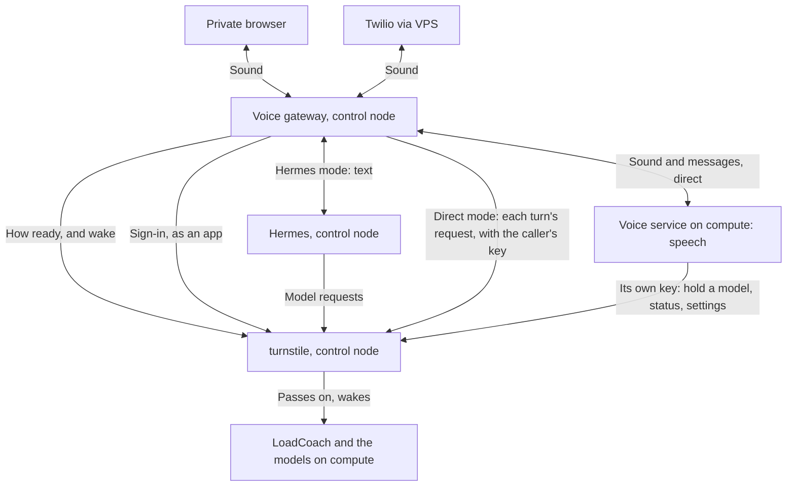

# Voice: a gateway on the control node and a voice service on compute

**Specification with an implementation.** Version 1.5, 16 October 2026 (1.4 of 14 October; owner-revised timing targets below). The owner authorized
all seven steps, deployment and generated-audio testing in the implementation session.
The [voice acceptance ledger](agent-status.md#voice-acceptance) records each step's state; [the code guide](loadcoach.md#25-voice)
records the installed configuration, measurements and remaining acceptance checks. This
specification retains the intended targets; it is not a claim that every target has passed.
Outstanding delivery and extension proposals are consolidated in
[Agent backlog](agent-status.md#open-delivery-and-qualification).

Status reviewed **2026-10-16**: Voice and gateway are active; this installation admits
**two active conversations** following the [bounded H1/V7 qualification](#h1-two-source-trial--2026-10-16).
The dedicated V10 browser identity and bounded permission/revocation qualification are
[complete](#v10-browser-identity-qualification--2026-10-16); Direct phone voice was owner-verified.

On **2026-10-14**, the owner confirmed V5/V9 real telephone and physical-device qualification
and V8 native Windows/macOS desktop execution/audio qualification complete. Those entries were
removed from Progression. This records operator confirmation; no new device tests were run
for the documentation update. The later H1/V7, H2 and V10 results are recorded below.

**Milestone 76 (deployed 2026-10-14)** moved the accounts to the control node
machine and had compute believe only what turnstile signs. For voice this means: the gateway asks
the model for each turn of a direct conversation, through turnstile with the caller's own key; the
voice service hands it what to ask (`model.request` on the sound socket) and speaks the words it
hands back (`agent.text.*`, as in Hermes mode). The voice service knows the caller from turnstile's
statement when the session is made, and the sound socket takes a token for that one session, never
the caller's key. Its own holds, status and settings go to turnstile with its own key. Where the
text below says direct mode keeps the conversation and the model's answer on compute, the
conversation is still kept there; the request to the model is made from the control node.

Two programs. A **voice gateway** on the control node takes private browser calls and Twilio
telephone calls. A **voice service** on compute turns speech into text and text into speech on
the processor, and in one of its two modes also holds the conversation. Each session picks one
conversation mode. `hermes` uses Hermes on the control node for history, skills and tools, with
the model reached through `turnstile` and LoadCoach as today. `direct` keeps transcription,
conversation history, the model's answer and synthesis on compute. Both modes are let in by
LoadCoach, woken through `turnstile`, and use the same sound socket from gateway to compute.

The implemented route and setting names are documented in the code guide and example TOML files.
The owner subsequently requested a Tk desktop client using one API key, including Linux,
Windows and macOS 12. That additional native transport is described in the code guide;
it reuses the conversation and speech protocol below.

## Operator pages (milestone 89, local 2026-10-14)

### H2 owner acceptance — 2026-10-16

**H2/G12 cleared by owner confirmation:** “I checked H2 it can be cleared.” This accepts
the existing checklist for desktop download/install, voice previews, greeting regeneration
and controlled compute-unavailable control node cache playback. The owner supplied no separate
per-check timing or device log; no additional test was run to record this acceptance.


Chat → Voice links to the configured private web app and provides the desktop download
and setup. System → Voice requires
`manage-settings` and shows service/profile readiness, active calls, Direct/Hermes/shared
configuration, speaker previews, six editable greeting phrases and previews of the actual
control node recordings. The existing private HTTPS microphone page remains directly available.

The operator's existing session authorizes every private gateway control through turnstile;
public Twilio and desktop listeners expose no admin routes. Observations and cached playback
do not wake compute or warm models. Explicit CPU synthesis previews do not alter the selected
speaker. `voice.greetings` uses fixed names and 1–300 characters per phrase, and participates
in the existing settings store/reset flow. Speaker, bundle and text determine the recording
revision. Regeneration replaces the whole control node cache atomically, preserving it on failure;
the UI waits for Voice to report saved changes before regenerating. Matching pages are deployed;
the owner acceptance above closes their remaining H2 qualification.

## What changed from version 1.2

Version 1.2 gave `turnstile` a large job: preparations, reservations, signed grants, a heartbeat
feed, and usage reports. The suite's `turnstile` is two hundred lines that pass a request on and
wake compute, and LoadCoach already holds accounts, abilities, sessions and usage. So:

| Version 1.2 | Now |
|---|---|
| `turnstile` authorizes and attributes usage | LoadCoach does, as for every other program. `turnstile` says how ready compute is, and wakes it |
| A grant signed by `turnstile`, bound to a boot ID, used once | A LoadCoach session key. The voice service asks LoadCoach, on its own machine, whose key it is |
| Preparation operations at `turnstile`, polled, with idempotency keys | One request from the gateway to the voice service, which answers when the session is ready |
| A heartbeat from compute every 5 seconds | `turnstile` asks the voice service when someone asks `turnstile`. `spotter` tells `turnstile` before compute sleeps |
| Model leases renewed every 10 seconds, preemption, job suspension | One new thing in LoadCoach: holding a model. Others wait in line. LoadCoach never cuts off an answer |
| Usage events sent to `turnstile` | Every turn is a request in LoadCoach's log already |
| A 24-byte header on every sound frame | Bare samples, and small messages that say when a turn starts and when to throw sound away |
| WSS from gateway to compute | Plain, on the home network, as LoadCoach is reached |
| `turnstile` starts a stopped voice service | The voice service is a service that runs whenever compute does |
| Tailscale identities mapped to people | The suite's accounts |
| YAML settings | TOML, with an example file and the live file kept in step |

Everything about how a call sounds and behaves is kept: one owner of a conversation, turns and
interruption, greetings while compute sleeps, the speech models, the limits on queues, and the
targets.

## Goals and boundaries

Build a common voice backend for browser and telephone sessions, with immediate prerecorded
greetings, truthful startup status, interruption handling, and concurrent calls. Keep the
always-on the control node lightweight. Reuse the suite's accounts, keys, wake rule, usage
accounting and line.

The two programs are deployed independently. LoadCoach, `turnstile` and `spotter` each need one
integration described under "openWeightGym integration requirements". Those contracts include
LoadCoach, turnstile and Spotter even though they are not speech programs.

Assumptions for the first release:

- Compute and the control node have reliable wired networking.
- Browser clients join Tailscale and reach the gateway over HTTPS.
- Twilio reaches the gateway through the existing VPS. Its public WebSocket endpoint is
  forwarded to the gateway.
- English is the first recognition language. Model and voice stay configurable.
- Browser network transport uses WebSockets and PCM. Optional transport changes are tracked in
  [Agent backlog](agent-status.md#optional-voice-extensions).
- The voice service exposes one endpoint. Its speech workers may run in separate processes.
- Hermes's model and tool traffic keeps its existing path through `turnstile`. In direct mode the
  gateway asks the model through `turnstile`, with what the voice service hands it (milestone 76).
  Both modes use the direct sound socket.
- No call capacity or latency is promised before it is measured on this hardware.

Excluded from the first release: speaker cloning, voice biometrics, outbound call campaigns,
public browser access, automatic language detection, and replaying a conversation across a
restart of compute.

## Architecture and ownership



| Part | Owns |
|---|---|
| Voice gateway | Callers' connections, the browser page, checking who a caller is, greetings, sound conversion, playback controls, the choice of mode, the bridge to Hermes, hanging up |
| Hermes on the control node | The agent loop, conversation and memory, skills, tools, a session for each caller, the words of the answer |
| Voice service | For each session: recognition, turn detection, phrase synthesis, cancelling speech, sound state, limits on its processor workers, and in direct mode the conversation and what to ask the model |
| LoadCoach | The line, the lock, holding a model, the models, the log and usage |
| `turnstile` | Accounts, abilities and session keys (milestone 76), checking every caller, passing requests on signed, waking compute, and saying how ready compute is |
| `spotter` | Putting compute to sleep, and telling `turnstile` when it does |
| VPS | Twilio's public way in, forwarded |

The voice service never calls out to an address a gateway gives it. The gateway opens one
authenticated two-way WebSocket for each session, straight to compute, and gets synthesized
sound back on that same connection. That keeps the network simple and makes it plain who ends
a call.

In `hermes` mode a final transcript goes back to the gateway. Its Hermes bridge hands it to
Hermes and returns speakable text for the voice service to synthesize. In `direct` mode the
voice service passes the final transcript to its own direct conversation adapter, which asks
the model through LoadCoach and feeds the text straight to synthesis. A session has exactly
one conversation owner. A direct session never starts Hermes and never runs a Hermes tool.

## Selectable conversation modes

The mode is set for each session, apart from model, voice, language and source. It is checked
against what the caller may do before compute is woken or a model is held. Browser and Twilio
sessions can each use either mode, at the same time.

| Mode | Conversation owner | Route to the model | Gives |
|---|---|---|---|
| `hermes` | Hermes on the control node | Hermes, `turnstile`, LoadCoach | Hermes's skills, memory and permitted tools |
| `direct` | The direct adapter in the voice service | Voice service, LoadCoach on the same machine | History and answers on compute. No Hermes |

Both modes use the same speech runtime and the same source adapters. LoadCoach is never
replaced by a second, unmanaged model server.

**Who may use voice** is an ability. Abilities whose names start `front-` are passed by
LoadCoach to programs on the control node untouched, so `front-voice` needs no change on
compute. It permits Direct and Hermes modes; ordinary model permissions still limit which
model either mode may use.

The browser page has a choice labelled "Hermes agent" and "Direct model", made before
connecting. Telephone sessions use a configured default; optional keypad selection is tracked
in [Agent backlog](agent-status.md#optional-voice-extensions).

`conversation_mode` is part of the session request, `session.start`, `session.ready`, the
readiness answer and the log. The mode in the socket's first message must match the mode the
session was made with. Since milestone 76 a direct session takes its answer's words as `agent.text.*`
from the gateway too, which asked the model. A Hermes
session never starts direct inference for the same utterance. Unknown modes are refused.

The gateway calls the Hermes bridge only for `hermes` sessions. Inside the voice service,
final transcripts go to the adapter the session was made with, and both adapters offer
`begin_turn`, text events, `cancel_turn` and `close`. In direct mode, transcript events may go
to the gateway for display, and must not reach Hermes.

One direct history for each call: the configured system prompt, what the caller said, and
what the assistant was heard to say. Context limits and correction after an interruption
apply. The model is the one the voice profile names. A caller cannot name a model or a
backend address.

Version 1 changes mode by starting a new session. The mode is fixed during a turn. Hermes's
history is never quietly moved into direct mode, and memory is never claimed to be shared.
The explicit in-session mode-change proposal is tracked in
[Agent backlog](agent-status.md#optional-voice-extensions).

There is no falling back from Hermes to direct by itself when an agent or tool run fails: the
caller may be counting on something only Hermes can do. An explicit "Start direct
conversation" may make a fresh session where allowed. Starting a direct session never checks
whether Hermes is up.

Acceptance:

- Browser and telephone sessions each use either allowed mode without a change of transport.
- Direct speech, model and synthesis work while Hermes is stopped.
- Direct model requests stay on compute, and appear in LoadCoach's log under the caller.
- Hermes-mode tool use still runs through Hermes on the control node.
- A Hermes call and a direct call at once have separate histories and fair turns at the model.
- A mode in the socket's first message that differs from the session's is refused.
- A transcript or an answer is handled by exactly one conversation owner.
- A direct session refuses agent text from outside and cannot gain Hermes's tools.

## Who a caller is, and letting a session in

LoadCoach decides. Nothing new is needed for it.

- **The gateway has an account of its own** in the `app` group, with the ability
  `app-sign-in`. A session it makes for a person can do no more than the gateway's account
  can, whatever the person may do elsewhere. That is the rule the suite already has for apps.
- **A browser caller is one account**, as a telephone caller is. The page asks for no name and
  no password; the owner asked for that on 12 October 2026 (step V10). Every caller is the
  account whose key the gateway reads from `browser_key_file`. Whoever can reach the page can
  use it, and the browser never sees a key.
- **A telephone caller is one account**, for every call Twilio delivers, with its own key,
  abilities and limits. Twilio's signature proves the call came through Twilio. The caller's
  number is noted with the call and gives no rights.
- **The session key is the proof.** The gateway sends it with the request that starts a
  session and when it opens the socket. The voice service asks LoadCoach on its own machine
  whose key it is and what it may do, as `spotter` and the ToolLocker do. A key that is
  disabled or has run out is refused there, and again at every request to the model.
- **Usage needs nothing.** In direct mode each turn is a request to LoadCoach under the
  caller's session key. It is in the log with its tokens, and counts in the caller's usage.
  One piece of work, `X-LoadCoach-Trace`, names the call, so its turns are found together.
- **In `hermes` mode** Hermes asks the model with its own key, so those turns are in the log
  under Hermes's account, as today. If the installed Hermes can send a header with a request,
  each call is marked as its own piece of work. Usage for each caller is not promised.

Voice turns are logged and kept like any other request. With `keep_text = 50` a long call
fills most of what is kept in full, and callers' words are among it, readable by their owner
and by those with `see-capture`. The owner chose that. Raising `keep_text` is the remedy.

### Startup

A question about readiness never wakes compute and never loads a model. Only a caller who has
been checked starts work. That keeps page reloads and health checks from waking the machine.

1. The gateway checks who the caller is and makes a session ID.
2. It asks `turnstile` how ready compute is.
3. It starts the fitting recorded greeting and shows the state in the browser.
4. If compute is asleep, it sends a request of its own through `turnstile`, which wakes compute
   and holds the request until compute answers. `turnstile` wakes only for a key it has seen work.
5. For a browser caller it now gets that person's session key from LoadCoach.
6. It asks the voice service to start the session: the session ID, the key, the voice profile
   and the mode. The request stays open until the session is ready, has failed, or
   `max_wait` has passed. Dropping the request cancels it.
7. The voice service asks LoadCoach whose key it is, loads or reuses its speech models, and
   holds the profile's model in LoadCoach. Loading that model waits in line like any request.
8. It checks recognition and synthesis. For `direct` it checks its own adapter. For `hermes`
   the gateway checks Hermes and the caller's profile there. Warming up is done with a short
   exchange that is not part of the caller's history.
9. The voice service answers ready. The gateway opens the socket to compute.
10. The voice service makes the session's state and sends `session.ready`.
11. The gateway finishes or clears the greeting, says it is ready, and turns on the microphone.

"Ready for voice" from `turnstile` is a hint. Only a session that was started and a
`session.ready` let this conversation speak: another session may have taken the room since.

Several callers starting at once share one load of the speech models and one held model, and
each has a session of their own. One caller giving up must not undo what another still needs.

By default a caller is not invited to speak at length before readiness. If the session is
ready during the greeting, the short greeting finishes first. A setting may allow at most ten
seconds of early speech to be kept in memory and handed over in order. If more arrives, the
caller is asked to repeat, and nothing is dropped without saying so.

| State | Recorded prompt |
|---|---|
| Ready already | "Hello. I'm connecting you now." |
| Asleep or getting ready | "Hello. I'm getting the voice system ready. I'll let you know when you can begin." |
| Taking longer | "I'm still getting things ready. Thanks for waiting." |
| Connected | "I'm ready. What can I help you with?" |
| No room | "The voice system is busy right now. Please try again shortly." |
| Could not start | "I couldn't start the voice system. Please try again later." |

Prompts are made beforehand in the chosen voice and kept in two forms: PCM for a browser and
8 kHz μ-law for a telephone. They must play while compute is asleep. The readiness
announcement and the first generated answer must not overlap.

**To settle when this is built:** how a browser caller's password is checked while compute is
asleep. `weightroom` keeps a copy of the password hashes of the few people who may act then,
which LoadCoach hands to a key with `mirror-users`. The gateway can use the same, so that a
wrong password never wakes the machine. The other way is to wake first and check after.

## Status and readiness

`turnstile` gives one of four answers when asked. Asking never wakes anything.

| Answer | Means |
|---|---|
| asleep | `spotter` said it was putting compute to sleep, and compute has not answered since |
| awake, not ready for voice | Compute answers. The voice service is starting, has no room, cannot get its model, or is not running |
| ready for voice | The voice service says the profile is warm and there is room for a session |
| not known | Compute does not answer and nothing said it went to sleep: off, crashed, or the network |

Silence alone cannot tell sleep from a crash or a broken network. So "asleep" is said only
when `spotter` announced it. Otherwise the answer is "not known".

`turnstile` asks the voice service only when it is asked itself. It waits one second at most and
remembers the answer for two. There is no steady heartbeat.

The voice service's own answer, which `turnstile` passes on in part, holds:

- for each profile: recognition, synthesis and the model, each ready or not, and since when;
- sessions active, starting, and the most allowed;
- whether a session could start now, and if not a reason that is safe to show;
- which modes are ready.

Readiness is for one profile and one mode. Hermes being down stops `hermes` sessions and must
not stop `direct` ones. LoadCoach being down, draining or locked stops both.

## openWeightGym integration requirements

These record the original V1 integration contract. The implementation guide documents current
route names and behavior; outstanding changes are tracked only in Progression.

**1. LoadCoach: holding a model.** A caller with the new ability `hold` asks LoadCoach to load
a model and keep it from being replaced until a time. Asking again before then puts the time
off. Letting it run out, or giving it up, ends it.

| Specified route | Does |
|---|---|
| `POST /loadcoach/hold` with `{"model": NAME, "seconds": N}` | Loads the model if it is not loaded, waiting in line like any request, and holds it for N seconds. Sent again, puts the end off |
| `DELETE /loadcoach/hold/NAME` | Gives the hold up |

- It is not the lock. The lock gives every card to one caller and makes the rest wait. A hold
  keeps one model where it is. Requests for that model, by anyone who may use it, run as
  always. Requests for other models run beside it if there is room.
- Where there is no room, the others wait in line until the hold ends.
- A held model counts as the machine being in use. `spotter` then does not put compute to
  sleep under a call, and an unforced sleep or restart waits for it, as it waits for requests.
- The status shows what is held, by whom and until when.
- A group can cap how long its members may hold, as `max_lock` caps a lock.
- The voice service holds with its own account, once for all its sessions. It puts the end
  off while any session is active, and for a short while after the last one ends.

Hold, drain, unload and power behavior are recorded in the implemented
[model-hold contract](loadcoach.md#holding-a-model).

**2. `turnstile`: an answer of its own.** Today every request to `turnstile` is passed on. It gains
one that it answers itself, such as `GET /turnstile/ready`, with the four answers above. It also
listens on the voice service's port, which is one more number in its settings, so that the
gateway's request to start a session wakes compute like any other. `turnstile` today remembers a
key only when it worked under `/v1/` or `/mcp`. The voice service's paths are added to that.

**3. `spotter`: a word to `turnstile`** just before it puts compute to sleep, restarts it or
switches it off. If `turnstile` cannot be told, the answer later is "not known", which is true.

Current measured context fitting and hold protection are documented in the
[implementation guide](loadcoach.md#29-cards-as-room-measured-models-share-a-card).

**A known limit, left as it is:** `turnstile` wakes compute for any key it saw work in the last
ninety days. A key removed since then still wakes the machine, and is then refused.

## Routes

These are the original specification's route shapes. Current registered routes are recorded
in [the implementation guide](loadcoach.md#25-voice); differences are implementation history,
not a new proposal list. Errors have a code, safe message and bounded retry meaning. No key
or caller text belongs in an error.

| Route | Whose | Does |
|---|---|---|
| `GET /turnstile/ready` | `turnstile` | How ready compute is. Never wakes, never loads |
| `POST /loadcoach/hold`, `DELETE /loadcoach/hold/NAME` | LoadCoach | Hold a model, put the end off, give it up |
| `POST /loadcoach/sign-in` | LoadCoach, as today | A session key for a person, through the gateway's own key |
| `GET /voice/ready` | Voice service | Its readiness for each profile and mode. Asked by `turnstile` |
| `POST /voice/sessions` | Voice service | Start a session. Open until ready, failed or timed out |
| `DELETE /voice/sessions/ID` | Voice service | End a session, or one that is still starting |
| `WS /voice/stream` | Voice service | The gateway's sound and messages for one session |
| `POST /browser/sessions` | Gateway | Make a session for a browser caller, with no sign-in |
| `WSS /browser/sessions/ID/stream` | Gateway | The browser's sound and controls |
| `POST /twilio/voice` | Gateway, through the VPS | The checked call webhook, answered with TwiML |
| `WSS /twilio/media` | Gateway, through the VPS | Twilio's two-way Media Stream |

A request to start a session:

```json
{
  "session_id": "voice-session-example",
  "source": "browser",
  "profile": "default",
  "conversation_mode": "direct",
  "max_wait": 60
}
```

The caller's session key goes in the `Authorization` header. The same `session_id` sent again
returns the same session. Answers: `200` when ready, with the profile's revision and the
limits that apply; `401` or `403` for a key that is wrong or may not; `429` when there is no
room; `503` when LoadCoach or a speech model cannot be had. A `503` from LoadCoach with
`code: draining`, and a `429` from it, are "busy" to a caller. None of these is tried again
without end.

A session that was started and whose socket is not opened within a minute is ended.

## The voice gateway

A small asynchronous program with an adapter for each source and one session controller. In
the suite's way: Python, Starlette, its settings in a TOML file, run as a user service. The
browser page captures sound with an AudioWorklet.

Its parts:

- **Browser adapter:** the page, the microphone, playback, the caller's controls.
- **Twilio adapter:** checking signatures, call identifiers, converting incoming sound,
  playback controls.
- **Compute client:** readiness from `turnstile`, waking, sign-in at LoadCoach, starting and
  ending sessions at the voice service, with tries that are bounded.
- **Stream client:** the direct socket to the voice service.
- **Greeting player:** the recorded prompts, startup announcements, cleanup.
- **Session controller:** which source, voice session and Hermes session belong together,
  the state, cancelling the agent, and who hangs up.
- **Sound conversion:** sample-rate conversion that keeps its state between blocks, and μ-law.
- **Counters:** the gateway's timings and what it sees of the transport.

Browser requirements:

- Serve the page over HTTPS inside Tailscale. Tailscale Serve is one way [S8]. A browser
  gives a page its microphone only over HTTPS, or on the machine itself.
- Start the microphone and playback only after the person has acted. Handle refused
  permission and a suspended AudioContext.
- Capture at the device's real rate, ask the browser for echo cancellation and noise
  suppression, and resample properly. Do not assume a requested sample rate was honoured.
- Send mono 16 kHz signed 16-bit PCM in 20 ms blocks. The worklet fills a block buffer. One
  worklet callback is not one network frame.
- Receive mono 24 kHz 16-bit PCM, resample for the playback device, and use a bounded
  playback ring buffer.
- Show waiting, ready, listening, thinking, speaking, busy and disconnected. Partial
  transcripts are optional and off unless turned on.
- Offer mute, hang up, reconnect, and optionally push-to-talk.
- Check the browser's Origin and the session on the WebSocket upgrade.
- WebSockets first, for simplicity. WebRTC may do better on a poor mobile connection, and
  brings signalling, codecs and network traversal with it.

Twilio requirements:

- Use two-way Media Streams with Connect/Stream. The sound is base64 8 kHz μ-law [S6, S7].
- Check the signature of the webhook and of the WebSocket upgrade against the address the
  outside world sees. Trust forwarded headers only from the configured VPS.
- Tie CallSid and StreamSid to the session and to the stream's custom parameters. Refuse
  identifiers that were not expected.
- Decode incoming μ-law and resample 8 kHz to 16 kHz. That does not bring back what a
  telephone line cut off.
- Resample the 24 kHz output to 8 kHz, encode as μ-law, and send payloads without headers.
- Use `media`, `mark` and `clear` for playback bookkeeping and interruption. A `mark` that
  comes back after a `clear` can be for sound that was thrown away, so it is not counted as
  heard [S7].
- Handle Twilio's stop and call-ended notices so that a second one does no harm.
- Give the proxy bounded timeouts for long-lived sockets. The VPS forwards sound at once. It
  never waits for a whole utterance.
- Telephone access has its own profile and a narrow set of tools.

A connection to the gateway does not need compute awake. Only a caller who has been checked
starts anything.

## The voice service

One program on compute, with one interface for a session: sound in, synthesized sound out. In
`hermes` mode it also exchanges transcripts and the agent's text with the gateway. In `direct`
mode it keeps the history and asks the model. Hermes is not installed on compute in either
mode, and neither are its tools' credentials.

It is a client of LoadCoach like any other program. It runs whenever compute does, as a user
service, and loads its speech models when first needed.

Its parts:

- **Session manager:** each session's own state, its key, its share of the held model, cleanup.
- **Recognizer:** sherpa-onnx online recognition on the processor.
- **Turn detector:** speech, silence, where an utterance ends, the final transcript.
- **Conversation router:** exactly one adapter for a session. The Hermes text adapter takes
  the gateway's agent text. The direct adapter keeps history and asks LoadCoach.
- **LoadCoach client:** whose key, holding the model and putting the end off, requests for
  answers. No tools.
- **Text segmenter:** where a speakable phrase ends, and cleaning text for speech.
- **Synthesizer:** Kokoro through ONNX on the processor, a queue of phrases, framing of sound.
- **Playback tracker:** what was heard, and what an interruption cut off.
- **Worker scheduler:** processor budgets, fair queues, when to say there is no room.
- **Readiness:** the answer `turnstile` asks for.

All blocking speech work runs outside the event loop, in bounded worker pools. Each caller
has a recognizer stream, caches and transcript buffers of their own. Model weights may be
shared. Session state is never shared.

A session has at most one assistant generation at a time, apart from a short overlap while an
old one is being cancelled. Late output of the old one is thrown away by its turn number.

## The Hermes bridge, on the control node

Hermes stays installed and running on the control node. Its documentation offers a Python
library and an agent HTTP API [S9, S10]. Its model provider points at `turnstile`, as today [S11].
Hermes handles text and tools there. The model itself runs on compute.

Prefer a separate Hermes process and the installed version's supported API, so that
restarting the gateway does not touch Hermes's insides. Ask it what it can do at startup. Use
run submission, event streaming and stopping where it has them; the documented API does
[S10]. If the installed version lacks them, use a Python adapter pinned to that version with
explicit hooks for output and cancelling. Do not assume an OpenAI-shaped endpoint gives
everything voice needs.

The bridge:

- makes one Hermes conversation for each voice session, tied to the caller's profile;
- submits each utterance exactly once, with a key for that turn where Hermes supports one;
- follows the Hermes run and reads its output and lifecycle events;
- passes on only text that is meant for the caller. Reasoning, tool JSON, tool progress and
  drafts are never synthesized;
- returns progress apart from that, for the browser or a short recorded "one moment";
- where Hermes wants a tool approved, shows that through controls the browser or the phone
  has, and never approves by itself;
- passes interruption and hanging up to the running Hermes run, and drops stale events;
- records what was delivered and what an interruption cut off, before the next turn.

On `transcript.final` the voice service has already given the turn its number. The gateway
ties its Hermes run to it. `agent.text.delta` carries the turn and a count that goes up.
A repeated count is ignored, a gap fails that turn, and text for a turn that was cancelled is
dropped. `agent.text.done` closes the phrase segmenter. `turn.completed` is sent only when
synthesis for the turn is finished. Playback having finished is a separate report.

Only one Hermes turn writes a caller's conversation at a time. Asking Hermes to stop does not
prove its work has stopped. A new utterance is still captured, and waits to be submitted
until the old turn has let go, or fails after a bounded time. Different callers have separate
agent sessions and proceed at the same time, within what compute can carry.

Some Hermes output events may be intermediate messages before tools finish. Pin and test what
the chosen API means by them. For the first release, passing on only the finished final
answer is acceptable where streaming of the final answer cannot be made safe, though it adds
delay. Do not claim words-to-speech streaming until it is shown end to end.

The held model and the speech session cover the whole call, tool work included. Tools on the
control node do not use compute's speech. Moving the model off the control node does not
make browser automation or file scanning free there.

Acceptance:

- A caller can use an allowed Hermes tool and hear the result, with no Hermes on compute.
- Two calls have separate Hermes sessions, histories, memory and working places.
- Hermes's model requests go through `turnstile` to the held model.
- Interruption stops playback at once even when Hermes takes its time to stop.
- Reasoning, drafts and tool progress never reach synthesis.
- A telephone caller gets only the configured abilities, whatever the bridge's own key may do.

## Speech runtime selection

sherpa-onnx is the runtime, not one recognition model. Its documentation includes an online
recognition WebSocket server for several clients [S1]. Use the in-process online recognizer
inside the voice service, with a stream for each caller. A separate sherpa WebSocket server is
not needed in version 1.

For English, measure these documented processor candidates [S2]:

| Profile | Candidate | For |
|---|---|---|
| Light | `sherpa-onnx-streaming-zipformer-en-20M-2023-02-17` | Less processor, more calls at once |
| Balanced | `sherpa-onnx-streaming-zipformer-en-2023-06-26` | Another balance of accuracy and delay |

Test the INT8 variants where there are any. Pin encoder, decoder, joiner, token files, archive
revision, checksums, runtime version and licences. These are starting points that can be
reproduced, not a claim that older bundles are the best recognizers now. Choose by accuracy on
telephone and microphone sound under load, names and the owner's own vocabulary included.

Kokoro-82M is an 82-million-parameter open-weight speech model under Apache 2.0 [S4].
sherpa-onnx documents Kokoro ONNX bundles, among them a multilingual v1.0 bundle and an INT8
v1.1 bundle [S3]. Start by comparing those for English voice quality and speed. Bundle names
and each model's speaker map matter: a speaker's number is not the same across revisions.

Settings name one voice by a name of ours, resolved to a speaker in a pinned bundle. Test
voices in a browser and through real telephone conversion. The voice stays configurable.

Kokoro's reference implementation returns sound for a piece of text at 24 kHz [S5]. Treat it
in version 1 as phrase synthesis followed by streamed transport. Do not promise synthesis
sample by sample, or cancelling at once inside a native call. If the pinned sherpa API has
callbacks, measure how fine they are before relying on them. A short finished phrase can be
framed and sent while the next one is synthesized.

Name the processor provider outright for recognition and synthesis. Not asking for a card is
not enough: check which providers really run, and that warming up speech alone takes no
memory on a card.

## The sound socket, version 1

One WebSocket for one session, from gateway to voice service, plain, on the home network. The
gateway sends the caller's session key in a header when it opens it. The voice service
refuses before taking any sound if the key is not the one the session was started with.

**Text frames are messages, in JSON. Binary frames are sound, and nothing but samples.**

- Gateway to voice service: mono 16 kHz signed 16-bit little-endian PCM.
- Voice service to gateway: mono 24 kHz signed 16-bit little-endian PCM.
- A frame is 20 ms by default: 640 bytes in, 960 bytes out. Up to 100 ms may be sent as one.
  A frame holds whole samples. One that is longer than agreed is refused.

There is no header on a sound frame, no sequence number and no sample offset. A WebSocket on a
wired network delivers every frame once and in order, so those would count what cannot go
wrong. What a header was for is done by messages:

- `turn.started` comes before the first sound of a turn. Sound after it belongs to that turn.
- `playback.clear` means: throw away the sound you hold, and every sound frame that arrives
  until the next `turn.started`.
- Messages that carry text for speech name their turn. Text for a turn that is over is dropped.

The first message agrees the formats:

```json
{
  "type": "session.start",
  "protocol_version": 1,
  "session_id": "voice-session-example",
  "conversation_mode": "direct",
  "input": {"encoding": "pcm_s16le", "sample_rate": 16000, "channels": 1},
  "output": {"encoding": "pcm_s16le", "sample_rate": 24000, "channels": 1}
}
```

The voice service answers `session.ready` with the session, the profile's revision, the
formats chosen and the limits that apply. A format it does not support fails outright. Bytes
are never guessed at.

| Direction | Message | Holds |
|---|---|---|
| Service to gateway | `session.ready`, `session.state` | profile, state of speech |
| Service to gateway | `transcript.partial`, `transcript.final` | utterance, revision, text, turn |
| Service to gateway | `turn.started`, `turn.completed` | turn |
| Service to gateway | `turn.interrupted` | turn, why |
| Gateway to service | `agent.text.delta` | turn, count, speakable text |
| Gateway to service | `agent.text.done` | turn, last count |
| Gateway to service | `agent.status` | thinking, working, or waiting for approval |
| Gateway to service | `agent.error` | turn, a code safe to show |
| Service to gateway | `playback.segment` | turn, segment, its text, how many samples |
| Service to gateway | `playback.clear` | turn, why |
| Gateway to service | `playback.progress` | turn, segment, samples played, or thrown away |
| Gateway to service | `input.end` | finish the current utterance |
| Gateway to service | `session.cancel` | end of session, or an explicit interruption |
| Either | `session.error`, `session.close` | a code or a reason safe to show |
| Either | `ping`, `pong` | a timing token |

Every message is checked against the state the session is in. `playback.segment` comes before
its sound.

Output is ordered and bounded. Messages, `playback.clear` above all, go ahead of sound that is
still waiting inside the program. Sound that has been handed to the network cannot be called
back, so little is handed over at a time, and the gateway drops what a clear makes stale.

There is no picking up a session in the middle in version 1. A reconnect is a new session.

The browser's socket to the gateway may use the same messages, with a first message of its
own. Twilio's side stays Twilio's own JSON.

If a transport that can lose or reorder frames is added later, such as WebRTC, counters go on
the frames then, in a version 2.

## Turns and interruption

A session is created, preparing, connecting, active, closing or closed. While active, what the
caller is doing and what the assistant is doing are tracked apart: listening goes on while the
assistant thinks or speaks. One "speaking" state that turns the microphone off is wrong.

1. Feed incoming sound to the session's recognizer without pause.
2. Optionally send partial transcripts. Nothing that cannot be undone starts from a partial.
3. Use speech activity and the recognizer's endpoint rules to settle one final utterance.
4. The voice service gives the turn its number. In `hermes` mode the final transcript goes to
   the gateway's Hermes session. In `direct` mode it goes to the direct adapter.
5. The conversation owner gets the model's output. Hermes runs its agent loop and tools on
   the control node. Direct mode asks LoadCoach under the caller's key.
6. The adapter gives only speakable text: no reasoning, no tool JSON, no drafts. Hermes's
   text arrives as `agent.text.delta`. Direct text goes into the same segmenter with no trip
   across the network.
7. Cut the text into short clauses or sentences that can be spoken.
8. Give synthesis its turns fairly, and stream each finished phrase.
9. Record what was heard.

Start with 600 ms of trailing silence as the end of a turn and 30 seconds as the longest
utterance, both to be tuned. These are this program's defaults to measure, not sherpa's.
Silence alone never becomes a turn. Add a short wait at the start of speech, about 120 ms,
and measure how often an interruption is a false one.

When the caller truly speaks while the assistant is speaking:

- stop queuing sound for the old turn;
- send `playback.clear` at once;
- cancel queued synthesis. In `hermes` mode send `turn.interrupted` so that the gateway asks
  Hermes to stop. In `direct` mode cancel the request to the model, which LoadCoach passes on
  by closing its connection. Late output is dropped either way;
- go on recognizing the new utterance;
- refuse every late word and sound frame of the cancelled turn;
- never play the old answer again once the caller stops.

The gateway empties the browser's buffers or sends Twilio's `clear`, and reports which
segments were played, queued or thrown away. A browser can report samples played. Twilio's
marks are coarser [S7]. Where it is not known how much was heard, it is recorded as not known.

The gateway keeps the record of what was delivered. In `hermes` mode it tells Hermes what was
heard and what was cut off, without assuming Hermes's API can shorten its stored history. In
`direct` mode the voice service applies the playback reports to its own history and marks an
answer that was interrupted. Tool records are kept wherever they are.

Echo cancellation in the browser, and testing with a headset, reduce the assistant
interrupting itself. Telephone interruption must be tested with a speakerphone's echo and
with noise. One noisy frame must not cancel an answer.

A tool may already have acted when the caller interrupts. Cancelling cannot undo that. Tool
calls have stable identifiers. Finished results are kept. Something that cannot safely be
done twice is never tried again after a failure whose outcome is not known.

A request that someone stopped from the first page ends as LoadCoach says, with
`code: stopped`. That is the end of the turn. It is not sent again.

## Conversation adapters and the model

The Hermes bridge on the control node and the direct adapter in the voice service share the
scheduling, the segmenter and the way of cancelling. Who owns the history is always plain.

A voice profile holds: the system prompt, the name of a model at LoadCoach, a context budget,
the most tokens in an answer, the voice, the language, and for Hermes the tools allowed.
Answers are conversational and short, with the length a setting. Reasoning, raw tool
arguments and internal errors are never spoken.

- **The model may be any that the profile names.** One that spans both cards means nothing
  else runs while voice is ready. The owner chose not to make a rule of it.
- **Thinking is off for voice.** A model that thinks first adds seconds before the first
  word. The profile says so with each request.
- **Two calls at once** need the model to take two requests at once, its `parallel` flag in
  LoadCoach's settings. Each call then has a slot and a cache of its own in `llama-server`.
- **Each caller has a history of their own** in either mode. Hermes mode also keeps agent
  instances, memory, working folders and tool permissions apart. Direct mode has no Hermes
  memory and no skills, on purpose.
- **Tools belong to Hermes mode.** Direct mode is plain conversation, with tools off. A tool
  adapter for direct mode would be a separate thing to turn on, with permissions of its own.
- **No routing in circles.** Hermes's provider address is `turnstile`, never Hermes's own agent
  API and never the voice socket.

## Calls at once, and the cards

Several sockets do not make several calls possible. Whether a session is let in depends on
the processor load of speech, the wait for synthesis, how many requests the model takes at
once, the memory each call's context takes, and what the cards have free.

First aim: one browser call and one telephone call at once on the same profile. That is a
thing to pass, not a promise. If it is not met, admit fewer or choose a smaller model.

| Setting | To begin with |
|---|---|
| Sessions active at most | 2, turned on only once the two-call measurement passes |
| Sessions starting at most | 4 |
| Requests to the model at once | 1, until the model's `parallel` is shown to hold |
| Recognition threads | 1 or 2 for each worker |
| Synthesis workers | 2 |
| Synthesis threads | 1 or 2 for each worker |
| Longest session | 30 minutes |
| Caller silent | 120 seconds, not counting tools at work and playback |
| Model held after the last call | 120 seconds |
| Hold put off | every 10 seconds, for 30 seconds each time |

Scheduling is fair across sessions: one long answer must not take every synthesis worker or
keep the model without end. With one request to the model at a time, turns that overlap wait
a bounded time and are told honestly that it is busy.

What a model takes is its weights, its working memory, and a context for each session. Two
cards' memory together is usable only as far as the model and `llama-server` place it so.

LoadCoach owns the cards:

- A request for another model waits in line while the voice model is held and there is no
  room. Nothing is stopped to make room. LoadCoach never cuts off an answer.
- The voice service never ends a process on a card and never removes a model.
- Sessions share the held model. One session ending does not end the hold while another needs it.
- Compute is not put to sleep while a model is held.
- When the last call is over and the wait after it has passed, the hold runs out, and
  LoadCoach replaces the model when something else needs the cards, as it does any idle one.

Speech on the processor still competes for cores and for memory bandwidth. Measure the delay
while the model is answering and other work is running, not only on an idle machine.

## Buffering and backpressure

Live capture is continuous and bounded. To begin with:

- sound waiting from gateway to voice service: 500 ms;
- recognition behind: 1 second before overload is handled;
- synthesized sound not yet sent: 2 seconds;
- playback at the source: 100 to 200 ms aimed for;
- playback at the source at most: 1 second where it can be controlled;
- early speech kept during startup, if turned on: 10 seconds.

These need measuring and are settings. Stop scheduling synthesis when playback downstream is
full. Ask the model for less ahead, or cancel the turn, if its queue cannot stay bounded.

Speech in the middle of an utterance is never dropped quietly. On overload, say so with a
message, clear the recognizer's damaged state, and ask the caller to repeat. A growing
backlog is never played out as if it were live conversation.

A slow consumer is found by the program's own queues, by pressure on the socket's write
buffer, and in a browser by `bufferedAmount`. Network throughput is not enough: check that
the device is really playing.

## Reliability and lifecycle

| Failure | What must happen |
|---|---|
| `turnstile` not answering before a session starts | Play the recorded "unavailable". Never start around it |
| Readiness not known | Say "not known". Starting a session finds out for real |
| Compute awake, voice service stopped | "Awake, not ready for voice". It is a service that restarts itself; the Machine page can restart it |
| The cards are locked or taken | "Busy", with when to try again. Nothing is ended by force |
| LoadCoach is draining | "Busy". No new session until it takes requests again |
| A model will not load or warm up | The session fails to start, with LoadCoach's reason kept in its log. The hold is given up |
| Caller hangs up during startup | End that session. Keep what another caller still needs |
| Compute crashes during a call | Gateway clears waiting sound, plays the recorded failure prompt, and closes or offers to start again |
| Gateway crashes | The socket closing starts cleanup on compute. The hold running out is the last resort |
| A request to the model fails | Nothing made up is spoken. A recorded error prompt is played |
| A tool's outcome is not known | Keep it as pending. No blind second try |
| A slow listener | Bound the queues, stop output growing, close after the configured time |
| The caller's key is disabled during a call | The next request to the model is refused. The session is closed |
| Hermes not answering | `hermes` sessions fail or end gently. `direct` sessions go on if what they need is well |
| A Hermes run slow to stop | Drop its output at once. Wait for the turn to let go before the next run |

If `turnstile` stops answering after a call has started, the sound stays connected, since it does
not pass through `turnstile`. Hermes's model requests do, and stop. Direct mode asks LoadCoach on
its own machine and goes on.

A reconnect is a new session. Sound that was not acknowledged is not played again, and a tool
call that may have acted is not sent again.

Sound is in memory only, by default. Keeping transcripts or recordings on disk would be
separate features with settings of their own. What LoadCoach keeps of each turn is said above.

## Counters and targets

One piece of work, `X-LoadCoach-Trace`, names a call at LoadCoach and at the ToolLocker. The
gateway and the voice service use the same name in what they print, with the mode, the
source, the account, the profile, the session and the turn.

Record:

- who was let in and who was not;
- how long waking, the service's start, warming speech and loading the model took;
- how old a readiness answer was, and readiness checks that failed;
- length of what was said, recognition's processor time, the wait for an endpoint, the time
  of the final transcript;
- the wait in LoadCoach's line, time to the first speakable word, tokens, cancellations;
- the wait for synthesis, time to the first phrase of sound, processor time, length of sound;
- from the gateway receiving sound to the source playing it, where that can be seen;
- from an interruption to playback being cleared, and sound thrown away;
- sessions active and starting, memory, processor, card memory, pressure on worker queues;
- errors, disconnects and overloads.

LoadCoach's log already has the tokens, the wait in line and how long each answer ran.
`spotter` already has the processor, the memory and the cards over time.

The real-time factor is processing time divided by the length of the sound. One that stays
below 1 is needed to keep up. It does not promise a quick first sound, or room for two calls.

Current warm-system targets, revised by the owner on **2026-10-16** to accept the recorded
installation performance; [bounded latency acceptance](#h1-owner-latency-acceptance--2026-10-16)
closes the H1 latency gate. These targets also guide subsequent capacity qualification:

| Measure | Target |
|---|---|
| Caller stops speaking to first sound of the answer | median ≤2.5 s; p95 ≤3.0 s, for ordinary turns with no tool |
| Interruption noticed to playback stopped at the source | p95 ≤350 ms, measured for each source |
| Wait to decide an utterance has ended | about 400 to 800 ms, tuned for accuracy |
| Startup | 60 s at most from a session being asked for |
| "Still getting ready" | every 10 s while starting, never over another prompt |
| Socket opened | within 5 s of the session being ready |
| Recovery | nothing left starting for ever, and no hold left behind |

The first measure takes in the endpoint wait, the line, the model's first phrase, synthesis
and transport. Startup and turns with tools are reported apart. The time a frame was sent is
not proof that it was heard.

The configured number of sessions must meet the targets under sustained load from both
sources. If it does not, change the model, the context or the workers, or admit fewer. A
failure is not hidden behind averages.

## Voice latency diagnostics (C06, milestone 100)

### H1 desktop review — 2026-10-16

Owner confirmed audible preparation greeting, correct recognition/answer for “Please tell me
what number comes after twenty-four,” and successful spoken interruption of counting followed
by the grass-colour question. Initial isolated-word attempts do not establish clipped input:
the owner clarified that the instruction prefix had not been spoken. Owner reports Ubuntu 26.4 with microphone and speakers, and response timing felt slightly
slow. Exact OS release/client build and physical timing were not independently captured. System → Voice showed five desktop/direct turns on
`qwen3.6-35b-a3b-q4`, revision `435eb3ff685a9ee6`: inferred receive-endpoint to first PCM
p50 2844.3 ms / p95 4324.4 ms; recognition-final p50 1633.0 ms / p95 1855.0 ms;
control node first-PCM to playback-progress p50 41.6 ms / p95 43.2 ms. This small sample
was not separated into warm-only turns and does not qualify warm physical latency. No queue-clear
measurement was displayed. At this initial review, repeated timing and V7 checks were still
open with capacity one; the later owner acceptance and completed trial below supersede that state.

Owner then reported correct model answers on three warm questions, with “hot” transcribed
as “heart.” Eight accumulated desktop/direct turns under the same revision showed inferred
receive-endpoint → first PCM p50 2559.6 ms / p95 4324.4 ms, endpoint → recognition final
p50 1511.5 ms / p95 1855.0 ms, and the control node first-PCM → playback-progress p50 37.6 ms /
p95 1142.2 ms. These cumulative percentiles include the earlier five turns; they are not
warm-only measurements. Recognition findings and timing samples are retained; later owner latency acceptance is recorded below.

Phone browser initially displayed controls without sign-in but returned “Voice unavailable”
on Start. Control node's gateway configuration lacked `browser_key_file`; no speech session reached
compute. Provisioned dedicated `voice-browser` account/group with only `front-voice`, `load`
and `hold`, one request, no tools and only `qwen3.6-35b-a3b-q4`; temporary-key authentication
passed and revocation returned 401. Final key is owner-private mode 0600 on the control node at
`/home/jpk/weightroom/keys/voice-browser.key`, referenced by the gateway configuration.
Gateway restarted with zero active/starting calls and idle benchmark queue, and is active.
Owner then confirmed the phone's correct twenty-five answer, successful spoken interruption
and grass-colour answer, and response delay feeling slightly better than desktop. Owner reports iPhone 15 Pro running iOS 26.6 with Safari. Browser/direct session `178b87df1c59697d70ae59ece396efd3`
turns 1–3 used revision `435eb3ff685a9ee6`: inferred endpoint → first PCM was 2535.384 ms,
4684.860 ms (counting, interrupted) and 2410.240 ms. Turn 2 application queue-clear
acknowledgement was 7.408 ms; this does not measure physical speaker-stop latency.
Desktop session `92b0331c070e9d968a1d964d1f98aefc` warm turns 6–8 were 2471.902,
2285.354 and 2395.878 ms to first PCM. Neither small sample qualifies the specified physical
p50/p95 targets. Single-source functional checks have passed on both devices; measured
physical latency, sustained two-source V7 and full V10 permission/revocation-in-session
qualification were open at that review; the later results below supersede that state. No browser-route request was made by the agent after browser
access was denied; the owner performed the browser checks.

### V10 browser identity qualification — 2026-10-16

**G13 closed.** The live control node gateway listens on loopback `127.0.0.1:8446`; Tailscale Serve
provides private HTTPS on port 443. Its `browser_key_file` is present, owned by the service
user and mode 0600. The dedicated `voice-browser` account has `front-voice`, `load` and
`hold` only; its group permits one model, no tools and one request at a time. Direct voice is
allowed; the same `front-voice` grant now admits Hermes, subject to its model permission. A
foreign-Origin session request returned 403. Existing owner phone use established private HTTPS Direct voice; an
earlier temporary key returned 401 after revocation. An isolated active browser-WebSocket
test, with no compute or real call, changed Turnstile's response to 401 and verified an
`unauthorized` event, socket closure and no further model request. The gateway fix that sends
that event to browsers was deployed and its localhost API checked after restart. No agent
request to the denied private HTTPS page and no live mid-call revocation were made.
[Machine-readable checks](../data/qualification/delivery-2026-10-16.json).


### H1 endpoint comparison — 2026-10-16

CPU replay of three bundled human recordings, each clean and with seeded 15/5 dB noise,
compared 800/600/400 ms trailing silence. Across 231 reference words the error counts were
5/5/6; median last-loud-frame to final endpoint was 1660/1340/1320 ms. Utterance counts
were 9/10/15: 600 ms split one noisy recording, while 400 ms fragmented several cases.
Select 600 ms as a live qualification candidate; retain the prior 800 ms value for rollback
if physical pauses are clipped. This is replay evidence, not a physical latency pass.
[Exact cases and results](../data/qualification/h1-2026-10-16/endpoint-comparison.json).
Applied 600 ms to this compute installation and restarted only Voice after owner-confirmed
disconnection and fresh zero-call/idle-benchmark checks. Service is active; initial desktop physical samples are recorded below. Supported capacity
remains one; broader physical comparison is pending.

### H1 recorded desktop samples — 2026-10-16

Owner supplied `IMG_1796–1798.mov` from the iPhone camera, capturing desktop speakers and
human input with the 600 ms candidate. Approximate question-end → audible-answer gaps were
**2.1 s** (two plus three) and **2.6 s** (day after Monday), with threshold sensitivity in the
[measurement artifact](../data/qualification/h1-2026-10-16/desktop-recordings/measurements.json).
Both exceeded the then-current 1.5 s median target; two samples do not establish a population p95.
The counting interruption has a provisional **220–310 ms** mixed-audio stop estimate;
overlap/source attribution and the actual interruption-noticed boundary prevent claiming
≤300 ms qualification. Retained private PCM and waveform plots accompany the artifact;
original movie hashes identify the supplied attachments. No matched physical 800 ms baseline
exists, so the replay improvement is not promoted to a physical improvement claim. At this review, phone recordings, repeated physical timing and sustained two-source V7 were
open; the later owner decision below closes the current latency acceptance requirement.

### H1 owner latency acceptance — 2026-10-16

**Latency gate closed by owner acceptance.** After reviewing the desktop recordings and phone
functional results, the owner explicitly requested adjusting the timing targets to the recorded
values and clearing this gate. The [current targets](#counters-and-targets) replace the former
1.5 s median / 2.5 s p95 response and 300 ms stop requirements. The recorded 2.1/2.6 s
response gaps and provisional 220–310 ms interruption estimate support this bounded owner
acceptance; they do not establish a population p95 or independently measure interruption
notice. No additional latency recording/tuning is required to clear this installation's gate.
H1/V7 concurrency and resource/recovery acceptance is recorded in the completed trial below.

### H1 two-source trial — 2026-10-16

**H1/V7 complete for this installation.** The bounded desktop/Safari trial retained isolated
cedar/harbour conversation memories, 18 journalled turns over 293 s and no failed turns;
Voice peaked at 1.95 GiB under its 4 GiB limit. Browser mute initially stopped PCM frames,
causing misleading 13.8–58.8 s endpoint measurements. The deployed fix sends equal-length
zero PCM while muted; two local browser checks passed and refreshed Safari answered five
while still muted (1.896 s inferred endpoint → first PCM).

Owner confirmed desktop survival and cedar retention after phone disconnect/reconnect,
then phone survival and correct Tuesday answer after desktop disconnect. Both calls ended;
live readiness showed zero active/starting sessions, and the voice hold expired normally
with zero queued/running requests. Retain `max_active_sessions=2` through the existing Settings
API; the file default remains one. [Trial, resources, cleanup and rollback](../data/qualification/h1-2026-10-16/two-source-trial.json),
[retained turn diagnostics](../data/qualification/h1-2026-10-16/two-source-latency.json) and
[post-fix recovery timings](../data/qualification/h1-2026-10-16/two-source-recovery.json).
This accepts bounded two-call operation under the owner's revised timing contract; it is
not a long-duration or population p95 guarantee. H2 operator pages are owner-accepted;
[V10 browser identity qualification](#v10-browser-identity-qualification--2026-10-16) is complete.

### Instrumentation and remaining acceptance

Implemented locally **2026-10-15**; matching control node/compute instrumentation was observed live
on **2026-10-16** during H1. The owner-accepted latency gate is closed; capacity/resource
H1/V7 qualification is recorded below; V10 identity qualification is recorded above. System → Voice now shows numeric per-turn diagnostics and
nearest-rank p50/p95 summaries. The private gateway status API supplies the last 200 turns
since gateway start, with a maximum age of 24 hours; the page shows the newest twenty.
No new database, service, credential or collection of words/audio is introduced. The page
window is in memory and resets on gateway restart. Numeric `voice.latency` events also use
the existing `voice.service` and `voice-gateway.service` journals.

Compute records these stages with its own monotonic clock: final recognition block,
endpoint received to recognition final, recognition final to first speakable phrase,
first-phrase synthesis, and endpoint/final recognition to the first PCM frame sent. The
endpoint basis is either explicit `input.end` received or the last loud input frame
received, inferred using the existing speech threshold. These are receive-side boundaries;
they are not measurements of when a person physically stopped talking. Recognition worker
processing/queueing is included in block elapsed time; this is not CPU-time accounting.
Optional `latency` fields on existing turn/segment/completion/interruption/error messages
carry durations and profile/model/configuration-revision labels captured at recognition final,
never monotonic timestamps. Controlled comparisons require unchanged configuration during a turn.
Gateway consumes those fields before forwarding events to clients. Existing PCM framing,
backpressure and confirmed-playback history are unchanged.

Control node separately times first PCM received to first positive valid playback-progress report,
and clear forwarding started to `playback.cleared`. The latter confirms only that a browser
worklet or desktop application emptied its queue; hardware sound may already be scheduled.
Both include network/processing delay. Native progress keeps its existing DAC scheduling;
browser progress reflects worklet consumption and telephone progress uses returned marks.
Telephone marks returned after clear do not count as heard and do not provide a queue-clear
latency. Missing/older-client acknowledgements remain unavailable, never zero or a pass.
New gateway advertises `queue_clear_ack` on `session.ready`; updated clients send that new
acknowledgement only when advertised, preserving connections to older gateways.

Summaries keep source, Direct/Hermes mode, profile, model, configuration revision and endpoint
basis separate. Each retained turn contributes once per available metric. Numeric values are
finite, nonnegative and bounded; prompt text, PCM, caller keys and telephone numbers are not
accepted as diagnostics. The existing manager permission and private listener protect status;
public Twilio/desktop ports cannot expose it, and status reads do not wake compute. Inspect
longer-lived numeric events through System logs or `journalctl --user -u voice-gateway` on
control node and `journalctl --user -u voice` on compute, subject to configured journal retention.

This installation admits two active conversations after the bounded
[H1/V7 trial](#h1-two-source-trial--2026-10-16), under the [current targets](#counters-and-targets). The current installation's latency gate is closed
under the [owner's bounded acceptance](#h1-owner-latency-acceptance--2026-10-16), with its
recorded sample limits preserved. Existing functional device acceptance is retained; numeric
acknowledgements alone never establish physical playback or a population p95.
Local verification passed all 910 tests with zero skips in 482.58 seconds, including seven new
checks, PostgreSQL and desktop/mobile Chromium; one existing Starlette/httpx warning remains.

## Settings and deployment

Settings are TOML, as everywhere in the suite, each program with a file of its own, an
example file that is committed, and the live file kept in step with it. This shows what is
meant. The names are settled when each part is built.

```toml
# the voice service, on compute
host = "10.77.10.84"
port = 8445
compute = "http://127.0.0.1:8442"     # LoadCoach, on the same machine
max_active_sessions = 2
max_starting_sessions = 4
max_session_minutes = 30
hold_seconds = 30                      # how long each hold lasts
hold_every = 10                        # seconds between putting its end off
hold_after_last_call = 120

[profiles.default]
model = "the-voice-model"              # a model's name at LoadCoach
modes = ["hermes", "direct"]
system_prompt = "You are speaking with someone by voice. Answer briefly."
max_output_tokens = 256
max_context_tokens = 8192
thinking = false
language = "en"
voice = "default_english"

[recognition]
model = "pinned_streaming_english_bundle"
threads = 2
trailing_silence_ms = 600
max_utterance_seconds = 30

[synthesis]
model = "pinned_kokoro_bundle"
threads = 2
workers = 2
```

```toml
# the voice gateway, on the control node
host = "127.0.0.1"                     # Tailscale Serve and the VPS's forward reach it here
port = 8446
turnstile = "http://127.0.0.1:8442"        # readiness, waking, sign-in
voice = "http://10.77.10.84:8445"      # the voice service, straight
key_file = "voice-gateway.key"         # its own key at LoadCoach, never in this file
phone_key_file = "voice-phone.key"     # the telephone account's key
default_mode = "hermes"                # for a telephone call, and what the browser page starts on
startup_seconds = 60
```

The limits on context and answer length are starting points, bound by what the model can do
and what calls need.

Both run as user services that restart themselves and stop gently: no new sessions, current
ones finished or ended as configured, the hold given up.

Speech workers get no card. The voice service's port is bound to the home network and takes
sound only from a key that LoadCoach knows. The public VPS exposes Twilio's routes and
nothing else.

## Required components

- the voice gateway, its browser page and its Hermes bridge;
- the voice service and its speech workers;
- the messages of the sound socket, in one small module both programs use;
- holding a model in LoadCoach, `turnstile`'s readiness answer, and `spotter`'s word to `turnstile`;
- example settings without secrets, the recorded prompts, and how they are made;
- a list of the speech models with where they come from, their licences and checksums;
- stand-ins for LoadCoach, speech and tools for the tests, as the suite has for `llama-server`;
- how to deploy it and how to look into a failure, in `docs/loadcoach.md`;
- tests, and a report of what was measured and how many calls are supported.

## V1–V7 implementation sequence

Decided with the owner: holding a model, then direct mode with a browser on the home network,
then readiness, greetings and waking, then Twilio, then Hermes mode. Steps 3 and 7 are from
version 1.2's own order, put where they fit. The README records selected implementation and
verification; remaining delivery and qualification are in Progression.

1. **Holding a model**, in LoadCoach.
2. **The voice service in direct mode, with a plain browser page on the home network.** The
   smallest thing that talks: speech in, LoadCoach, speech out. First with stand-ins for
   speech and a known text, then the real recognizer and Kokoro, measured on this machine. A
   browser gives a page the microphone only over HTTPS or on the machine itself, so this
   step is tried in compute's own browser.
3. **Turns and interruption**, with what was heard recorded.
4. **The gateway: readiness from `turnstile`, `spotter`'s word, greetings and waking**, and the
   browser page served through Tailscale.
5. **Twilio**, with sound conversion and the VPS's forward.
6. **Hermes mode**, after finding out what the installed Hermes can do.
7. **Two calls at once**, fair workers, the measurements, and the number that is supported.

## Tests that mean something

- Ready, asleep, not known and busy at startup each give the right prompt.
- Two callers starting at once cause one load of the speech models and one held model, and
  have a session each.
- A key that has run out, is disabled, belongs to someone else, or was not the one the
  session started with cannot open a socket.
- Asking how ready compute is never wakes it. A checked caller starting a session can.
- Warming up speech alone leaves the cards' memory as it was.
- Recognition is fed without pause and settles each utterance once. Silence alone asks the
  model nothing.
- μ-law and PCM conversion keep timing and intelligibility through a telephone round trip.
- Two sessions never share transcripts, history, tools, sound or a slot's cache.
- Output of an interrupted turn is thrown away even when an old synthesis worker ends late.
- Sound frames that arrive after `playback.clear` and before the next `turn.started` are not
  played.
- Twilio marks that belong to a `clear` are not counted as heard.
- A caller who gives up does not unload a model or end what another still needs.
- A tool is not run twice after a reconnect or a timeout whose outcome is not known.
- A slow browser or Twilio listener leaves memory and queues bounded.
- A crash of compute or of the gateway lets the hold run out. Nothing is left held.
- A browser call and a telephone call at once meet the configured delay and recognition.
- The model stays held and compute stays awake while any call needs them.
- Each turn of a direct call is in LoadCoach's log under the caller, with its piece of work.

## Remaining qualification

Use the [acceptance ledger](agent-status.md#voice-acceptance) for recorded native/device,
capacity and private-browser acceptance, and
[the optional extensions](agent-status.md#optional-voice-extensions) for proposed changes.
The targets and protocol tests above remain specification requirements, not claims that every
physical device or concurrency target has passed. Measurements are in the implementation guide.

## Source references

Checked on 8 October 2026. The shapes of routes and messages, the defaults, the targets and
the architecture above are design choices of this document.

- [S1] [sherpa-onnx streaming WebSocket server](https://k2-fsa.github.io/sherpa/onnx/python/streaming-websocket-server.html)
- [S2] [sherpa-onnx streaming Zipformer model catalogue](https://k2-fsa.github.io/sherpa/onnx/pretrained_models/online-transducer/zipformer-transducer-models.html)
- [S3] [sherpa-onnx Kokoro models](https://k2-fsa.github.io/sherpa/onnx/tts/pretrained_models/kokoro.html)
- [S4] [Kokoro-82M model card](https://huggingface.co/hexgrad/Kokoro-82M)
- [S5] [Kokoro reference implementation](https://github.com/hexgrad/kokoro)
- [S6] [Twilio Media Streams overview](https://www.twilio.com/docs/voice/media-streams)
- [S7] [Twilio WebSocket message protocol](https://www.twilio.com/docs/voice/media-streams/websocket-messages)
- [S8] [Tailscale Serve](https://tailscale.com/docs/features/tailscale-serve)
- [S9] [Hermes Python library](https://hermes-agent.nousresearch.com/docs/guides/python-library)
- [S10] [Hermes API server](https://hermes-agent.nousresearch.com/docs/user-guide/features/api-server)
- [S11] [Hermes model providers](https://hermes-agent.nousresearch.com/docs/integrations/providers/)
