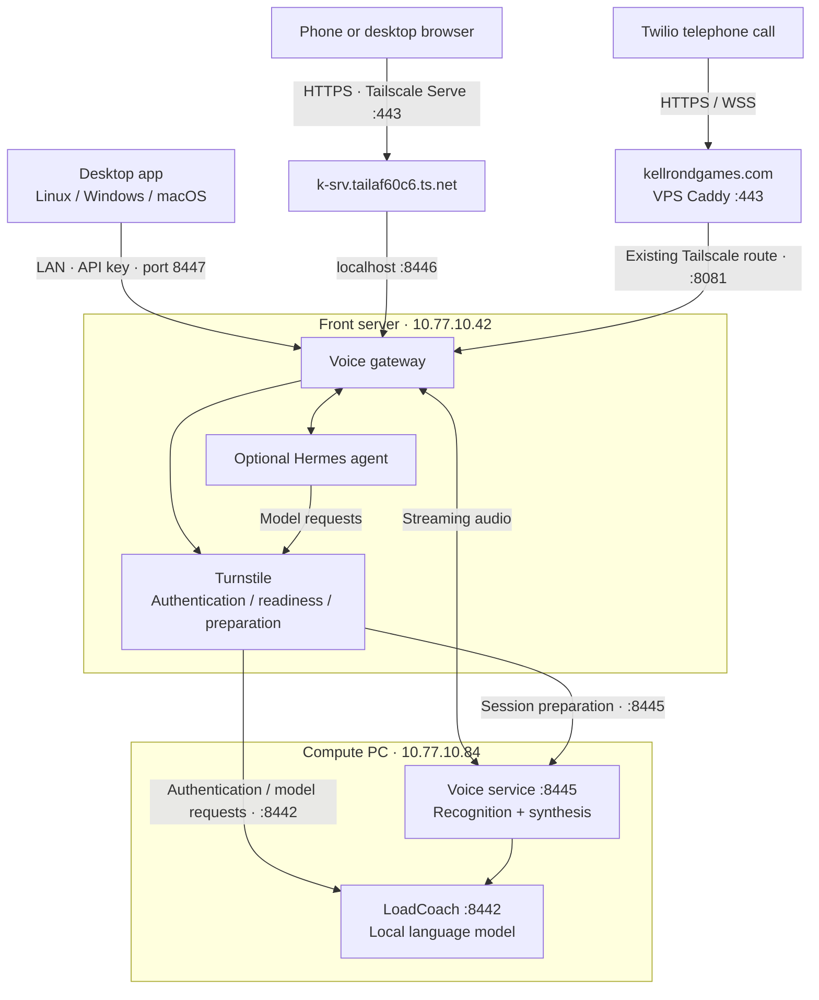
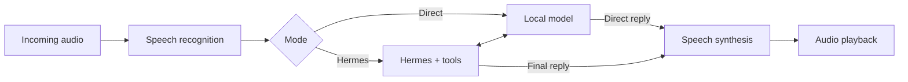

# Voice service brief

Deployment status reviewed: **2026-10-25**. Voice and gateway are active; this installation
admits **two active conversations** after [bounded H1/V7 qualification](../docs/voice.md#h1-two-source-trial--2026-10-16).
The private browser identity has [bounded V10 permission/revocation qualification](../docs/voice.md#v10-browser-identity-qualification--2026-10-16).
H2 operator pages are [owner-accepted](../docs/voice.md#h2-owner-acceptance--2026-10-16). Earlier V5/V8/V9 acceptance is retained.

The voice service runs across **k-srv (`10.77.10.42`)** and the **compute PC
(`10.77.10.84`)**. The front server handles connections and authentication; the compute
PC handles speech recognition, speech synthesis, and local model inference. Capacity is
currently **two active conversations** on this installation.

The conversation supports two modes. **Direct** uses the local model for replies.
**Hermes** adds an agent and tools while retaining the same speech pipeline.

## Operator pages

Milestone 89 is deployed; [H2 owner acceptance](../docs/voice.md#h2-owner-acceptance--2026-10-16) closes its page/playback gate.
**Chat → Voice** opens the browser conversation at `/voice`; **Voice desktop app** opens
the ZIP and platform setup instructions at `/voice/desktop`.
**System → Voice** (`/system/voice`, `manage-settings`) provides server/readiness status,
Direct/Hermes/shared settings, voice previews, greeting text editing and regeneration, and
playback of the actual front cache. Existing Settings forms edit the same values. Status
and cached playback do not wake compute; explicit previews use CPU synthesis. Edited
phrases and speaker selection regenerate a complete versioned set, retained on front for
compute outages. Public Twilio and desktop ports cannot reach the private admin controls.
See [installation](../docs/installation.md#voice-pages-and-home-summaries) for delivery.

### Browser call settings

Choose a **Conversation model** and **Speech engine** before starting. **CPU voices** offers
the installed built-in speakers; **Saved voice** offers your SoundRoom voices, a cloning
**Speech model**, a **Recognition model**, and the **Pause before reply**. Speaking speed,
reply length and optional conversation instructions apply to this call. Hermes keeps its own
model and instructions; unsupported choices are hidden. These controls preserve server defaults.

Choose the **Microphone** before connecting. **Microphone gain** and **Playback volume** can
change during a call; echo cancellation stays available. Device names appear only when the
browser permits them. **Record this call** explicitly retains audio in SoundRoom; call settings
and unrecorded audio stay in memory. A startup failure leaves its reason visible after disconnect.
Canceling startup also cancels the upstream model wait before response headers; the hold-renewal
loop renews only models already acquired, so failed starts do not queue duplicate loads.

The speech service account needs `hold` and `load`, plus `high` when a speech profile requests
high priority. On this installation these required permissions were restored on 2026-10-25,
preserving the existing request limit; the cloned-voice profile's stale model name was corrected
to `qwen-2.5-1.5b`. Global defaults remain under **System → Voice**.

Deployment check, 2026-10-25: live CPU and saved-synthetic-voice calls each transcribed generated
input and returned a complete model reply as PCM at 1.25× speed; test voice/reference cleanup
succeeded, and no abandoned startup requests remained queued. Browser checks cover call choices,
device/gain/volume controls and retained failure reasons. Personal spoken-chat acceptance remains
in the [delivery ledger](../docs/agent-status.md#open-delivery-and-qualification).

## Latency diagnostics

Milestone 100 is implemented locally **2026-10-15**, with deployment and real latency
qualification pending. System → Voice shows per-turn numeric stages and p50/p95 grouped by
source, mode, profile/model revision and explicit/inferred endpoint basis. The private gateway
keeps at most 200 turns/24 hours in memory since start; numeric `voice.latency` events also
use the existing service journals. No utterance/audio/key/telephone-number capture is added.
Compute reports receive-endpoint/recognition/phrase/synthesis/first-PCM stages on its clock;
front measures playback progress and client application queue-clear acknowledgements on its
clock. Missing acknowledgements are unavailable; neither an acknowledgement nor PCM sent is
physical speaker-stop proof. New clients negotiate queue-clear reports through the gateway's
`queue_clear_ack` capability. Bounded H1/V7 two-call qualification is complete. The owner closed the current latency gate on 2026-10-16
under [revised targets and bounded recorded-sample acceptance](../docs/voice.md#h1-owner-latency-acceptance--2026-10-16). All 910 local tests passed with zero skips in 482.58 seconds, including
PostgreSQL and desktop/mobile Chromium; one existing Starlette/httpx warning remains.
See the [diagnostic contract](../docs/voice.md#voice-latency-diagnostics-c06-milestone-100).

## Key ports

| Host | Port | Purpose |
|---|---:|---|
| Front | 443 | Tailscale Serve HTTPS → private browser listener |
| Front | 8440 | WeightRoom and desktop client download |
| Front | 8442 | Turnstile to LoadCoach: authentication and model requests |
| Front | 8445 | Turnstile to compute voice: readiness and session preparation |
| Front, localhost only | 8446 | Browser voice interface |
| Front, LAN | 8447 | Desktop voice WebSocket using an API key |
| Front | 8081 | Twilio voice webhook and audio stream |
| Compute | 8442 | LoadCoach model API |
| Compute | 8444 | Spotter compute/power management |
| Compute | 8445 | Speech service |
| Public VPS | 443 | Public Twilio HTTPS/WebSocket entry point |

## Key endpoints

Relative browser paths are served through the private browser listener; relative voice
service paths are on compute port 8445. The model endpoint is on LoadCoach port 8442.

| Address or path | Purpose |
|---|---|
| `https://k-srv.tailaf60c6.ts.net/` | Browser interface; Tailscale Serve is configured, and clients need tailnet access |
| `http://10.77.10.42:8440/static/LoadCoach-Voice.zip` | Desktop client download |
| `ws://10.77.10.42:8447/desktop/stream?conversation_mode=direct` | Desktop connection; Bearer API key; also accepts `hermes` |
| `POST /browser/sessions` | Browser sign-in and session creation |
| `WS /browser/sessions/{sid}/stream` | Browser audio connection |
| `POST https://kellrondgames.com/voice/inbound` | Signed Twilio inbound-call webhook |
| `wss://kellrondgames.com/voice/stream` | Signed Twilio audio stream |
| `GET /voice/ready` | Compute speech readiness |
| `POST /voice/sessions` / `DELETE /voice/sessions/{sid}` | Create or close a compute voice session |
| `WS /voice/stream?session_id=…` | Internal authenticated audio stream |
| `POST /v1/chat/completions` | LoadCoach model inference |

Desktop clients connect directly over the LAN without Tailscale. Browser microphone access
requires HTTPS (or localhost). Internal audio uses mono PCM at **16 kHz input / 24 kHz
output**; the gateway converts Twilio's **8 kHz μ-law** audio.

See the [implementation guide](../docs/loadcoach.md#25-voice) for setup/measurements, the
[voice specification](../docs/voice.md) for requirements and the
[acceptance ledger](../docs/agent-status.md#voice-acceptance) for recorded checks and limits.

## Echo cancellation and spoken interruption

Echo cancellation is enabled by default without pausing the microphone. Desktop uses WebRTC
AEC3 against actual speaker output; browser and phone-browser playback uses a local WebRTC
connection so the browser can cancel it; telephone calls use AEC3 at the front gateway before
recognition. Browser and desktop offer an Echo cancellation switch, which can be disabled
when using headphones. Speak over a reply to interrupt it. See the implementation guide for
simulated-audio verification. The owner confirmed V9 physical-device qualification complete
on 2026-10-14; recorded acceptance and limits are in the
[agent ledger](../docs/agent-status.md#voice-acceptance).

The greetings follow the speaker selected in **Settings → voice**. Compute regenerates a
complete set when the speaker changes; front refreshes its persistent `data/voice-prompts.json`
cache through authenticated `GET /voice/prompts` on compute port **8445**. Allow roughly
20 seconds plus synthesis time. The last complete set stays available while compute is off.
Current fallback recordings use **26 — bm_george**. No desktop update is needed for speaker changes.
