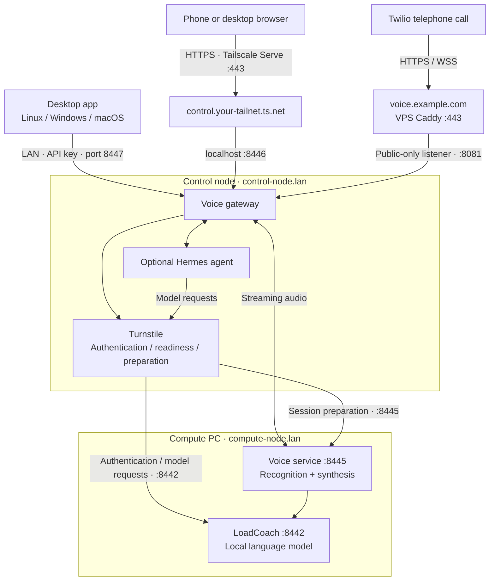
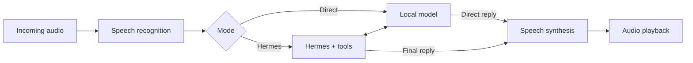

# Voice service brief

The voice gateway handles browser, desktop and Twilio connections on the control node.
Compute runs speech recognition, speech synthesis and local inference. Capacity and model
readiness depend on your configured profiles; inspect **Voice status** before testing.
Telephone setup, credentials, numbers and caller access are managed in **System → Voice →
Telephone**. Follow the [telephone guide](../docs/telephone.md) for public HTTPS routes,
SMS registration and troubleshooting. Existing machine-file Twilio settings keep working
until explicitly imported in the panel.

Connection addresses below are examples; use the configured listeners for your installation.

The conversation supports two modes. **Direct** uses the local model for replies.
**Hermes** adds an agent and tools while retaining the same speech pipeline.

## Operator pages

**Interact → Voice chat** opens the browser conversation at `/voice`; **Voice desktop app** opens
the ZIP and platform setup instructions at `/voice/desktop`.
**System → Voice** (`/system/voice`, `manage-settings`) provides server/readiness status,
Direct/Hermes/shared settings, voice previews, greeting text editing and regeneration, and
playback of the actual control node cache. Existing Settings forms edit the same values. Status
and cached playback do not wake compute; explicit previews use CPU synthesis. Edited
phrases and speaker selection regenerate a complete versioned set, retained on the control node for
compute outages. Public Twilio and desktop ports cannot reach the private admin controls.

### Browser call settings

The browser page uses **Transcript studio**: the live transcript beside a model setup rail,
with call controls and language choices below. Choose the **Conversation model (LLM)** and
**Speech engine** before starting. **CPU voices** uses the installed recognition/synthesis
bundle and its built-in voice list. **Audio models** enables independent **Recognition (STT)**
and **Speech (TTS)** models. Speech models offer their declared built-in voices; cloning models
use your saved or shared SoundRoom voices. A model without a declared voice list offers its default.

Choose **I speak / listen in** for recognition. Enable **Translate replies** to select a different
response language; otherwise replies match the listening language. Language overrides apply to
this call, and declared model language limits are checked before loading. CPU speech supports
English; audio models depend on the selected models. Hermes manages its own reply instructions.

The transcript updates recognition text when the engine supports partial results and groups spoken
reply segments into one assistant message per turn. Interruption marks the affected reply and
ignores late segments. Text and JSON exports preserve original words, language labels, timestamps
and interruption status. **New conversation** clears the tab's transcript after a call ends.
The transcript stays in page memory until navigation or reload; export it to keep a copy.

**Conversation preferences** contains speaking speed, reply length, instructions, the microphone,
gain, playback volume, pause before reply and echo cancellation. Gain and playback volume can
change during a call; other choices stay locked. Device names appear only when the browser permits
them. **Record this call** explicitly retains audio in SoundRoom for saved-voice calls; unrecorded
audio stays in memory. Startup errors remain visible, and settings failures offer Retry settings.
Canceling startup stops microphone capture and the pending reservation request. Server defaults,
normal request logging and the existing gateway/session authorization remain in effect.

The speech service account needs the load/hold permissions required by its configured profile.
Use [Voice administration](/docs/administration/telephone) to inspect service readiness and
[abilities](/docs/system/abilities) for the permission contract.

## Latency diagnostics

System → Voice shows per-turn numeric stages and p50/p95 grouped by
source, mode, profile/model revision and explicit/inferred endpoint basis. The private gateway
keeps at most 200 turns/24 hours in memory since start; numeric `voice.latency` events also
use the existing service journals. No utterance/audio/key/telephone-number capture is added.
Compute reports receive-endpoint/recognition/phrase/synthesis/first-PCM stages on its clock;
control node measures playback progress and client application queue-clear acknowledgements on its
clock. Missing acknowledgements are unavailable; neither an acknowledgement nor PCM sent is
physical speaker-stop proof. New clients negotiate queue-clear reports through the gateway's
`queue_clear_ack` capability. These numeric observations help locate a delay; they do not establish physical-device
latency. Keep device acceptance evidence separate from current service readiness.

## Key ports

Listener defaults and connection setup live in [Installation](/docs/operations/installation).
Use `owg status` and the configured Voice gateway addresses. Browser microphone access needs
HTTPS or localhost; desktop clients use the configured LAN listener and their own API key.

## Key endpoints

The [generated endpoint inventory](/docs/api/custom) and [Code references](/docs/code/voice)
own route declarations and handler contracts. The public telephone listener cannot access
private browser/admin routes. Internal audio is mono PCM; the telephone gateway converts
Twilio audio before sending it through the speech pipeline.

## Echo cancellation and spoken interruption

Echo cancellation is enabled by default without pausing the microphone. Desktop uses WebRTC
AEC3 against actual speaker output; browser and phone-browser playback uses a local WebRTC
connection so the browser can cancel it; telephone calls use AEC3 at the control node gateway before
recognition. Browser and desktop offer an Echo cancellation switch, which can be disabled
when using headphones. Speak over a reply to interrupt it. Inspect the transcript and interruption state when diagnosing a call; sent PCM is not physical speaker-stop proof.

The greetings follow the speaker selected in **Settings → voice**. Compute regenerates a
complete set when the speaker changes; control node refreshes its persistent `data/voice-prompts.json`
cache through authenticated `GET /voice/prompts` on compute port **8445**. Allow roughly
20 seconds plus synthesis time. The last complete set stays available while compute is off.
Speaker changes do not require a desktop-client update.
